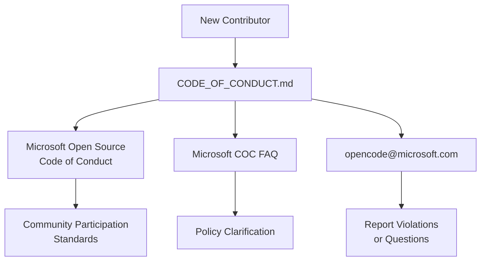
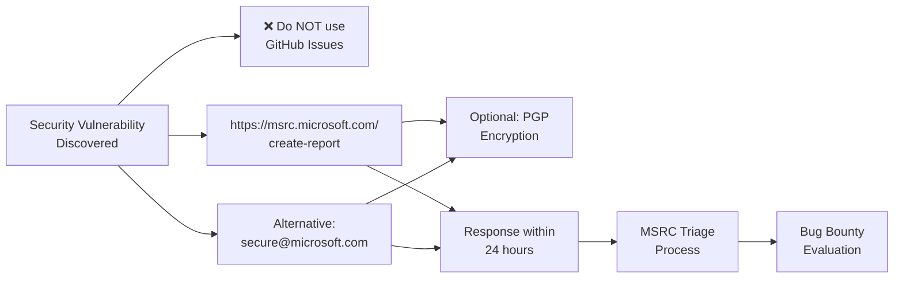
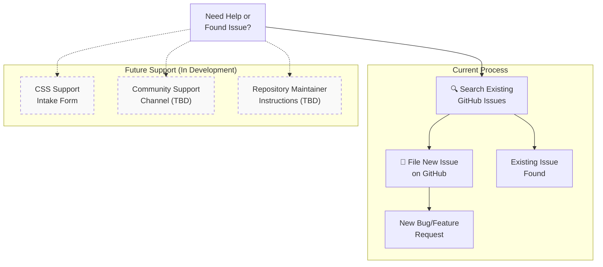
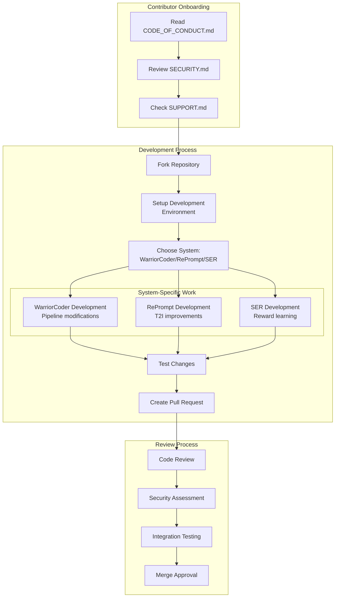

<!-- source: DeepWiki mcp.deepwiki.com · repo microsoft/DKI_LLM · page 5 Contributing Guidelines · fetched 2026-10-26 -->

# Contributing Guidelines

Relevant source files

The following files were used as context for generating this wiki page:

- [CODE_OF_CONDUCT.md](CODE_OF_CONDUCT.md)
- [SECURITY.md](SECURITY.md)
- [SUPPORT.md](SUPPORT.md)

This document outlines the processes, policies, and procedures for contributing to the Microsoft DKI LLM Paper Code Collection repository. It covers community standards, security reporting, support channels, and the contribution workflow for all three research systems (WarriorCoder, RePrompt, and SER).

For information about setting up your development environment, see [Development Environment](#5.1).

## Code of Conduct

The Microsoft DKI LLM repository follows the Microsoft Open Source Code of Conduct, which establishes community standards for participation and collaboration.

**Community Standards Overview**

| Resource | Purpose | Contact Method |
|----------|---------|----------------|
| [Microsoft Open Source Code of Conduct](https://opensource.microsoft.com/codeofconduct/) | Primary policy document | Web portal |
| [Microsoft Code of Conduct FAQ](https://opensource.microsoft.com/codeofconduct/faq/) | Common questions and clarifications | Documentation |
| opencode@microsoft.com | Violations reporting and questions | Email |

Sources: [CODE_OF_CONDUCT.md:1-10]()

## Security Reporting Process

Security vulnerabilities must be reported through Microsoft's Security Response Center (MSRC) rather than public GitHub issues. This ensures responsible disclosure and proper handling of security concerns.

**Required Security Report Information**

When reporting security vulnerabilities, include the following details to help with triage:

| Information Type | Description | Example |
|------------------|-------------|---------|
| Issue Type | Category of vulnerability | Buffer overflow, injection, XSS |
| File Paths | Source files affected | `WarriorCoder/vllmlan.py`, `SER/ppo.py` |
| Source Location | Specific code location | Tag, branch, commit, or direct URL |
| Configuration | Special setup requirements | Environment variables, model configs |
| Reproduction Steps | Step-by-step instructions | Detailed reproduction guide |
| Proof of Concept | Exploit code if available | Working example or demonstration |
| Impact Assessment | Potential exploitation scenarios | Risk level and attack vectors |

Sources: [SECURITY.md:1-42]()

## Getting Help and Support

The repository provides structured channels for getting help, filing issues, and accessing community support. The current support framework is in development as indicated by the template structure.

**Current Support Structure**

| Support Type | Status | Access Method | Scope |
|--------------|--------|---------------|--------|
| GitHub Issues | ✅ Active | Direct repository access | Bug reports, feature requests |
| Search existing issues | ✅ Active | GitHub issue search | Avoid duplicates |
| CSS Support | 🚧 In Development | [aka.ms/onboardsupport](https://aka.ms/onboardsupport) | Professional support |
| Community Help | 🚧 In Development | To be determined | General questions |

Sources: [SUPPORT.md:1-26]()

## Filing Issues and Bug Reports

The repository uses GitHub Issues as the primary mechanism for tracking bugs and feature requests. Contributors should follow the search-first approach to avoid duplicates.

**Issue Filing Workflow**

1. **Search Existing Issues**: Check if your issue has already been reported
2. **Verify System Scope**: Identify if the issue affects WarriorCoder, RePrompt, SER, or general repository infrastructure
3. **Gather Information**: Collect relevant details about the problem
4. **File New Issue**: Create a detailed issue report with appropriate labels

**Issue Categories by System**

| System | Issue Types | Key Files to Reference |
|--------|-------------|------------------------|
| WarriorCoder | Training pipeline, data generation, model battles | `WarriorCoder/vllmlan.py`, `WarriorCoder/run_sft_warrior.py` |
| RePrompt | T2I generation, RL training, reward models | `RePrompt/`, training scripts |
| SER | PPO training, reward learning, policy optimization | `SER/ppo.py`, reward model files |
| Infrastructure | Documentation, CI/CD, dependencies | Root-level config files, `docs/` |

Sources: [SUPPORT.md:15-17]()

## Contribution Workflow

The contribution process integrates with the repository's three-system architecture and follows Microsoft's open source policies.

**Contribution Guidelines by System**

| System Component | Contribution Focus | Key Considerations |
|------------------|-------------------|-------------------|
| WarriorCoder Pipeline | Data generation, model training improvements | Performance impact on 7-stage pipeline |
| RePrompt Training | RL algorithms, reward model enhancements | T2I model compatibility |
| SER Implementation | PPO training, reward learning optimization | Distributed training compatibility |
| Documentation | GitHub Pages site updates | Consistency across system documentation |
| Infrastructure | CI/CD, dependency management | Cross-system compatibility |

**Pre-Contribution Checklist**

- [ ] Read and acknowledge `CODE_OF_CONDUCT.md`
- [ ] Understand security reporting process from `SECURITY.md`
- [ ] Review support channels in `SUPPORT.md`
- [ ] Set up appropriate development environment for target system
- [ ] Identify which system(s) your contribution affects
- [ ] Search existing issues to avoid duplication
- [ ] Verify compatibility with existing training pipelines

Sources: [CODE_OF_CONDUCT.md:1-10](), [SECURITY.md:1-42](), [SUPPORT.md:1-26]()

---

