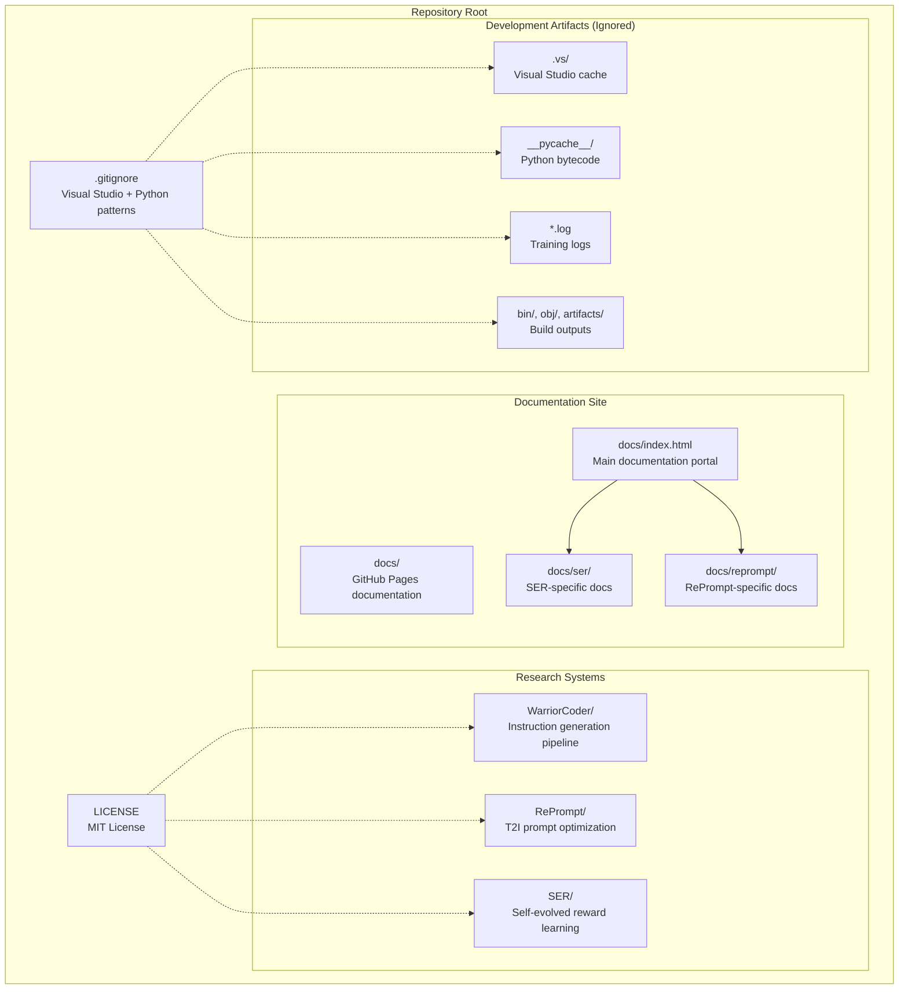
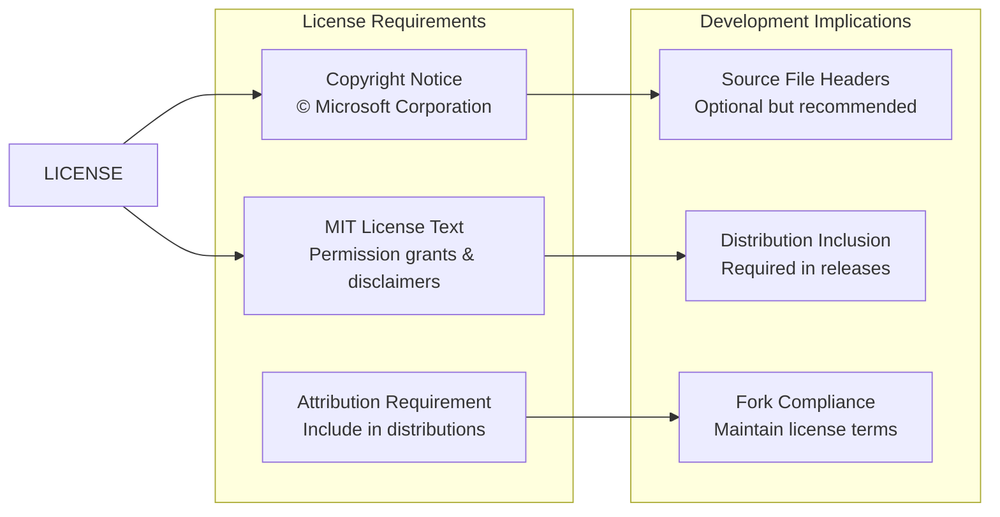
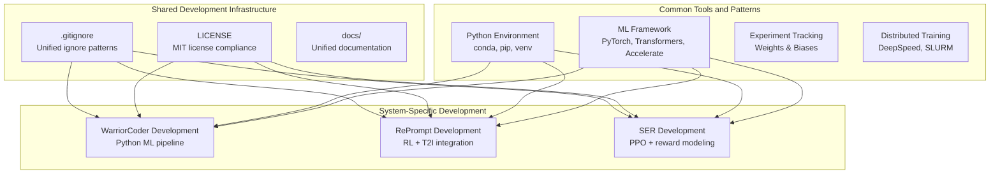

<!-- source: DeepWiki mcp.deepwiki.com · repo microsoft/DKI_LLM · page 5.1 Development Environment · fetched 2026-10-26 -->

# Development Environment

<details>
<summary>Relevant source files</summary>

The following files were used as context for generating this wiki page:

- [.gitignore](.gitignore)
- [LICENSE](LICENSE)

</details>


This section provides setup instructions and development guidelines for contributors to the Microsoft DKI LLM Paper Code Collection repository. It covers environment configuration, version control patterns, licensing requirements, and development workflow fundamentals that apply across all three research systems (WarriorCoder, RePrompt, and SER).

For system-specific environment setup, see [RePrompt Environment Setup](#3.1) and [SER Dependencies and Setup](#4.2). For general contribution guidelines, see [Contributing Guidelines](#5).

## Development Workspace Structure

The repository follows a modular architecture with separate development environments for each research system while sharing common development infrastructure and patterns.

### Repository Development Layout



Sources: [.gitignore:1-401](), [LICENSE:1-22]()

### Development Environment Types

The repository supports multiple development scenarios with different tooling requirements:

| Environment Type | Primary Tools | Target Systems | File Patterns |
|-----------------|---------------|----------------|---------------|
| Python ML Development | Python, Jupyter, vLLM | All three systems | `*.py`, `*.ipynb`, `requirements.txt` |
| Visual Studio Development | VS 2017/2019/2022, MSBuild | Documentation, C# components | `*.sln`, `*.csproj`, `*.cs` |
| Web Documentation | HTML, CSS, GitHub Pages | Documentation site | `docs/*.html`, `*.css`, `*.js` |
| Distributed Training | Accelerate, DeepSpeed, SLURM | WarriorCoder, SER training | `config_*.yaml`, `run_*.py` |

Sources: [.gitignore:35-36](), [.gitignore:329-330](), [.gitignore:382-387]()

## Version Control Configuration

The repository uses a comprehensive `.gitignore` configuration optimized for mixed Visual Studio and Python ML development workflows.

### Ignored Development Artifacts

```mermaid
graph TD
    subgraph "Visual Studio Artifacts"
        VS_USER["*.user, *.suo<br/>User-specific settings"]
        VS_CACHE_DIR[".vs/<br/>Visual Studio cache"]
        VS_BUILD["bin/, obj/, Debug/, Release/<br/>Build outputs"]
        VS_LOGS["*.log, *.tlog<br/>Build logs"]
    end
    
    subgraph "Python ML Artifacts"
        PY_CACHE["__pycache__/<br/>Python bytecode cache"]
        PY_LOGS["*.log<br/>Training logs"]
        JUPYTER["*.ipynb_checkpoints<br/>Jupyter checkpoints"]
        MODEL_CACHE["*.cache<br/>Model caches"]
    end
    
    subgraph "IDE and Editor Files"
        VSCODE[".vscode/*<br/>VS Code settings (partial)"]
        RIDER["*.sln.iml<br/>JetBrains Rider"]
        VIM["*~<br/>Vim temporary files"]
    end
    
    subgraph "Package Management"
        NUGET["*.nupkg, packages/<br/>NuGet packages"]
        NODE_MODS["node_modules/<br/>Node.js dependencies"]
        PYTHON_DIST["*.egg-info/<br/>Python distributions"]
    end
    
    GITIGNORE[".gitignore"] --> VS_USER
    GITIGNORE --> VS_CACHE_DIR
    GITIGNORE --> VS_BUILD
    GITIGNORE --> PY_CACHE
    GITIGNORE --> VSCODE
    GITIGNORE --> NUGET
```



Sources: [.gitignore:6-11](), [.gitignore:35-36](), [.gitignore:19-33](), [.gitignore:329-330](), [.gitignore:382-387]()

### Protected VS Code Configuration

The repository maintains selective VS Code configuration tracking:

```
.vscode/*           # Ignore all VS Code settings by default
!.vscode/settings.json    # Track shared settings
!.vscode/tasks.json       # Track build tasks
!.vscode/launch.json      # Track debug configurations
!.vscode/extensions.json  # Track recommended extensions
```

This pattern allows teams to share essential development configuration while preserving individual developer preferences.

Sources: [.gitignore:382-386]()

## License and Legal Requirements

### MIT License Compliance

The repository is licensed under the MIT License from Microsoft Corporation, requiring proper attribution in derivative works.



Sources: [LICENSE:1-22]()

#### Key License Terms

| Aspect | Requirement | Implementation |
|--------|-------------|---------------|
| **Copyright Notice** | Must include "Copyright (c) Microsoft Corporation" | Present in [LICENSE:3]() |
| **Permission Grants** | Free use, modify, distribute, sublicense, sell | Defined in [LICENSE:5-9]() |
| **Attribution** | Include license text in distributions | Copy [LICENSE:1-22]() |
| **Warranty Disclaimer** | Software provided "AS IS" without warranty | Specified in [LICENSE:15-16]() |
| **Liability Limitation** | No liability for damages or claims | Protected in [LICENSE:17-21]() |

Sources: [LICENSE:3](), [LICENSE:5-9](), [LICENSE:15-21]()

## Development Workflow Integration

### Multi-System Development Support

The development environment is designed to support simultaneous work across all three research systems with shared tooling and patterns.



Sources: [.gitignore:1-401](), [LICENSE:1-22]()

### Recommended Development Setup

For optimal development experience across all systems:

1. **Environment Isolation**: Use separate Python environments for each system to avoid dependency conflicts
2. **IDE Configuration**: Leverage the protected VS Code settings for consistent formatting and debugging
3. **Git Workflow**: Follow the comprehensive ignore patterns to avoid committing build artifacts or cache files
4. **License Compliance**: Ensure any derivative works properly attribute the MIT license terms

The development environment configuration supports both individual system development and cross-system integration work, with careful attention to the diverse tooling requirements of machine learning research and software development.

Sources: [.gitignore:382-387](), [LICENSE:3](), [LICENSE:15-21]()