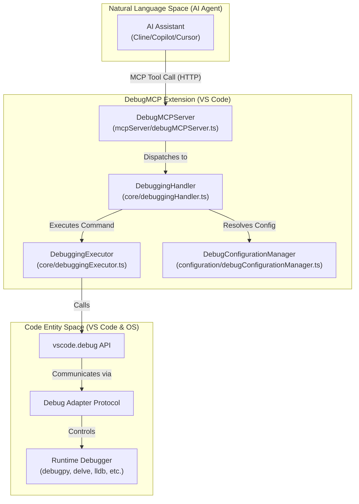
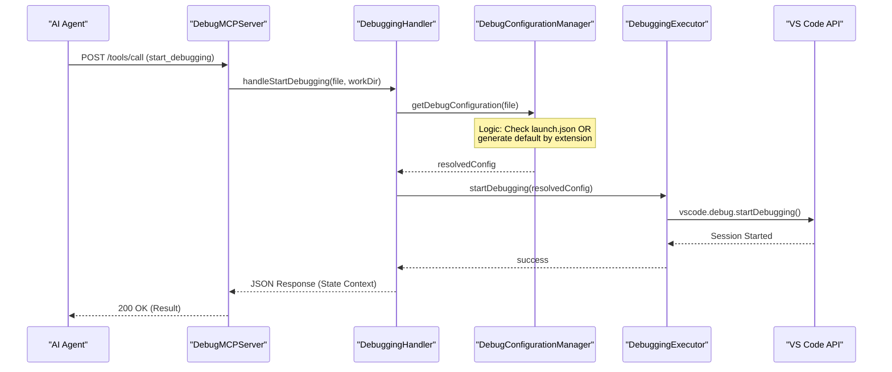

<!-- source: DeepWiki mcp.deepwiki.com · repo microsoft/DebugMCP · page 1 Home · fetched 2026-10-26 -->

# Home

Relevant source files

The following files were used as context for generating this wiki page:

- [CHANGELOG.md](CHANGELOG.md)
- [README.md](README.md)
- [assets/DebugMCP.webp](assets/DebugMCP.webp)
- [assets/architecture.png](assets/architecture.png)
- [package.json](package.json)

## Purpose and Scope

This wiki documents the DebugMCP system: a VS Code extension that exposes comprehensive multi-language debugging capabilities to AI agents via the Model Context Protocol (MCP). This page provides an overview of what DebugMCP is, why it exists, and how its components work together.

DebugMCP bridges professional debugging capabilities with AI-assisted development by embedding an MCP server within VS Code. It exposes 13 debugging tools and documentation resources to AI assistants via a **Streamable HTTP** transport on port 3001 (default).

**Sources:** [package.json:2-4](), [README.md:1-5](), [README.md:33-35]()

---

## What is DebugMCP?

DebugMCP is a VS Code extension that enables AI agents (such as Cline, GitHub Copilot, Cursor, and Roo Code) to autonomously control the VS Code debugger. Instead of reading logs or guessing, an AI assistant can set breakpoints, launch sessions, step through code, and inspect state.

### Key Characteristics
*   **Local-only operation:** Runs 100% locally with no external communications and requires no credentials [README.md:69-70]().
*   **Multi-language support:** Supports Python, JS/TS, Java, C#, C++, Go, Rust, PHP, and Ruby [README.md:112-121]().
*   **Protocol-based:** Implements the Model Context Protocol (MCP) using the official `@modelcontextprotocol/sdk` [package.json:92-92](), [CHANGELOG.md:27-27]().
*   **Streamable HTTP Transport:** Migrated from SSE to a faster, more reliable Streamable HTTP transport for communication [CHANGELOG.md:19-19]().

**Sources:** [README.md:33-36](), [package.json:16-30](), [CHANGELOG.md:18-28]()

---

## Why DebugMCP Exists

Traditional debugging requires manual interaction with IDE tools. While AI coding assistants can modify code, they historically lack the ability to verify logic through runtime inspection. DebugMCP fills this gap by providing a programmatic interface to VS Code's debugging infrastructure (the Debug Adapter Protocol).

**Problem:** AI agents can suggest fixes but cannot "see" the variable state or execution flow at runtime without manual developer intervention.
**Solution:** DebugMCP exposes tools like `start_debugging`, `add_breakpoint`, and `get_variables_values` directly to the LLM, allowing for systematic root cause analysis.

**Sources:** [README.md:33-36](), [README.md:61-67](), [CHANGELOG.md:73-75]()

---

## System Architecture

### High-Level Component Structure

The following diagram illustrates how the extension bridges the AI Agent's natural language requests to the VS Code Code Entity Space.

**Sources:** [package.json:46-50](), [CHANGELOG.md:19-21](), [CHANGELOG.md:27-28]()

### Request Flow: Starting a Debug Session

This trace shows the data flow when an AI agent initiates a debugging operation.

**Sources:** [README.md:44-44](), [CHANGELOG.md:10-11](), [CHANGELOG.md:66-68]()

---

## Key Capabilities

### Available MCP Tools

The extension registers 13 tools that allow the AI to manipulate the debugger state.

| Tool Name | Purpose | Key Parameters |
| :--- | :--- | :--- |
| `start_debugging` | Launches a debug session | `fileFullPath`, `workingDirectory`, `configurationName` |
| `add_breakpoint` | Sets a breakpoint using line content matching | `fileFullPath`, `lineContent` |
| `step_over` | Executes the next line | None |
| `get_variables_values` | Inspects state in current frame | `scope` ('local', 'global', 'all') |
| `evaluate_expression` | Runs arbitrary code in debug context | `expression` |
| `list_breakpoints` | Returns all active breakpoints | None |
| `get_debug_instructions` | Returns the debugging best practices guide | None |

**Sources:** [README.md:41-56](), [CHANGELOG.md:11-11](), [CHANGELOG.md:44-46]()

### Resource Loading
DebugMCP provides a `debug_instructions` resource (and a corresponding tool for clients like Copilot) that guides the AI on how to debug effectively, emphasizing root cause analysis over symptom fixing.

**Sources:** [README.md:58-58](), [README.md:60-67]()

---

## Language Support

The `DebugConfigurationManager` uses heuristics to map file extensions to the correct VS Code debugger type.

| Language | VS Code Extension Dependency | Debugger Type |
| :--- | :--- | :--- |
| **Python** | `ms-python.python` | `debugpy` |
| **Node.js** | `ms-vscode.js-debug` | `pwa-node` |
| **Java** | `vscjava.vscode-java-pack` | `java` |
| **C++** | `ms-vscode.cpptools` | `cppdbg` |
| **Go** | `golang.Go` | `go` |
| **C#** | `ms-dotnettools.csharp` | `coreclr` |

**Sources:** [README.md:112-121](), [CHANGELOG.md:55-55](), [CHANGELOG.md:61-65]()

---

## Configuration

The extension contributes settings to VS Code that control the server behavior.

*   **`debugmcp.serverPort`**: The port the MCP server listens on (Default: `3001`) [package.json:75-79]().
*   **`debugmcp.timeoutInSeconds`**: How long the server waits for debug operations to complete (Default: `180`) [package.json:70-74]().

### Agent Auto-Configuration
The extension includes an `AgentConfigurationManager` that triggers a popup (`debugmcp.showAgentSelectionPopup`) to automatically detect and configure AI assistants like Cline, Copilot, and Cursor.

**Sources:** [package.json:52-57](), [CHANGELOG.md:32-33](), [CHANGELOG.md:19-21]()

---

