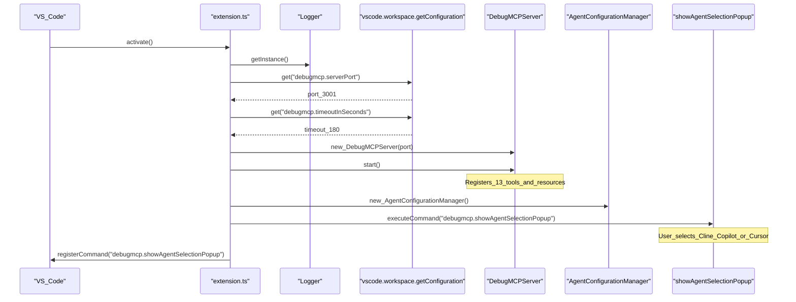

<!-- source: DeepWiki mcp.deepwiki.com · repo microsoft/DebugMCP · page 2 Getting Started · fetched 2026-10-26 -->

# Getting Started

<details>
<summary>Relevant source files</summary>

The following files were used as context for generating this wiki page:

- [README.md](README.md)
- [assets/DebugMCP.webp](assets/DebugMCP.webp)
- [assets/architecture.png](assets/architecture.png)
- [package.json](package.json)

</details>


This page provides an overview of the initial setup process for DebugMCP. After completing these steps, the extension will be running and ready to accept debugging requests from AI agents.

**Scope**: This page covers the high-level setup workflow and prerequisites. For detailed instructions, see:
- [Installation](#2.1) — Step-by-step instructions for installing the DebugMCP extension from the VS Code marketplace
- [Configuring AI Agents](#2.2) — How to configure supported AI agents (Cline, GitHub Copilot, Cursor) to connect to the DebugMCP server
- [Your First Debug Session](#2.3) — Walkthrough of starting a simple debugging session through an AI agent

For architecture details, see [Architecture Overview](#3). For the complete reference of configuration options, see [Configuration Reference](#8.2).

---

## Prerequisites

Before installing DebugMCP, ensure you have:

| Requirement | Version | Purpose |
|-------------|---------|---------|
| **VS Code** | ≥ 1.104.0 | Host environment for the extension |
| **Language Extensions** | Latest | Required for debugging specific languages (see [Language Support](#6)) |
| **AI Agent** | Any MCP-compatible | Cline, GitHub Copilot, Cursor, or other MCP client |
| **Network Port** | 3001 (default) | For MCP server communication (configurable) |

**Sources**: [package.json:32-34](), [package.json:75-79](), [README.md:112-121]()

---

## Setup Process Overview

The DebugMCP setup consists of three primary phases:

```mermaid
graph LR
    subgraph Phase1["Phase_1:_Install_Extension"]
        [MARKET] --> [INSTALL]
        [MARKET]["VS_Code_Marketplace"]
        [INSTALL]["Install_DebugMCP_ozzafar.debugmcpextension"]
    end
    
    subgraph Phase2["Phase_2:_Automatic_Activation"]
        [ACTIVATE] --> [SERVER]
        [SERVER] --> [POPUP]
        [ACTIVATE]["Extension_Activates_via_onStartupFinished"]
        [SERVER]["DebugMCPServer_Starts_Port_3001"]
        [POPUP]["Agent_Selection_Popup_debugmcp.showAgentSelectionPopup"]
    end
    
    subgraph Phase3["Phase_3:_Agent_Configuration"]
        [CONFIG] --> [AGENT]
        [CONFIG]["AgentConfigurationManager"]
        [AGENT]["AI_Agent_Config_mcp_settings.json"]
    end
    
    [INSTALL] --> [ACTIVATE]
    [AGENT] --> [READY]
    [READY]["Ready_for_Use"]
```

**DebugMCP Setup Flow**

This diagram shows the complete initialization sequence from marketplace installation through agent configuration. The process is largely automated, with the extension handling server startup and offering to configure supported AI agents.

**Sources**: [package.json:46-49](), [package.json:54-57](), [README.md:18-31]()

---

## Extension Activation Sequence

When VS Code starts or the extension is installed, DebugMCP follows this activation sequence:



**Extension Activation and Server Initialization**

This sequence shows the exact order of operations during extension activation, mapping to actual code components. The system initializes the server first, followed by the configuration manager, and finally presents the UI for agent integration.

**Sources**: [package.json:46-58](), [package.json:70-80](), [README.md:39-57]()

---

## Configuration Structure

DebugMCP uses a hierarchical configuration system:

```mermaid
graph TB
    subgraph VSCodeSettings["VS_Code_Settings"]
        [ExtConfig] --> [ServerPort]
        [ExtConfig] --> [Timeout]
        [ExtConfig]["Extension_Configuration"]
        [ServerPort]["debugmcp.serverPort_default:_3001"]
        [Timeout]["debugmcp.timeoutInSeconds_default:_180"]
    end
    
    subgraph MCPConfig["MCP_Server_Configuration"]
        [Transport]
        [URL]
        [Transport]["transport:_sse"]
        [URL]["url:_http://localhost:3001/sse"]
    end
    
    subgraph AgentConfigs["AI_Agent_Configurations"]
        [Cline]
        [Copilot]
        [Cursor]
        [Cline]["cline_mcp_settings.json"]
        [Copilot][".vscode/settings.json"]
        [Cursor]["mcp_settings.json"]
    end
    
    [ServerPort] --> [URL]
    [URL] --> [Cline]
    [URL] --> [Copilot]
    [URL] --> [Cursor]
```

**Configuration Hierarchy**

The extension settings in `package.json` define the MCP server's port and timeout. These values propagate to the agent configuration files, which tell AI agents how to connect to the MCP server via HTTP/SSE transport.

**Sources**: [package.json:67-81](), [README.md:112-125]()

---

## Configuration Settings

The extension exposes two configurable settings through VS Code's settings UI:

| Setting | Type | Default | Description | Configuration Key |
|---------|------|---------|-------------|-------------------|
| Server Port | `number` | `3001` | TCP port for the DebugMCP server | `debugmcp.serverPort` |
| Timeout | `number` | `180` | Operation timeout in seconds | `debugmcp.timeoutInSeconds` |

These settings can be modified in:
- **User Settings**: Applies globally to all workspaces
- **Workspace Settings**: `.vscode/settings.json` for workspace-specific configuration

**Sources**: [package.json:67-81]()

---

## Verification Steps

After installation, verify DebugMCP is running correctly:

### 1. Extension Status
Check that the extension appears in your installed extensions list.
- **VS Code** → **Extensions** → Search "**DebugMCP**"
- Status should be **Enabled**.

### 2. Output Channel
The extension creates an output channel for diagnostics:
- **VS Code** → **Output** → Select "**DebugMCP**" from the dropdown.
- Expected: Logs showing the server starting on the configured port.

### 3. MCP Server Connectivity
The server runs on the configured port (default `3001`) and accepts connections at the root or `/sse` endpoints.
- **Endpoint**: `http://localhost:3001`
- **Protocol**: MCP (Model Context Protocol)

**Sources**: [package.json:75-79](), [README.md:92-97]()

---

## Agent Configuration Overview

DebugMCP includes logic to automatically configure supported AI agents. The configuration process involves:

1.  **Detection**: Identifying which AI agents (Cline, Cursor, Copilot) are installed.
2.  **Registration**: Writing the MCP server connection details to the respective agent's configuration files.
3.  **Command Execution**: Users can trigger this manually via the `debugmcp.showAgentSelectionPopup` command.

**Sources**: [package.json:54-57](), [README.md:102-106]()

---

## Activation Events

The extension registers two activation events in `package.json`:

```json
"activationEvents": [
  "onStartupFinished",
  "onDebug"
]
```

- **`onStartupFinished`**: Activates automatically when VS Code finishes starting up, ensuring the MCP server is available immediately.
- **`onDebug`**: Activates when any debug session starts, guaranteeing the extension is ready for debugging operations.

**Sources**: [package.json:46-49]()

---

## Next Steps

Once DebugMCP is installed and verified:

1.  **Configure Your AI Agent** — See [Configuring AI Agents](#2.2) for detailed setup instructions for Cline, GitHub Copilot, or Cursor.
2.  **Run Your First Debug Session** — Follow [Your First Debug Session](#2.3) for a guided walkthrough.
3.  **Install Language Extensions** — Ensure you have the required debugger extensions for your target languages (see [Language Support](#6)).

**Sources**: [README.md:102-108]()

---

