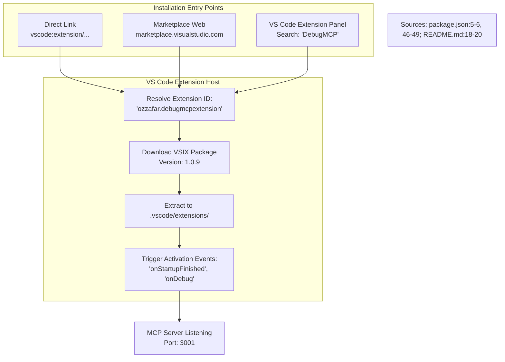
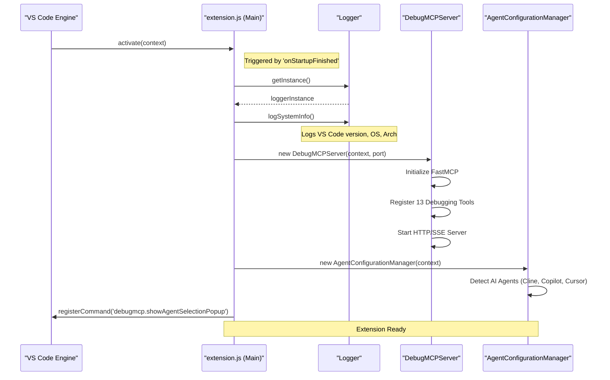

<!-- source: DeepWiki mcp.deepwiki.com · repo microsoft/DebugMCP · page 2.1 Installation · fetched 2026-10-26 -->

# Installation

Relevant source files

The following files were used as context for generating this wiki page:

- [.gitignore](.gitignore)
- [.vscodeignore](.vscodeignore)
- [README.md](README.md)
- [assets/DebugMCP.webp](assets/DebugMCP.webp)
- [assets/architecture.png](assets/architecture.png)
- [package.json](package.json)

## Purpose and Scope

This page provides step-by-step instructions for installing the DebugMCP extension from the VS Code Marketplace. Installation is the first step in enabling AI agents to autonomously manage breakpoints, step through code, and inspect variables within your local environment.

For information about configuring AI agents to connect to DebugMCP after installation, see **2.2 Configuring AI Agents**. For a walkthrough of your first debugging session, see **2.3 Your First Debug Session**.

---

## Prerequisites

Before installing DebugMCP, ensure your system meets the following requirements:

| Requirement | Minimum Version | Notes |
|------------|----------------|-------|
| **VS Code** | 1.104.0 | Required engine version [package.json:33-34]() |
| **Node.js** | 22.x | Recommended for extension host stability [package.json:99-99]() |
| **Operating System** | Windows, macOS, or Linux | All platforms supported [README.md:123-131]() |
| **Available Port** | 3001 (default) | Configurable via `debugmcp.serverPort` [package.json:75-79]() |

Sources: [package.json:33-34](), [package.json:75-79](), [package.json:99-99](), [README.md:123-131]()

---

## Installation Methods

DebugMCP can be installed through three primary methods. The direct link method is fastest, while the VS Code Extensions panel provides the most familiar interface.

### Method 1: Direct Link (Recommended)

The fastest installation method uses the VS Code extension URI scheme:

1. Click this link: [vscode:extension/ozzafar.debugmcpextension](vscode:extension/ozzafar.debugmcpextension)
2. Your browser will prompt to open VS Code.
3. VS Code will display the extension page.
4. Click **Install**.

Sources: [README.md:77-79](), [package.json:2-3]()

### Method 2: VS Code Marketplace

Install directly from the web-based VS Code Marketplace:

1. Visit the [DebugMCP Marketplace Page](https://marketplace.visualstudio.com/items?itemName=ozzafar.debugmcpextension).
2. Click the **Install** button.
3. Confirm the browser prompt to launch VS Code.
4. Click **Install** within the VS Code interface.

Sources: [README.md:81-83](), [package.json:6]()

### Method 3: Within VS Code

Install using the built-in Extensions panel:

1. Launch VS Code.
2. Open the Extensions view (`Ctrl+Shift+X` or `Cmd+Shift+X`).
3. Search for **"DebugMCP"**.
4. Click **Install** on the entry published by `ozzafar`.

Sources: [README.md:85-90](), [package.json:2-3]()

---

## Installation Flow Diagram

The following diagram illustrates how different installation entry points converge into the VS Code extension lifecycle.

Sources: [package.json:5-6](), [package.json:46-49](), [README.md:18-20]()

---

## Extension Activation Process

Upon installation, DebugMCP activates automatically based on the defined `activationEvents` [package.json:46-49]().

### Activation Sequence

The activation logic is defined in the main entry point specified in `package.json` [package.json:50-50]().

**Activation Triggers**
1. **`onStartupFinished`**: Ensures the MCP server starts as soon as the editor is ready [package.json:47-47]().
2. **`onDebug`**: Ensures the extension is active if a user starts a debug session manually [package.json:48-48]().

Sources: [package.json:46-50](), [package.json:54-57]()

---

## Post-Installation Verification

After installation, verify the extension is functioning correctly:

### Visual Indicators
*   **Command Palette**: Press `Ctrl+Shift+P` and type `DebugMCP`. You should see `DebugMCP: Show Agent Selection Popup` [package.json:54-57]().
*   **Output Channel**: Open **View > Output** and select **DebugMCP** from the dropdown. You should see system information logs including VS Code version and platform details.

### MCP Server Connectivity
The extension starts an MCP server on a local port (default `3001`). You can verify the server is running by checking the Output log for:
`DebugMCP server started on port 3001`

Sources: [package.json:75-79](), [README.md:93-97]()

---

## Configuration Options

Post-installation, you can customize the extension via VS Code Settings (`settings.json`):

| Setting | Type | Default | Description |
|---------|------|---------|-------------|
| `debugmcp.serverPort` | `number` | `3001` | The port the MCP server listens on [package.json:75-79](). |
| `debugmcp.timeoutInSeconds` | `number` | `180` | Maximum time allowed for debug operations [package.json:70-74](). |

### Directory Structure
The extension follows the standard VS Code structure:
*   `package.json`: Manifest and contribution points [package.json:1-112]().
*   `out/extension.js`: Compiled entry point [package.json:50-50]().
*   `assets/`: Icons and media [package.json:35-35]().

Sources: [package.json:35-35](), [package.json:50-50](), [package.json:70-79]()

---

## Troubleshooting Installation

### Common Issues
*   **Port Conflict**: If port `3001` is occupied, the MCP server will fail to start. Change `debugmcp.serverPort` in settings and restart VS Code [package.json:75-79]().
*   **Engine Version**: Ensure VS Code is at least version `1.104.0`. Older versions will refuse to install the extension [package.json:33-34]().
*   **Activation Failure**: Check the **Developer Tools** console (`Help > Toggle Developer Tools`) for stack traces if the extension fails to activate.

Sources: [package.json:33-34](), [package.json:75-79]()

---

