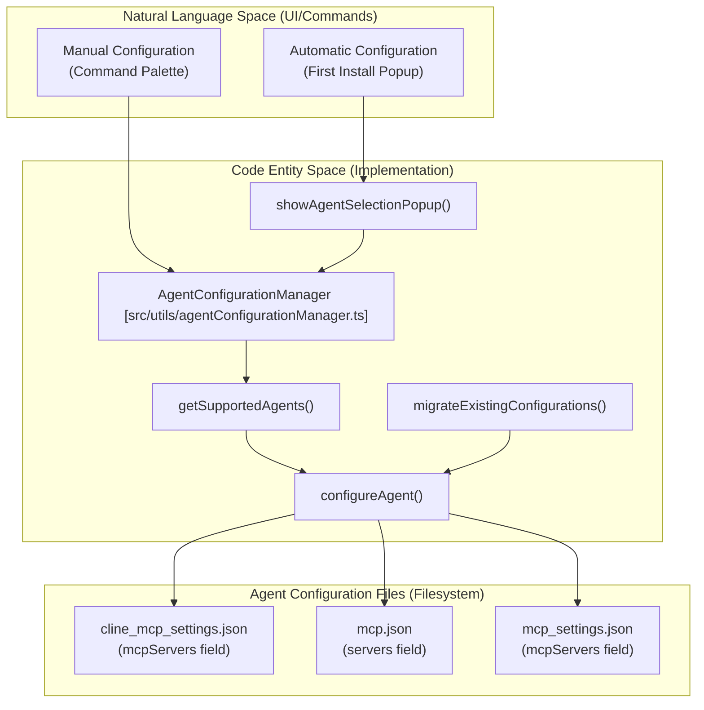
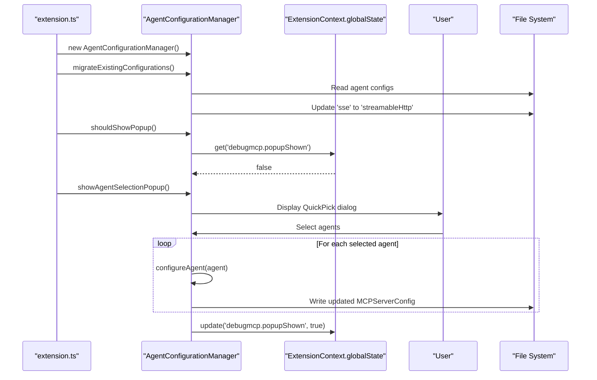
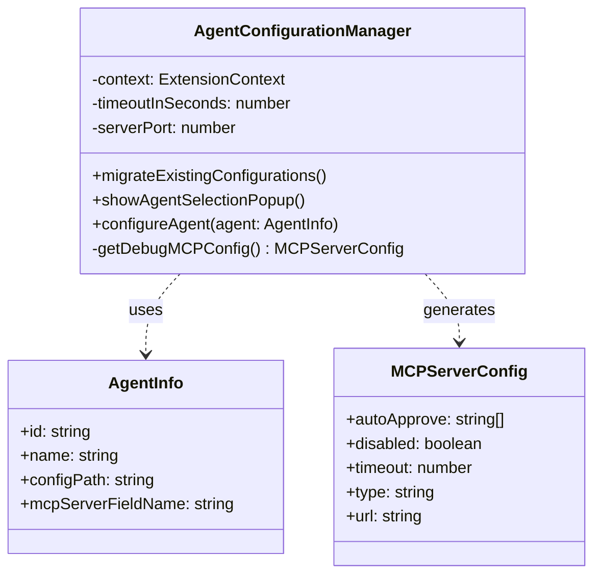

<!-- source: DeepWiki mcp.deepwiki.com · repo microsoft/DebugMCP · page 2.2 Configuring AI Agents · fetched 2026-10-26 -->

# Configuring AI Agents

<details>
<summary>Relevant source files</summary>

The following files were used as context for generating this wiki page:

- [README.md](README.md)
- [assets/DebugMCP.webp](assets/DebugMCP.webp)
- [assets/architecture.png](assets/architecture.png)
- [src/utils/agentConfigurationManager.ts](src/utils/agentConfigurationManager.ts)

</details>


This document explains how to configure AI agents (Cline, GitHub Copilot, Cursor) to connect to the DebugMCP server. After installing the extension, you must configure at least one AI agent to use the debugging tools. This page covers both automatic and manual configuration approaches, including the migration from legacy SSE transport to the current `streamableHttp` transport.

For information about using the debugging tools after configuration, see [Your First Debug Session](2.3). For details about the MCP protocol and server architecture, see [MCP Protocol Integration](3.2).

## Overview

DebugMCP uses the `AgentConfigurationManager` class [src/utils/agentConfigurationManager.ts:24-24]() to automatically detect and configure supported AI agents. The configuration process adds an MCP server entry pointing to `http://localhost:{port}/mcp` using the `streamableHttp` transport type [src/utils/agentConfigurationManager.ts:154-162]().

### Data Flow: Agent Configuration
The following diagram illustrates how the `AgentConfigurationManager` bridges the Natural Language Space (User requests/Popups) to the Code Entity Space (Configuration Files/Filesystem).


**Sources:** [src/utils/agentConfigurationManager.ts:24-162](), [README.md:115-176]()

## Supported AI Agents

DebugMCP supports three AI agents with automatic configuration detection. Each agent is represented by an `AgentInfo` object [src/utils/agentConfigurationManager.ts:8-14]().

| Agent | Config File Field | Config Path (Platform-Specific) |
|-------|-------------------|--------------------------------|
| **Cline** | `mcpServers` | `{configBase}/Code/User/globalStorage/saoudrizwan.claude-dev/settings/cline_mcp_settings.json` |
| **GitHub Copilot** | `servers` | `{configBase}/Code/User/mcp.json` |
| **Cursor** | `mcpServers` | `{configBase}/Cursor/User/globalStorage/cursor.mcp/settings/mcp_settings.json` |

The `{configBase}` location is resolved via `getConfigBasePath()` [src/utils/agentConfigurationManager.ts:97-113]():
- **Windows**: `process.env.APPDATA` or `~\AppData\Roaming`
- **macOS**: `~/Library/Application Support`
- **Linux**: `process.env.XDG_CONFIG_HOME` or `~/.config`

**Sources:** [src/utils/agentConfigurationManager.ts:118-149](), [src/utils/agentConfigurationManager.ts:97-113]()

## Automatic Configuration & Migration

### Migration from SSE/HTTP
The current version of DebugMCP uses `streamableHttp`. The `migrateExistingConfigurations()` method [src/utils/agentConfigurationManager.ts:168-211]() automatically scans agent config files for legacy `sse` or `http` types and updates them to the new standard.

### First Install Popup
On first activation, the extension checks the `debugmcp.popupShown` key in `globalState` [src/utils/agentConfigurationManager.ts:40-44](). If false, it triggers `showAgentSelectionPopup()` [src/utils/agentConfigurationManager.ts:49-60]().


**Sources:** [src/utils/agentConfigurationManager.ts:40-60](), [src/utils/agentConfigurationManager.ts:168-211]()

## Manual Configuration

### Via Command Palette
Users can manually trigger configuration using the `debugmcp.configureAgent` command, which invokes `showManualConfiguration()` [src/utils/agentConfigurationManager.ts:72-92](). This presents a `QuickPick` of supported agents.

### Configuration File Structure
The `MCPServerConfig` interface [src/utils/agentConfigurationManager.ts:16-22]() defines the structure written to the agent's JSON files:

```json
{
  "autoApprove": [],
  "disabled": false,
  "timeout": 180,
  "type": "streamableHttp",
  "url": "http://localhost:3001/mcp"
}
```

The `url` is dynamically generated using the `serverPort` passed to the constructor [src/utils/agentConfigurationManager.ts:154-162]().

**Sources:** [src/utils/agentConfigurationManager.ts:16-22](), [src/utils/agentConfigurationManager.ts:154-162]()

## Agent-Specific Configuration Details

### Logic for Configuration Updates
The `configureAgent(agent: AgentInfo)` method [src/utils/agentConfigurationManager.ts:213-258]() performs the following:
1. **Directory Verification**: Uses `fs.existsSync` and `fs.promises.mkdir` to ensure the target path exists [src/utils/agentConfigurationManager.ts:217-221]().
2. **JSON Handling**: Reads the file, parses existing content (or initializes `{}` if missing/corrupt), and updates the specific field (e.g., `mcpServers` or `servers`) [src/utils/agentConfigurationManager.ts:224-245]().
3. **Atomic Write**: Writes the prettified JSON back to disk [src/utils/agentConfigurationManager.ts:248-248]().

### System Component Association
The following diagram bridges the high-level configuration concepts to the specific code classes and properties.


**Sources:** [src/utils/agentConfigurationManager.ts:8-22](), [src/utils/agentConfigurationManager.ts:24-35]()

## Troubleshooting Configuration

- **Port Mismatch**: If you change the `debugmcp.serverPort` setting in VS Code, you must re-run the configuration for your agent so the `url` in the agent's config file is updated [src/utils/agentConfigurationManager.ts:160-160]().
- **Migration Failures**: If an agent config is manually set to a read-only state, `migrateExistingConfigurations()` will log an error to the console [src/utils/agentConfigurationManager.ts:207-207]().
- **Popup Reset**: To re-trigger the setup flow, use `resetPopupState()` which clears the `globalState` key [src/utils/agentConfigurationManager.ts:65-67]().

**Sources:** [src/utils/agentConfigurationManager.ts:65-67](), [src/utils/agentConfigurationManager.ts:168-211](), [README.md:186-194]()

---

