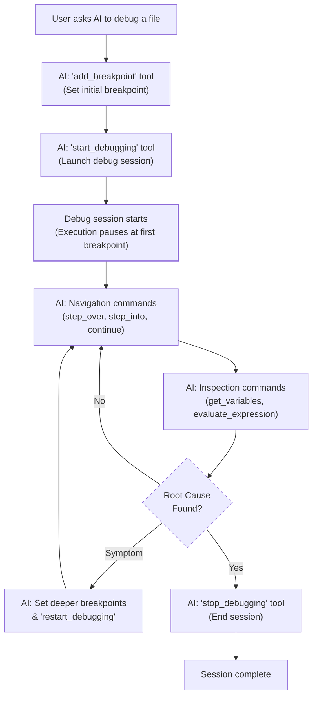
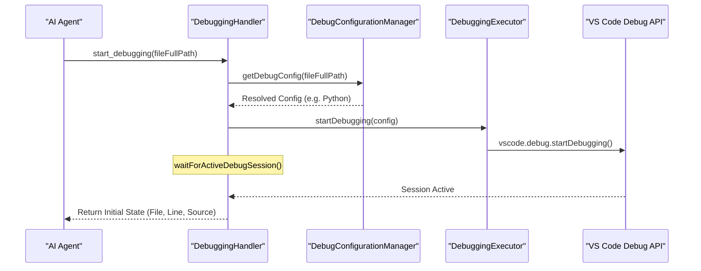
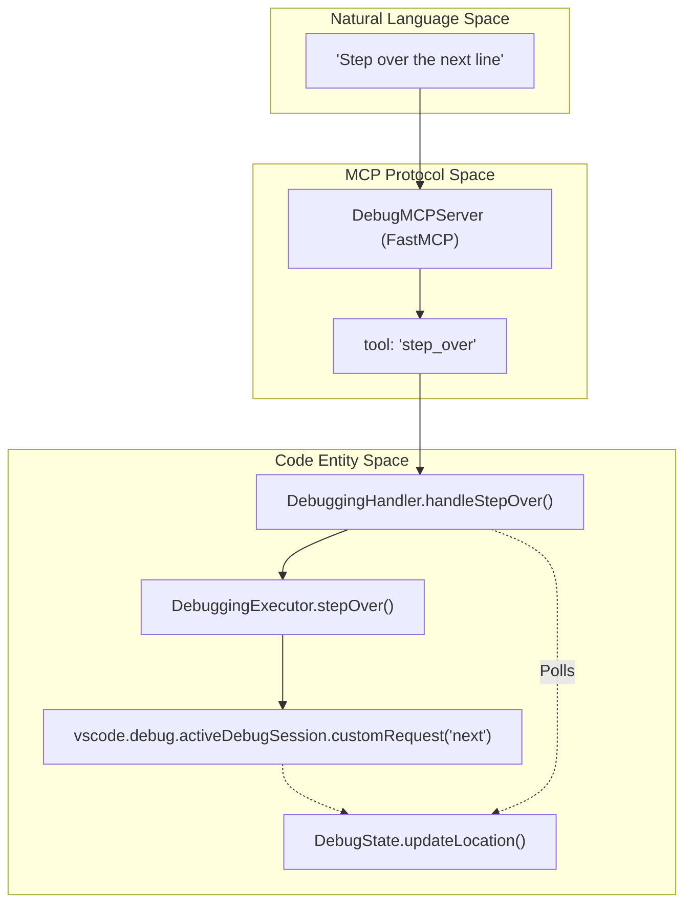

<!-- source: DeepWiki mcp.deepwiki.com · repo microsoft/DebugMCP · page 2.3 Your First Debug Session · fetched 2026-10-26 -->

# Your First Debug Session

<details>
<summary>Relevant source files</summary>

The following files were used as context for generating this wiki page:

- [README.md](README.md)
- [assets/DebugMCP.webp](assets/DebugMCP.webp)
- [assets/architecture.png](assets/architecture.png)
- [docs/agent-resources/debug_instructions.md](docs/agent-resources/debug_instructions.md)
- [src/test/debuggingHandler.test.ts](src/test/debuggingHandler.test.ts)

</details>


**Purpose:** This page provides a step-by-step walkthrough of starting and conducting your first debugging session using DebugMCP through an AI agent. It demonstrates the complete workflow from setting breakpoints to inspecting program state, showing both the user-facing commands and the underlying system operations.

**Scope:** This guide covers a single debugging session lifecycle using the MCP tools. For information about installing and configuring the extension, see **Installation (2.1)** and **Configuring AI Agents (2.2)**. For detailed information about all available debugging operations, see **Debugging Operations (5)**.

---

## Prerequisites

Before starting your first debug session, ensure:

| Requirement | Verification |
|-------------|--------------|
| **DebugMCP Extension** | Installed and activated in VS Code [README.md:85-91]() |
| **AI Agent** | Configured to connect to the MCP server (default port 3001) [README.md:92-97]() |
| **Language Extension** | Appropriate debugger installed (e.g., ms-python.python for `.py`) [README.md:110-122]() |
| **Source File** | A source code file ready to debug in an open workspace [README.md:104-106]() |

**Sources:** [README.md:85-122]()

---

## Basic Workflow Overview

The standard debugging workflow follows a systematic sequence designed to identify root causes rather than just symptoms.



**Sources:** [docs/agent-resources/debug_instructions.md:3-8](), [README.md:41-56]()

---

## Step-by-Step Walkthrough

### Step 1: Set Initial Breakpoint
AI agents are instructed to set at least one breakpoint *before* starting the session to ensure execution pauses at a meaningful location [docs/agent-resources/debug_instructions.md:4-5]().

**MCP Tool Invocation:**
```json
{
  "tool": "add_breakpoint",
  "parameters": {
    "fileFullPath": "/path/to/app.py",
    "lineContent": "result = calculate_logic(data)"
  }
}
```

**Implementation Detail:**
The `DebuggingHandler.handleAddBreakpoint` method does not require a line number. It opens the document, searches for `lineContent`, and applies breakpoints to matching executable lines [src/debuggingHandler.ts:244-280]().

**Sources:** [src/debuggingHandler.ts:244-280](), [docs/agent-resources/debug_instructions.md:108-116]()

---

### Step 2: Start Debug Session
The agent invokes `start_debugging`, which triggers the configuration heuristic.

**Configuration Resolution Flow:**
The `DebugConfigurationManager` attempts to find a matching `launch.json` entry or generates a default based on the file extension (e.g., `python` for `.py`, `pwa-node` for `.js`) [src/utils/debugConfigurationManager.ts:60-95]().



**Sources:** [src/debuggingHandler.ts:47-85](), [src/utils/debugConfigurationManager.ts:60-95]()

---

### Step 3: Navigate and Inspect
Once paused, the agent uses stepping tools. Each command (like `step_over`) triggers a `waitForStateChange` call in the `DebuggingHandler` [src/debuggingHandler.ts:126-145]().

**State Synchronization:**
The handler captures the `DebugState` before the command, executes the step, and polls `executor.getCurrentDebugState()` with exponential backoff until the line number or frame changes [src/debuggingHandler.ts:505-536]().

**Variable Inspection:**
The `get_variables_values` tool retrieves variables from the `activeStackItem`'s `frameId` [src/debuggingHandler.ts:343-388]().

**Sources:** [src/debuggingHandler.ts:126-145](), [src/debuggingHandler.ts:343-388](), [src/debuggingHandler.ts:505-536]()

---

### Step 4: Root Cause Analysis (RCA)
DebugMCP enforces a "Symptom vs Root Cause" framework [docs/agent-resources/debug_instructions.md:10-20]().

| Action | Purpose | Code Entity |
|--------|---------|-------------|
| **Identify Symptom** | Spot an unexpected value or null. | `get_variables_values` [src/debuggingHandler.ts:343]() |
| **Trace Backwards** | Set breakpoints earlier in the call stack. | `add_breakpoint` [src/debuggingHandler.ts:244]() |
| **Restart Session** | Re-run logic with new breakpoints active. | `restart_debugging` [src/debuggingHandler.ts:224]() |

**Sources:** [docs/agent-resources/debug_instructions.md:10-50](), [src/debuggingHandler.ts:224-239]()

---

## System Request Flow Diagram
This diagram bridges the Natural Language request from the AI to the specific Code Entities that handle the logic.



**Sources:** [src/debugMCPServer.ts:100-110](), [src/debuggingHandler.ts:126-145](), [src/debuggingExecutor.ts:180-195]()

---

## Troubleshooting the First Session

If the session fails to start or behavior is unexpected, check the following:

*   **Session Timeout:** The default timeout is configurable. If the debugger is slow to attach, the handler may return a timeout error [src/debuggingHandler.ts:476-500]().
*   **Active Frame Requirement:** Tools like `get_variables_values` and `evaluate_expression` will fail if the debugger is currently "running" and not "paused" at a breakpoint [src/debuggingHandler.ts:351-354]().
*   **Breakpoint Placement:** Ensure breakpoints are set inside function bodies, not on the `def` or `class` signature lines [docs/agent-resources/debug_instructions.md:109-110]().

**Sources:** [src/debuggingHandler.ts:351-500](), [docs/agent-resources/debug_instructions.md:109-110]()

---

