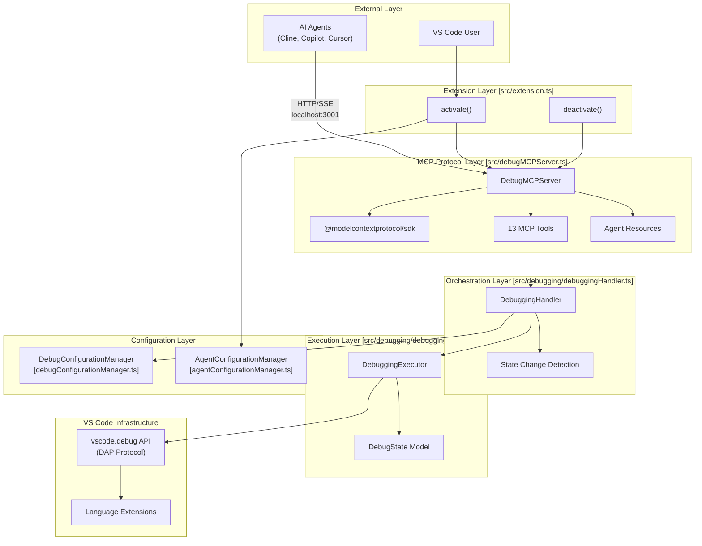
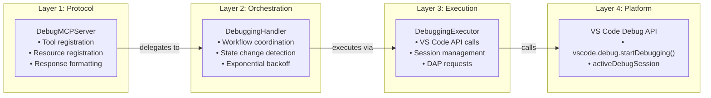
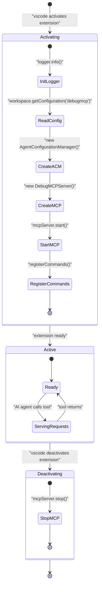
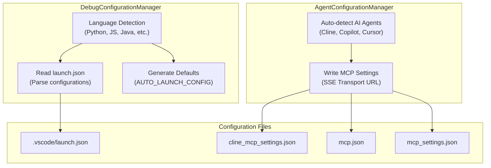
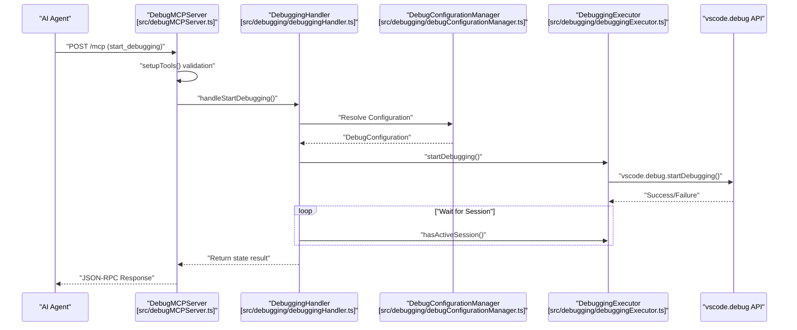

<!-- source: DeepWiki mcp.deepwiki.com · repo microsoft/DebugMCP · page 3 Architecture Overview · fetched 2026-10-26 -->

# Architecture Overview

Relevant source files

The following files were used as context for generating this wiki page:

- [AGENTS.md](AGENTS.md)
- [README.md](README.md)
- [assets/DebugMCP.webp](assets/DebugMCP.webp)
- [assets/architecture.png](assets/architecture.png)
- [docs/architecture/debugMCPServer.md](docs/architecture/debugMCPServer.md)
- [tsconfig.json](tsconfig.json)

This page provides a high-level overview of the DebugMCP system architecture, describing how the major components work together to enable AI agents to control VS Code's debugging capabilities through the Model Context Protocol (MCP). For detailed information about individual components, see [System Components](#3.1). For specifics about the MCP protocol implementation, see [MCP Protocol Integration](#3.2). For execution flow details, see [Request Flow](#3.3).

## System Overview

DebugMCP is implemented as a VS Code extension that embeds an MCP server, exposing debugging operations as MCP tools. The architecture follows a layered design with clear separation of concerns:

**Sources:** [src/extension.ts:70-115](), [README.md:33-56](), [AGENTS.md:7-22](), [docs/architecture/debugMCPServer.md:19-34]()

## Core Component Roles

The system consists of six primary components, each with distinct responsibilities:

| Component | File | Primary Responsibility |
|-----------|------|----------------------|
| **Extension** | `src/extension.ts` | Entry point; initializes and coordinates all components during `activate()` [src/extension.ts:70-115]() |
| **DebugMCPServer** | `src/debugMCPServer.ts` | MCP server implementation; exposes 13 tools and documentation resources via `@modelcontextprotocol/sdk` [docs/architecture/debugMCPServer.md:11-18]() |
| **DebuggingHandler** | `src/debugging/debuggingHandler.ts` | Orchestration layer; manages debug workflows, state change detection, and configuration selection [AGENTS.md:18-18]() |
| **DebuggingExecutor** | `src/debugging/debuggingExecutor.ts` | Execution layer; interfaces with VS Code Debug API and manages DAP requests [AGENTS.md:19-19]() |
| **DebugConfigurationManager** | `src/debugging/debugConfigurationManager.ts` | Manages `launch.json` configurations and generates language-specific defaults [AGENTS.md:21-21]() |
| **AgentConfigurationManager** | `src/utils/agentConfigurationManager.ts` | Auto-configures AI agents (Cline, Copilot, Cursor) to connect to the MCP server [AGENTS.md:22-22]() |

**Sources:** [AGENTS.md:14-22](), [docs/architecture/debugMCPServer.md:11-18]()

## Layered Architecture Pattern

DebugMCP implements a strict layered architecture where each layer has defined responsibilities and dependencies flow in one direction:

**Key Architectural Principles:**

- **Unidirectional Dependencies:** Upper layers depend on lower layers, never the reverse [AGENTS.md:7-11]().
- **Clear Boundaries:** `DebugMCPServer` handles the MCP protocol while `DebuggingHandler` handles the debugging logic [docs/architecture/debugMCPServer.md:11-18]().
- **Stateless Communication:** The `StreamableHTTPServerTransport` uses stateless HTTP POST requests for MCP communication [docs/architecture/debugMCPServer.md:43-48]().
- **Error Propagation:** Errors are caught and handled with descriptive messages throughout the stack [AGENTS.md:56-56]().

**Sources:** [AGENTS.md:7-11](), [docs/architecture/debugMCPServer.md:19-48]()

## Extension Lifecycle

The extension follows a deterministic initialization and shutdown sequence managed by `src/extension.ts`:

**Initialization Sequence:**

1. **Configuration Reading**: Reads `debugmcp.serverPort` (default: 3001) and `debugmcp.timeoutInSeconds` (default: 180) [AGENTS.md:75-79]().
2. **Manager Creation**: Instantiates `AgentConfigurationManager` to handle AI agent auto-detection [src/extension.ts:70-115]().
3. **Server Startup**: Creates `DebugMCPServer` and starts the express HTTP server for MCP communication [docs/architecture/debugMCPServer.md:55-55]().
4. **Command Registration**: Registers VS Code commands for manual configuration of agents [src/extension.ts:70-115]().

**Sources:** [src/extension.ts:70-115](), [AGENTS.md:75-79](), [docs/architecture/debugMCPServer.md:50-56]()

## Configuration Management Architecture

DebugMCP uses two specialized managers to handle different configuration concerns:

**AgentConfigurationManager**: Detects installed AI agents and writes the MCP server connection settings (default port 3001) to their respective configuration files [AGENTS.md:22-22]().

**DebugConfigurationManager**: Detects the programming language from file extensions and manages the resolution of debug configurations from `.vscode/launch.json` or generated heuristics [AGENTS.md:21-21]().

**Sources:** [AGENTS.md:21-22](), [README.md:112-122]()

## Data Flow Through Layers

The following diagram shows how a typical debug request flows through the system:

**Sources:** [AGENTS.md:7-11](), [docs/architecture/debugMCPServer.md:19-34](), [README.md:41-56]()

## Technology Stack

The system is built on the following key dependencies:

| Technology | Purpose | Usage Location |
|------------|---------|----------------|
| **@modelcontextprotocol/sdk** | MCP server framework | `src/debugMCPServer.ts` [AGENTS.md:64-64]() |
| **zod** | Schema validation | `src/debugMCPServer.ts` [AGENTS.md:65-65]() |
| **express** | HTTP server for SSE | `src/debugMCPServer.ts` [AGENTS.md:66-66]() |
| **vscode API** | VS Code extension API | Throughout [AGENTS.md:60-60]() |
| **TypeScript** | Type-safe development | ES2022 Target [AGENTS.md:52-52]() |

**Sources:** [AGENTS.md:52-67](), [docs/architecture/debugMCPServer.md:9-17]()

## Security and Isolation

DebugMCP operates with the following security characteristics:

- **Local Operation**: The MCP server runs 100% locally with no external communications [README.md:70-70]().
- **Secure Communication**: All MCP communications use secure protocols (SSE/HTTP) [README.md:69-69]().
- **State Validation**: Robust validation of debugging states and operations [README.md:71-71]().
- **Zero Credentials**: Requires no external credentials or cloud access [README.md:70-70]().

**Sources:** [README.md:68-71]()

---

