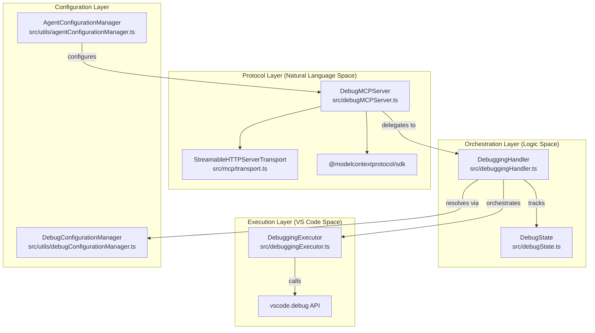
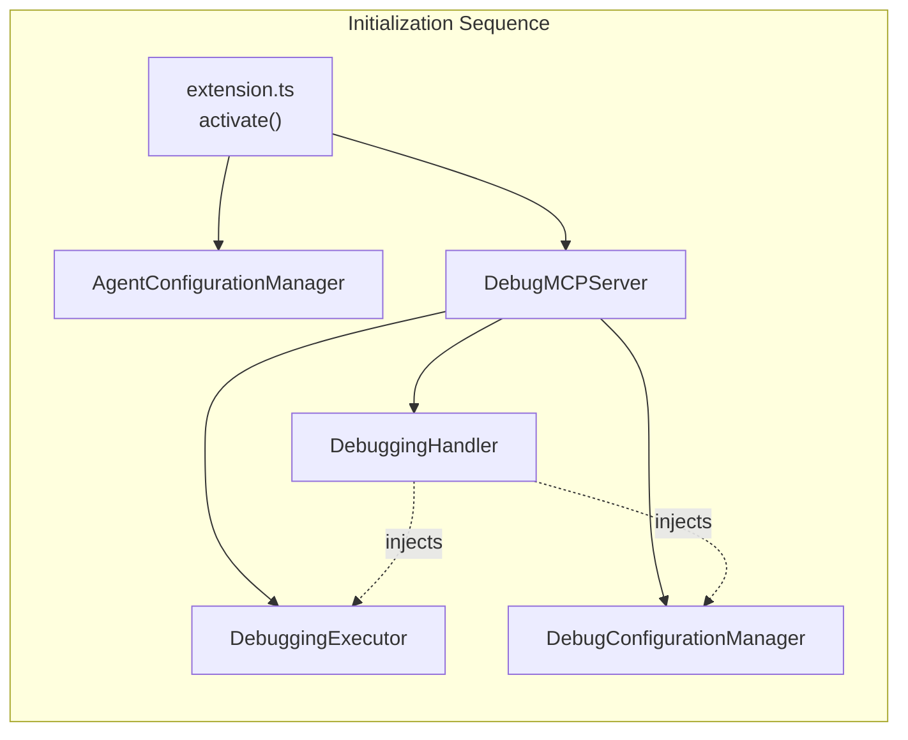
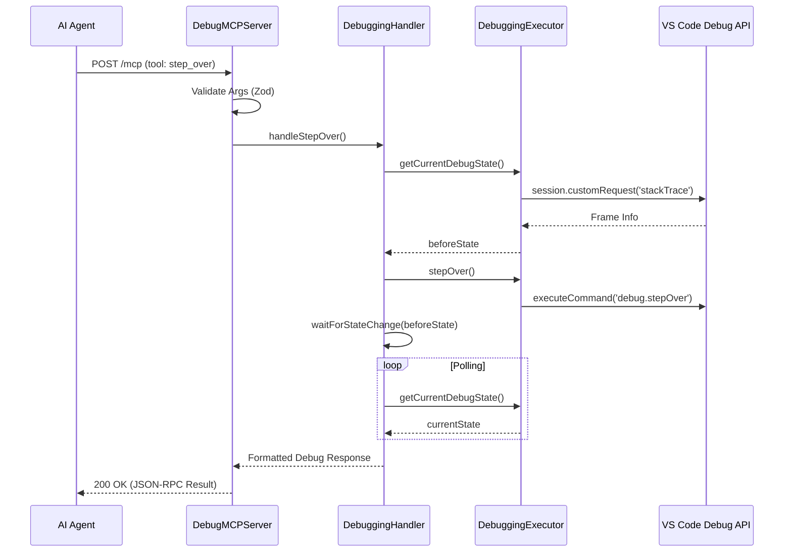

<!-- source: DeepWiki mcp.deepwiki.com · repo microsoft/DebugMCP · page 3.1 System Components · fetched 2026-10-26 -->

# System Components

Relevant source files

The following files were used as context for generating this wiki page:

- [AGENTS.md](AGENTS.md)
- [docs/architecture/debugMCPServer.md](docs/architecture/debugMCPServer.md)
- [src/extension.ts](src/extension.ts)
- [src/utils/logger.ts](src/utils/logger.ts)
- [tsconfig.json](tsconfig.json)

## Purpose and Scope

This document describes the core architectural components that comprise the DebugMCP system. It focuses on the primary classes, their responsibilities, and how they interact to bridge AI agents with the VS Code Debugging infrastructure.

The DebugMCP architecture follows a layered design pattern with clear separation of concerns across four primary components:

1.  **DebugMCPServer**: The protocol entry point that exposes MCP tools and resources via HTTP.
2.  **DebuggingHandler**: The orchestration layer managing high-level debugging workflows and state change detection.
3.  **DebuggingExecutor**: The execution layer that directly interfaces with VS Code APIs and the Debug Adapter Protocol (DAP).
4.  **Configuration Managers**: Supporting components for managing `launch.json` heuristics and AI agent auto-configuration.

---

## Component Architecture Overview

The following diagram illustrates the primary components and their relationships, mapping system names to their implementation files and key classes.

### Code Entity Map

**Sources:** [src/debugMCPServer.ts:38-40](), [src/extension.ts:25-40](), [AGENTS.md:9-22]()

---

## Component Lifecycle and Injection

DebugMCP uses a centralized initialization pattern in the extension's `activate` function. The `DebugMCPServer` acts as the root container for the debugging logic.

The `DebugMCPServer` constructor initializes the sub-components to ensure a consistent execution context:
*   **DebuggingExecutor**: Handles raw VS Code API calls [src/debugMCPServer.ts:43]().
*   **DebugConfigurationManager**: Handles `launch.json` and language detection [src/debugMCPServer.ts:44]().
*   **DebuggingHandler**: Orchestrates the two above to process MCP tool requests [src/debugMCPServer.ts:45]().

**Sources:** [src/extension.ts:11-48](), [src/debugMCPServer.ts:38-48]()

---

## DebugMCPServer

The `DebugMCPServer` class implements the Model Context Protocol (MCP) and serves as the primary interface for AI agents (Cline, Copilot, Cursor).

### Responsibilities
*   **Tool Registration**: Exposes 13 debugging tools (e.g., `start_debugging`, `step_over`) using `McpServer.tool()` [src/debugMCPServer.ts:76-220]().
*   **Resource Management**: Provides documentation resources like `debug_instructions` for agents [src/debugMCPServer.ts:224-263]().
*   **Transport Handling**: Implements a Streamable HTTP transport over an Express server on a configurable port (default: 3001) [src/debugMCPServer.ts:320-345]().

### Key Implementation Details
*   **Stateless HTTP**: Uses `POST /mcp` for JSON-RPC messages [src/debugMCPServer.ts:333]().
*   **Validation**: Uses `zod` schemas to validate tool parameters from the AI agent [src/debugMCPServer.ts:79-88]().

**Sources:** [src/debugMCPServer.ts:35-71](), [docs/architecture/debugMCPServer.md:13-18]()

---

## DebuggingHandler

The `DebuggingHandler` is the "brain" of the system. It translates high-level MCP tool requests into sequences of debugger actions.

### Responsibilities
*   **Workflow Orchestration**: Manages the sequence of starting a session, waiting for it to attach, and returning the initial state [src/debuggingHandler.ts:47-85]().
*   **State Change Detection**: After a step operation (e.g., `step_over`), it polls the debugger to ensure the execution has actually moved before returning to the AI agent [src/debuggingHandler.ts:543-584]().
*   **Exponential Backoff**: Implements `waitForStateChange` and `waitForActiveDebugSession` to handle the asynchronous nature of VS Code debugging [src/debuggingHandler.ts:476-536]().

### State Comparison Logic
The handler compares `DebugState` objects to detect transitions:
*   `sessionActive` status.
*   `fileFullPath` and `currentLine`.
*   `frameId` to detect stack changes.

**Sources:** [src/debuggingHandler.ts:31-42](), [docs/architecture/debuggingHandler.md:1-20]()

---

## DebuggingExecutor

The `DebuggingExecutor` interacts directly with the `vscode.debug` namespace and executes workbench commands.

### Key Functions
*   **Session Control**: `startDebugging`, `stopDebugging`, and `restart` [src/debuggingExecutor.ts:36-122]().
*   **Breakpoint Management**: Wraps `vscode.debug.addBreakpoints` and `removeBreakpoints`. It uses content-based matching to find breakpoints in files [src/debuggingExecutor.ts:124-180]().
*   **DAP Interaction**: Sends custom requests to the Debug Adapter for `stackTrace`, `scopes`, and `variables` to build the `DebugState` [src/debuggingExecutor.ts:212-260]().
*   **Expression Evaluation**: Uses `session.customRequest('evaluate', ...)` to allow agents to inspect complex objects [src/debuggingExecutor.ts:275-295]().

**Sources:** [src/debuggingExecutor.ts:9-31](), [docs/architecture/debuggingExecutor.md:1-20]()

---

## Configuration Managers

### DebugConfigurationManager
Manages the complexity of `launch.json`. It includes heuristics to:
*   Auto-detect languages (Python, JS/TS, Java, C#, Go, etc.) [src/utils/debugConfigurationManager.ts]().
*   Generate "AUTO_LAUNCH" configurations when no `launch.json` is present [AGENTS.md:21]().
*   Resolve test-specific configurations for frameworks like `pytest` or `jest`.

### AgentConfigurationManager
Handles the "Zero-Config" onboarding experience:
*   **Auto-detection**: Finds configuration paths for Cline, Cursor, and GitHub Copilot [src/utils/agentConfigurationManager.ts]().
*   **Migration**: Updates legacy SSE configurations to the new Streamable HTTP format [src/extension.ts:28-32]().
*   **UI**: Manages the VS Code popups for agent selection [src/extension.ts:54-62]().

**Sources:** [src/extension.ts:25-32](), [AGENTS.md:21-22]()

---

## Data Flow: Tool Execution

The following sequence demonstrates how a request moves through the components.

**Sources:** [src/debugMCPServer.ts:126-145](), [src/debuggingHandler.ts:126-145](), [src/debuggingExecutor.ts:69-85]()

---

