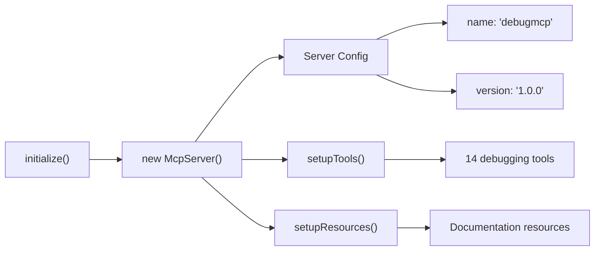
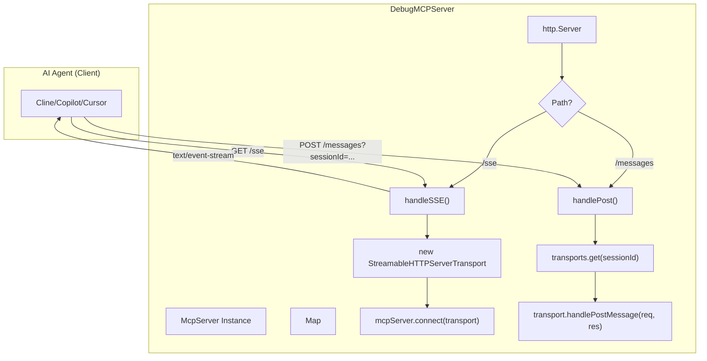
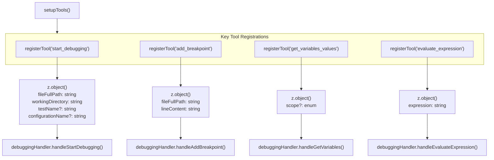
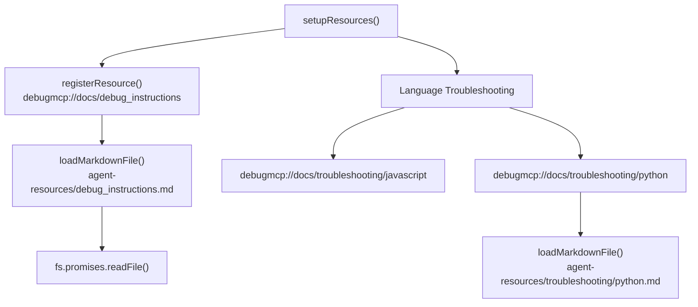

<!-- source: DeepWiki mcp.deepwiki.com · repo microsoft/DebugMCP · page 3.2 MCP Protocol Integration · fetched 2026-10-26 -->

# MCP Protocol Integration

<details>
<summary>Relevant source files</summary>

The following files were used as context for generating this wiki page:

- [package-lock.json](package-lock.json)
- [src/debugMCPServer.ts](src/debugMCPServer.ts)

</details>


This page explains how DebugMCP implements the Model Context Protocol (MCP) using the official MCP SDK and a streamable HTTP transport. It covers the technical details of server initialization, tool and resource registration, and the implementation of the communication layer between AI agents and the VS Code debugging engine.

## Model Context Protocol Overview

The Model Context Protocol (MCP) is a standardized protocol for exposing tools and resources to AI agents. DebugMCP implements MCP to allow AI assistants like Cline, GitHub Copilot, and Cursor to invoke debugging operations programmatically.

The MCP server in DebugMCP exposes:
- **Tools**: 14 debugging operations that AI agents can invoke (e.g., `start_debugging`, `add_breakpoint`, `get_variables_values`). [src/debugMCPServer.ts:61-248]()
- **Resources**: Documentation files that AI agents can read to understand debugging workflows (e.g., `debugmcp://docs/debug_instructions`). [src/debugMCPServer.ts:253-289]()

Sources: [src/debugMCPServer.ts:19-21](), [src/debugMCPServer.ts:61-289]()

## MCP SDK Integration

DebugMCP uses the official `@modelcontextprotocol/sdk` (version ^1.26.0) to implement the MCP protocol. Unlike previous versions that used `fastmcp`, the current implementation utilizes the core SDK classes for finer control over transport and server behavior.

### Server Initialization

The `DebugMCPServer.initialize()` method creates the `McpServer` instance with metadata:

**MCP Server Configuration**


Sources: [src/debugMCPServer.ts:41-54](), [package-lock.json:12]()

## Streamable HTTP Transport

DebugMCP implements a custom transport layer using `StreamableHTTPServerTransport` from the MCP SDK, integrated with a standard Node.js `http.Server`.

### Transport Architecture

The server handles two primary types of requests:
1.  **SSE Connection**: A `GET` request to `/sse` that establishes a long-running event stream. [src/debugMCPServer.ts:342-358]()
2.  **Message Posting**: `POST` requests to `/messages` that send MCP JSON-RPC payloads to the server. [src/debugMCPServer.ts:360-373]()

**HTTP Transport Architecture**


Sources: [src/debugMCPServer.ts:28](), [src/debugMCPServer.ts:342-373]()

### Connection Management

The server maintains a `Map` of active transports indexed by a unique `sessionId`. When a client connects to the `/sse` endpoint, a new `StreamableHTTPServerTransport` is instantiated and associated with that session.

```typescript
const transport = new StreamableHTTPServerTransport('/messages', res);
this.transports.set(transport.sessionId, transport);
await this.mcpServer!.connect(transport);
```

Sources: [src/debugMCPServer.ts:28](), [src/debugMCPServer.ts:352-354]()

## Tool Registration and Schema Validation

### Tool Structure

Each debugging tool is registered using `mcpServer.registerTool()`. The SDK uses `zod` for schema validation, ensuring that AI agents provide correctly typed arguments.

**Tool Registration Flow**


Sources: [src/debugMCPServer.ts:61-248]()

### Tool-to-Handler Mapping

| Tool Name | Parameters | Handler Method | Line Reference |
|-----------|-----------|----------------|----------------|
| `get_debug_instructions` | None | `loadMarkdownFile()` | [src/debugMCPServer.ts:61-68]() |
| `start_debugging` | `fileFullPath`, `workingDirectory`, `testName?`, `configurationName?` | `handleStartDebugging()` | [src/debugMCPServer.ts:71-97]() |
| `stop_debugging` | None | `handleStopDebugging()` | [src/debugMCPServer.ts:100-105]() |
| `step_over` | None | `handleStepOver()` | [src/debugMCPServer.ts:108-113]() |
| `step_into` | None | `handleStepInto()` | [src/debugMCPServer.ts:116-121]() |
| `step_out` | None | `handleStepOut()` | [src/debugMCPServer.ts:124-129]() |
| `continue_execution` | None | `handleContinue()` | [src/debugMCPServer.ts:132-137]() |
| `restart_debugging` | None | `handleRestart()` | [src/debugMCPServer.ts:140-145]() |
| `add_breakpoint` | `fileFullPath`, `lineContent` | `handleAddBreakpoint()` | [src/debugMCPServer.ts:148-158]() |
| `remove_breakpoint` | `fileFullPath`, `line` | `handleRemoveBreakpoint()` | [src/debugMCPServer.ts:161-171]() |
| `clear_all_breakpoints` | None | `handleClearAllBreakpoints()` | [src/debugMCPServer.ts:174-179]() |
| `list_breakpoints` | None | `handleListBreakpoints()` | [src/debugMCPServer.ts:182-187]() |
| `get_variables_values` | `scope?` | `handleGetVariables()` | [src/debugMCPServer.ts:190-201]() |
| `evaluate_expression` | `expression` | `handleEvaluateExpression()` | [src/debugMCPServer.ts:204-215]() |

Sources: [src/debugMCPServer.ts:61-248]()

## Resource Registration

### Resource URI Scheme

DebugMCP uses a custom URI scheme (`debugmcp://`) to expose documentation resources. This is implemented via `mcpServer.registerResource()`.

**Resource Registration Architecture**


Sources: [src/debugMCPServer.ts:253-289]()

### Registered Resources

| URI | Name | Description | File Path |
|-----|------|-------------|-----------|
| `debugmcp://docs/debug_instructions` | Debugging Instructions | Step-by-step debugging workflow | `agent-resources/debug_instructions.md` |
| `debugmcp://docs/troubleshooting/python` | Python Debugging Tips | Python-specific guidance | `agent-resources/troubleshooting/python.md` |
| `debugmcp://docs/troubleshooting/javascript` | JavaScript Debugging Tips | JS/TS-specific guidance | `agent-resources/troubleshooting/javascript.md` |
| `debugmcp://docs/troubleshooting/java` | Java Debugging Tips | Java-specific guidance | `agent-resources/troubleshooting/java.md` |
| `debugmcp://docs/troubleshooting/csharp` | C# Debugging Tips | C#-specific guidance | `agent-resources/troubleshooting/csharp.md` |

Sources: [src/debugMCPServer.ts:255-288]()

## Server Lifecycle

The server is managed as a singleton within the VS Code extension.

1.  **Start**: The `start()` method creates the Node.js `http.Server` and listens on the configured port. [src/debugMCPServer.ts:321-382]()
2.  **Request Handling**: Incoming requests are parsed and routed to either the SSE handler or the message handler. [src/debugMCPServer.ts:340-375]()
3.  **Stop**: The `stop()` method closes the HTTP server and clears the transport map. [src/debugMCPServer.ts:387-396]()

Sources: [src/debugMCPServer.ts:321-396]()

---

