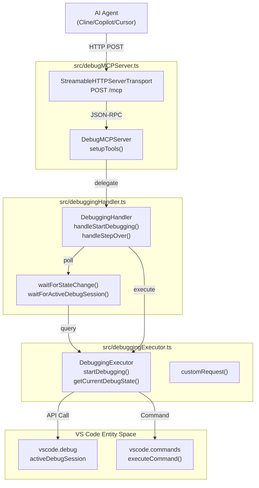
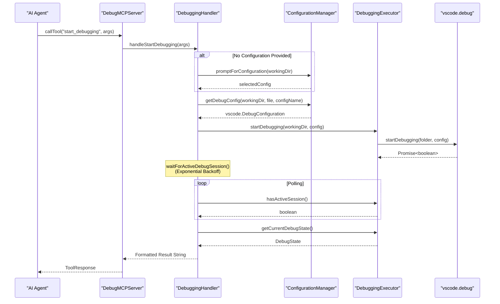
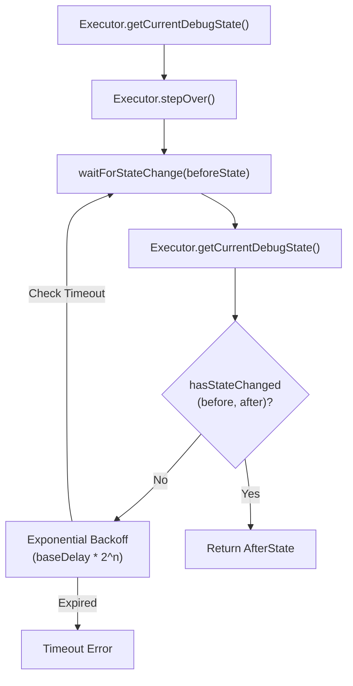

<!-- source: DeepWiki mcp.deepwiki.com · repo microsoft/DebugMCP · page 3.3 Request Flow · fetched 2026-10-26 -->

# Request Flow

Relevant source files

The following files were used as context for generating this wiki page:

- [AGENTS.md](AGENTS.md)
- [docs/architecture/debugMCPServer.md](docs/architecture/debugMCPServer.md)
- [src/debugMCPServer.ts](src/debugMCPServer.ts)
- [src/debuggingHandler.ts](src/debuggingHandler.ts)
- [tsconfig.json](tsconfig.json)

## Purpose and Scope

This document traces the complete lifecycle of debugging requests as they flow from AI agents through the DebugMCP system to VS Code's Debug API. It covers request processing layers, timing mechanisms, state change detection, and response formatting. This page focuses on the internal mechanics of the `DebugMCPServer`, `DebuggingHandler`, and `DebuggingExecutor`.

## Request Processing Architecture

DebugMCP uses a multi-layered architecture to process debugging requests, bridging the asynchronous nature of MCP with the event-driven VS Code Debug API.

| Layer | Component | Responsibility | Implementation |
|-------|-----------|----------------|-----------|
| **Protocol Layer** | `DebugMCPServer` | Hosts the MCP server, registers tools/resources, and manages HTTP transport. | [src/debugMCPServer.ts:22-54]() |
| **Orchestration Layer** | `DebuggingHandler` | Manages high-level workflows, state change detection, and result formatting. | [src/debuggingHandler.ts:31-42]() |
| **Execution Layer** | `DebuggingExecutor` | Interfaces with `vscode.debug` API, manages breakpoints, and executes DAP requests. | [src/debuggingExecutor.ts:16-34]() |
| **VS Code Layer** | VS Code Debug API | Communicates with language-specific debug adapters via DAP. | Native VS Code |

### System Data Flow

The following diagram maps the logical flow to specific code entities and methods.

**Sources:** [src/debugMCPServer.ts:59-65](), [src/debuggingHandler.ts:31-42](), [src/debuggingExecutor.ts:16-34]()

## Starting a Debug Session

The `start_debugging` tool implementation illustrates how the system coordinates configuration resolution and session initialization.

### Request Flow Sequence

**Key Code Pointers:**
- Tool Registration: [src/debugMCPServer.ts:71-97]()
- Logic Entry: [src/debuggingHandler.ts:47-86]()
- Config Resolution: [src/debuggingHandler.ts:56-64]()
- VS Code Invocation: [src/debuggingExecutor.ts:36-53]()

**Sources:** [src/debugMCPServer.ts:71-97](), [src/debuggingHandler.ts:47-86](), [src/debuggingExecutor.ts:36-53]()

## State Change Detection and Timing

Unlike standard API calls, debugging operations (like `step_over`) are asynchronous in the debug adapter. The `DebuggingHandler` implements a polling mechanism to ensure the AI agent receives the updated state only after the debugger has paused at the next location.

### The `waitForStateChange` Loop

When a stepping command is issued, the handler captures the `beforeState` and polls until the `afterState` differs.

**Implementation Details:**
- **Comparison Logic**: `hasStateChanged` checks `sessionActive`, `fileFullPath`, `currentLine`, `frameName`, and `frameId` [src/debuggingHandler.ts:541-584]().
- **Backoff Constants**: Base delay of 1000ms, max delay of 10000ms [src/debuggingHandler.ts:477-478]().
- **Jitter**: A random jitter of up to 200ms is added to polling intervals [src/debuggingHandler.ts:493]().

**Sources:** [src/debuggingHandler.ts:476-536](), [src/debuggingHandler.ts:541-584]()

## Breakpoint Management Flow

Breakpoint requests bridge the gap between "Natural Language Space" (searching for code content) and "Code Entity Space" (VS Code URI/Line numbers).

1. **Content Search**: The handler receives a `lineContent` string [src/debuggingHandler.ts:152]().
2. **File Resolution**: It opens the document via `vscode.workspace.openTextDocument` [src/debuggingHandler.ts:249]().
3. **Line Matching**: It iterates through the file to find all line numbers matching the content [src/debuggingHandler.ts:254-258]().
4. **DAP Registration**: For each match, it calls `executor.addBreakpoint`, which creates a `vscode.SourceBreakpoint` [src/debuggingExecutor.ts:127-136]().

**Sources:** [src/debuggingHandler.ts:244-280](), [src/debuggingExecutor.ts:127-136]()

## Variable Inspection and DAP Requests

When an agent requests variables, the flow descends into raw Debug Adapter Protocol (DAP) messages via the `customRequest` interface.

1. **Frame Context**: The system identifies the `activeStackItem` to get the current `frameId` [src/debuggingExecutor.ts:168-174]().
2. **Scope Retrieval**: A DAP `scopes` request is sent to find 'Local', 'Global', etc. [src/debuggingExecutor.ts:241]().
3. **Variable Expansion**: For each scope, a DAP `variables` request is sent using the `variablesReference` [src/debuggingExecutor.ts:257]().
4. **Serialization**: The `DebuggingHandler` formats the nested DAP response into a human-readable string for the LLM [src/debuggingHandler.ts:362-384]().

**Sources:** [src/debuggingExecutor.ts:235-273](), [src/debuggingHandler.ts:343-388]()

---

