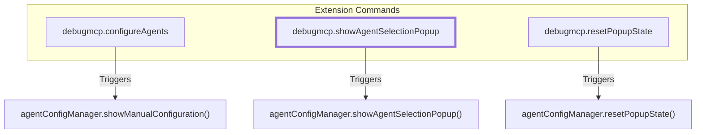
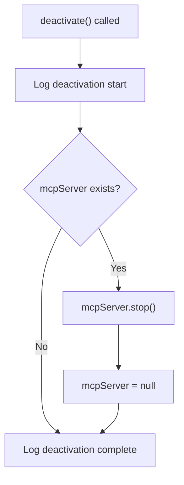

<!-- source: DeepWiki mcp.deepwiki.com · repo microsoft/DebugMCP · page 3.4 Extension Lifecycle · fetched 2026-10-26 -->

# Extension Lifecycle

<details>
<summary>Relevant source files</summary>

The following files were used as context for generating this wiki page:

- [package.json](package.json)
- [src/extension.ts](src/extension.ts)
- [src/utils/logger.ts](src/utils/logger.ts)

</details>


This page documents the complete lifecycle of the DebugMCP VS Code extension, from activation through initialization to deactivation. It covers the activation triggers, the sequential initialization process of components, configuration loading, command registration, and cleanup procedures.

For information about the MCP server initialization and runtime behavior, see **4.1 DebugMCP Server**. For details about agent configuration setup, see **4.5 Agent Configuration Manager**.

## Activation Events

The DebugMCP extension is activated by VS Code when specific events occur, as defined in the extension manifest `package.json`.

| Activation Event | Trigger Condition | Purpose |
|-----------------|-------------------|---------|
| `onStartupFinished` | VS Code completes startup | Ensures extension is available immediately after VS Code loads [package.json:47]() |
| `onDebug` | User initiates any debug session | Activates extension when debugging capabilities are needed [package.json:48]() |

The extension uses `onStartupFinished` as the primary activation event to ensure the MCP server is available for AI agents as soon as possible. The `onDebug` event provides a fallback activation mechanism when debugging activity begins.

**Sources:** [package.json:46-49]()

---

## Activation Sequence

When VS Code triggers activation, the `activate()` function in the extension entry point executes a carefully ordered sequence of initialization steps.

### Extension Initialization Flow
The following diagram illustrates the transition from the VS Code environment into the specific logic of `src/extension.ts`.

```mermaid
sequenceDiagram
    participant VSCode as "VS Code Runtime"
    participant activate as "activate(context)"
    participant logger as "Logger.ts"
    participant config as "vscode.workspace.getConfiguration"
    participant ACM as "AgentConfigurationManager.ts"
    participant MCP as "DebugMCPServer.ts"
    participant commands as "registerCommands()"

    VSCode->>activate: "Extension activation event"
    
    activate->>logger: "getInstance()"
    activate->>logger: "info('DebugMCP extension is now active!')"
    activate->>logger: "logSystemInfo()"
    activate->>logger: "logEnvironment()"
    
    activate->>config: "getConfiguration('debugmcp')"
    config-->>activate: "timeoutInSeconds, serverPort"
    
    activate->>ACM: "new AgentConfigurationManager(context, timeout, port)"
    activate->>ACM: "migrateExistingConfigurations()"
    
    activate->>MCP: "new DebugMCPServer(serverPort, timeoutInSeconds)"
    activate->>MCP: "initialize()"
    activate->>MCP: "start()"
    
    activate->>VSCode: "window.showInformationMessage(endpoint)"
    
    activate->>commands: "registerCommands(context)"
    
    activate->>activate: "setTimeout(2000ms) -> shouldShowPopup()"
    
    activate-->>VSCode: "Activation complete"
```

**Sources:** [src/extension.ts:11-65](), [src/utils/logger.ts:12-26]()

---

## Initialization Steps

### 1. Logger Initialization
The first action during activation is retrieving the `Logger` singleton instance and recording system diagnostics.
[src/extension.ts:11-15]()

```typescript
// Initial logging sequence
logger.info('DebugMCP extension is now active!');
logger.logSystemInfo();
logger.logEnvironment();
```

The `Logger.logSystemInfo()` method outputs:
- VS Code Version (`vscode.version`) [src/utils/logger.ts:86]()
- Platform and Architecture (`process.platform`, `process.arch`) [src/utils/logger.ts:87-88]()
- Node.js Version and PID [src/utils/logger.ts:89-90]()

**Sources:** [src/utils/logger.ts:84-101](), [src/extension.ts:13-15]()

### 2. Configuration Loading
The extension reads user-configurable settings from VS Code's workspace configuration under the `debugmcp` namespace. [package.json:67-81]()

| Configuration Key | Default Value | Purpose |
|------------------|---------------|---------|
| `debugmcp.timeoutInSeconds` | 180 | Maximum time to wait for debug operations [package.json:72]() |
| `debugmcp.serverPort` | 3001 | Port number for the MCP server [package.json:77]() |

**Sources:** [src/extension.ts:17-22](), [package.json:67-81]()

### 3. Agent Configuration Manager and Migration
The `AgentConfigurationManager` is instantiated to handle AI agent integration. A critical early step is migrating legacy SSE configurations to the modern `streamableHttp` transport. [src/extension.ts:25-32]()

```typescript
agentConfigManager = new AgentConfigurationManager(context, timeoutInSeconds, serverPort);
await agentConfigManager.migrateExistingConfigurations();
```

**Sources:** [src/extension.ts:25-32]()

### 4. MCP Server Initialization and Startup
The `DebugMCPServer` is initialized through a two-phase process. [src/extension.ts:38-40]()

- **Phase 1: `initialize()`**: Sets up the internal `DebuggingHandler`, registers tools, and prepares resources.
- **Phase 2: `start()`**: Binds the Express server to the configured `serverPort`.

Upon success, a notification is shown to the user via `vscode.window.showInformationMessage`. [src/extension.ts:44]()

**Sources:** [src/extension.ts:34-48]()

### 5. Command Registration
The extension registers three internal commands, only one of which is exposed to the Command Palette. [package.json:52-66]()



| Command ID | Source Call | Palette Category |
|-----------|-------------|------------------|
| `debugmcp.configureAgents` | `showManualConfiguration()` | N/A [src/extension.ts:73-79]() |
| `debugmcp.showAgentSelectionPopup` | `showAgentSelectionPopup()` | DebugMCP [package.json:54-57]() |
| `debugmcp.resetPopupState` | `resetPopupState()` | N/A [src/extension.ts:92-100]() |

**Sources:** [src/extension.ts:70-107](), [package.json:51-66]()

---

## Module-Level State

The extension maintains two module-level variables to track core component instances across the activation/deactivation lifecycle. [src/extension.ts:8-9]()

```typescript
let mcpServer: DebugMCPServer | null = null;
let agentConfigManager: AgentConfigurationManager | null = null;
```

These variables are initialized to `null`, assigned during `activate()`, and cleaned up during `deactivate()`.

**Sources:** [src/extension.ts:8-118]()

---

## Deactivation Process

When VS Code unloads the extension (e.g., on shutdown), the `deactivate()` function ensures the MCP server is gracefully stopped. [src/extension.ts:109-121]()



**Cleanup Steps:**
1. Log the deactivation event. [src/extension.ts:110]()
2. Invoke `mcpServer.stop()` to close HTTP listeners and clear timeouts. [src/extension.ts:114]()
3. Nullify references to prevent memory leaks. [src/extension.ts:117]()

**Sources:** [src/extension.ts:109-121]()

---

## Error Handling Strategy

The activation process implements defensive error handling to ensure VS Code remains stable even if the MCP server fails to start.

| Failure Point | Logic | Outcome |
|--------------|-------|---------|
| Configuration Migration | `try-catch` block around `migrateExistingConfigurations()` [src/extension.ts:28-32]() | Error logged; activation continues. |
| Server Initialization | `try-catch` block around `initialize()` and `start()` [src/extension.ts:35-48]() | Error message shown to user; server remains offline. |
| Delayed Popup | `try-catch` block inside `setTimeout` [src/extension.ts:54-62]() | Error logged; popup is skipped. |
| Deactivation | `.catch()` on `mcpServer.stop()` [src/extension.ts:114-116]() | Error logged; extension host continues shutdown. |

**Sources:** [src/extension.ts:28-116]()

---

