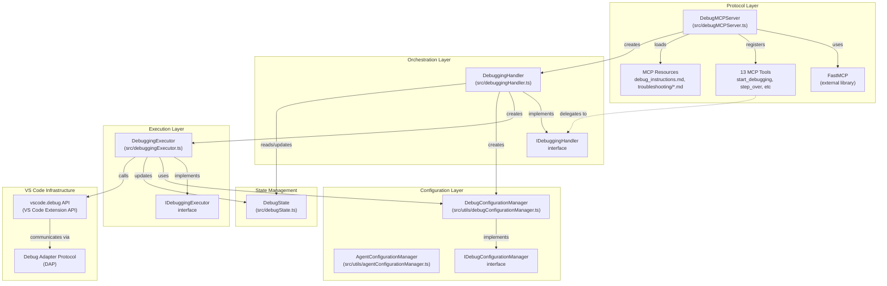
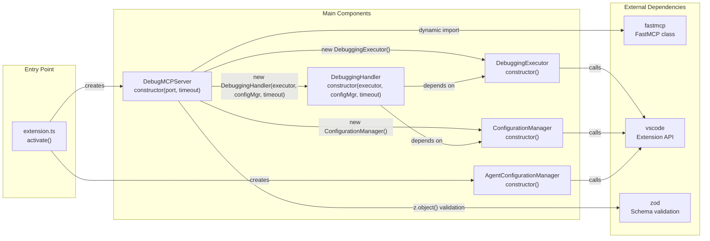
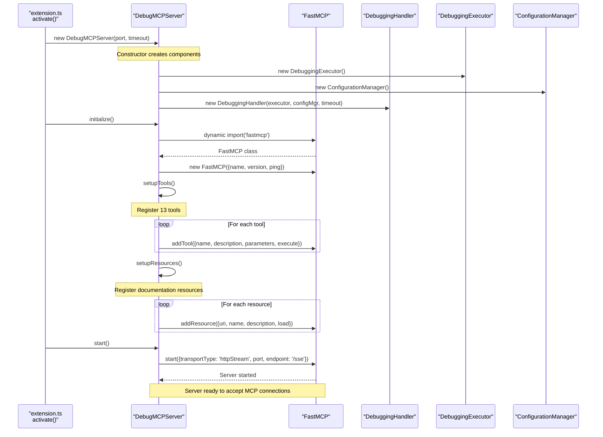
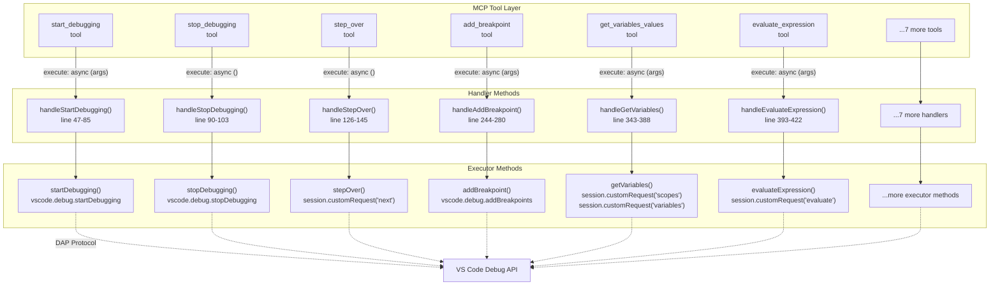
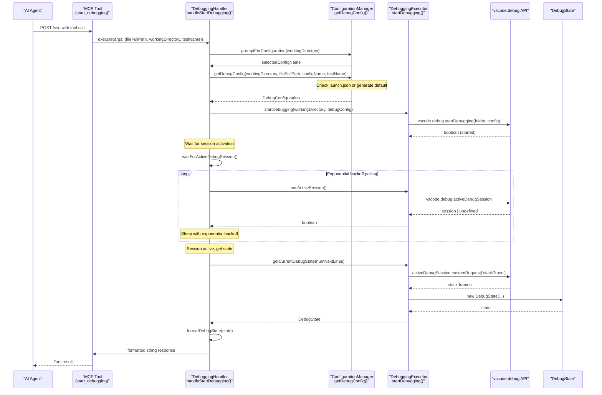
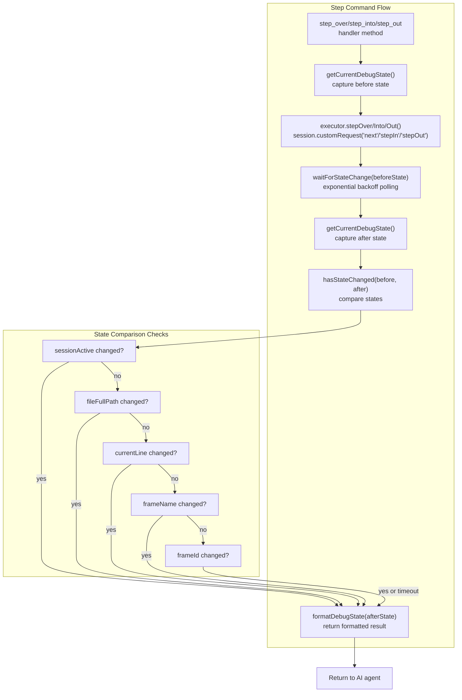
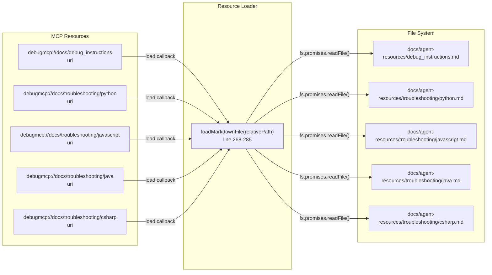
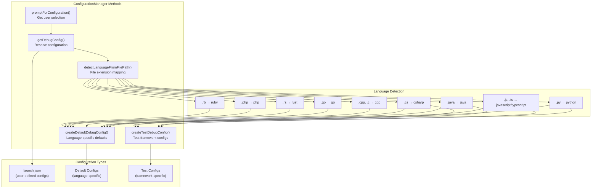

<!-- source: DeepWiki mcp.deepwiki.com · repo microsoft/DebugMCP · page 4 Core Components · fetched 2026-10-26 -->

# Core Components

Relevant source files

The following files were used as context for generating this wiki page:

- [AGENTS.md](AGENTS.md)
- [docs/architecture/debugMCPServer.md](docs/architecture/debugMCPServer.md)
- [src/index.ts](src/index.ts)
- [tsconfig.json](tsconfig.json)

This document provides detailed documentation of the major components that make up the DebugMCP system. Each component has a specific responsibility in the layered architecture that bridges MCP protocol communication with VS Code's Debug Adapter Protocol (DAP).

For information about the overall architecture and how these components work together, see [Architecture Overview](#3). For detailed information about individual components, see the subsections: [DebugMCP Server](#4.1), [Debugging Handler](#4.2), [Debugging Executor](#4.3), [Debug Configuration Manager](#4.4), and [Agent Configuration Manager](#4.5).

## Component Overview

The DebugMCP system consists of six core components organized into three architectural layers:

| Component | Layer | Primary Responsibility | File Location |
|-----------|-------|----------------------|---------------|
| `DebugMCPServer` | Protocol Layer | MCP server implementation, tool/resource registration, FastMCP integration | [src/debugMCPServer.ts]() |
| `DebuggingHandler` | Orchestration Layer | Command orchestration, state change detection, workflow management | [src/debuggingHandler.ts]() |
| `DebuggingExecutor` | Execution Layer | VS Code Debug API interface, DAP request execution | [src/debuggingExecutor.ts]() |
| `DebugConfigurationManager` | Configuration Layer | Debug configuration management, language detection | [src/utils/debugConfigurationManager.ts]() |
| `AgentConfigurationManager` | Configuration Layer | AI agent auto-configuration and setup | [src/utils/agentConfigurationManager.ts]() |
| `DebugState` | State Management | Debug session state model and tracking | [src/debugState.ts]() |

Sources: [src/debugMCPServer.ts:1-376](), [src/debuggingHandler.ts:1-617](), [AGENTS.md:13-22](), [src/index.ts:4-11]()

## Layered Architecture

This diagram maps the natural language component names to their actual code entities (classes, interfaces, and files). The three-layer separation ensures clear boundaries: the Protocol Layer handles MCP communication, the Orchestration Layer manages workflows and state changes, and the Execution Layer directly interfaces with VS Code's debugging infrastructure.

Sources: [src/debugMCPServer.ts:35-47](), [src/debuggingHandler.ts:12-31](), [AGENTS.md:9-11]()

## Component Dependencies

The dependency graph shows how components are constructed through dependency injection. `DebugMCPServer` acts as a factory that creates the executor and configuration manager, then injects them into `DebuggingHandler`. This pattern promotes testability and loose coupling.

Sources: [src/debugMCPServer.ts:41-47](), [src/index.ts:4-11](), [AGENTS.md:62-66]()

## Component Initialization Flow

This sequence diagram shows the exact initialization flow from extension activation through component creation to server startup. The `DebugMCPServer` constructor [src/debugMCPServer.ts:41-47]() performs dependency injection, creating the executor and configuration manager before passing them to the handler.

Sources: [src/debugMCPServer.ts:41-71](), [docs/architecture/debugMCPServer.md:50-56]()

## Tool Registration and Delegation

The tool registration happens in `setupTools()` [src/debugMCPServer.ts:76-220](). Each tool's `execute` callback delegates directly to a corresponding handler method, which orchestrates the operation and calls the executor. This three-tier delegation ensures separation of concerns: protocol parsing (tools), workflow orchestration (handlers), and API execution (executor).

Sources: [src/debugMCPServer.ts:76-220](), [src/debuggingHandler.ts:12-26](), [docs/architecture/debugMCPServer.md:58-71]()

## Request Processing Flow

This detailed sequence shows the complete request processing flow for `start_debugging`. Key aspects:
- Configuration resolution happens before debugging starts [src/debuggingHandler.ts:55-63]()
- Exponential backoff with jitter waits for session activation [src/debuggingHandler.ts:476-500]()
- State capture happens immediately after session becomes active [src/debuggingHandler.ts:77]()
- Formatted state is returned to the AI agent [src/debuggingHandler.ts:78]()

Sources: [src/debuggingHandler.ts:47-85](), [src/debuggingHandler.ts:476-500](), [docs/architecture/debugMCPServer.md:43-48]()

## State Change Detection

State change detection [src/debuggingHandler.ts:505-536]() ensures that step commands don't return until the debugger state has actually changed. The `hasStateChanged()` method [src/debuggingHandler.ts:541-584]() compares multiple attributes: session status, file path, line number, frame name, and frame ID. This prevents race conditions where the VS Code API returns before the debugger has actually moved.

Sources: [src/debuggingHandler.ts:505-584](), [src/debuggingHandler.ts:126-145](), [AGENTS.md:58]()

## Resource Loading

MCP resources provide AI agents with documentation about how to use the debugging tools effectively. The `setupResources()` method [src/debugMCPServer.ts:225-263]() registers resources with lazy-loading callbacks. When an agent requests a resource, `loadMarkdownFile()` [src/debugMCPServer.ts:268-285]() reads the content from the `docs/agent-resources/` directory.

Sources: [src/debugMCPServer.ts:225-285](), [AGENTS.md:86-93](), [docs/architecture/debugMCPServer.md:73-79]()

## Configuration Management

The `DebugConfigurationManager` provides a hierarchical configuration system. It first checks for user-defined configurations in `launch.json`, then falls back to language-specific defaults. Language detection uses file extensions, and each language has tailored debug configurations including test framework support (unittest for Python, Jest/Mocha for JavaScript, JUnit for Java, dotnet test for C#).

Sources: [src/utils/debugConfigurationManager.ts](), [AGENTS.md:21](), [src/index.ts:6]()

## Component Communication Patterns

The components implement three key communication patterns:

### 1. Dependency Injection Pattern
Components are constructed with their dependencies injected via constructor parameters:
- `DebuggingHandler(executor, configManager, timeout)` [src/debuggingHandler.ts:36-42]()
- Promotes testability by allowing mock implementations
- Ensures loose coupling between layers

### 2. Interface-Based Contracts
Each layer defines interfaces to formalize contracts:
- `IDebuggingHandler` [src/debuggingHandler.ts:12-26]()
- `IDebuggingExecutor` [src/index.ts:5]()
- `IDebugConfigurationManager` [src/debuggingHandler.ts:4]()
- Allows implementation swapping without affecting consumers

### 3. Exponential Backoff Polling
Asynchronous operations use exponential backoff with jitter:
- `waitForActiveDebugSession()` [src/debuggingHandler.ts:476-500]()
- `waitForStateChange()` [src/debuggingHandler.ts:505-536]()
- Balances responsiveness with resource usage

Sources: [src/debuggingHandler.ts:36-42](), [src/debuggingHandler.ts:476-536](), [AGENTS.md:58]()

## Error Handling Strategy

All components implement consistent error handling:

| Layer | Error Handling Approach | Example |
|-------|------------------------|---------|
| Protocol Layer | Catch and format errors for MCP response | Tool `execute` callbacks wrap handler calls |
| Orchestration Layer | Throw descriptive errors with context | `throw new Error(\`Error starting debug session: ${error}\`)` [src/debuggingHandler.ts:83]() |
| Execution Layer | Validate preconditions, throw on invalid state | Check `hasActiveSession()` before operations |

Errors propagate up the stack with added context at each layer, providing AI agents with actionable error messages.

Sources: [src/debuggingHandler.ts:82-84](), [src/debuggingHandler.ts:128-130](), [AGENTS.md:56]()

## Next Steps

For detailed information about each component:
- [DebugMCP Server](#4.1) - MCP protocol implementation, tool/resource registration
- [Debugging Handler](#4.2) - Operation orchestration and state management  
- [Debugging Executor](#4.3) - VS Code API interface and DAP communication
- [Debug Configuration Manager](#4.4) - Configuration resolution and language detection
- [Agent Configuration Manager](#4.5) - AI agent auto-configuration

For understanding how these components work together in practice, see [Request Flow](#3.3) and [Debugging Operations](#5).

---

