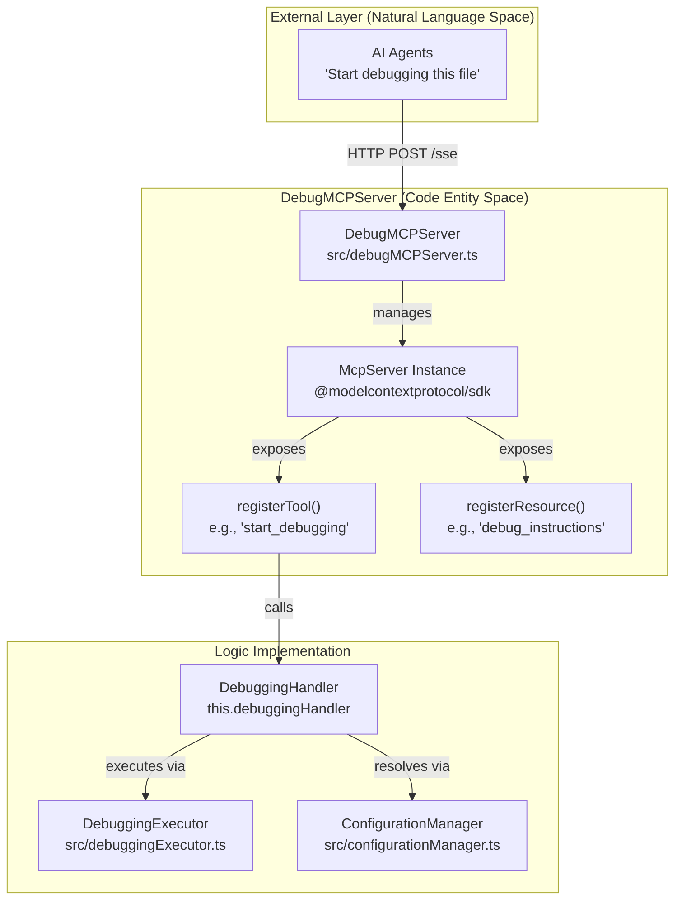
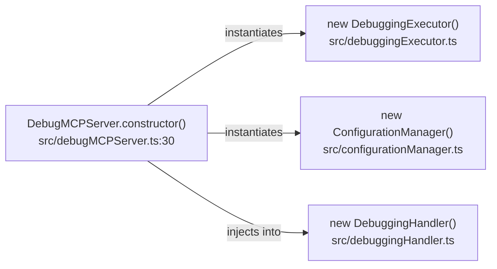
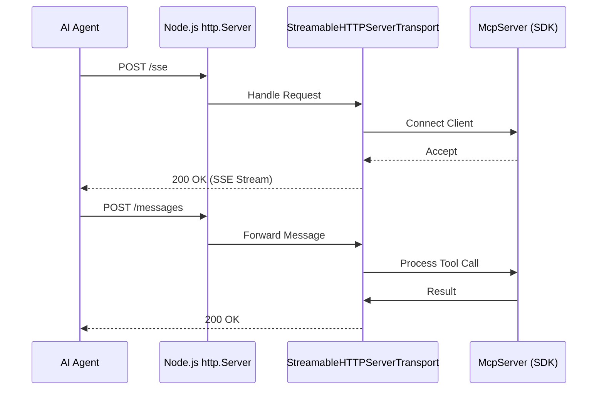

<!-- source: DeepWiki mcp.deepwiki.com · repo microsoft/DebugMCP · page 4.1 DebugMCP Server · fetched 2026-10-26 -->

# DebugMCP Server

Relevant source files

The following files were used as context for generating this wiki page:

- [src/debugMCPServer.ts](src/debugMCPServer.ts)

## Purpose and Scope

The `DebugMCPServer` class is the core MCP (Model Context Protocol) server component that exposes VS Code debugging capabilities to AI agents. It serves as the primary integration point between external AI assistants and the internal debugging infrastructure. This server listens on a configurable HTTP port (default 3001) and uses the `@modelcontextprotocol/sdk` to provide a `StreamableHTTPServerTransport` for communication.

This document covers the server's architecture, tool and resource registration, HTTP endpoint handling, and lifecycle management.

**Sources:** [src/debugMCPServer.ts:1-36]()

## Architecture Overview

The `DebugMCPServer` acts as a facade that exposes debugging functionality through the MCP protocol. It coordinates three key components: the `DebuggingExecutor`, `ConfigurationManager`, and `DebuggingHandler`. The server registers 13 debugging tools and a set of documentation resources, delegating all tool execution to the `DebuggingHandler`.

### Natural Language to Code Entity Space

The following diagram maps high-level debugging concepts to the specific code entities that implement them within the `DebugMCPServer` context.

**Sources:** [src/debugMCPServer.ts:22-36](), [src/debugMCPServer.ts:59-61]()

## Class Structure

The `DebugMCPServer` class manages the MCP server instance and debugging components through dependency injection.

### Key Properties

| Property | Type | Description |
|----------|------|-------------|
| `mcpServer` | `McpServer \| null` | Official MCP SDK server instance. [src/debugMCPServer.ts:23-23]() |
| `httpServer` | `http.Server \| null` | Node.js HTTP server for transport. [src/debugMCPServer.ts:24-24]() |
| `port` | `number` | HTTP server port (default 3001). [src/debugMCPServer.ts:25-25]() |
| `transports` | `Map<string, StreamableHTTPServerTransport>` | Active client connections. [src/debugMCPServer.ts:28-28]() |
| `debuggingHandler` | `IDebuggingHandler` | Logic orchestration layer. [src/debugMCPServer.ts:27-27]() |

### Constructor and Dependency Injection

The constructor initializes the debugging stack. It creates a `DebuggingExecutor` and `ConfigurationManager`, which are then injected into the `DebuggingHandler`.

**Sources:** [src/debugMCPServer.ts:30-36]()

## Tool Registration

The server exposes 13 debugging tools through the `setupTools()` method. Each tool is registered with the `McpServer` instance using `registerTool()`, specifying the tool name, description, and a Zod-based input schema.

### Tool Catalog

| Tool Name | Input Schema (Zod) | Handler Method |
|-----------|--------------------|----------------|
| `get_debug_instructions` | none | Loads `debug_instructions.md` |
| `start_debugging` | `fileFullPath`, `workingDirectory`, `testName?`, `configurationName?` | `handleStartDebugging()` |
| `stop_debugging` | none | `handleStopDebugging()` |
| `step_over` | none | `handleStepOver()` |
| `step_into` | none | `handleStepInto()` |
| `step_out` | none | `handleStepOut()` |
| `continue_execution` | none | `handleContinue()` |
| `restart_debugging` | none | `handleRestart()` |
| `add_breakpoint` | `fileFullPath`, `lineContent` | `handleAddBreakpoint()` |
| `remove_breakpoint` | `fileFullPath`, `line` | `handleRemoveBreakpoint()` |
| `clear_all_breakpoints` | none | `handleClearAllBreakpoints()` |
| `list_breakpoints` | none | `handleListBreakpoints()` |
| `get_variables_values` | `scope?` | `handleGetVariables()` |
| `evaluate_expression` | `expression` | `handleEvaluateExpression()` |

### Critical Tool: start_debugging

The `start_debugging` tool is the entry point for AI-driven debugging. Its registration includes a comprehensive description that instructs agents to use it for any "unexpected behavior" and mandates reading the `debug_instructions` first.

**Sources:** [src/debugMCPServer.ts:59-188]()

## Resource Registration

Resources are registered via `setupResources()` to provide static or dynamic documentation to the AI agent.

### Documentation Resources

The server registers URIs using `this.mcpServer!.registerResource()`. These resources are primarily markdown files served from the `agent-resources` directory.

| URI | Description | Source File |
|-----|-------------|-------------|
| `debugmcp://docs/debug_instructions` | Core debugging guide | `debug_instructions.md` |
| `debugmcp://docs/troubleshooting/python` | Python-specific tips | `troubleshooting/python.md` |
| `debugmcp://docs/troubleshooting/javascript` | JS/TS-specific tips | `troubleshooting/javascript.md` |
| `debugmcp://docs/troubleshooting/java` | Java-specific tips | `troubleshooting/java.md` |
| `debugmcp://docs/troubleshooting/csharp` | C#-specific tips | `troubleshooting/csharp.md` |

The implementation uses `loadMarkdownFile()` to read these files from the extension's local path.

**Sources:** [src/debugMCPServer.ts:193-231](), [src/debugMCPServer.ts:236-253]()

## HTTP Endpoint and Transport

The server uses a `StreamableHTTPServerTransport` to handle MCP communication over HTTP.

### Connection Flow

### Implementation Details

The `start()` method initializes the `http.Server`. It handles two primary routes:
1. **SSE Endpoint (`/sse`)**: Creates a new `StreamableHTTPServerTransport` and connects it to the `mcpServer`. [src/debugMCPServer.ts:300-307]()
2. **Message Endpoint (`/messages`)**: Routes incoming JSON-RPC messages to the specific transport instance identified by the `sessionId` query parameter. [src/debugMCPServer.ts:309-317]()

**Sources:** [src/debugMCPServer.ts:288-323]()

## Server Lifecycle

### Initialization
The `initialize()` method sets up the `McpServer` instance, registers all tools, and registers resources. It uses a boolean flag `initialized` to prevent redundant setups. [src/debugMCPServer.ts:41-54]()

### Startup
The `start()` method performs a port check using `isServerRunning()` before binding the HTTP server. If the port is already in use, it logs a warning and returns. Otherwise, it starts the HTTP server on `this.port`. [src/debugMCPServer.ts:288-297]()

### Shutdown
The `stop()` method closes the HTTP server and clears the `transports` map, ensuring all SSE connections are terminated gracefully. [src/debugMCPServer.ts:328-335]()

**Sources:** [src/debugMCPServer.ts:41-54](), [src/debugMCPServer.ts:258-283](), [src/debugMCPServer.ts:288-335]()

---

