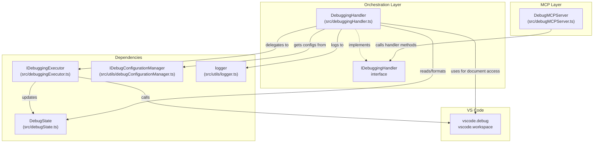
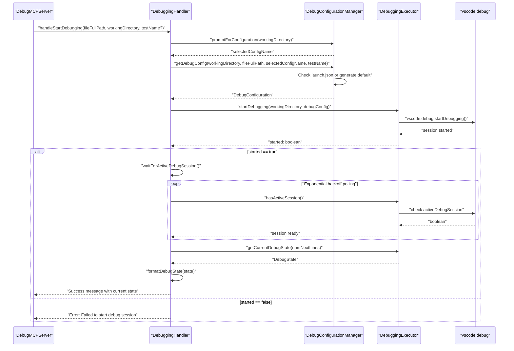
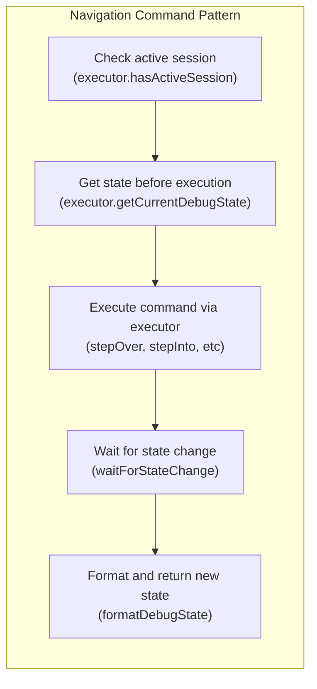
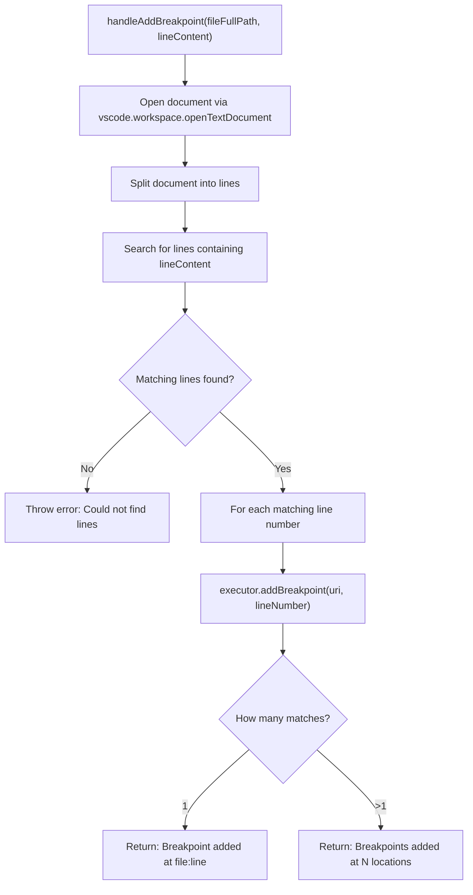
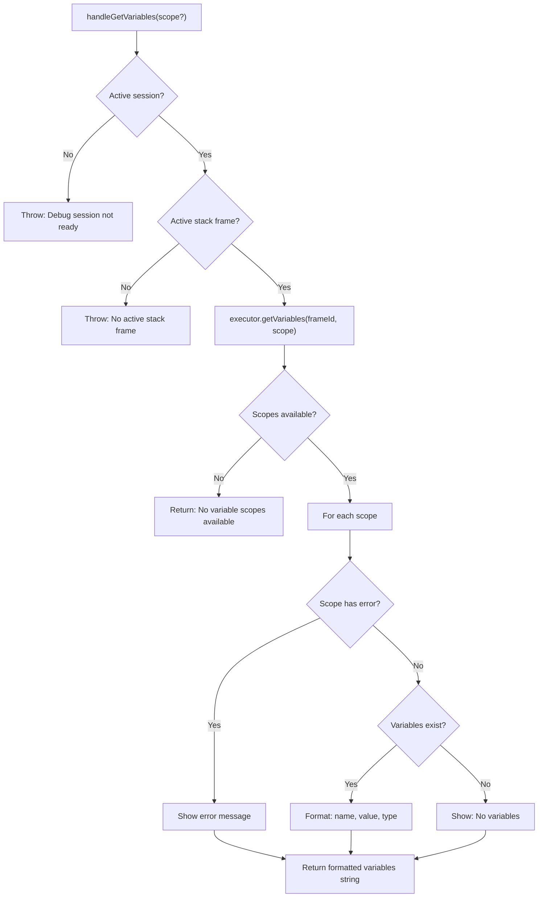

<!-- source: DeepWiki mcp.deepwiki.com · repo microsoft/DebugMCP · page 4.2 Debugging Handler · fetched 2026-10-26 -->

# Debugging Handler

<details>
<summary>Relevant source files</summary>

The following files were used as context for generating this wiki page:

- [docs/architecture/debuggingHandler.md](docs/architecture/debuggingHandler.md)
- [src/debuggingHandler.ts](src/debuggingHandler.ts)

</details>


The Debugging Handler is the orchestration layer in DebugMCP that coordinates all debugging operations between the MCP server and VS Code's Debug API. It implements business logic for debug commands, manages asynchronous state changes with exponential backoff, and formats responses for AI agents.

For implementation details of the VS Code API integration, see [Debugging Executor](#4.3). For configuration management, see [Debug Configuration Manager](#4.4). For information about the MCP tools that invoke these handlers, see [MCP Tools API](#8.1).

## Overview and Responsibilities

The `DebuggingHandler` class in [src/debuggingHandler.ts:31-42]() serves as the central coordinator for all debugging operations. It receives requests from the `DebugMCPServer`, delegates low-level operations to the `DebuggingExecutor`, and manages debug configurations through the `DebugConfigurationManager`.

**Core Responsibilities:**

| Responsibility | Description | Key Methods |
|---------------|-------------|-------------|
| Session Lifecycle | Starting, stopping, and restarting debug sessions | `handleStartDebugging`, `handleStopDebugging`, `handleRestart` |
| Navigation | Stepping through code execution | `handleStepOver`, `handleStepInto`, `handleStepOut`, `handleContinue` |
| Breakpoint Management | Adding, removing, and listing breakpoints | `handleAddBreakpoint`, `handleRemoveBreakpoint`, `handleClearAllBreakpoints`, `handleListBreakpoints` |
| Inspection | Retrieving variables and evaluating expressions | `handleGetVariables`, `handleEvaluateExpression` |
| State Management | Tracking debug state changes and formatting output | `waitForStateChange`, `hasStateChanged`, `formatDebugState` |
| Timeout Management | Implementing exponential backoff for asynchronous operations | `waitForActiveDebugSession`, `waitForStateChange` |

Sources: [src/debuggingHandler.ts:9-26](), [src/debuggingHandler.ts:31-42](), [docs/architecture/debuggingHandler.md:11-17]()

## Architecture and Dependencies

**System Component Interaction**


**Constructor Dependencies:**

The `DebuggingHandler` is constructed with three dependencies injected [src/debuggingHandler.ts:36-42]():

```typescript
constructor(
    private readonly executor: IDebuggingExecutor,
    private readonly configManager: IDebugConfigurationManager,
    timeoutInSeconds: number
)
```

| Parameter | Type | Purpose |
|-----------|------|---------|
| `executor` | `IDebuggingExecutor` | Executes low-level debug operations via VS Code API |
| `configManager` | `IDebugConfigurationManager` | Retrieves and generates debug configurations |
| `timeoutInSeconds` | `number` | Maximum wait time for asynchronous operations |

**Configuration Constants:**

The handler defines key timing constants [src/debuggingHandler.ts:32-34]():

| Constant | Value | Purpose |
|----------|-------|---------|
| `numNextLines` | 3 | Number of subsequent lines to include in debug state |
| `executionDelay` | 300ms | Wait time for debugger updates |
| `timeoutInSeconds` | Constructor parameter | Maximum timeout for state changes and session activation |

Sources: [src/debuggingHandler.ts:31-42](), [docs/architecture/debuggingHandler.md:21-35]()

## Session Management Operations

### Starting Debug Sessions

The `handleStartDebugging` method [src/debuggingHandler.ts:47-85]() orchestrates the complete debug session initialization workflow:

**Debug Session Initialization Flow**


**Key Steps:**

1. **Configuration Selection** [src/debuggingHandler.ts:56](): Prompts user to select a debug configuration.
2. **Configuration Retrieval** [src/debuggingHandler.ts:59-64](): Gets configuration from `launch.json` or generates default via `configManager.getDebugConfig`.
3. **Session Start** [src/debuggingHandler.ts:66](): Delegates to executor to start VS Code debug session.
4. **Active Session Wait** [src/debuggingHandler.ts:69](): Polls with exponential backoff until session is active.
5. **State Retrieval** [src/debuggingHandler.ts:78](): Fetches current debug state and formats response.

Sources: [src/debuggingHandler.ts:47-85](), [docs/architecture/debuggingHandler.md:69]()

### Stopping and Restarting Sessions

**Stop Operation** [src/debuggingHandler.ts:91-104]():
- Validates active session exists using `executor.hasActiveSession()`.
- Delegates to executor's `stopDebugging()`.
- Returns root cause analysis checkpoint message to guide AI agents [src/debuggingHandler.ts:100]().

**Restart Operation** [src/debuggingHandler.ts:224-239]():
- Validates active session exists.
- Calls executor's `restart()` method.
- Waits fixed `executionDelay` (300ms) for restart completion.

Sources: [src/debuggingHandler.ts:91-104](), [src/debuggingHandler.ts:224-239]()

## Navigation Commands

All navigation commands follow a consistent pattern for state change detection:



### State Change Detection Flow

Navigation commands (`handleStepOver`, `handleStepInto`, `handleStepOut`, `handleContinue`) all use the same state change detection mechanism [src/debuggingHandler.ts:127-220]():

| Command | Method | Executor Call | Lines |
|---------|--------|---------------|-------|
| Step Over | `handleStepOver` | `executor.stepOver()` | [src/debuggingHandler.ts:127-145]() |
| Step Into | `handleStepInto` | `executor.stepInto()` | [src/debuggingHandler.ts:150-169]() |
| Step Out | `handleStepOut` | `executor.stepOut()` | [src/debuggingHandler.ts:174-193]() |
| Continue | `handleContinue` | `executor.continue()` | [src/debuggingHandler.ts:198-220]() |

Sources: [src/debuggingHandler.ts:127-220](), [docs/architecture/debuggingHandler.md:39-46]()

### Wait for State Change Implementation

The `waitForStateChange` method [src/debuggingHandler.ts:505-536]() implements exponential backoff polling to detect when the debugger state has changed:

**State Change Polling State Machine**
```mermaid
stateDiagram-v2
    [*] --> "Poll Current State"
    "Poll Current State" --> "Compare States": "getCurrentDebugState()"
    "Compare States" --> "Return New State": "hasStateChanged() == true"
    "Compare States" --> "Check Session": "hasStateChanged() == false"
    "Check Session" --> "Return Inactive": "session not active"
    "Check Session" --> "Check Timeout": "session active"
    "Check Timeout" --> "Return Current": "timeout reached"
    "Check Timeout" --> "Exponential Backoff": "timeout not reached"
    "Exponential Backoff" --> "Poll Current State": "wait with jitter"
    "Return New State" --> [*]
    "Return Inactive" --> [*]
    "Return Current" --> [*]
```

**Key Parameters** [src/debuggingHandler.ts:506-509]():
- `baseDelay`: 1000ms (1 second)
- `maxDelay`: 1000ms (capped at 1 second)
- Jitter: Random 0-200ms added to each delay [src/debuggingHandler.ts:522]()
- Timeout: `timeoutInSeconds * 1000` milliseconds

**State Change Detection Criteria** [src/debuggingHandler.ts:541-584]():

The `hasStateChanged` method compares states based on multiple criteria:

| Criterion | Comparison | Significance |
|-----------|------------|--------------|
| Session Status | `beforeState.sessionActive !== afterState.sessionActive` | Session started/stopped |
| File Path | `beforeState.fileFullPath !== afterState.fileFullPath` | Moved to different file |
| Line Number | `beforeState.currentLine !== afterState.currentLine` | Moved to different line |
| Frame Name | `beforeState.frameName !== afterState.frameName` | Moved to different function |
| Frame ID | `beforeState.frameId !== afterState.frameId` | Internal frame change |
| Location Info | `beforeState.hasLocationInfo() !== afterState.hasLocationInfo()` | Location became available/unavailable |

Sources: [src/debuggingHandler.ts:505-536](), [src/debuggingHandler.ts:541-584](), [docs/architecture/debuggingHandler.md:47-59]()

## Breakpoint Management

### Adding Breakpoints

The `handleAddBreakpoint` method [src/debuggingHandler.ts:244-280]() adds breakpoints by matching line content:



**Key Features:**
- Opens document using `vscode.workspace.openTextDocument()` [src/debuggingHandler.ts:249]().
- Searches all lines for content match using `includes()` [src/debuggingHandler.ts:254-258]().
- Supports multiple matches, adding breakpoints to all matching lines [src/debuggingHandler.ts:267-269]().
- Converts 0-based internal line numbers to 1-based display numbers [src/debuggingHandler.ts:256]().

Sources: [src/debuggingHandler.ts:244-280]()

### Removing and Listing Breakpoints

**Remove Breakpoint** [src/debuggingHandler.ts:285-310]():
- Validates breakpoint exists at specified location.
- Compares URI and line number (converted to 0-based) [src/debuggingHandler.ts:293-299]().
- Returns helpful message if no breakpoint found [src/debuggingHandler.ts:302]().

**List Breakpoints** [src/debuggingHandler.ts:315-338]():
- Retrieves all breakpoints from executor via `executor.getBreakpoints()`.
- Formats each breakpoint with file name and line number.
- Supports both `SourceBreakpoint` and `FunctionBreakpoint` types [src/debuggingHandler.ts:325-331]().

**Clear All Breakpoints** [src/debuggingHandler.ts:109-122]():
- Gets current breakpoint count.
- Calls `executor.clearAllBreakpoints()`.
- Returns count of cleared breakpoints.

Sources: [src/debuggingHandler.ts:109-122](), [src/debuggingHandler.ts:285-338]()

## Inspection Operations

### Variable Retrieval

The `handleGetVariables` method [src/debuggingHandler.ts:343-388]() retrieves variables from the current debug context:

**Variable Inspection Logic**


**Scope Options** [src/debuggingHandler.ts:344]():
- `'local'`: Local variables only.
- `'global'`: Global variables only.
- `'all'`: All scopes (default).

Sources: [src/debuggingHandler.ts:343-388]()

### Expression Evaluation

The `handleEvaluateExpression` method [src/debuggingHandler.ts:393-422]() evaluates arbitrary expressions:

**Validation Steps:**
1. Check active session [src/debuggingHandler.ts:397-399]().
2. Verify active stack frame exists [src/debuggingHandler.ts:401-404]().
3. Call `executor.evaluateExpression(expression, frameId)` [src/debuggingHandler.ts:406]().

Sources: [src/debuggingHandler.ts:393-422]()

## State Management and Formatting

### Debug State Formatting

The `formatDebugState` method [src/debuggingHandler.ts:427-457]() converts `DebugState` objects into human-readable text for AI agents:

**Output Format** [src/debuggingHandler.ts:432-456]():
```
Debug State:
==========

Frame: <frameName>
File: <fileName>
Line: <currentLine>
<currentLine>: <currentLineContent>
```

Sources: [src/debuggingHandler.ts:427-457](), [docs/architecture/debuggingHandler.md:15]()

### Wait for Active Session

The `waitForActiveDebugSession` method [src/debuggingHandler.ts:476-500]() implements exponential backoff polling to wait for a debug session to become active:

**Backoff Parameters** [src/debuggingHandler.ts:477-479]():
| Parameter | Value |
|-----------|-------|
| Base Delay | 1000ms (1 second) |
| Max Delay | 10000ms (10 seconds) |
| Jitter | 0-200ms random |

Sources: [src/debuggingHandler.ts:476-500](), [docs/architecture/debuggingHandler.md:69]()

## Error Handling and Guidance

### Root Cause Analysis Checkpoint

When stopping a debug session, the handler provides a comprehensive guidance message [src/debuggingHandler.ts:589-615]() to encourage thorough debugging:

This message is returned by `handleStopDebugging` [src/debuggingHandler.ts:100]() to guide AI agents toward deeper analysis, prompting them to consider if they found the root cause or just a symptom.

Sources: [src/debuggingHandler.ts:100](), [src/debuggingHandler.ts:589-615](), [docs/architecture/debuggingHandler.md:60-63]()

---

