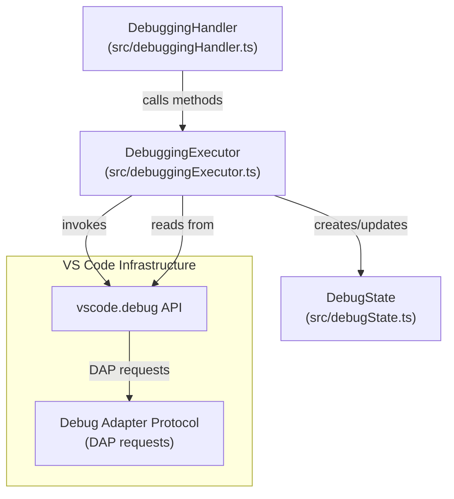
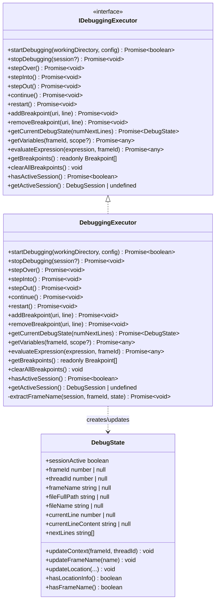
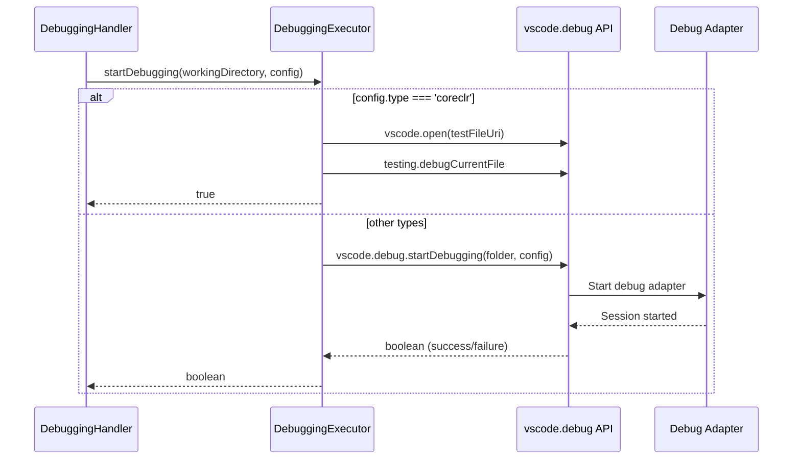
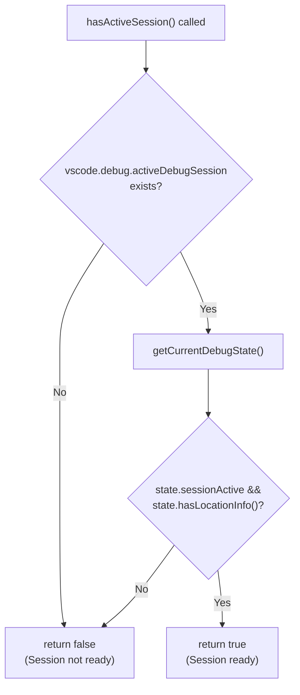
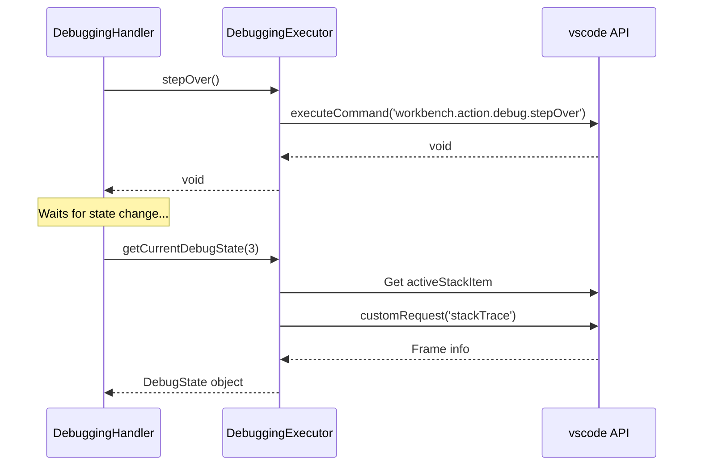

<!-- source: DeepWiki mcp.deepwiki.com · repo microsoft/DebugMCP · page 4.3 Debugging Executor · fetched 2026-10-26 -->

# Debugging Executor

Relevant source files

The following files were used as context for generating this wiki page:

- [docs/architecture/debuggingExecutor.md](docs/architecture/debuggingExecutor.md)
- [src/debuggingExecutor.ts](src/debuggingExecutor.ts)

The Debugging Executor is the lowest-level component in the DebugMCP architecture, serving as the direct interface to the VS Code Debug API. It translates high-level debugging operations into specific VS Code API calls and DAP (Debug Adapter Protocol) requests. This component executes all debugging commands and manages the lifecycle of debug sessions.

For orchestration logic that coordinates multiple executor operations, see [Debugging Handler](4.2). For configuration of debug sessions, see [Debug Configuration Manager](4.4).

## Overview

The `DebuggingExecutor` class implements the `IDebuggingExecutor` interface defined in [src/debuggingExecutor.ts:9-26](). It provides a thin abstraction layer over VS Code's debugging APIs, handling session management, execution control, breakpoint manipulation, and state inspection.

The executor is instantiated by the `DebuggingHandler` and receives commands from it. Unlike the handler, the executor does not implement workflow logic, waiting strategies, or state change detection—it simply executes commands and returns results.

**Sources:** [src/debuggingExecutor.ts:1-346](), [docs/architecture/debuggingExecutor.md:3-18]()

## Architecture

### Component Relationships

**Sources:** [src/debuggingExecutor.ts:31](), [src/debuggingHandler.ts:36-42](), [docs/architecture/debuggingExecutor.md:22-37]()

### Interface Definition

The `IDebuggingExecutor` interface defines 14 methods organized into five functional categories:

| Category | Methods | Purpose |
|----------|---------|---------|
| **Session Management** | `startDebugging`, `stopDebugging`, `hasActiveSession`, `getActiveSession` | Control debug session lifecycle |
| **Execution Control** | `stepOver`, `stepInto`, `stepOut`, `continue`, `restart` | Navigate through code execution |
| **Breakpoint Operations** | `addBreakpoint`, `removeBreakpoint`, `getBreakpoints`, `clearAllBreakpoints` | Manage breakpoints |
| **State Inspection** | `getCurrentDebugState` | Retrieve current execution state |
| **Variable Operations** | `getVariables`, `evaluateExpression` | Inspect and evaluate runtime values |

**Sources:** [src/debuggingExecutor.ts:9-26](), [docs/architecture/debuggingExecutor.md:13-18]()

### Class Structure

**Sources:** [src/debuggingExecutor.ts:9-345](), [src/debugState.ts:1-123]()

## Session Management

### Starting a Debug Session

The `startDebugging` method initiates a new debug session. It handles a special case for C# CoreCLR debugging (`config.type === 'coreclr'`), which requires opening the test file and using a specific VS Code command `testing.debugCurrentFile`.

**Implementation details:**
- [src/debuggingExecutor.ts:36-53]()
- For CoreCLR (C# .NET), opens test file and executes `testing.debugCurrentFile` command [src/debuggingExecutor.ts:41-47]().
- For other languages, invokes `vscode.debug.startDebugging` with workspace folder and config [src/debuggingExecutor.ts:48-49]().
- Returns `true` on success, throws error on failure.

**Sources:** [src/debuggingExecutor.ts:36-53](), [docs/architecture/debuggingExecutor.md:94-101]()

### Stopping a Debug Session

The `stopDebugging` method terminates the current or specified debug session.

**Implementation:**
- [src/debuggingExecutor.ts:58-67]()
- Accepts optional `session` parameter, defaults to `vscode.debug.activeDebugSession` [src/debuggingExecutor.ts:60]().
- Calls `vscode.debug.stopDebugging(activeSession)` [src/debuggingExecutor.ts:62]().

**Sources:** [src/debuggingExecutor.ts:58-67]()

### Checking Session Readiness

The `hasActiveSession` method determines if a debug session is active and ready for operations. A session is considered "ready" when `vscode.debug.activeDebugSession` exists and location info (file name/line number) is available via `getCurrentDebugState`.

**Sources:** [src/debuggingExecutor.ts:318-337](), [docs/architecture/debuggingExecutor.md:61-67]()

## Execution Control

The executor provides methods for controlling code execution. All methods invoke VS Code commands via `vscode.commands.executeCommand`.

| Method | VS Code Command | Purpose |
|--------|-----------------|---------|
| `stepOver()` | `workbench.action.debug.stepOver` | Execute current line, skip function calls |
| `stepInto()` | `workbench.action.debug.stepInto` | Step into function calls |
| `stepOut()` | `workbench.action.debug.stepOut` | Return from current function |
| `continue()` | `workbench.action.debug.continue` | Resume execution until next breakpoint |
| `restart()` | `workbench.action.debug.restart` | Restart debug session from beginning |

**Sources:** [src/debuggingExecutor.ts:72-122](), [docs/architecture/debuggingExecutor.md:41-49]()

## Breakpoint Operations

### Management Logic

- **Add Breakpoint**: Creates a `vscode.SourceBreakpoint` at the specified URI and line (converted to 0-indexed internally). [src/debuggingExecutor.ts:127-136]()
- **Remove Breakpoint**: Filters `vscode.debug.breakpoints` for matching URI and line, then removes them. [src/debuggingExecutor.ts:141-157]()
- **List/Clear**: `getBreakpoints()` returns the global list [src/debuggingExecutor.ts:301-303](), while `clearAllBreakpoints()` removes every active breakpoint [src/debuggingExecutor.ts:308-313]().

**Sources:** [src/debuggingExecutor.ts:127-157](), [src/debuggingExecutor.ts:301-313](), [docs/architecture/debuggingExecutor.md:85-91]()

## State Inspection

### Getting Current Debug State

The `getCurrentDebugState` method captures a snapshot of the debugging context including frame IDs, thread IDs, and source location.

**Data captured:**
1. **Context**: Frame ID and thread ID from `vscode.debug.activeStackItem` [src/debuggingExecutor.ts:171-173]().
2. **Frame name**: Extracted via DAP `stackTrace` request in `extractFrameName` [src/debuggingExecutor.ts:212-230]().
3. **Location**: File name, line number, and line content from `vscode.window.activeTextEditor` [src/debuggingExecutor.ts:179-183]().
4. **Context Lines**: Retrieves `numNextLines` of subsequent code for agent context [src/debuggingExecutor.ts:186-194]().

**Sources:** [src/debuggingExecutor.ts:162-207](), [docs/architecture/debuggingExecutor.md:69-76]()

## Variable Operations

### Variable and Expression Retrieval

The executor uses DAP custom requests for data retrieval:

- **`getVariables(frameId, scope)`**: First requests `scopes` for the frame [src/debuggingExecutor.ts:242](), then requests `variables` for each matching scope [src/debuggingExecutor.ts:259](). It supports filtering by 'local', 'global', or 'all' [src/debuggingExecutor.ts:245-251]().
- **`evaluateExpression(expression, frameId)`**: Sends an `evaluate` request to the DAP with context `'repl'` [src/debuggingExecutor.ts:285-289]().

**Sources:** [src/debuggingExecutor.ts:235-295](), [docs/architecture/debuggingExecutor.md:50-60]()

## Typical Operation Flow

**Sources:** [src/debuggingExecutor.ts:72-78](), [src/debuggingExecutor.ts:162-207](), [src/debuggingHandler.ts:126-145]()

---

