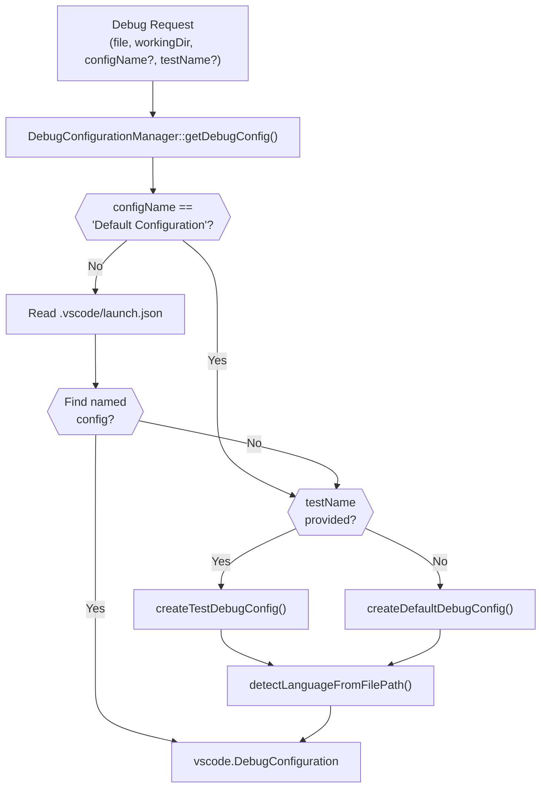
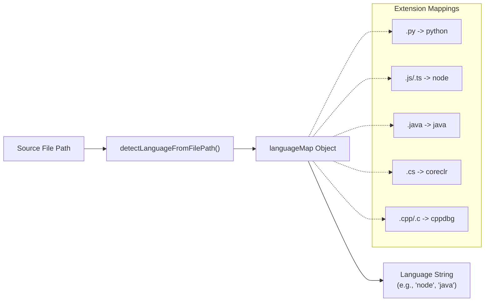
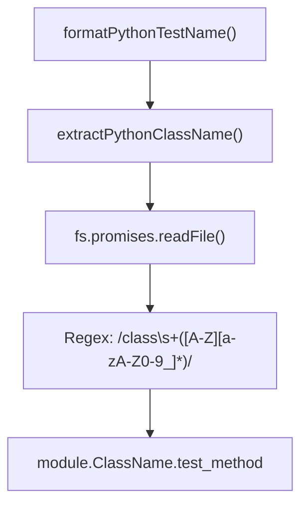
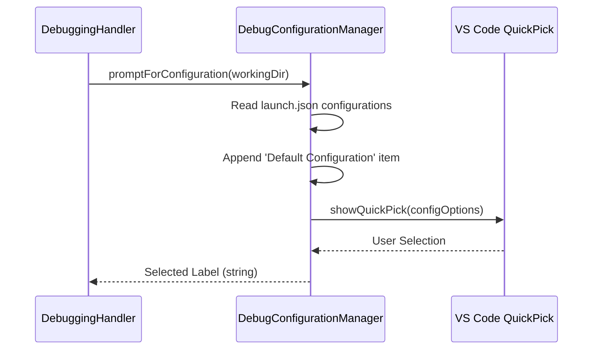
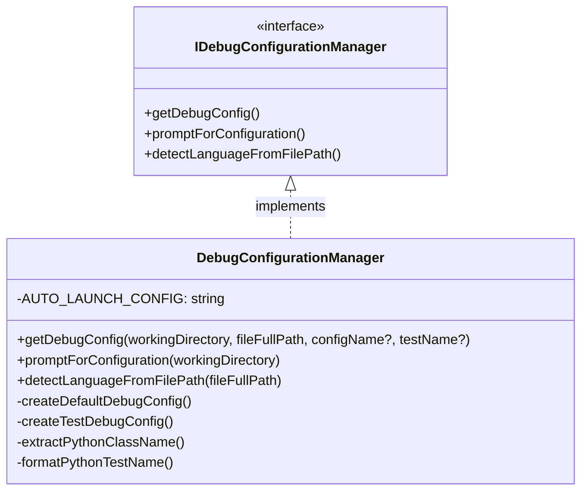

<!-- source: DeepWiki mcp.deepwiki.com · repo microsoft/DebugMCP · page 4.4 Debug Configuration Manager · fetched 2026-10-26 -->

# Debug Configuration Manager

Relevant source files

The following files were used as context for generating this wiki page:

- [docs/architecture/debugConfigurationManager.md](docs/architecture/debugConfigurationManager.md)
- [src/utils/debugConfigurationManager.ts](src/utils/debugConfigurationManager.ts)

## Purpose and Scope

The **Debug Configuration Manager** is responsible for managing debug configurations and determining how to launch debug sessions. It handles language detection, reads from existing `launch.json` files when available, generates appropriate default configurations for nine programming languages, and creates specialized test configurations. This component bridges user intent (debugging a file) with VS Code's debug infrastructure by providing a valid `vscode.DebugConfiguration` object. [src/utils/debugConfigurationManager.ts:22-25]()

For information about how these configurations are used to start debug sessions, see [Session Management](#5.1). For language-specific debugging features, see [Language Support](#6).

**Sources:** [src/utils/debugConfigurationManager.ts:1-456](), [docs/architecture/debugConfigurationManager.md:3-5]()

---

## System Overview

The `DebugConfigurationManager` follows a hierarchy of configuration sources to ensure every debugging request receives a valid configuration:

1.  **Named configurations** from `launch.json` (if specified and found). [src/utils/debugConfigurationManager.ts:54-63]()
2.  **Auto-detected default configuration** (the `AUTO_LAUNCH_CONFIG` heuristic). [src/utils/debugConfigurationManager.ts:36-38]()
3.  **Test-specific configurations** (when a `testName` parameter is provided). [src/utils/debugConfigurationManager.ts:173-176]()

### Request to Configuration Flow

**Sources:** [src/utils/debugConfigurationManager.ts:30-73](), [src/utils/debugConfigurationManager.ts:168-238](), [docs/architecture/debugConfigurationManager.md:22-27]()

---

## Configuration Resolution Strategy

The `getDebugConfig()` method implements a multi-tiered resolution strategy to find the best matching configuration. [src/utils/debugConfigurationManager.ts:30-35]()

### Resolution Logic

1.  **Direct Heuristic**: If `configurationName` is `'Default Configuration'`, it bypasses `launch.json` entirely and generates a default based on file type. [src/utils/debugConfigurationManager.ts:36-38]()
2.  **Launch.json Lookup**: It attempts to read `.vscode/launch.json` using `vscode.workspace.openTextDocument`. [src/utils/debugConfigurationManager.ts:42-43]()
3.  **JSON Sanitization**: Before parsing, it strips C-style comments and removes trailing commas to prevent `JSON.parse` failures. [src/utils/debugConfigurationManager.ts:47-50]()
4.  **Fallback**: If no configuration is found or an error occurs, it falls back to `createDefaultDebugConfig()`. [src/utils/debugConfigurationManager.ts:72]()

### Configuration Hierarchy

| Priority | Source | Condition | Method |
| :--- | :--- | :--- | :--- |
| 1 | Auto-detected default | `configName === 'Default Configuration'` | `createDefaultDebugConfig()` |
| 2 | Named configuration | `configName` provided and found in `launch.json` | Parsed from `launch.json` |
| 3 | Fallback default | Named config not found or file error | `createDefaultDebugConfig()` |

**Sources:** [src/utils/debugConfigurationManager.ts:36-73](), [docs/architecture/debugConfigurationManager.md:65-69]()

---

## Language Detection

The manager detects programming languages from file extensions using a mapping table in `detectLanguageFromFilePath()`. [src/utils/debugConfigurationManager.ts:142-163]()

### Language Mapping Table

| File Extension | Detected Language | Debugger Type |
| :--- | :--- | :--- |
| `.py` | `python` | `python` |
| `.js`, `.ts`, `.jsx`, `.tsx` | `node` | `pwa-node` |
| `.java` | `java` | `java` |
| `.cs` | `coreclr` | `coreclr` |
| `.cpp`, `.cc`, `.c` | `cppdbg` | `cppdbg` |
| `.go` | `go` | `go` |
| `.rs` | `lldb` | `lldb` |
| `.php` | `php` | `php` |
| `.rb` | `ruby` | `ruby` |
| Other | `python` (default) | `python` |

**Sources:** [src/utils/debugConfigurationManager.ts:145-162](), [docs/architecture/debugConfigurationManager.md:28-39]()

---

## Default Debug Configurations

The `createDefaultDebugConfig()` method generates language-specific templates. [src/utils/debugConfigurationManager.ts:168-172]()

### Configuration Templates

| Language | Debug Type | Key Configuration Fields |
| :--- | :--- | :--- |
| **Python** | `python` | `program`, `console: 'integratedTerminal'`, `cwd` |
| **Node.js** | `pwa-node` | `program`, `console: 'integratedTerminal'`, `cwd` |
| **Java** | `java` | `mainClass` (derived from basename), `cwd` |
| **C#** | `coreclr` | `program: 'dotnet'`, `args: ['run']`, `cwd` |
| **C++** | `cppdbg` | `program` (heuristic based on binary name), `MIMode` |

**Sources:** [src/utils/debugConfigurationManager.ts:181-237](), [docs/architecture/debugConfigurationManager.md:14-17]()

---

## Test-Specific Configurations

When a `testName` is provided, `createTestDebugConfig()` generates configurations optimized for test runners. [src/utils/debugConfigurationManager.ts:296-307]()

### Python Test Name Construction

Python tests require special formatting to resolve the class name within the file. [src/utils/debugConfigurationManager.ts:335-343]()

1.  **Heuristic**: It reads the file content to find the first class definition matching `class [A-Z]...`. [src/utils/debugConfigurationManager.ts:349-354]()
2.  **Formatting**: If a class is found, it constructs `module.ClassName.test_method`. Otherwise, it uses `module.test_method`. [src/utils/debugConfigurationManager.ts:323-328]()

**Sources:** [src/utils/debugConfigurationManager.ts:313-330](), [src/utils/debugConfigurationManager.ts:345-363](), [docs/architecture/debugConfigurationManager.md:71-73]()

---

## Configuration Selection UI

The `promptForConfiguration()` method provides an interactive `QuickPick` for users to select from `launch.json` or the auto-detected default. [src/utils/debugConfigurationManager.ts:78-83]()

### QuickPick Logic

-   **Items**: Existing configurations from `launch.json` are listed first, followed by the `AUTO_LAUNCH_CONFIG` option. [src/utils/debugConfigurationManager.ts:106-119]()
-   **Cancellation**: If the user cancels the picker, an error is thrown to stop the debug flow. [src/utils/debugConfigurationManager.ts:127-130]()

**Sources:** [src/utils/debugConfigurationManager.ts:102-132](), [docs/architecture/debugConfigurationManager.md:50-54]()

---

## Implementation Details

### Class Structure

### Key Methods

| Method | Description |
| :--- | :--- |
| `getAvailableConfigurations()` | Returns an array of configuration names from `launch.json`. [src/utils/debugConfigurationManager.ts:282-290]() |
| `hasLaunchJson()` | Checks for the existence of `.vscode/launch.json`. [src/utils/debugConfigurationManager.ts:256-277]() |
| `validateWorkspace()` | Checks if the workspace is valid for debugging operations. [src/utils/debugConfigurationManager.ts:243-251]() |

**Sources:** [src/utils/debugConfigurationManager.ts:10-19](), [src/utils/debugConfigurationManager.ts:24-456]()

---

