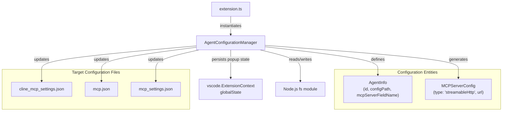
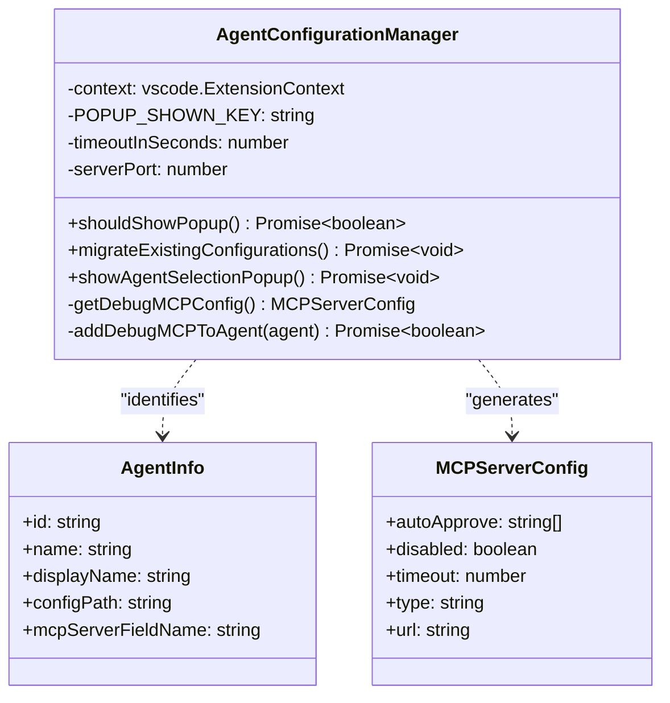

<!-- source: DeepWiki mcp.deepwiki.com · repo microsoft/DebugMCP · page 4.5 Agent Configuration Manager · fetched 2026-10-26 -->

# Agent Configuration Manager

<details>
<summary>Relevant source files</summary>

The following files were used as context for generating this wiki page:

- [docs/architecture/agentConfigurationManager.md](docs/architecture/agentConfigurationManager.md)
- [src/utils/agentConfigurationManager.ts](src/utils/agentConfigurationManager.ts)

</details>


The Agent Configuration Manager is responsible for automatically detecting supported AI agents and configuring them to connect to the DebugMCP server. It handles cross-platform file system paths, manages configuration file formats for different agents, and provides both automatic (first-run popup) and manual (command palette) configuration workflows. 

A key responsibility of this component is the migration from legacy SSE/HTTP transport types to the modern `streamableHttp` transport required by the current server implementation.

## Purpose and Responsibilities

The `AgentConfigurationManager` class serves four primary functions:

1.  **Agent Detection**: Identifies which AI agents (Cline, GitHub Copilot, Cursor) are installed on the system by checking for their configuration directories [src/utils/agentConfigurationManager.ts:118-149]().
2.  **Configuration Writing**: Creates or updates agent-specific configuration files to register the DebugMCP server using the `streamableHttp` transport type [src/utils/agentConfigurationManager.ts:154-162]().
3.  **Legacy Migration**: Automatically detects and upgrades old `sse` or `http` configurations to `streamableHttp` [src/utils/agentConfigurationManager.ts:168-211]().
4.  **User Interaction**: Presents configuration options through VS Code quick pick UI and tracks whether configuration has been completed [src/utils/agentConfigurationManager.ts:49-60]().

Sources: [src/utils/agentConfigurationManager.ts:8-211]()

## Architecture and Integration

### Component Structure



**Diagram: Agent Configuration Manager Component Structure**

The manager is instantiated with the extension context, timeout settings, and server port. It uses these values to construct the `streamableHttp` URL used by agents to communicate with the MCP server.

Sources: [src/utils/agentConfigurationManager.ts:24-35](), [src/utils/agentConfigurationManager.ts:154-162]()

### Data Structures



**Diagram: AgentConfigurationManager Class Structure**

The `AgentInfo` interface maps an agent to its specific configuration file and the JSON key (e.g., `mcpServers` or `servers`) used to store MCP definitions.

Sources: [src/utils/agentConfigurationManager.ts:8-22](), [src/utils/agentConfigurationManager.ts:24-35]()

## Supported Agents

The manager supports three AI agents, each with specific configuration requirements:

| Agent | ID | Config File | MCP Field Name |
| :--- | :--- | :--- | :--- |
| **Cline** | `cline` | `cline_mcp_settings.json` | `mcpServers` |
| **GitHub Copilot** | `copilot` | `mcp.json` | `servers` |
| **Cursor** | `cursor` | `mcp_settings.json` | `mcpServers` |

Sources: [src/utils/agentConfigurationManager.ts:124-146]()

### Cross-Platform Path Resolution

The `getConfigBasePath()` method resolves the root configuration directory based on the operating system:

*   **Windows**: `%APPDATA%` or `~/AppData/Roaming` [src/utils/agentConfigurationManager.ts:102-103]()
*   **macOS**: `~/Library/Application Support` [src/utils/agentConfigurationManager.ts:104-105]()
*   **Linux**: `$XDG_CONFIG_HOME` or `~/.config` [src/utils/agentConfigurationManager.ts:106-107]()

Sources: [src/utils/agentConfigurationManager.ts:97-113]()

## Configuration Migration (SSE to Streamable HTTP)

A critical feature is the `migrateExistingConfigurations()` method. It scans all supported agent config files for legacy DebugMCP entries and updates them to the `streamableHttp` transport.

### Migration Logic
1.  Iterate through all agents in `getSupportedAgents()` [src/utils/agentConfigurationManager.ts:172]().
2.  Check if `debugmcp` exists in the agent's MCP server field [src/utils/agentConfigurationManager.ts:188]().
3.  Identify if `type` is `sse` or `http`, or if the URL ends in `/sse` [src/utils/agentConfigurationManager.ts:195-198]().
4.  If migration is needed, overwrite the entry with the result of `getDebugMCPConfig()` [src/utils/agentConfigurationManager.ts:204-205]().

Sources: [src/utils/agentConfigurationManager.ts:168-211]()

## Configuration Workflows

### Automatic Configuration (First Run)

On extension activation, the system checks `globalState` for `debugmcp.popupShown` [src/utils/agentConfigurationManager.ts:40-44](). If false, it triggers `showAgentSelectionPopup()` which:
1.  Retrieves supported agents [src/utils/agentConfigurationManager.ts:51]().
2.  Displays a multi-select QuickPick [src/utils/agentConfigurationManager.ts:228-243]().
3.  Calls `addDebugMCPToAgent()` for each selection [src/utils/agentConfigurationManager.ts:247-251]().

Sources: [src/utils/agentConfigurationManager.ts:40-60](), [src/utils/agentConfigurationManager.ts:214-258]()

### Manual Configuration

Users can trigger `showManualConfiguration()` via the command palette to force-update or add DebugMCP to a specific agent.

Sources: [src/utils/agentConfigurationManager.ts:72-92]()

## Generated Configuration Structure

The manager produces a standard MCP server configuration object:

```json
{
  "autoApprove": [],
  "disabled": false,
  "timeout": 180,
  "type": "streamableHttp",
  "url": "http://localhost:3001/mcp"
}
```

The `type` is hardcoded to `streamableHttp` to support the custom transport implemented in the DebugMCP server [src/utils/agentConfigurationManager.ts:159]().

Sources: [src/utils/agentConfigurationManager.ts:154-162]()

## Error Handling and State

*   **Persistence**: Uses `vscode.ExtensionContext.globalState` to ensure the onboarding popup only appears once [src/utils/agentConfigurationManager.ts:42]().
*   **Robust Parsing**: When reading existing JSON files, the manager uses try-catch blocks to handle malformed JSON, falling back to a fresh configuration if parsing fails [src/utils/agentConfigurationManager.ts:180-185]().
*   **Directory Management**: Uses `fs.promises.mkdir(..., { recursive: true })` to ensure the target configuration path exists before writing [src/utils/agentConfigurationManager.ts:265]().

Sources: [src/utils/agentConfigurationManager.ts:24-286]()

---

