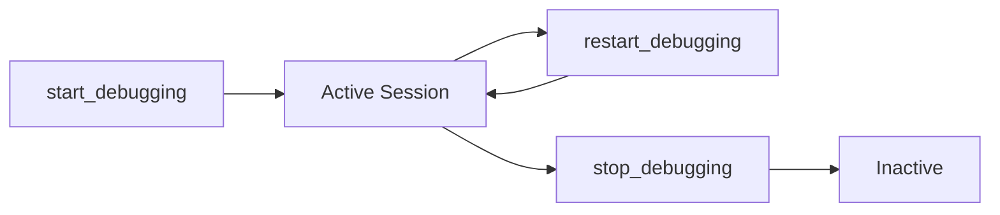
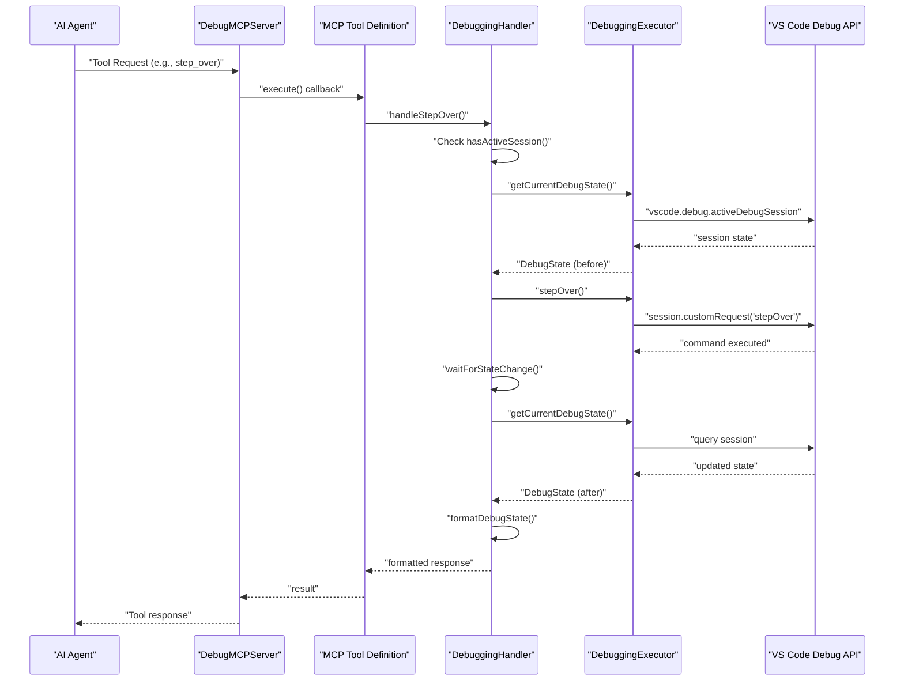
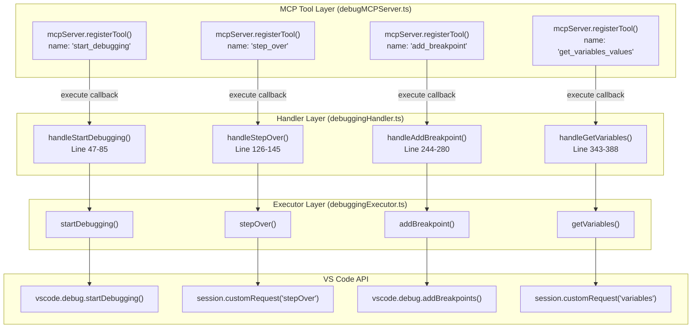
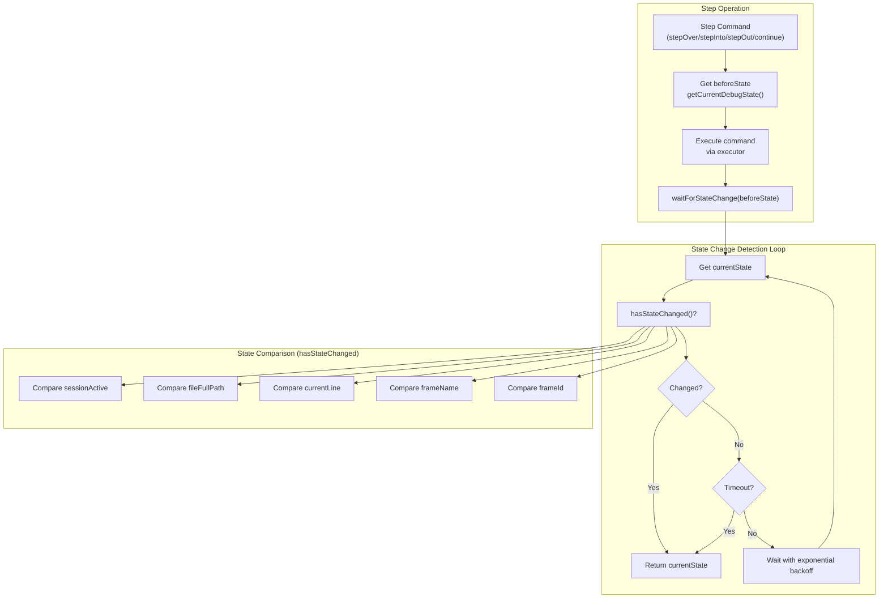
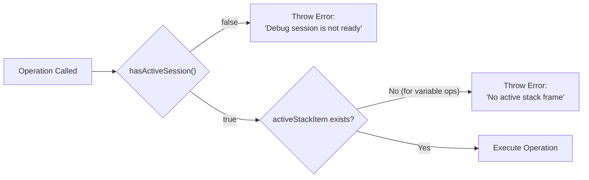

<!-- source: DeepWiki mcp.deepwiki.com · repo microsoft/DebugMCP · page 5 Debugging Operations · fetched 2026-10-26 -->

# Debugging Operations

<details>
<summary>Relevant source files</summary>

The following files were used as context for generating this wiki page:

- [README.md](README.md)
- [assets/DebugMCP.webp](assets/DebugMCP.webp)
- [assets/architecture.png](assets/architecture.png)
- [src/debugMCPServer.ts](src/debugMCPServer.ts)

</details>


## Purpose and Scope

This page provides a comprehensive guide to all debugging operations available through the DebugMCP tools. It covers the complete set of 13 debugging tools exposed by the system, their parameters, execution flow, and how they interact with the VS Code Debug API.

For implementation details of specific operation categories, see:
- Session lifecycle operations: [Session Management](#5.1)
- Breakpoint operations: [Breakpoint Management](#5.2)
- Step operations: [Code Navigation](#5.3)
- Variable retrieval: [Variable Inspection](#5.4)
- Expression evaluation: [Expression Evaluation](#5.5)

For the orchestration layer that implements these operations, see [Debugging Handler](#4.2).

---

## Available Operations Overview

DebugMCP exposes 13 debugging tools through the MCP protocol. Each tool is registered in `DebugMCPServer` and delegates execution to `DebuggingHandler`, which orchestrates the operation using `DebuggingExecutor`.

### Complete Tool Reference

| Tool Name | Handler Method | Purpose | Requires Active Session |
|-----------|---------------|---------|------------------------|
| `start_debugging` | `handleStartDebugging()` | Start a debug session for a file | No |
| `stop_debugging` | `handleStopDebugging()` | Stop the current debug session | Yes |
| `step_over` | `handleStepOver()` | Execute current line without entering functions | Yes |
| `step_into` | `handleStepInto()` | Step into function calls | Yes |
| `step_out` | `handleStepOut()` | Exit current function | Yes |
| `continue_execution` | `handleContinue()` | Resume until next breakpoint | Yes |
| `restart_debugging` | `handleRestart()` | Restart session with same configuration | Yes |
| `add_breakpoint` | `handleAddBreakpoint()` | Set breakpoint at specified line content | No |
| `remove_breakpoint` | `handleRemoveBreakpoint()` | Remove breakpoint at specific line number | No |
| `clear_all_breakpoints` | `handleClearAllBreakpoints()` | Remove all breakpoints | No |
| `list_breakpoints` | `handleListBreakpoints()` | Display all active breakpoints | No |
| `get_variables_values` | `handleGetVariables()` | Retrieve variable values in scope | Yes |
| `evaluate_expression` | `handleEvaluateExpression()` | Evaluate arbitrary expression | Yes |

Sources: [src/debugMCPServer.ts:71-219](), [src/debuggingHandler.ts:12-26]()

---

## Operation Categories

### Session Control Operations

Operations that manage the debug session lifecycle:



**Key Methods:**
- `handleStartDebugging()` at [src/debuggingHandler.ts:47-85]()
- `handleStopDebugging()` at [src/debuggingHandler.ts:90-103]()
- `handleRestart()` at [src/debuggingHandler.ts:224-239]()

### Execution Control Operations

Operations that control code execution flow during an active debug session:

| Operation | Behavior | Use Case |
|-----------|----------|----------|
| `step_over` | Execute current line, skip function internals | Fast execution through known code |
| `step_into` | Enter function calls | Investigate function implementation |
| `step_out` | Complete current function, return to caller | Exit deep call stack |
| `continue_execution` | Run until next breakpoint or completion | Skip to areas of interest |

### Breakpoint Operations

Operations for managing breakpoints:

| Operation | Parameters | Returns |
|-----------|-----------|---------|
| `add_breakpoint` | `fileFullPath`, `lineContent` | Confirmation with line number(s) |
| `remove_breakpoint` | `fileFullPath`, `line` | Confirmation or not found message |
| `clear_all_breakpoints` | None | Count of cleared breakpoints |
| `list_breakpoints` | None | Formatted list of all breakpoints |

Sources: [src/debuggingHandler.ts:244-338]()

### Inspection Operations

Operations for examining program state:

- **`get_variables_values`**: Retrieves variables from local, global, or all scopes. [src/debugMCPServer.ts:198-207]()
- **`evaluate_expression`**: Evaluates arbitrary expressions in the current debug context. [src/debugMCPServer.ts:210-219]()

Sources: [src/debuggingHandler.ts:343-422]()

---

## Operation Execution Flow

### Tool Invocation to Handler Delegation



**Key Implementation Details:**

1. **Tool Definition**: [src/debugMCPServer.ts:108-113]() - `step_over` tool registration
2. **Handler Method**: [src/debuggingHandler.ts:126-145]() - `handleStepOver()` implementation
3. **Executor Call**: Delegates to `IDebuggingExecutor.stepOver()`
4. **State Detection**: [src/debuggingHandler.ts:505-536]() - `waitForStateChange()` with exponential backoff

Sources: [src/debugMCPServer.ts:71-220](), [src/debuggingHandler.ts:126-145]()

---

## Code Entity Mapping: Tools to Implementation

### Tool Registration Architecture



**Tool-to-Code Mapping Table:**

| MCP Tool | Registration Line | Handler Method | Handler Line Range |
|----------|------------------|----------------|-------------------|
| `start_debugging` | [src/debugMCPServer.ts:71-97]() | `handleStartDebugging()` | [src/debuggingHandler.ts:47-85]() |
| `stop_debugging` | [src/debugMCPServer.ts:100-105]() | `handleStopDebugging()` | [src/debuggingHandler.ts:90-103]() |
| `step_over` | [src/debugMCPServer.ts:108-113]() | `handleStepOver()` | [src/debuggingHandler.ts:126-145]() |
| `step_into` | [src/debugMCPServer.ts:116-121]() | `handleStepInto()` | [src/debuggingHandler.ts:150-169]() |
| `step_out` | [src/debugMCPServer.ts:124-129]() | `handleStepOut()` | [src/debuggingHandler.ts:174-193]() |
| `continue_execution` | [src/debugMCPServer.ts:132-137]() | `handleContinue()` | [src/debuggingHandler.ts:198-219]() |
| `restart_debugging` | [src/debugMCPServer.ts:140-145]() | `handleRestart()` | [src/debuggingHandler.ts:224-239]() |
| `add_breakpoint` | [src/debugMCPServer.ts:148-164]() | `handleAddBreakpoint()` | [src/debuggingHandler.ts:244-280]() |
| `remove_breakpoint` | [src/debugMCPServer.ts:167-177]() | `handleRemoveBreakpoint()` | [src/debuggingHandler.ts:285-310]() |
| `clear_all_breakpoints` | [src/debugMCPServer.ts:180-186]() | `handleClearAllBreakpoints()` | [src/debuggingHandler.ts:108-121]() |
| `list_breakpoints` | [src/debugMCPServer.ts:189-195]() | `handleListBreakpoints()` | [src/debuggingHandler.ts:315-338]() |
| `get_variables_values` | [src/debugMCPServer.ts:198-207]() | `handleGetVariables()` | [src/debuggingHandler.ts:343-388]() |
| `evaluate_expression` | [src/debugMCPServer.ts:210-219]() | `handleEvaluateExpression()` | [src/debuggingHandler.ts:393-422]() |

Sources: [src/debugMCPServer.ts:71-220](), [src/debuggingHandler.ts:47-422]()

---

## State Management During Operations

### State Change Detection Flow



**State Change Detection Implementation:**

The `waitForStateChange()` method at [src/debuggingHandler.ts:505-536]() implements exponential backoff polling:

- **Base delay**: 1000ms
- **Max delay**: 1000ms (no growth in this case)
- **Jitter**: Up to 200ms added randomly
- **Timeout**: Configurable via `timeoutInSeconds` (default 180 seconds)

**State Comparison Logic** at [src/debuggingHandler.ts:541-584]():

| Comparison | Indicates Change? | Implementation |
|------------|------------------|----------------|
| `sessionActive` status changed | Yes | Line 547-549 |
| Session became inactive | Yes | Line 551-554 |
| Different `fileFullPath` | Yes | Line 563-565 |
| Different `currentLine` | Yes | Line 567-570 |
| Different `frameName` | Yes | Line 572-575 |
| Different `frameId` | Yes | Line 577-580 |

Sources: [src/debuggingHandler.ts:505-584]()

---

## Session Validation Patterns

### Active Session Requirements

Operations that require an active debug session implement validation at the handler level:



**Implementation Examples:**

- **Step Operations**: [src/debuggingHandler.ts:128-130]() - Check session before executing
- **Variable Inspection**: [src/debuggingHandler.ts:347-354]() - Check session AND stack frame
- **Expression Evaluation**: [src/debuggingHandler.ts:397-404]() - Check session AND stack frame

**Session Check Delegation:**

Handler calls `executor.hasActiveSession()` which checks `vscode.debug.activeDebugSession` existence.

Sources: [src/debuggingHandler.ts:128-130, 347-354, 397-404]()

---

## Response Formatting

### Debug State Formatting

All stepping operations return formatted debug state via `formatDebugState()` at [src/debuggingHandler.ts:427-457]():

**Output Structure:**
```
Debug State:
==========

Frame: <frameName>
File: <fileName>
Line: <currentLine>
<currentLine>: <currentLineContent>
```

**Conditional Content:**
- Frame name included if `state.hasFrameName()` returns true
- Location info included if `state.hasLocationInfo()` returns true
- Fallback message if session inactive or no location available

### Variable Formatting

The `handleGetVariables()` method at [src/debuggingHandler.ts:362-382]() formats variable output:

```
Variables:
==========

<Scope Name>:
  <variable1>: <value1> (<type1>)
  <variable2>: <value2> (<type2>)

<Scope Name 2>:
  ...
```

**Scope Handling:**
- Iterates through all scopes in `variablesData.scopes`
- Shows scope name, variables with values and types
- Displays error message if scope retrieval fails
- Shows "No variables in this scope" for empty scopes

### Breakpoint List Formatting

The `handleListBreakpoints()` method at [src/debuggingHandler.ts:323-332]() formats breakpoints:

```
Active Breakpoints:
1. <fileName>:<line>
2. <fileName>:<line>
```

- Extracts filename from full path
- Converts 0-based to 1-based line numbers
- Handles both `SourceBreakpoint` and `FunctionBreakpoint` types

Sources: [src/debuggingHandler.ts:323-332, 362-382, 427-457]()

---

## Error Handling

### Error Propagation Pattern

All handler methods follow a consistent error handling pattern:

```typescript
try {
    // Validate preconditions
    // Execute operation
    // Format response
    return response;
} catch (error) {
    throw new Error(`Error <operation name>: ${error}`);
}
```

**Implementation Locations:**

| Operation | Error Handler | Location |
|-----------|--------------|----------|
| Start Debugging | `catch` block with context | [src/debuggingHandler.ts:82-84]() |
| Stop Debugging | `catch` block with context | [src/debuggingHandler.ts:100-102]() |
| Step Over | `catch` block with context | [src/debuggingHandler.ts:142-144]() |
| Add Breakpoint | `catch` block with context | [src/debuggingHandler.ts:277-279]() |
| Get Variables | `catch` block with context | [src/debuggingHandler.ts:385-387]() |
| Evaluate Expression | `catch` block with context | [src/debuggingHandler.ts:419-421]() |

### Common Error Scenarios

| Error Condition | Checked By | Thrown Error Message |
|----------------|-----------|---------------------|
| No active session (stepping) | `hasActiveSession()` | "Debug session is not ready. Please wait for initialization to complete." |
| No active session (variables) | `hasActiveSession()` | "Debug session is not ready. Start debugging first and ensure execution is paused." |
| No stack frame | `activeStackItem` check | "No active stack frame. Make sure execution is paused at a breakpoint." |
| Session activation timeout | `waitForActiveDebugSession()` | "Debug session started but failed to become active within timeout period" |
| Start failure | `startDebugging()` returns false | "Failed to start debug session. Make sure the appropriate language extension is installed." |

Sources: [src/debuggingHandler.ts:70-84, 128-130, 347-354]()

---

## Special Operation Behaviors

### Breakpoint Line Matching

The `handleAddBreakpoint()` method at [src/debuggingHandler.ts:244-280]() uses content-based line matching:

1. Opens document via `vscode.workspace.openTextDocument()`
2. Splits document into lines
3. Searches for all lines containing `lineContent` parameter
4. Adds breakpoints to **all matching lines**
5. Returns success message listing all line numbers

This allows setting multiple breakpoints when the same code pattern appears on multiple lines.

### Session Activation Waiting

The `waitForActiveDebugSession()` method at [src/debuggingHandler.ts:476-500]() uses exponential backoff:

- **Base delay**: 1000ms (1 second)
- **Max delay**: 10000ms (10 seconds)
- **Backoff calculation**: `Math.min(baseDelay * Math.pow(2, attempt), maxDelay)`
- **Jitter**: Adds up to 200ms random delay
- **Logging**: Logs each attempt for debugging

This ensures robust session activation even when debugger initialization is slow.

### Root Cause Analysis Reminder

The `handleStopDebugging()` method at [src/debuggingHandler.ts:99]() appends a special message via `getRootCauseAnalysisCheckpointMessage()` at [src/debuggingHandler.ts:589-615]() to remind AI agents to verify they found the root cause, not just a symptom.

Sources: [src/debuggingHandler.ts:244-280, 476-500, 589-615]()

---

## Configuration and Timeouts

### Operation Timeout Configuration

The `DebuggingHandler` constructor at [src/debuggingHandler.ts:36-42]() accepts `timeoutInSeconds` parameter, which controls:

- Session activation timeout in `waitForActiveDebugSession()`
- State change detection timeout in `waitForStateChange()`

**Default Value**: 180 seconds (configured in extension settings)

**Configuration Source**: [README.md:174]() shows `debugmcp.timeoutInSeconds` setting

### Execution Delay

Constant `executionDelay` at [src/debuggingHandler.ts:33]() set to 300ms:
- Used after restart operation to allow debugger to stabilize
- Applied in `handleRestart()` at [src/debuggingHandler.ts:233]()

### Context Lines

Constant `numNextLines` at [src/debuggingHandler.ts:32]() set to 3:
- Determines how many lines after current position to retrieve
- Passed to `getCurrentDebugState()` calls
- Provides execution context in formatted output

Sources: [src/debuggingHandler.ts:32-42](), [README.md:174]()

---

