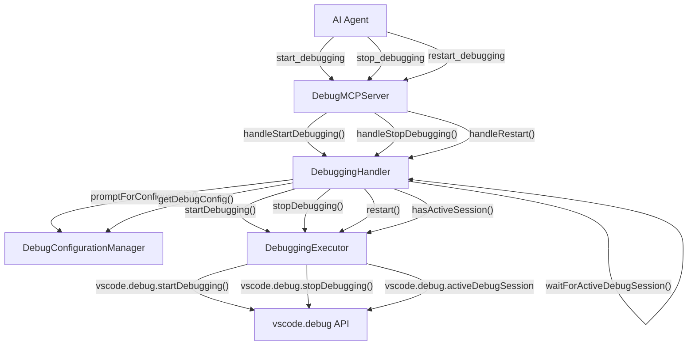
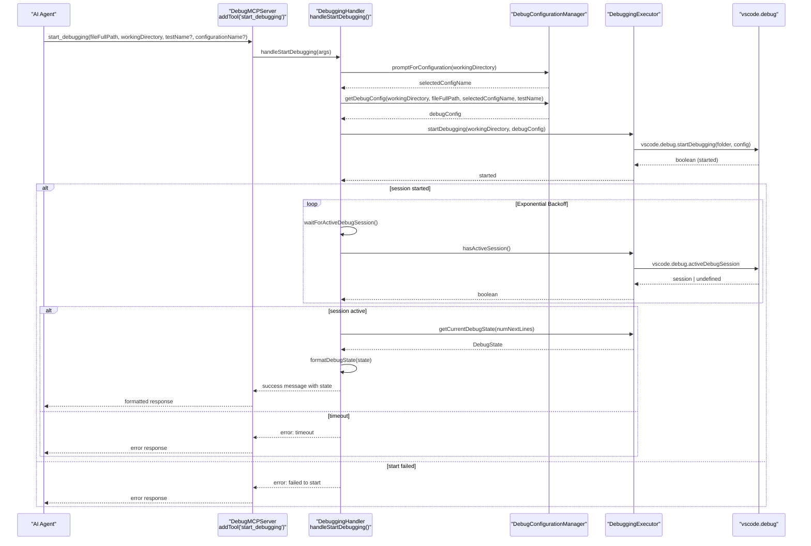
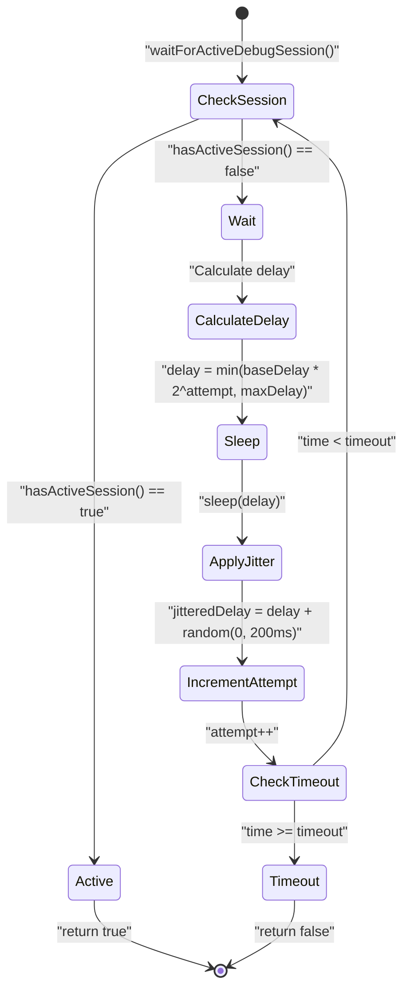
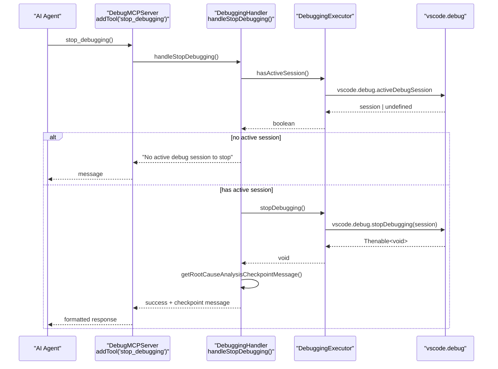
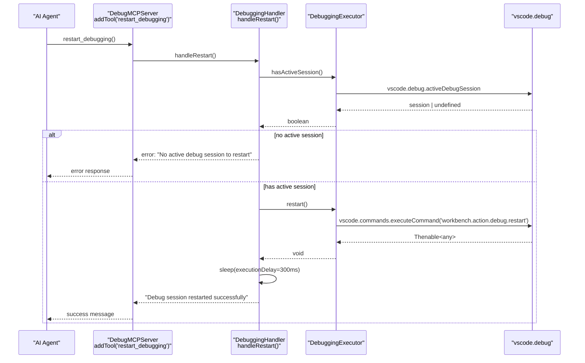
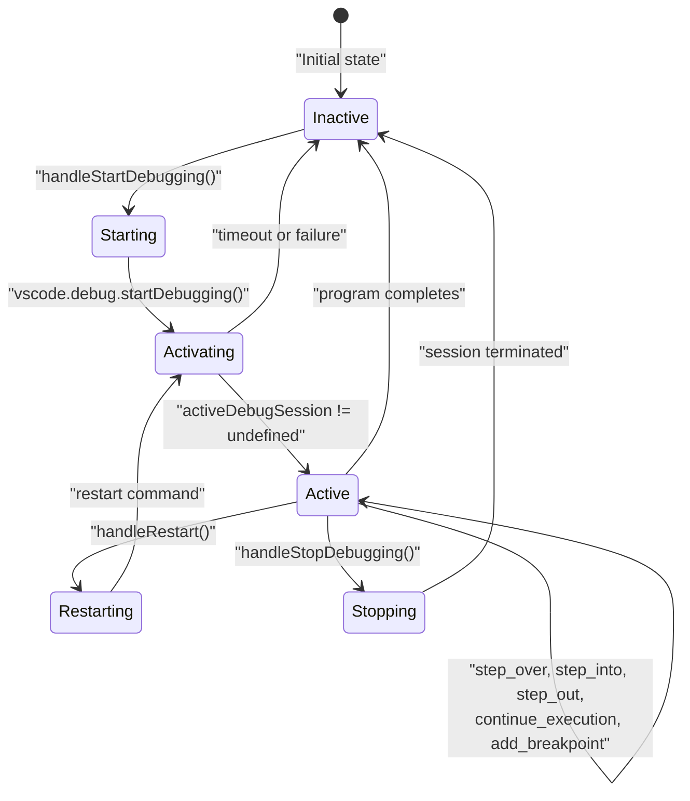

<!-- source: DeepWiki mcp.deepwiki.com · repo microsoft/DebugMCP · page 5.1 Session Management · fetched 2026-10-26 -->

# Session Management

<details>
<summary>Relevant source files</summary>

The following files were used as context for generating this wiki page:

- [src/debuggingHandler.ts](src/debuggingHandler.ts)

</details>


## Purpose and Scope

This document describes the debugging session lifecycle operations in DebugMCP: starting, stopping, and restarting debug sessions. These operations form the foundation of all debugging workflows, controlling when code execution begins under debugger control and when it ends.

For information about code navigation operations during an active session, see [5.3 Code Navigation](). For breakpoint operations that control where execution pauses, see [5.2 Breakpoint Management]().

## Overview

Session management in DebugMCP controls the lifecycle of debug sessions through three primary operations exposed as MCP tools. The system handles configuration selection, session activation waiting with exponential backoff, and state tracking to ensure reliable debugging workflows.

**Session Management Architecture**



Sources: [src/debugMCPServer.ts:76-151](), [src/debuggingHandler.ts:12-26](), [src/debuggingExecutor.ts:40-100]()

## Starting a Debug Session

The `start_debugging` tool initiates a debug session for a specified source file. This is typically the first operation in any debugging workflow.

### Tool Interface

| Parameter | Type | Required | Description |
|-----------|------|----------|-------------|
| `fileFullPath` | string | Yes | Full path to the source code file to debug |
| `workingDirectory` | string | Yes | Working directory for the debug session |
| `testName` | string | No | Name of specific test to debug |
| `configurationName`| string | No | Name of the configuration to use from launch.json |

Sources: [src/debugMCPServer.ts:78-97](), [src/debuggingHandler.ts:47-52]()

### Start Debugging Flow

**Start Debugging Sequence**



Sources: [src/debuggingHandler.ts:47-85](), [src/debugMCPServer.ts:78-97](), [src/debuggingExecutor.ts:60-80]()

### Configuration Selection

Before starting, the system selects a debug configuration. If `configurationName` is not provided in the tool arguments, it calls `DebugConfigurationManager.promptForConfiguration()`. This either uses an existing configuration from `launch.json` or generates a default configuration via `getDebugConfig()`.

Sources: [src/debuggingHandler.ts:55-64](), [src/utils/debugConfigurationManager.ts:48-112]()

### Session Activation Waiting

After calling `vscode.debug.startDebugging()`, the session may not be immediately active. The `DebuggingHandler` implements `waitForActiveDebugSession()` using exponential backoff to wait for activation.

**Exponential Backoff Algorithm**



| Parameter | Value | Description |
|-----------|-------|-------------|
| `baseDelay` | 1000 ms | Initial delay between checks |
| `maxDelay` | 10000 ms | Maximum delay cap |
| `jitter` | 0-200 ms | Random delay added to prevent thundering herd |
| `timeout` | `this.timeoutInSeconds * 1000` | Maximum total wait time |

Sources: [src/debuggingHandler.ts:476-500]()

### Return Value

On success, returns a formatted string containing:
- File path being debugged
- Configuration name used (or "default configuration")
- Test name (if specified)
- Current debug state (file, line, frame) via `executor.getCurrentDebugState()`

Sources: [src/debuggingHandler.ts:75-79]()

## Stopping a Debug Session

The `stop_debugging` tool terminates the active debug session.

### Tool Interface

No parameters required.

Sources: [src/debugMCPServer.ts:100-106]()

### Stop Debugging Flow

**Stop Debugging Process**



Sources: [src/debuggingHandler.ts:90-104](), [src/debuggingExecutor.ts:82-90]()

### Root Cause Analysis Checkpoint

When stopping a session, the handler appends a root cause analysis checkpoint message to remind the agent to verify they found the actual cause rather than just a symptom. This is generated by `getRootCauseAnalysisCheckpointMessage()`.

Sources: [src/debuggingHandler.ts:99-100](), [src/debuggingHandler.ts:589-615]()

## Restarting a Debug Session

The `restart_debugging` tool restarts the current debug session from the beginning with the same configuration.

### Tool Interface

No parameters required. Uses the active session's configuration.

Sources: [src/debugMCPServer.ts:144-151]()

### Restart Flow

**Restart Debugging Process**



Sources: [src/debuggingHandler.ts:224-239](), [src/debuggingExecutor.ts:92-95]()

### Restart Delay

After issuing the restart command, the handler waits 300ms (`executionDelay`) for the debugger to stabilize before returning. This fixed delay differs from the exponential backoff used during initial session activation.

Sources: [src/debuggingHandler.ts:33](), [src/debuggingHandler.ts:233]()

## Session State Tracking

### Session Lifecycle States

**Debug Session State Machine**



Sources: [src/debuggingHandler.ts:47-239](), [src/debuggingExecutor.ts:40-100]()

### Active Session Detection

The `hasActiveSession()` method in `DebuggingExecutor` checks whether a debug session is currently active by querying `vscode.debug.activeDebugSession`.

```typescript
public async hasActiveSession(): Promise<boolean> {
    return vscode.debug.activeDebugSession !== undefined;
}
```

This check is performed by the handler before most debugging operations to ensure the session is ready.

Sources: [src/debuggingExecutor.ts:40-42](), [src/debuggingHandler.ts:469-471]()

## Implementation Details

### Key Classes and Methods

| Class | Method | Purpose |
|-------|--------|---------|
| `DebugMCPServer` | `setupTools()` | Registers MCP tools for session management |
| `DebuggingHandler` | `handleStartDebugging()` | Orchestrates debug session startup |
| `DebuggingHandler` | `handleStopDebugging()` | Orchestrates debug session shutdown |
| `DebuggingHandler` | `handleRestart()` | Orchestrates debug session restart |
| `DebuggingHandler` | `waitForActiveDebugSession()` | Implements exponential backoff for activation |
| `DebuggingExecutor` | `startDebugging()` | Calls VS Code debug API |
| `DebuggingExecutor` | `stopDebugging()` | Calls VS Code debug API |
| `DebuggingExecutor` | `restart()` | Executes restart command |
| `DebuggingExecutor` | `hasActiveSession()` | Checks session status |

Sources: [src/debugMCPServer.ts:76-151](), [src/debuggingHandler.ts:12-26](), [src/debuggingExecutor.ts:40-100]()

### Timeout Configuration

The timeout for session activation is configurable via the `timeoutInSeconds` constructor parameter in `DebuggingHandler`, which is passed from the extension configuration.

```typescript
constructor(
    private readonly executor: IDebuggingExecutor,
    private readonly configManager: IDebugConfigurationManager,
    timeoutInSeconds: number
) {
    this.timeoutInSeconds = timeoutInSeconds;
}
```

Sources: [src/debuggingHandler.ts:36-42]()

### Error Handling

All session management operations wrap their logic in try-catch blocks and throw descriptive errors:

- **Start fails**: `"Failed to start debug session. Make sure the appropriate language extension is installed."`
- **Timeout**: `"Debug session started but failed to become active within timeout period"`
- **No active session** (stop/restart): Returns informative message or throws error.

Sources: [src/debuggingHandler.ts:80-84](), [src/debuggingHandler.ts:70-72](), [src/debuggingHandler.ts:93-95]()

### Logging

Session management operations log their progress using the `logger` utility:

```typescript
logger.info('Debug session is now active!');
logger.info(`[Attempt ${attempt + 1}] Waiting for debug session to become active...`);
```

Sources: [src/debuggingHandler.ts:485-489](), [src/utils/logger.ts:1-109]()

---

