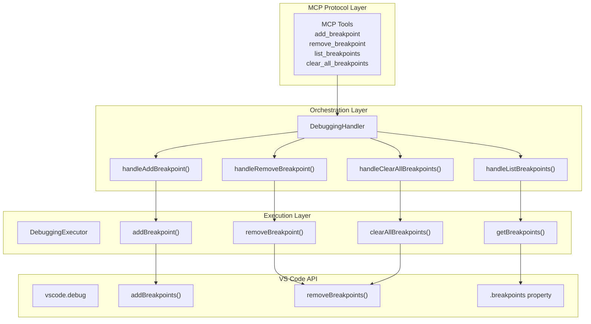
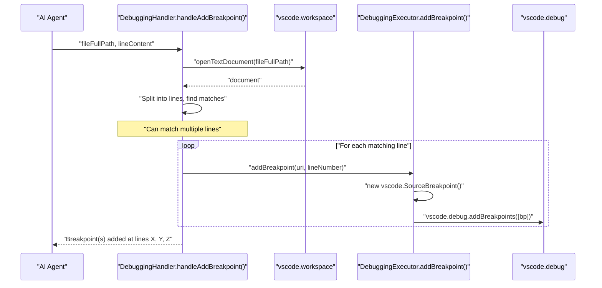
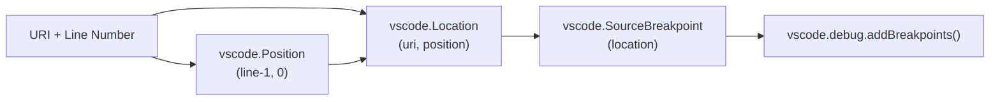
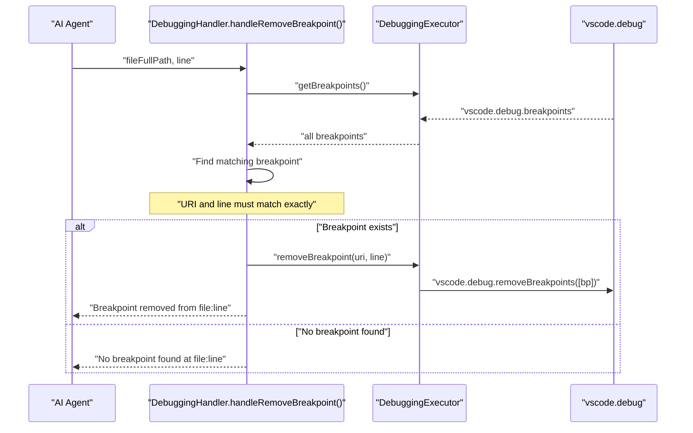
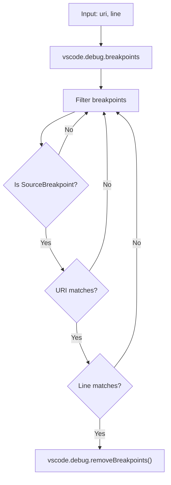
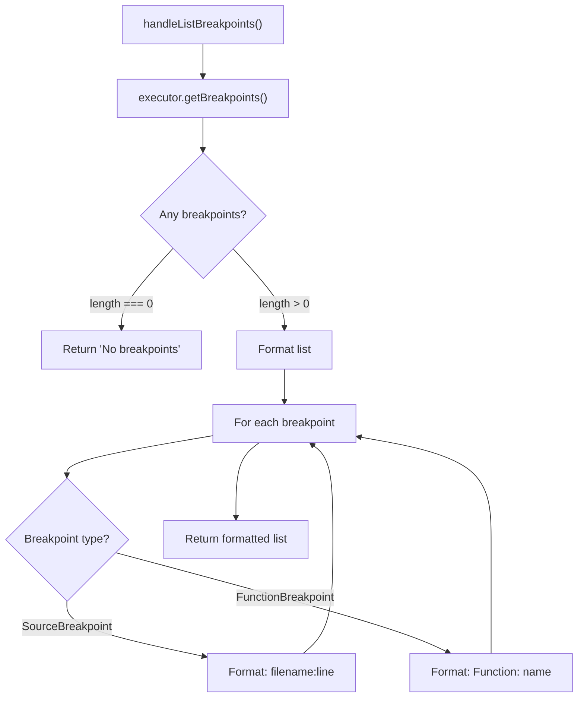
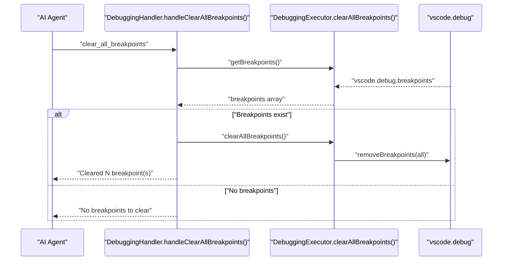
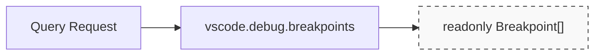
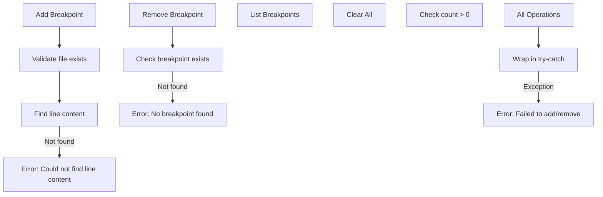
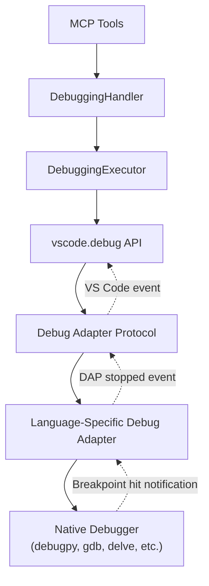

<!-- source: DeepWiki mcp.deepwiki.com · repo microsoft/DebugMCP · page 5.2 Breakpoint Management · fetched 2026-10-26 -->

# Breakpoint Management

<details>
<summary>Relevant source files</summary>

The following files were used as context for generating this wiki page:

- [src/debugMCPServer.ts](src/debugMCPServer.ts)
- [src/debuggingHandler.ts](src/debuggingHandler.ts)

</details>


This page documents the breakpoint management subsystem of DebugMCP, which provides capabilities for adding, removing, listing, and clearing breakpoints during debugging sessions. Breakpoints are fundamental to interactive debugging as they allow execution to pause at specific locations in source code for inspection.

For information about starting and managing debugging sessions, see [Session Management](5.1). For navigating through code after hitting breakpoints, see [Code Navigation](5.3).

## Overview

The breakpoint management system in DebugMCP exposes four MCP tools that allow AI agents to control breakpoints:

| Tool | Handler Method | Purpose |
|------|----------------|---------|
| `add_breakpoint` | `handleAddBreakpoint()` | Add breakpoint(s) by matching line content |
| `remove_breakpoint` | `handleRemoveBreakpoint()` | Remove breakpoint at specific line number |
| `list_breakpoints` | `handleListBreakpoints()` | Display all active breakpoints |
| `clear_all_breakpoints` | `handleClearAllBreakpoints()` | Remove all breakpoints at once |

Breakpoints persist across execution commands (step, continue, etc.) but are maintained only for the current VS Code session. They are managed through VS Code's native debugging API, ensuring compatibility with all supported language debuggers.

**Sources:** [src/debuggingHandler.ts:20-23](), [src/debugMCPServer.ts:148-185]()

## Architecture

### Component Layering

Breakpoint operations follow the standard DebugMCP layering pattern with two distinct levels:



**Component Responsibilities:**

- **DebuggingHandler**: Validates inputs, performs file content matching, and formats responses [src/debuggingHandler.ts:31-42]().
- **DebuggingExecutor**: Direct interaction with `vscode.debug` API [src/debuggingExecutor.ts:25-33]().
- **VS Code API**: Underlying breakpoint storage and debugger communication.

**Sources:** [src/debuggingHandler.ts:31-42](), [src/debuggingExecutor.ts:25-33]()

## Adding Breakpoints

### Content-Based Matching

The `handleAddBreakpoint()` method accepts a line of code content rather than an explicit line number. This design accommodates AI agents that understand code semantically but may not know exact line numbers.



**Implementation Details:**

1. **File Reading**: Opens the document using `vscode.workspace.openTextDocument()` [src/debuggingHandler.ts:252]().
2. **Line Matching**: Searches all lines for the provided content using `includes()` [src/debuggingHandler.ts:257-261]().
3. **Multiple Matches**: If content appears on multiple lines, breakpoints are added to all locations [src/debuggingHandler.ts:270-279]().
4. **1-Based Indexing**: Converts 0-based array indices to 1-based line numbers [src/debuggingHandler.ts:259]().

**Sources:** [src/debuggingHandler.ts:246-283](), [src/debuggingExecutor.ts:129-139]()

### SourceBreakpoint Creation

The executor creates `vscode.SourceBreakpoint` objects with precise location information:



**Key Implementation Points:**

- Position uses `line - 1` because VS Code uses 0-based line indexing [src/debuggingExecutor.ts:133]().
- Column position is always `0` (start of line) [src/debuggingExecutor.ts:133]().
- `vscode.Location` combines URI and position into a single object [src/debuggingExecutor.ts:133]().

**Sources:** [src/debuggingExecutor.ts:130-135]()

## Removing Breakpoints

### Exact Location Matching

The `handleRemoveBreakpoint()` method requires an exact file path and line number, ensuring precise removal:



**Matching Logic:**

The handler verifies breakpoint existence before attempting removal [src/debuggingHandler.ts:295-302]():

1. Retrieves all breakpoints via `this.executor.getBreakpoints()`.
2. Filters for `vscode.SourceBreakpoint` instances.
3. Compares URI strings using `toString()` for consistency.
4. Matches line position (converted from 1-based to 0-based).

**Sources:** [src/debuggingHandler.ts:288-313](), [src/debuggingExecutor.ts:144-160]()

### Executor-Level Removal

The `DebuggingExecutor.removeBreakpoint()` method filters and removes matching breakpoints:



**Sources:** [src/debuggingExecutor.ts:144-160]()

## Listing Breakpoints

### Breakpoint Enumeration

The `handleListBreakpoints()` method formats all active breakpoints into a human-readable list:



**Output Format:**

```
Active Breakpoints:
1. calculator.py:25
2. main.py:42
3. Function: processData
```

**Implementation Details:**

- Extracts filename using path splitting: `bp.location.uri.fsPath.split(/[/\\]/).pop()` [src/debuggingHandler.ts:329]().
- Converts 0-based line to 1-based: `bp.location.range.start.line + 1` [src/debuggingHandler.ts:330]().
- Supports both `SourceBreakpoint` and `FunctionBreakpoint` types [src/debuggingHandler.ts:328-334]().

**Sources:** [src/debuggingHandler.ts:318-341]()

### Breakpoint Types

DebugMCP supports two VS Code breakpoint types:

| Type | Class | Description | List Format |
|------|-------|-------------|-------------|
| Source | `vscode.SourceBreakpoint` | Line-based breakpoint | `filename:lineNumber` |
| Function | `vscode.FunctionBreakpoint` | Function name breakpoint | `Function: functionName` |

**Sources:** [src/debuggingHandler.ts:328-334]()

## Clearing All Breakpoints

### Batch Removal

The `handleClearAllBreakpoints()` method removes all breakpoints in a single operation:



**Implementation:**

The executor-level implementation is straightforward [src/debuggingExecutor.ts:311-316]():

```typescript
public clearAllBreakpoints(): void {
    const breakpoints = vscode.debug.breakpoints;
    if (breakpoints.length > 0) {
        vscode.debug.removeBreakpoints(breakpoints);
    }
}
```

**Sources:** [src/debuggingHandler.ts:109-122](), [src/debuggingExecutor.ts:311-316]()

## Breakpoint State Management

### State Queries

The `DebuggingExecutor.getBreakpoints()` method provides read-only access to the breakpoint collection:



**Characteristics:**

- Returns `readonly vscode.Breakpoint[]` to prevent direct modification [src/debuggingExecutor.ts:304]().
- Array includes all breakpoint types (Source, Function, Data, etc.).
- Reflects current state maintained by VS Code debugger.

**Sources:** [src/debuggingExecutor.ts:304-306]()

### Persistence and Scope

Breakpoints managed through DebugMCP have specific lifecycle characteristics:

| Aspect | Behavior |
|--------|----------|
| **Persistence** | Session-only (not saved to launch.json) |
| **Scope** | All workspace files |
| **Debugger Integration** | Automatic synchronization with active debug adapter |
| **Modification Source** | MCP tools, VS Code UI, or debug adapter |

**Sources:** [src/debuggingExecutor.ts:304-316]()

## Error Handling

### Input Validation

Each breakpoint operation includes validation and error handling:



**Error Messages:**

- **Add**: `"Could not find any lines containing: {lineContent}"` [src/debuggingHandler.ts:264]().
- **Remove**: `"No breakpoint found at {fileFullPath}:{line}"` [src/debuggingHandler.ts:305]().
- **Generic**: `"Error {operation} breakpoint: {error}"` [src/debuggingHandler.ts:281,311,340]().

**Sources:** [src/debuggingHandler.ts:246-341]()

## Usage Patterns

### Typical Workflow

AI agents typically use breakpoint operations in this sequence:

1. Analyze code for potential failure points.
2. Call `add_breakpoint` to set pause points [src/debugMCPServer.ts:148-157]().
3. Call `start_debugging` to begin execution [src/debugMCPServer.ts:71-97]().
4. Inspect state when execution pauses.
5. Optionally call `remove_breakpoint` or `clear_all_breakpoints` to clean up [src/debugMCPServer.ts:159-176]().

**Sources:** [src/debugMCPServer.ts:71-185]()

### Multiple Breakpoint Scenario

When line content appears multiple times, all instances receive breakpoints:

**Example:** Adding breakpoint for `logger.info()` might set breakpoints at:
- `logger.info('Starting process')`  → Line 15
- `logger.info('Process complete')`  → Line 42
- `logger.info('Error occurred')`    → Line 58

**Response:** `"Breakpoints added at 3 locations in file.py: lines 15, 42, 58"`

**Sources:** [src/debuggingHandler.ts:274-279]()

## Integration with VS Code

### Debug Adapter Protocol

All breakpoint operations ultimately communicate through VS Code's Debug Adapter Protocol (DAP):



This architecture ensures:
- **Language Independence**: Same API works for Python, JavaScript, Java, etc.
- **UI Consistency**: Breakpoints appear in VS Code's breakpoint view.
- **Adapter Control**: Debug adapters validate and translate breakpoint locations.

**Sources:** [src/debuggingExecutor.ts:130-160]()

---

