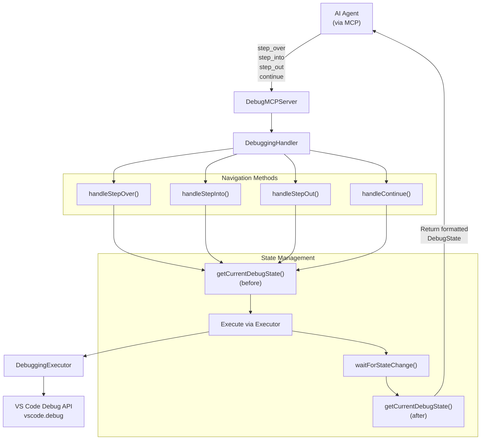
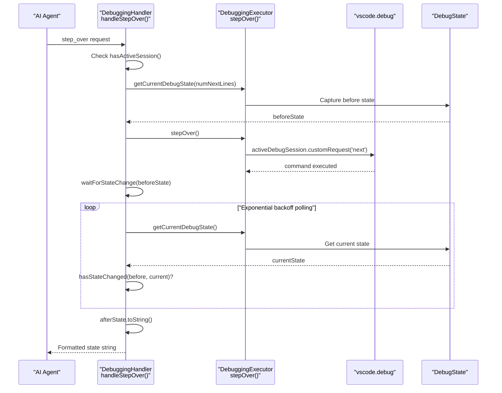
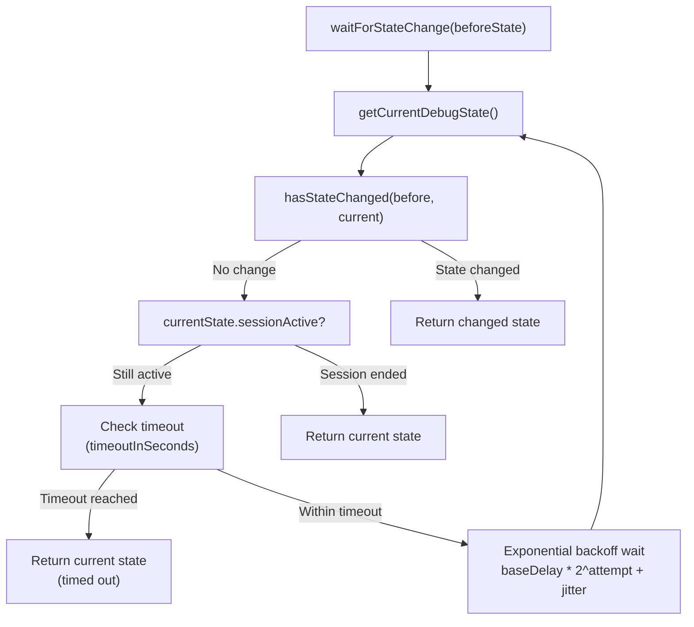

<!-- source: DeepWiki mcp.deepwiki.com · repo microsoft/DebugMCP · page 5.3 Code Navigation · fetched 2026-10-26 -->

# Code Navigation

Relevant source files

The following files were used as context for generating this wiki page:

- [src/debuggingHandler.ts](src/debuggingHandler.ts)

## Purpose and Scope

This document describes the code navigation operations available in DebugMCP, which enable AI agents to control program execution flow during debugging sessions. These operations include stepping through code line-by-line, entering and exiting functions, and continuing execution until breakpoints are encountered.

For information about starting and stopping debug sessions, see [5.1 Session Management](). For breakpoint management, see [5.2 Breakpoint Management](). For inspecting program state, see [5.4 Variable Inspection]() and [5.5 Expression Evaluation]().

## Overview

Code navigation operations allow fine-grained control over program execution during debugging. All navigation operations follow a consistent pattern: they execute a debugger command, wait for the debugger state to change via `waitForStateChange`, and return the new execution state to the caller.

### Available Operations

| Operation | MCP Tool | Handler Method | Description |
|-----------|----------|----------------|-------------|
| Step Over | `step_over` | `handleStepOver()` | Execute the current line, stepping over function calls |
| Step Into | `step_into` | `handleStepInto()` | Execute the current line, entering into function calls |
| Step Out | `step_out` | `handleStepOut()` | Execute until returning from the current function |
| Continue | `continue_execution` | `handleContinue()` | Resume execution until the next breakpoint or program end |

Sources: [src/debuggingHandler.ts:12-26](), [src/debuggingHandler.ts:127-219]()

## Navigation Operation Architecture

The following diagram illustrates the flow from an AI agent's request through the MCP Server to the VS Code Debug API.

Sources: [src/debuggingHandler.ts:126-219](), [src/debuggingExecutor.ts:11-25]()

## Step Over Operation

### Purpose

Step Over executes the current line of code and advances to the next line in the same function or scope. If the current line contains a function call, the entire function executes without stopping, and execution pauses at the line following the function call.

### Implementation

The `handleStepOver()` method in `DebuggingHandler` orchestrates the step over operation:

**Method signature:** [src/debuggingHandler.ts:127]()

**Flow:**
1. Validates an active debug session exists via `executor.hasActiveSession()` [src/debuggingHandler.ts:129-131]()
2. Captures the current `DebugState` before stepping [src/debuggingHandler.ts:134]()
3. Invokes `executor.stepOver()` to execute the VS Code debug command [src/debuggingHandler.ts:136]()
4. Waits for debugger state to change using `waitForStateChange(beforeState)` [src/debuggingHandler.ts:139]()
5. Returns the string representation of the new state [src/debuggingHandler.ts:141]()

Sources: [src/debuggingHandler.ts:127-145](), [src/debuggingExecutor.ts:161-167]()

## Step Into Operation

### Purpose

Step Into executes the current line and, if the line contains a function call, enters that function and pauses at its first executable line.

### Implementation

The `handleStepInto()` method follows the same pattern as Step Over but uses the `stepIn` debug command:

**Method signature:** [src/debuggingHandler.ts:150]()

**Key differences from Step Over:**
- Uses `executor.stepInto()` [src/debuggingHandler.ts:159]() which sends the `stepIn` custom request to VS Code [src/debuggingExecutor.ts:169-175]().
- Execution stops at the first line inside a called function rather than stepping over it.

Sources: [src/debuggingHandler.ts:150-169](), [src/debuggingExecutor.ts:169-175]()

## Step Out Operation

### Purpose

Step Out continues execution until the current function returns, then pauses at the line following the function call in the calling function.

### Implementation

The `handleStepOut()` method executes until returning from the current stack frame:

**Method signature:** [src/debuggingHandler.ts:174]()

**Command execution:** [src/debuggingHandler.ts:183]() calls `executor.stepOut()`, which triggers the `stepOut` DAP command [src/debuggingExecutor.ts:177-183]().

Sources: [src/debuggingHandler.ts:174-193](), [src/debuggingExecutor.ts:177-183]()

## Continue Execution

### Purpose

Continue resumes program execution from the current paused state and runs until a breakpoint is hit, the program terminates, or an exception occurs.

### Implementation

The `handleContinue()` method resumes execution:

**Method signature:** [src/debuggingHandler.ts:198]()

**Command execution:** [src/debuggingHandler.ts:207]() calls `executor.continue()`, which triggers the `continue` DAP command [src/debuggingExecutor.ts:185-191]().

Sources: [src/debuggingHandler.ts:198-219](), [src/debuggingExecutor.ts:185-191]()

## State Change Detection Mechanism

All navigation operations depend on detecting when the debugger state has changed after executing a command. This is critical because debugger operations are asynchronous.

### Wait for State Change

The `waitForStateChange` method implements an exponential backoff polling mechanism to detect when the debugger has finished its operation and paused again.

**Implementation:** [src/debuggingHandler.ts:505-536]()

**Configuration:**
- `baseDelay`: 1000ms (1 second) [src/debuggingHandler.ts:506]()
- `maxDelay`: 1000ms (capped at 1 second) [src/debuggingHandler.ts:507]()
- `timeoutInSeconds`: Configurable via constructor [src/debuggingHandler.ts:39-41]()

Sources: [src/debuggingHandler.ts:505-536]()

### State Change Detection Logic

The `hasStateChanged()` method determines if a meaningful state change occurred by comparing the current `DebugState` with the previous one:

**Method signature:** [src/debuggingHandler.ts:541]()

**Comparison criteria (in priority order):**

| Check | Location | Description |
|-------|----------|-------------|
| Session status | [src/debuggingHandler.ts:547-549]() | If session active state changed |
| Session inactive | [src/debuggingHandler.ts:552-554]() | If session is no longer active |
| Location info availability | [src/debuggingHandler.ts:557-560]() | If location info presence changed |
| File path | [src/debuggingHandler.ts:563-565]() | If execution moved to different file |
| Line number | [src/debuggingHandler.ts:568-570]() | If execution moved to different line |
| Frame name | [src/debuggingHandler.ts:573-575]() | If execution entered different function |
| Frame ID | [src/debuggingHandler.ts:578-580]() | If internal frame changed |

Sources: [src/debuggingHandler.ts:541-584](), [src/debugState.ts:11-30]()

## Common Patterns and Error Handling

### Active Session Validation

All navigation operations validate that an active debug session exists before attempting to execute commands using `executor.hasActiveSession()` [src/debuggingHandler.ts:129-131]().

### Error Propagation

All navigation methods wrap their operations in try-catch blocks to provide context-specific error messages, such as:
`throw new Error('Error executing step over: ${error}')` [src/debuggingHandler.ts:143]().

### State Formatting

After state changes are detected, the `DebugState` object's `toString()` method is called to provide a human-readable summary for the AI agent [src/debuggingHandler.ts:141](). This includes the frame name, file path, line number, and a snippet of the source code [src/debugState.ts:60-93]().

Sources: [src/debuggingHandler.ts:126-219](), [src/debugState.ts:60-93]()

---

