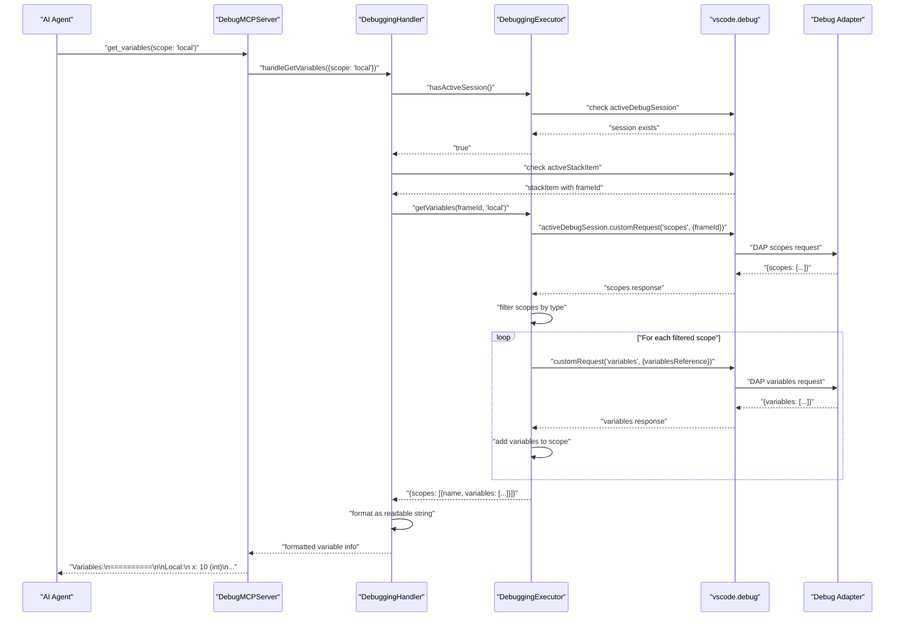
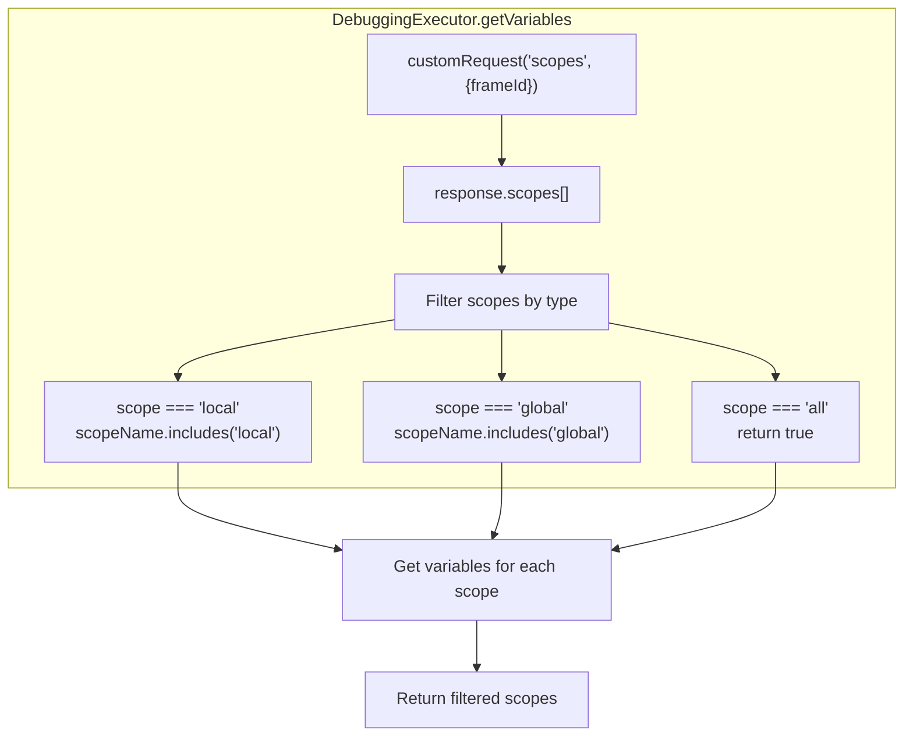
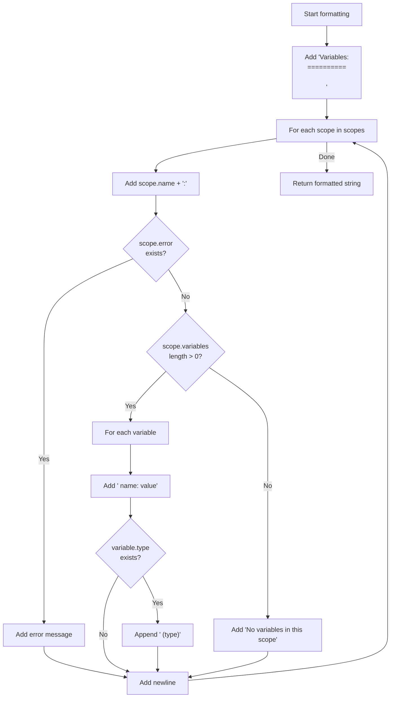
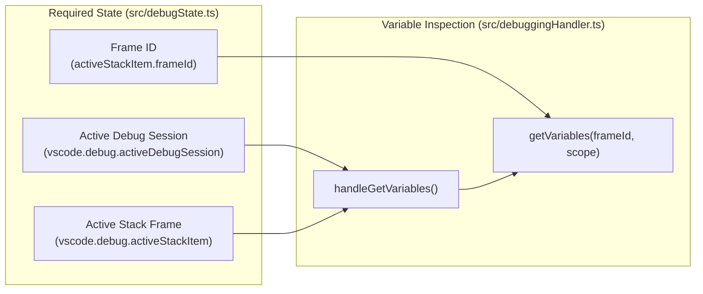

<!-- source: DeepWiki mcp.deepwiki.com · repo microsoft/DebugMCP · page 5.4 Variable Inspection · fetched 2026-10-26 -->

# Variable Inspection

<details>
<summary>Relevant source files</summary>

The following files were used as context for generating this wiki page:

- [docs/architecture/debugState.md](docs/architecture/debugState.md)
- [src/debugState.ts](src/debugState.ts)
- [src/debuggingHandler.ts](src/debuggingHandler.ts)

</details>


This page documents the variable inspection capabilities of DebugMCP, which enable AI agents to retrieve and examine variable values during debugging sessions. Variable inspection is available when execution is paused at a breakpoint or after a step operation. For information about evaluating arbitrary expressions, see [Expression Evaluation](5.5). For information about pausing execution, see [Code Navigation](5.3) and [Breakpoint Management](5.2).

---

## Overview

Variable inspection allows AI agents to query the current values of variables in different scopes (local, global, or all) when a debug session is paused. This operation is implemented through the `get_variables` MCP tool, which retrieves variables from the Debug Adapter Protocol (DAP) and formats them into a human-readable response.

The variable inspection system operates through three layers:
1. **MCP Tool Layer**: Exposes `get_variables` tool with scope filtering.
2. **Handler Layer**: [`DebuggingHandler.handleGetVariables()`](src/debuggingHandler.ts:343-388)() validates session state and formats output.
3. **Executor Layer**: [`DebuggingExecutor.getVariables()`](src/debuggingExecutor.ts:235-273)() communicates with DAP to retrieve variable data.

**Sources:** [src/debuggingHandler.ts:343-388](), [src/debuggingExecutor.ts:235-273]()

---

## Variable Inspection Request Flow



**Diagram: Complete flow of a variable inspection request from AI agent to Debug Adapter Protocol**

This diagram illustrates how a variable inspection request flows through the system layers, showing the key validation steps (session check, frame check), the DAP protocol interactions (scopes and variables requests), and the scope filtering logic.

**Sources:** [src/debuggingHandler.ts:343-388](), [src/debuggingExecutor.ts:235-273]()

---

## Scope Types and Filtering

The `get_variables` tool supports three scope types that filter which variable scopes are returned:

| Scope Type | Description | Filtering Logic |
|------------|-------------|-----------------|
| `'local'` | Variables in the current function/method | Includes scopes where `scopeName.toLowerCase().includes('local')` |
| `'global'` | Module-level or global variables | Includes scopes where `scopeName.toLowerCase().includes('global')` |
| `'all'` | All available scopes | No filtering - returns all scopes |

### Scope Filtering Implementation



**Diagram: Scope filtering logic in getVariables method**

The filtering occurs at [src/debuggingExecutor.ts:248-254]() and uses case-insensitive substring matching on the scope name provided by the debug adapter.

**Sources:** [src/debuggingExecutor.ts:248-254]()

---

## Data Structures

### Input Arguments

The `handleGetVariables` method accepts an arguments object:

```typescript
args: { scope?: 'local' | 'global' | 'all' }
```

- **scope** (optional): Defaults to `'all'` if not specified [src/debuggingHandler.ts:344]().
- Only accepts the three predefined scope types.

### Variables Response Structure

The DAP returns variables with the following structure:

```typescript
{
  scopes: [
    {
      name: string,              // e.g., "Locals", "Globals"
      variablesReference: number, // DAP reference for fetching variables
      variables: [
        {
          name: string,          // Variable name
          value: string,         // String representation of value
          type?: string          // Optional type information
        }
      ],
      error?: any                // Set if variable retrieval failed
    }
  ]
}
```

**Sources:** [src/debuggingExecutor.ts:235-273](), [src/debuggingHandler.ts:356-384]()

---

## Implementation Details

### Pre-Execution Validation

Before retrieving variables, [`handleGetVariables`](src/debuggingHandler.ts:343-388)() performs two critical validation checks:

1. **Active Session Check** [src/debuggingHandler.ts:347-349]()
   - Calls `executor.hasActiveSession()`.
   - Throws error: `"Debug session is not ready. Start debugging first and ensure execution is paused."`

2. **Active Stack Frame Check** [src/debuggingHandler.ts:351-354]()
   - Verifies `vscode.debug.activeStackItem` exists.
   - Verifies the stack item contains a `frameId` property.
   - Throws error: `"No active stack frame. Make sure execution is paused at a breakpoint."`

### DAP Communication

The [`getVariables`](src/debuggingExecutor.ts:235-273)() method uses two DAP custom requests:

1. **Scopes Request** [src/debuggingExecutor.ts:242]()
   ```typescript
   const response = await activeSession.customRequest('scopes', { frameId });
   ```
   Returns available scopes for the current stack frame.

2. **Variables Request** [src/debuggingExecutor.ts:259-261]()
   ```typescript
   const variablesResponse = await activeSession.customRequest('variables', {
       variablesReference: scopeItem.variablesReference
   });
   ```
   Returns variables within a specific scope using its reference.

**Sources:** [src/debuggingExecutor.ts:235-273]()

---

## Output Formatting

The [`handleGetVariables`](src/debuggingHandler.ts:343-388)() method formats the structured data into a readable string:

### Format Structure

```
Variables:
==========

<ScopeName>:
  <variableName>: <value> (<type>)
  <variableName>: <value>
  ...

<ScopeName>:
  <variableName>: <value> (<type>)
  ...
```

### Formatting Logic



**Diagram: Variable formatting algorithm in handleGetVariables**

The formatting code is located at [src/debuggingHandler.ts:362-384]().

**Sources:** [src/debuggingHandler.ts:362-384]()

---

## Error Handling

### Error Scenarios

| Scenario | Detection Point | Error Message |
|----------|-----------------|---------------|
| No active debug session | [src/debuggingHandler.ts:347-349]() | `"Debug session is not ready. Start debugging first and ensure execution is paused."` |
| No active stack frame | [src/debuggingHandler.ts:351-354]() | `"No active stack frame. Make sure execution is paused at a breakpoint."` |
| No scopes available | [src/debuggingHandler.ts:358-360]() | `"No variable scopes available at current execution point."` |
| Scope retrieval failure | [src/debuggingExecutor.ts:263-266]() | Error stored in `scope.error`, empty variables array |
| General failure | [src/debuggingHandler.ts:385-387]() | `"Error getting variables: <error>"` |

### Graceful Degradation

When variable retrieval fails for a specific scope, the system:
1. Sets `scopeItem.variables = []` [src/debuggingExecutor.ts:264]().
2. Stores the error in `scopeItem.error` [src/debuggingExecutor.ts:265]().
3. Continues processing other scopes.
4. Displays the error in formatted output [src/debuggingHandler.ts:367-368]().

**Sources:** [src/debuggingHandler.ts:343-388](), [src/debuggingExecutor.ts:263-266]()

---

## Integration with Debug State

Variable inspection is tightly coupled with the debug state management system. The `DebugState` class tracks whether a session is active and holds context like `frameId` and `threadId` [src/debugState.ts:16-43]().



**Diagram: Dependencies between debug state and variable inspection**

The `frameId` from the active stack item is critical - it identifies which stack frame's variables to retrieve from the debug adapter. Without a valid frame ID, variable inspection cannot proceed.

**Sources:** [src/debuggingHandler.ts:351-356](), [src/debugState.ts:16-43]()

---

## Usage Example

Here's a typical usage flow:

1. **AI Agent Request**:
   ```json
   {
     "tool": "get_variables",
     "arguments": {
       "scope": "local"
     }
   }
   ```

2. **System Response** (when paused at a breakpoint):
   ```
   Variables:
   ==========

   Locals:
     x: 10 (int)
     y: 'hello' (str)
     result: None (NoneType)
   
   ```

3. **Error Response** (when not paused):
   ```
   Error getting variables: No active stack frame. Make sure execution is paused at a breakpoint.
   ```

**Sources:** [src/debuggingHandler.ts:362-384]()

---

## Related Components

The variable inspection system interacts with several other components:

- **Debugging Handler**: Orchestrates variable inspection and formats output [src/debuggingHandler.ts:31-42]().
- **Debugging Executor**: Executes DAP requests to retrieve variable data [src/debuggingExecutor.ts:235-273]().
- **DebugState**: Provides session and frame context required for inspection [src/debugState.ts:16-43]().
- **Code Navigation**: Step operations that pause execution for inspection [src/debuggingHandler.ts:127-185]().
- **Breakpoint Management**: Sets breakpoints where execution pauses for inspection [src/debuggingHandler.ts:202-231]().
- **Expression Evaluation**: Complementary feature for evaluating custom expressions [src/debuggingHandler.ts:393-416]().

**Sources:** [src/debuggingHandler.ts:1-616](), [src/debuggingExecutor.ts:1-346](), [src/debugState.ts:1-200]()

---

