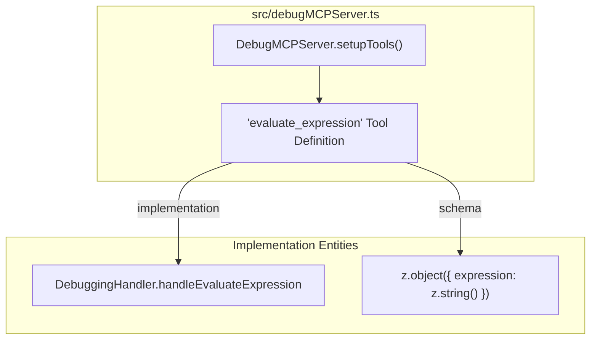
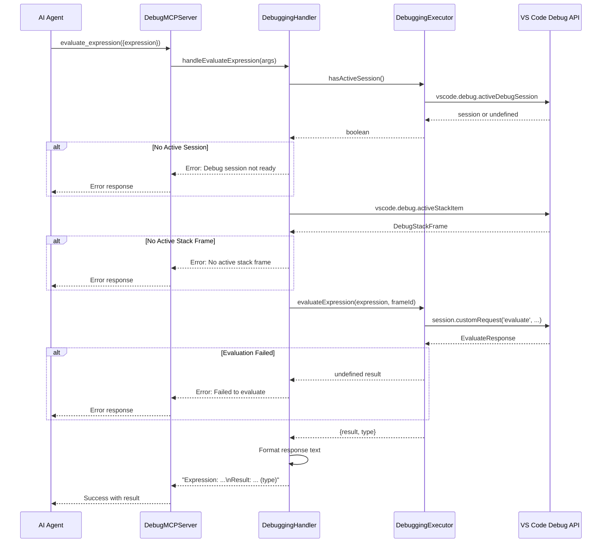
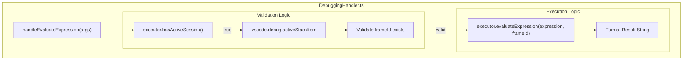

<!-- source: DeepWiki mcp.deepwiki.com · repo microsoft/DebugMCP · page 5.5 Expression Evaluation · fetched 2026-10-26 -->

# Expression Evaluation

<details>
<summary>Relevant source files</summary>

The following files were used as context for generating this wiki page:

- [src/debuggingHandler.ts](src/debuggingHandler.ts)

</details>


## Purpose and Scope

This page documents the expression evaluation capability in DebugMCP, which allows AI agents to evaluate arbitrary expressions in the current debug context using the active frame ID. Expression evaluation enables dynamic inspection beyond simple variable values, including computed expressions, method calls, property access, and complex language-specific operations.

For retrieving predefined variables and their values, see [Variable Inspection](5.4). For information about navigating through code during debugging, see [Code Navigation](5.3).

Sources: [src/debuggingHandler.ts:24-25](), [src/debuggingHandler.ts:390-391]()

## Overview

Expression evaluation provides a runtime expression evaluator that operates within the active debug session's current execution context. Unlike variable inspection which retrieves predefined variables from scopes, expression evaluation can:

- Evaluate computed expressions (e.g., `x + y * 2`)
- Call methods on objects (e.g., `user.getName()`)
- Access object properties (e.g., `config.settings.timeout`)
- Test conditional expressions (e.g., `items.length > 0`)
- Execute any valid expression in the target programming language

The evaluation occurs in the context of the current stack frame, with access to all variables visible at that execution point.

Sources: [src/debugMCPServer.ts:209-219](), [src/debuggingHandler.ts:390-422]()

## MCP Tool Registration

The expression evaluation capability is exposed through the `evaluate_expression` MCP tool, registered in `DebugMCPServer.setupTools`.

### Tool Definition to Code Entity Mapping

This diagram bridges the Natural Language tool definition to the specific code entities in `src/debugMCPServer.ts`.



**Tool Registration Details**

| Property | Value | Description |
|----------|-------|-------------|
| **name** | `evaluate_expression` | MCP tool identifier [src/debugMCPServer.ts:209]() |
| **description** | "Powerful runtime expression evaluator..." | Explains capabilities beyond variable inspection [src/debugMCPServer.ts:210-213]() |
| **parameters** | `{ expression: string }` | Single required parameter: the expression to evaluate [src/debugMCPServer.ts:214-216]() |
| **execute** | `handleEvaluateExpression` | Delegates to `DebuggingHandler` method [src/debugMCPServer.ts:218]() |

Sources: [src/debugMCPServer.ts:209-219]()

## Request Flow

The following sequence diagram illustrates the complete flow from MCP tool invocation to result delivery, highlighting the interaction between the `DebuggingHandler` and `DebuggingExecutor`.



Sources: [src/debuggingHandler.ts:393-422]()

## Implementation Architecture

### Handler Layer

The `DebuggingHandler.handleEvaluateExpression()` method in `src/debuggingHandler.ts` orchestrates the evaluation process. It validates the environment before delegating to the executor.



**Validation Sequence**

1. **Session Validation**: Confirms active debug session exists via `executor.hasActiveSession()` [src/debuggingHandler.ts:397-399]().
2. **Stack Frame Validation**: Ensures execution is paused by checking `vscode.debug.activeStackItem` and verifying a `frameId` is present [src/debuggingHandler.ts:401-404]().
3. **Evaluation Execution**: Calls `executor.evaluateExpression` with the provided expression and the context-specific `frameId` [src/debuggingHandler.ts:406]().
4. **Result Validation**: Verifies the response contains a defined result [src/debuggingHandler.ts:408-410]().

Sources: [src/debuggingHandler.ts:393-422]()

### Executor Layer

The `DebuggingExecutor` interfaces with VS Code's Debug API. While the internal implementation of `evaluateExpression` is abstracted, the handler expects it to return an object containing the result string and an optional type.

| Method | Source Definition | Purpose |
|--------|-------------------|---------|
| `hasActiveSession()` | [src/debuggingExecutor.ts:25]() | Validates if a session is currently running |
| `evaluateExpression()` | [src/debuggingExecutor.ts:32]() | Executes evaluation via Debug Adapter Protocol (DAP) |

Sources: [src/debuggingHandler.ts:397-406]()

## Evaluation Context

Expression evaluation occurs within a specific execution context determined by the current stack frame. The `frameId` is crucial as it allows the debugger to resolve local variables and "this" pointers correctly.

- **Frame Scope**: Only variables visible in the current stack frame can be referenced [src/debuggingHandler.ts:401-404]().
- **DAP Context**: The evaluation is typically performed with a context of `watch` or `repl` depending on the executor implementation.
- **Language Semantics**: Syntax must match the language of the active debug session.

Sources: [src/debuggingHandler.ts:401-406]()

## Response Format

The evaluation result is formatted by the handler into a human-readable string before being returned to the MCP client.

```typescript
// Format implementation in handleEvaluateExpression
const typeInfo = response.type ? ` (${response.type})` : '';
return `Expression: ${expression}\nResult: ${response.result}${typeInfo}`;
```

**Example Output:**
```
Expression: user.age + 10
Result: 35 (number)
```

Sources: [src/debuggingHandler.ts:412-415]()

## Error Handling

The system handles several failure modes during evaluation:

| Error Condition | Error Message | Source |
|----------------|---------------|--------|
| No active session | "Debug session is not ready. Start debugging first..." | [src/debuggingHandler.ts:398]() |
| No active stack frame | "No active stack frame. Make sure execution is paused..." | [src/debuggingHandler.ts:403]() |
| Evaluation failed | "Failed to evaluate expression" | [src/debuggingHandler.ts:409]() |
| General Exception | "Error evaluating expression: {error}" | [src/debuggingHandler.ts:420]() |

Sources: [src/debuggingHandler.ts:393-422]()

## Comparison with Variable Inspection

| Aspect | Variable Inspection ([5.4](5.4)) | Expression Evaluation |
|--------|-----------------------------------|----------------------|
| **Purpose** | Retrieve predefined variables | Evaluate arbitrary expressions |
| **Input** | Scope selection (local/global/all) | Expression string |
| **Side Effects** | None | Possible (e.g., method calls) |
| **Use Case** | General state overview | Specific hypothesis testing |
| **MCP Tool** | `get_variables_values` | `evaluate_expression` |

Sources: [src/debuggingHandler.ts:343-388](), [src/debuggingHandler.ts:393-422]()

---

