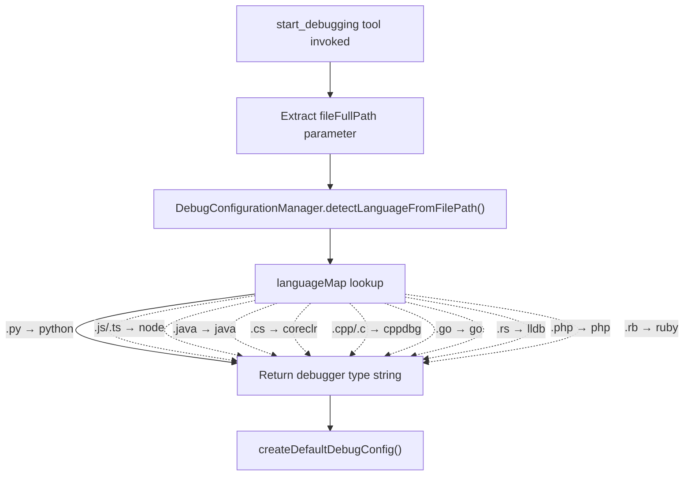
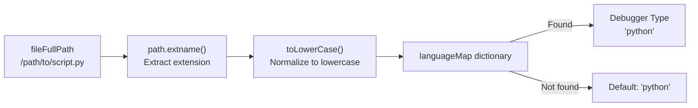
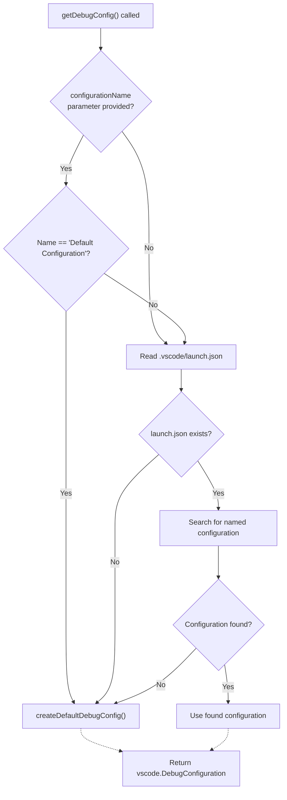
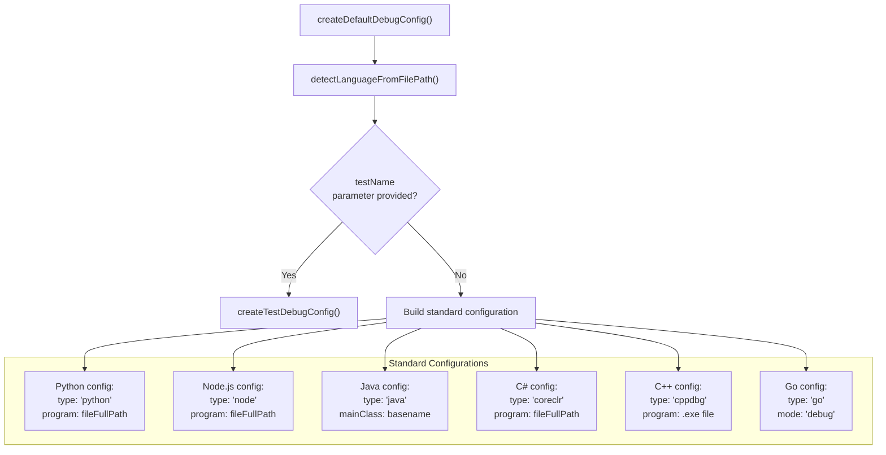
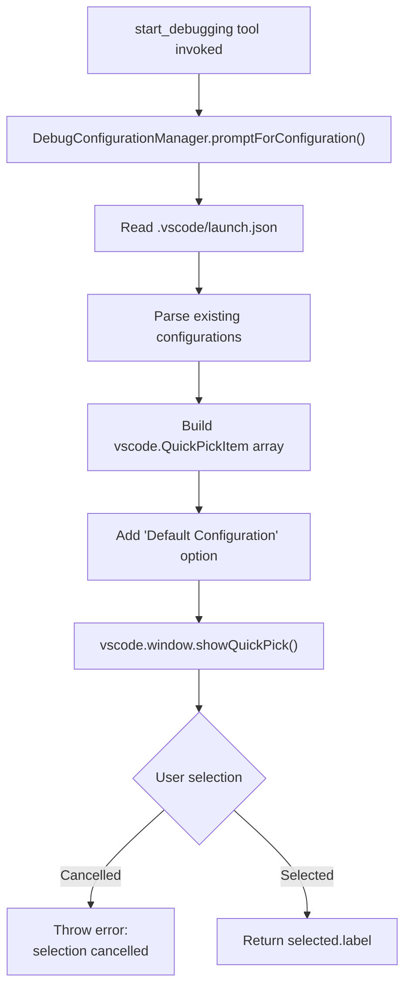

<!-- source: DeepWiki mcp.deepwiki.com · repo microsoft/DebugMCP · page 6 Language Support · fetched 2026-10-26 -->

# Language Support

Relevant source files

The following files were used as context for generating this wiki page:

- [README.md](README.md)
- [assets/DebugMCP.webp](assets/DebugMCP.webp)
- [assets/architecture.png](assets/architecture.png)
- [src/utils/debugConfigurationManager.ts](src/utils/debugConfigurationManager.ts)

This document provides an overview of DebugMCP's multi-language debugging capabilities. It explains how the system detects programming languages, generates appropriate debug configurations, and interfaces with VS Code's language-specific debuggers. For detailed information about individual language configurations and troubleshooting, see the language-specific pages ([Python Debugging](#6.1), [JavaScript and TypeScript](#6.2), [Java Debugging](#6.3), [C# and .NET](#6.4), [C and C++](#6.5), [Go Debugging](#6.6), [Other Languages](#6.7)).

## Supported Languages

DebugMCP supports nine programming languages with their respective VS Code debugging extensions. Each language requires its corresponding VS Code extension to be installed for debugging functionality.

| Language | Debugger Type | File Extensions | VS Code Extension Required | Test Framework Support |
|----------|---------------|-----------------|---------------------------|----------------------|
| Python | `python` | `.py` | ms-python.python | unittest |
| JavaScript/TypeScript | `node` | `.js`, `.ts`, `.jsx`, `.tsx` | Built-in / ms-vscode.js-debug | Jest, Mocha |
| Java | `java` | `.java` | vscjava.vscode-java-pack | JUnit |
| C#/.NET | `coreclr` | `.cs` | ms-dotnettools.csharp | xUnit, NUnit, MSTest |
| C/C++ | `cppdbg` | `.c`, `.cpp`, `.cc` | ms-vscode.cpptools | Not supported |
| Go | `go` | `.go` | golang.Go | Not supported |
| Rust | `lldb` | `.rs` | rust-lang.rust-analyzer | Not supported |
| PHP | `php` | `.php` | xdebug.php-debug | Not supported |
| Ruby | `ruby` | `.rb` | rebornix.ruby | Not supported |

Sources: [README.md:112-122](), [src/utils/debugConfigurationManager.ts:145-160]()

## Language Detection Architecture

The `DebugConfigurationManager` class implements automatic language detection based on file extensions. When a debug session is initiated via the `start_debugging` tool, the system determines the appropriate debugger type before generating a configuration.

**Language Detection Flow**: The process begins when a debugging tool is invoked, extracts the file path, and maps the extension to a debugger type used by VS Code.

Sources: [src/utils/debugConfigurationManager.ts:142-163]()

### Language Detection Implementation

The `detectLanguageFromFilePath` method performs a simple extension-based lookup using the `path` module:

**Extension Mapping Process**: File extensions are normalized to lowercase and mapped to debugger types using a predefined dictionary. If an extension is unknown, it defaults to `python`.

Sources: [src/utils/debugConfigurationManager.ts:142-163]()

## Debug Configuration Generation

DebugMCP generates debug configurations through a two-tier strategy: it first attempts to use existing `launch.json` configurations from the workspace, then falls back to language-specific defaults if none are found or if the user selects the `AUTO_LAUNCH_CONFIG` ("Default Configuration") option.

**Configuration Resolution Strategy**: The system prioritizes user-defined configurations in `launch.json` but provides automatic fallback defaults based on the detected language.

Sources: [src/utils/debugConfigurationManager.ts:25-73]()

## Default Configuration Strategy

When no `launch.json` configuration is available or the user selects automatic configuration, DebugMCP generates language-appropriate defaults. The `createDefaultDebugConfig` method builds configurations based on the detected language type.

### Configuration Generation Logic

**Default Configuration Architecture**: The system generates language-appropriate configurations with sensible defaults for program execution and terminal integration.

Sources: [src/utils/debugConfigurationManager.ts:168-238]()

### Common Configuration Properties

All default configurations generated by `createDefaultDebugConfig` include these common properties:

| Property | Purpose | Typical Values |
|----------|---------|----------------|
| `type` | Debugger type identifier | `python`, `node`, `java`, `coreclr`, etc. |
| `request` | Debug session type | Always `launch` |
| `name` | Configuration display name | `DebugMCP <Language> Launch` |
| `program` | Entry point file path | Absolute path to the source file |
| `console` | Output console type | `integratedTerminal` |
| `cwd` | Working directory | The `workingDirectory` provided to the tool |

Sources: [src/utils/debugConfigurationManager.ts:181-235]()

## Test-Specific Configurations

DebugMCP provides specialized configurations for debugging individual tests in supported languages. When the `testName` parameter is provided to the `start_debugging` tool, the system invokes `createTestDebugConfig` to generate framework-specific settings.

For details, see the following child pages:
- **Python**: Supports `unittest` with automatic class name extraction. [Python Debugging](#6.1)
- **JavaScript/TypeScript**: Supports `Jest` and `Mocha` based on file name patterns. [JavaScript and TypeScript](#6.2)
- **Java**: Supports `JUnit` test execution. [Java Debugging](#6.3)
- **C#**: Supports `dotnet test` with filter patterns. [C# and .NET](#6.4)

Sources: [src/utils/debugConfigurationManager.ts:335-448]()

## Configuration User Prompt

When a debug session is started without a specific `configurationName`, DebugMCP prompts the user via `promptForConfiguration`. This prompt lists all configurations found in `launch.json` and adds the `AUTO_LAUNCH_CONFIG` heuristic as an option.

**Configuration Selection Flow**: The system allows users to explicitly choose their preferred debugging environment or rely on DebugMCP's internal heuristics.

Sources: [src/utils/debugConfigurationManager.ts:78-137]()

---

