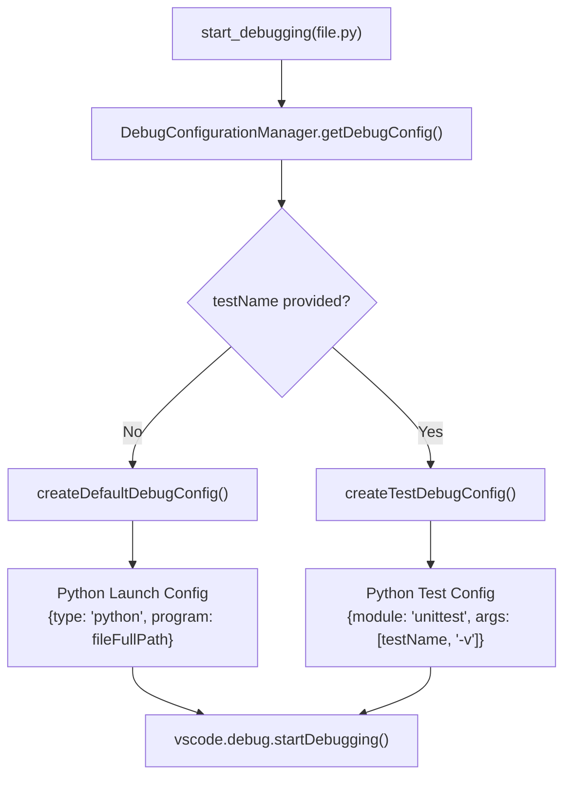
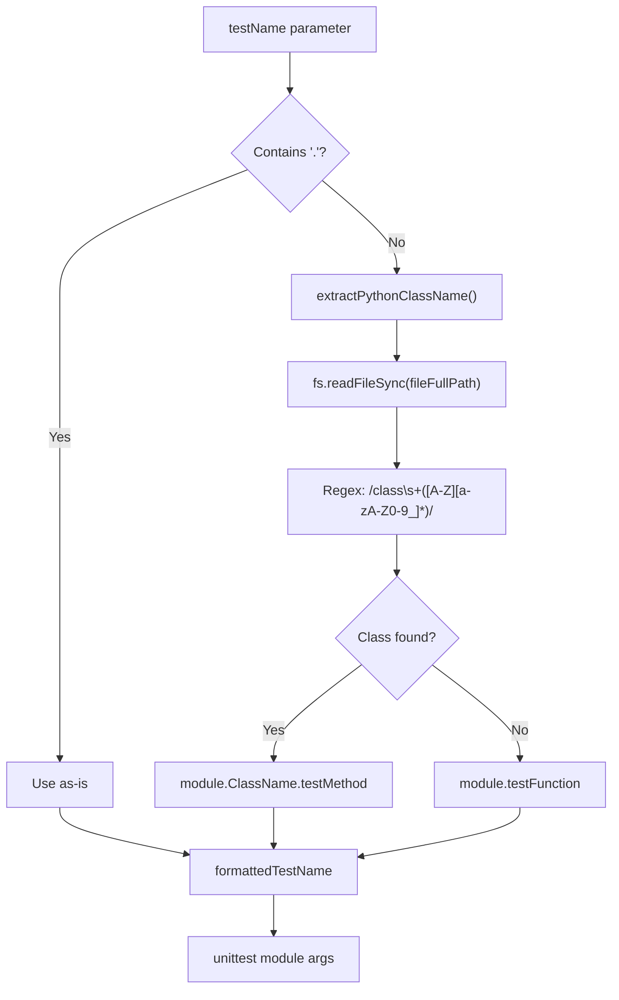

<!-- source: DeepWiki mcp.deepwiki.com · repo microsoft/DebugMCP · page 6.1 Python Debugging · fetched 2026-10-26 -->

# Python Debugging

Relevant source files

The following files were used as context for generating this wiki page:

- [docs/agent-resources/troubleshooting/python.md](docs/agent-resources/troubleshooting/python.md)
- [src/utils/debugConfigurationManager.ts](src/utils/debugConfigurationManager.ts)

This document describes Python-specific debugging capabilities in DebugMCP, including debug configuration generation, unittest integration, and test execution support. For general debugging operations applicable to all languages, see [5. Debugging Operations](). For information about configuring AI agents to use these debugging features, see [2.2. Configuring AI Agents]().

## Purpose and Scope

DebugMCP provides first-class support for Python debugging through automatic configuration generation and integration with the VS Code Python extension. This page covers:

- Python language detection and configuration selection.
- Default debug configurations for script execution.
- Unittest framework integration for test debugging.
- Automatic class name extraction for test methods.
- Support for both class-based and function-based tests.

The Python debugging functionality is primarily implemented in the `DebugConfigurationManager` class [src/utils/debugConfigurationManager.ts:24-24](), which handles configuration creation and test name formatting.

Sources: [src/utils/debugConfigurationManager.ts:24-24](), [docs/agent-resources/troubleshooting/python.md:1-35]()

## Language Detection

Python files are detected by the `.py` file extension through the `detectLanguageFromFilePath` method [src/utils/debugConfigurationManager.ts:142-142](). When a debug session is started for a Python file, the language is mapped to the `python` debug type [src/utils/debugConfigurationManager.ts:146-146](), which corresponds to the VS Code Python debugger.

| Extension | Debug Type | Debugger |
|-----------|-----------|----------|
| `.py` | `python` | VS Code Python Extension |

Sources: [src/utils/debugConfigurationManager.ts:142-163]()

## Default Debug Configuration

When no test name is provided, DebugMCP creates a default configuration for executing Python scripts. This configuration launches the Python file directly using the integrated terminal [src/utils/debugConfigurationManager.ts:182-191]().

### Configuration Structure

The default Python debug configuration includes the following parameters:

| Parameter | Value | Purpose |
|-----------|-------|---------|
| `type` | `python` | Specifies the VS Code Python debugger [src/utils/debugConfigurationManager.ts:183-183]() |
| `request` | `launch` | Indicates a new process launch [src/utils/debugConfigurationManager.ts:184-184]() |
| `name` | `DebugMCP Python Launch` | Human-readable configuration name [src/utils/debugConfigurationManager.ts:185-185]() |
| `program` | `fileFullPath` | Path to the Python file to execute [src/utils/debugConfigurationManager.ts:186-186]() |
| `console` | `integratedTerminal` | Uses VS Code's integrated terminal [src/utils/debugConfigurationManager.ts:187-187]() |
| `cwd` | `path.dirname(fileFullPath)` | Working directory set to file's directory [src/utils/debugConfigurationManager.ts:188-188]() |

Title: Python Configuration Selection Logic

Sources: [src/utils/debugConfigurationManager.ts:30-38](), [src/utils/debugConfigurationManager.ts:182-191]()

## Test Debug Configuration

When a `testName` parameter is provided to the debug session, DebugMCP creates a specialized configuration that uses Python's `unittest` module to run a specific test [src/utils/debugConfigurationManager.ts:344-363](). This enables debugging individual test methods without executing the entire test suite.

### Unittest Integration

The test configuration launches Python with the `unittest` module as the entry point, passing the formatted test name and verbose flag as arguments:

| Parameter | Value | Purpose |
|-----------|-------|---------|
| `module` | `unittest` | Use unittest as the entry module [src/utils/debugConfigurationManager.ts:349-349]() |
| `args` | `[formattedTestName, '-v']` | Test name and verbose output [src/utils/debugConfigurationManager.ts:350-350]() |
| `justMyCode` | `false` | Debug into library code if needed [src/utils/debugConfigurationManager.ts:353-353]() |
| `purpose` | `['debug-test']` | Marks this as a test configuration [src/utils/debugConfigurationManager.ts:354-354]() |

Sources: [src/utils/debugConfigurationManager.ts:344-363]()

## Test Name Formatting

Python test names in `unittest` follow a hierarchical dot-notation format: `module.Class.method` for class-based tests or `module.function` for standalone functions. DebugMCP automatically formats test names based on the file structure and test definition.

### Automatic Class Name Extraction

The `extractPythonClassName` method [src/utils/debugConfigurationManager.ts:313-313]() reads the Python source file and extracts the test class name using pattern matching:

Title: Python Test Name Formatting Logic

The class detection pattern matches Python classes that start with a capital letter using the regex `/class\s+([A-Z][a-zA-Z0-9_]*)/` [src/utils/debugConfigurationManager.ts:323-323]().

Sources: [src/utils/debugConfigurationManager.ts:293-330](), [src/utils/debugConfigurationManager.ts:313-330]()

## Configuration Hierarchy

DebugMCP follows a prioritized configuration hierarchy when starting a Python debug session [src/utils/debugConfigurationManager.ts:30-73]():

1. **User Selection**: If a specific `configurationName` is provided, DebugMCP searches `launch.json` [src/utils/debugConfigurationManager.ts:54-57]().
2. **Auto-Launch Heuristic**: If `Default Configuration` is selected or no match is found, it uses `createDefaultDebugConfig` [src/utils/debugConfigurationManager.ts:36-38]().
3. **Test Context**: Within auto-detection, if a `testName` is present, it generates a `unittest` configuration [src/utils/debugConfigurationManager.ts:176-179]().

Sources: [src/utils/debugConfigurationManager.ts:30-73](), [src/utils/debugConfigurationManager.ts:176-179]()

## Troubleshooting Python Debugging

The following guidance is provided for common Python debugging issues:

- **Virtual Environments**: Ensure the correct Python interpreter is selected in VS Code [docs/agent-resources/troubleshooting/python.md:13-13]().
- **Breakpoints**: Set breakpoints inside function bodies; be aware that decorators can affect breakpoint placement [docs/agent-resources/troubleshooting/python.md:7-17]().
- **Module Imports**: If debugging module loading, set breakpoints after import statements [docs/agent-resources/troubleshooting/python.md:14-14]().
- **Exception Handling**: Use breakpoints in `except` blocks to catch errors during execution [docs/agent-resources/troubleshooting/python.md:15-15]().

Sources: [docs/agent-resources/troubleshooting/python.md:1-35]()

---

