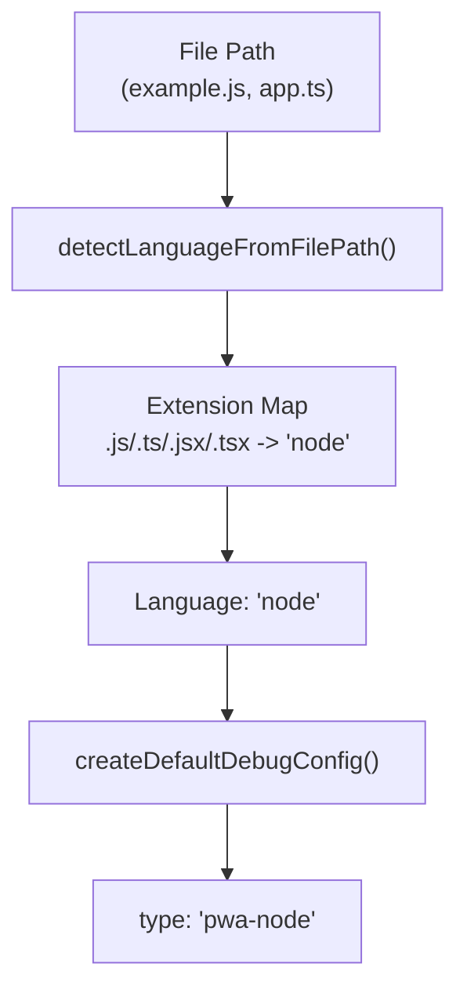
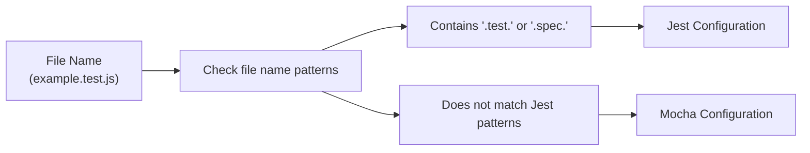
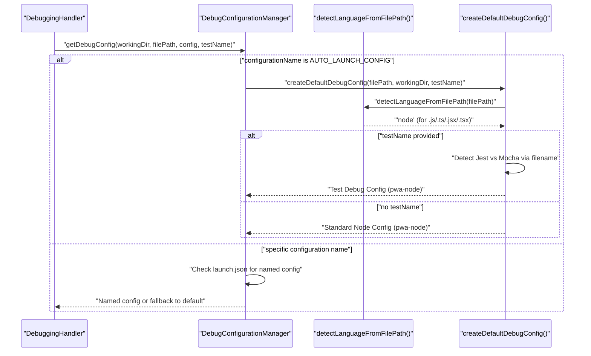

<!-- source: DeepWiki mcp.deepwiki.com · repo microsoft/DebugMCP · page 6.2 JavaScript and TypeScript · fetched 2026-10-26 -->

# JavaScript and TypeScript

<details>
<summary>Relevant source files</summary>

The following files were used as context for generating this wiki page:

- [docs/agent-resources/troubleshooting/javascript.md](docs/agent-resources/troubleshooting/javascript.md)
- [src/utils/debugConfigurationManager.ts](src/utils/debugConfigurationManager.ts)

</details>


This page documents DebugMCP's support for debugging JavaScript and TypeScript code running in Node.js environments. It covers language detection, default debug configurations using the `pwa-node` debugger type, and test-specific configurations for Jest and Mocha frameworks.

For client-side browser debugging, see the troubleshooting resources at [docs/agent-resources/troubleshooting/javascript.md:30-39](). For general debugging operations available across all languages, see [Section 5: Debugging Operations]().

## Language Detection

DebugMCP detects JavaScript and TypeScript files based on their file extensions and maps them to the Node.js debug type.

The detection logic in `DebugConfigurationManager` handles four file extensions:

| File Extension | Detected Language | Debug Type |
|---------------|-------------------|------------|
| `.js` | `node` | `pwa-node` |
| `.ts` | `node` | `pwa-node` |
| `.jsx` | `node` | `pwa-node` |
| `.tsx` | `node` | `pwa-node` |

When a file with one of these extensions is passed to the debugging system, the `detectLanguageFromFilePath` method returns `'node'`, which triggers Node.js-specific debug configuration generation.

### Language Detection Flow



Sources: [src/utils/debugConfigurationManager.ts:142-163](), [docs/agent-resources/troubleshooting/javascript.md:8-9]()

## Default Debug Configuration

When no test-specific configuration is requested, DebugMCP generates a standard Node.js launch configuration using the `pwa-node` debug type. This configuration is suitable for running standalone JavaScript/TypeScript files.

The configuration structure created by the system:

```typescript
{
    type: 'pwa-node',
    request: 'launch',
    name: 'DebugMCP Node.js Launch',
    program: fileFullPath,
    console: 'integratedTerminal',
    cwd: path.dirname(fileFullPath),
    env: {},
    stopOnEntry: false
}
```

Key properties:
- **type**: `pwa-node` specifies the modern Node.js debugger (PWA = Progressive Web App debugger) [docs/agent-resources/troubleshooting/javascript.md:9]().
- **program**: Absolute path to the JavaScript/TypeScript file to execute.
- **console**: `integratedTerminal` ensures output appears in VS Code's terminal [docs/agent-resources/troubleshooting/javascript.md:26]().
- **cwd**: Current working directory set to the file's directory.
- **stopOnEntry**: `false` allows the program to run immediately to the first breakpoint.

Sources: [src/utils/debugConfigurationManager.ts:18-19](), [docs/agent-resources/troubleshooting/javascript.md:19-28]()

## Test Framework Support

DebugMCP provides specialized debug configurations for two popular Node.js test frameworks: Jest and Mocha. The system automatically detects which framework to use based on file naming conventions.

### Test Framework Detection Logic



The detection logic checks if the filename includes `.test.` or `.spec.` patterns, which are common Jest conventions. If these patterns are not found, it defaults to Mocha configuration.

Sources: [src/utils/debugConfigurationManager.ts:10-16](), [src/utils/debugConfigurationManager.ts:30-35]()

### Jest Configuration

For files matching Jest naming patterns (e.g., `component.test.js`, `utils.spec.ts`), DebugMCP generates a configuration that runs Jest with test name filtering:

```typescript
{
    type: 'pwa-node',
    request: 'launch',
    name: 'DebugMCP Jest Test: ${testName}',
    program: '${workspaceFolder}/node_modules/.bin/jest',
    args: [
        '--testNamePattern', testName,
        '--runInBand',
        fileFullPath
    ],
    console: 'integratedTerminal',
    cwd: cwd,
    env: {},
    stopOnEntry: false
}
```

Key Jest-specific properties:
- **program**: Points to the Jest binary in `node_modules/.bin/jest`.
- **--testNamePattern**: Filters tests to run only the specified test by name.
- **--runInBand**: Runs tests serially in the current process (required for reliable debugging).
- **fileFullPath**: Restricts Jest to run only tests in the specified file.

Sources: [src/utils/debugConfigurationManager.ts:11-16]()

### Mocha Configuration

For files not matching Jest patterns, DebugMCP generates a Mocha test configuration:

```typescript
{
    type: 'pwa-node',
    request: 'launch',
    name: 'DebugMCP Mocha Test: ${testName}',
    program: '${workspaceFolder}/node_modules/.bin/mocha',
    args: [
        '--grep', testName,
        fileFullPath
    ],
    console: 'integratedTerminal',
    cwd: cwd,
    env: {},
    stopOnEntry: false
}
```

Key Mocha-specific properties:
- **program**: Points to the Mocha binary in `node_modules/.bin/mocha`.
- **--grep**: Filters tests using a regular expression pattern matching the test name.
- **fileFullPath**: Specifies which test file to run.

Sources: [src/utils/debugConfigurationManager.ts:11-16]()

## Configuration Creation Flow

The following diagram shows how the system creates JavaScript/TypeScript debug configurations, mapping specific functions and parameters to the configuration generation process:



Sources: [src/utils/debugConfigurationManager.ts:30-73](), [src/utils/debugConfigurationManager.ts:142-163]()

## Troubleshooting and Best Practices

For JavaScript/TypeScript debugging to work properly, ensure the following conditions are met:

1.  **Node.js Installation**: Node.js must be installed on the host machine [docs/agent-resources/troubleshooting/javascript.md:10]().
2.  **Source Maps**: When debugging TypeScript, transpiled code must include source maps to allow the debugger to map execution back to the original `.ts` files [docs/agent-resources/troubleshooting/javascript.md:46]().
3.  **Async Operations**: Use breakpoints inside `.then()`, `.catch()`, or within `async/await` functions to debug asynchronous logic [docs/agent-resources/troubleshooting/javascript.md:13-17]().
4.  **Launch Configurations**: Users can override the auto-detected configuration by defining a named configuration in `.vscode/launch.json` [src/utils/debugConfigurationManager.ts:42-66]().

### Common Troubleshooting Tips
- **Undefined Values**: Watch for `undefined` and `null` values which are frequent sources of errors in JS/TS [docs/agent-resources/troubleshooting/javascript.md:43]().
- **Integrated Terminal**: Output is directed to the `integratedTerminal` by default to handle interactive CLI programs [docs/agent-resources/troubleshooting/javascript.md:26]().
- **Browser Debugging**: For client-side code, use `pwa-chrome` or `pwa-msedge` types in `launch.json` [docs/agent-resources/troubleshooting/javascript.md:31-39]().

Sources: [docs/agent-resources/troubleshooting/javascript.md:1-47](), [src/utils/debugConfigurationManager.ts:41-69]()

---

