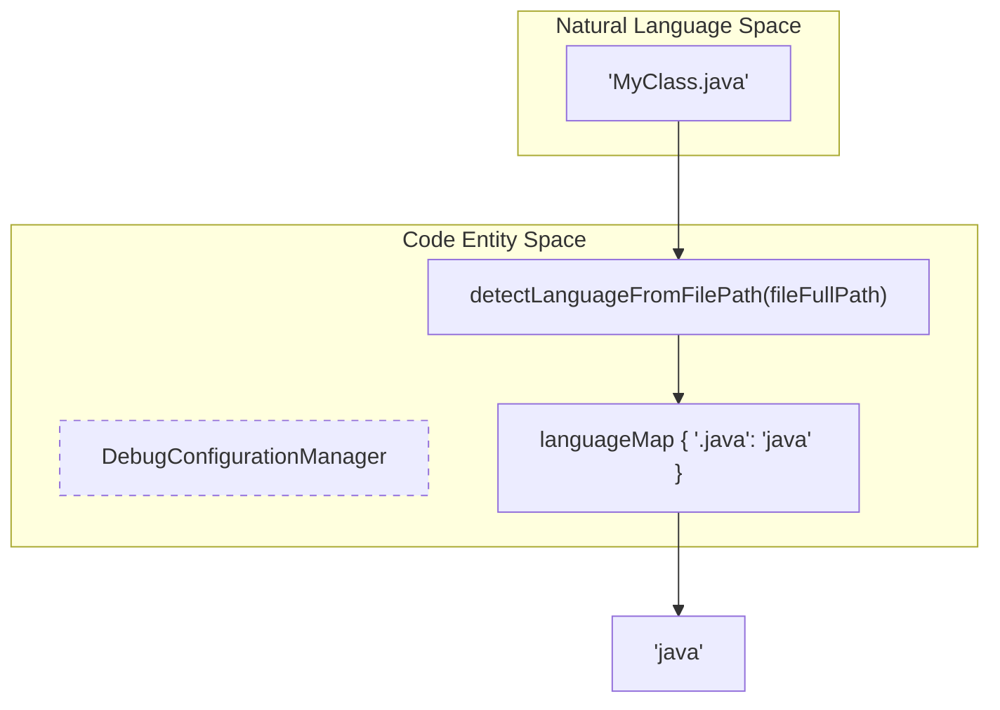
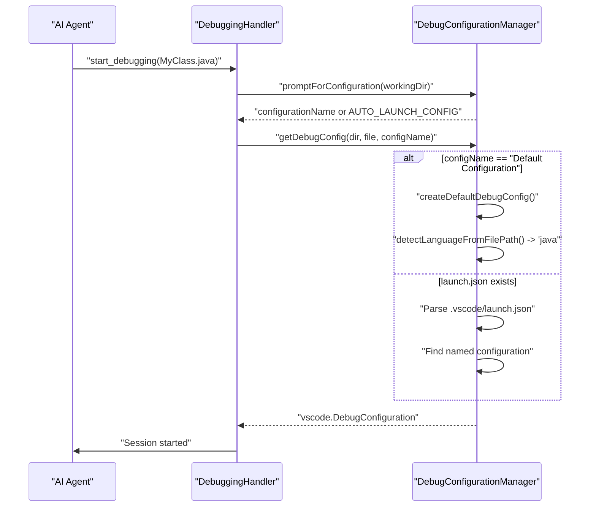
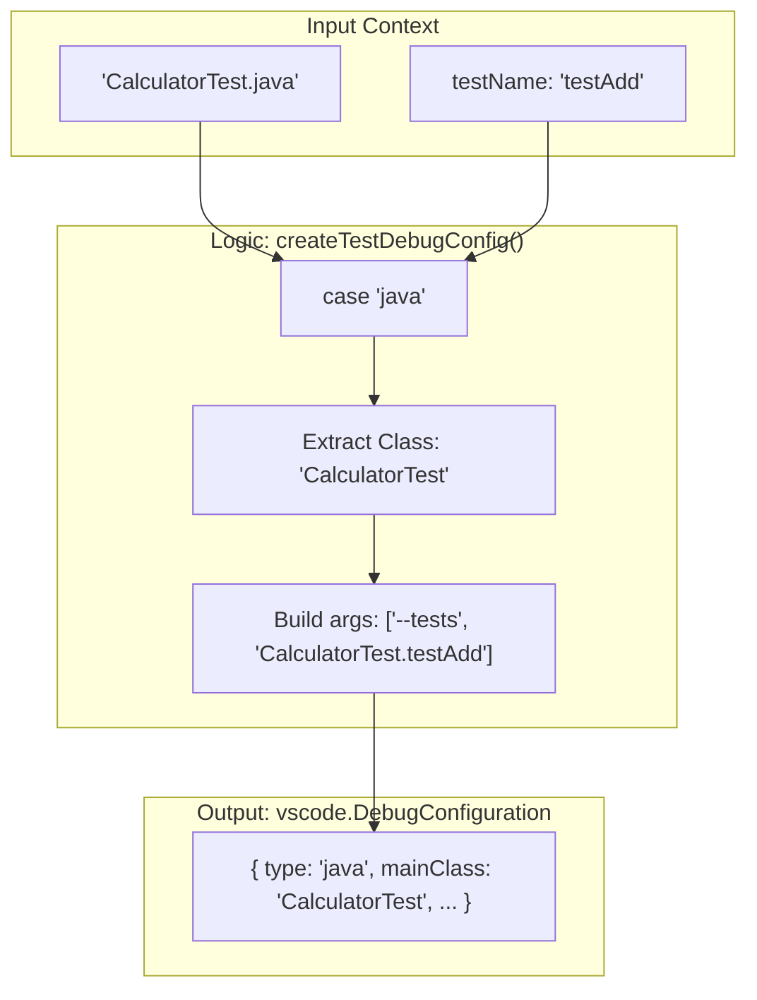

<!-- source: DeepWiki mcp.deepwiki.com · repo microsoft/DebugMCP · page 6.3 Java Debugging · fetched 2026-10-26 -->

# Java Debugging

<details>
<summary>Relevant source files</summary>

The following files were used as context for generating this wiki page:

- [docs/agent-resources/troubleshooting/java.md](docs/agent-resources/troubleshooting/java.md)
- [src/utils/debugConfigurationManager.ts](src/utils/debugConfigurationManager.ts)

</details>


This document describes Java-specific debugging support in DebugMCP, including language detection, debug configuration generation, JUnit test support, and classpath handling. For general debugging operations such as breakpoints and variable inspection, see [5. Debugging Operations](). For information about configuring launch.json files, see [4.4. Debug Configuration Manager]().

## Purpose and Scope

DebugMCP provides first-class support for debugging Java applications and JUnit tests through automatic configuration generation and integration with VS Code's Java debugger. This page covers:

- Java file detection and language identification.
- Default debug configuration structure for Java applications.
- JUnit test debugging with method-level filtering.
- Classpath configuration and project structure considerations.
- Common Java debugging issues and solutions.

## Prerequisites

Java debugging in DebugMCP requires the following:

| Requirement | Details |
|-------------|---------|
| **VS Code Extension** | [Extension Pack for Java](https://marketplace.visualstudio.com/items?itemName=vscjava.vscode-java-pack) |
| **File Extensions** | `.java` |
| **Debug Type** | `java` |
| **Environment** | `JAVA_HOME` must be configured |
| **Compilation** | Source files must be compiled to `.class` files before debugging |

Sources: [docs/agent-resources/troubleshooting/java.md:5-10]()

## Language Detection

DebugMCP automatically detects Java files based on file extension and maps them to the appropriate debug configuration type.

**Language Mapping Logic**
The `DebugConfigurationManager` uses a lookup map to associate file extensions with debugger types.



Sources: [src/utils/debugConfigurationManager.ts:142-163]()

## Configuration Flow

When an AI agent requests to debug a Java file, DebugMCP follows this configuration resolution process:



Sources: [src/utils/debugConfigurationManager.ts:30-73](), [src/utils/debugConfigurationManager.ts:168-180]()

## Default Debug Configuration

When no `launch.json` exists or when `AUTO_LAUNCH_CONFIG` ("Default Configuration") is selected, DebugMCP generates a default Java debug configuration.

### Standard Application Configuration

The default configuration for Java applications is generated within `createDefaultDebugConfig`:

| Field | Value | Description |
|-------|-------|-------------|
| `type` | `"java"` | VS Code Java debugger type |
| `request` | `"launch"` | Launch mode (vs. attach) |
| `name` | `"DebugMCP Java Launch"` | Configuration display name |
| `mainClass` | Derived from filename | Main class to execute (without `.java` extension) |
| `console` | `"integratedTerminal"` | Use VS Code integrated terminal |
| `cwd` | File's directory | Working directory for execution |

**Main Class Resolution**
The `mainClass` is extracted from the file path using `path.basename`. For example, a file at `/src/Main.java` results in `mainClass: "Main"`.

Sources: [src/utils/debugConfigurationManager.ts:202-209]()

## JUnit Test Debugging

DebugMCP supports debugging individual JUnit test methods when a `testName` parameter is provided to the `start_debugging` tool.



### JUnit Configuration Structure

The test configuration is created with specific arguments to filter execution:

| Field | Value | Description |
|-------|-------|-------------|
| `type` | `"java"` | Java debugger type |
| `name` | `"DebugMCP JUnit Test: {testName}"` | Descriptive name including test method |
| `mainClass` | Test class name | Class containing the test method |
| `args` | `["--tests", "{className}.{testName}"]` | JUnit test filter arguments |

Sources: [src/utils/debugConfigurationManager.ts:405-416]()

## Classpath and Project Structure

### Project Detection
The default configurations rely on VS Code's Java extension (Language Support for Java™ by Red Hat) to automatically determine the classpath based on:
- Maven `pom.xml` files.
- Gradle `build.gradle` files.
- Eclipse `.classpath` files.

### Manual Classpath Configuration
For projects requiring explicit classpath configuration, users should define a custom `launch.json` entry. DebugMCP will prioritize these over generated defaults if the user selects them.

```json
{
    "type": "java",
    "request": "launch",
    "name": "Launch Main",
    "mainClass": "com.example.Main",
    "classPaths": ["${workspaceFolder}/target/classes"]
}
```

Sources: [docs/agent-resources/troubleshooting/java.md:30-39]()

## Common Issues and Troubleshooting

| Issue | Cause | Solution |
|-------|-------|----------|
| **ClassNotFoundException** | Missing `.class` files or incorrect package. | Ensure project is compiled; check package declarations. |
| **NoSuchMethodError** | Stale compiled code. | Rebuild project (Maven/Gradle clean install). |
| **OutOfMemoryError** | Insufficient heap for debugger. | Monitor heap usage; adjust JVM args in `vmArgs`. |
| **Breakpoint Not Hit** | Source/Bytecode mismatch. | Ensure `.java` and `.class` files are in sync. |

Sources: [docs/agent-resources/troubleshooting/java.md:49-53]()

## Best Practices for AI Agents

When debugging Java code, AI agents should follow these guidelines provided in the system resources:

1.  **Compilation**: Always ensure the code is compiled before attempting to debug, as the Java debugger operates on bytecode.
2.  **Main Method**: For entry point debugging, set breakpoints inside the `public static void main(String[] args)` method.
3.  **Exception Handling**: Leverage breakpoints in `catch` blocks to inspect the state of a `Throwable` object.
4.  **Static Context**: Be aware of the difference between static and instance contexts when inspecting variables.

Sources: [docs/agent-resources/troubleshooting/java.md:12-17](), [docs/agent-resources/troubleshooting/java.md:41-48]()

---

