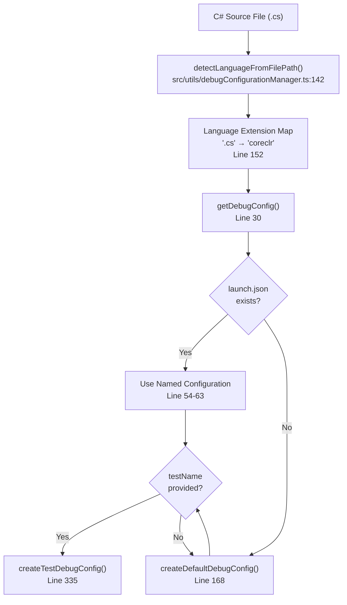
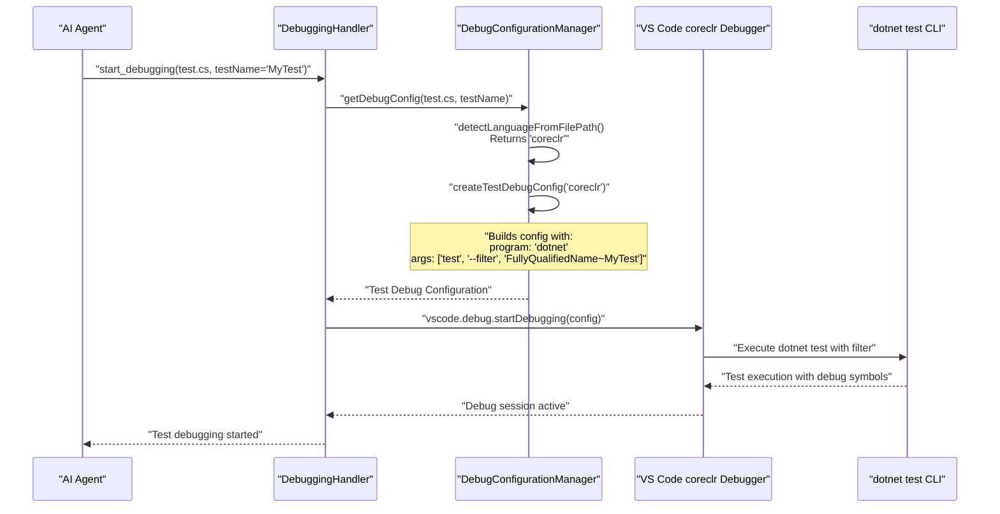
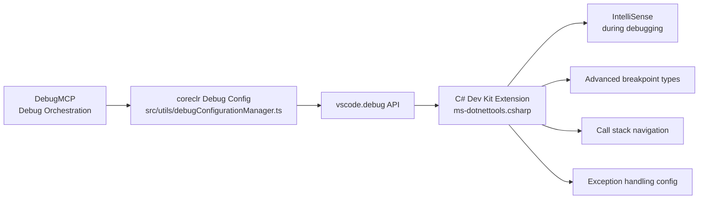

<!-- source: DeepWiki mcp.deepwiki.com · repo microsoft/DebugMCP · page 6.4 C# and .NET · fetched 2026-10-26 -->

# C# and .NET

Relevant source files

The following files were used as context for generating this wiki page:

- [docs/agent-resources/troubleshooting/csharp.md](docs/agent-resources/troubleshooting/csharp.md)
- [src/utils/debugConfigurationManager.ts](src/utils/debugConfigurationManager.ts)

This document covers C# and .NET debugging support in DebugMCP, including configuration generation, test framework integration, and the CoreCLR debugger interface. For general debugging operations like breakpoint management and code navigation, see [5. Debugging Operations](). For test-specific workflows across all languages, see [5.1. Session Management]().

## Overview

DebugMCP provides comprehensive debugging support for C# and .NET applications through the `coreclr` debugger type. The system automatically detects C# files by extension (`.cs`) and generates appropriate debug configurations for both regular execution and test scenarios. Support includes console applications, test projects (xUnit, NUnit, MSTest), and web applications.

**Key Features:**
- Automatic language detection from `.cs` file extension [src/utils/debugConfigurationManager.ts:152]()
- Default `coreclr` debug configurations [src/utils/debugConfigurationManager.ts:210-218]()
- Test framework integration with `dotnet test` filtering [src/utils/debugConfigurationManager.ts:418-433]()
- Expression evaluation in debug context [docs/agent-resources/troubleshooting/csharp.md:63-69]()
- Multi-scope variable inspection [docs/agent-resources/troubleshooting/csharp.md:70-74]()
- Integration with VS Code C# extension [docs/agent-resources/troubleshooting/csharp.md:81-88]()

Sources: [src/utils/debugConfigurationManager.ts:152](), [docs/agent-resources/troubleshooting/csharp.md:1-22]()

## Language Detection and Configuration Flow

The system uses `DebugConfigurationManager` to detect C# files and generate appropriate debug configurations.

Title: C# Language Detection and Configuration Flow

**Configuration Selection Logic:**
The `detectLanguageFromFilePath` function maps the `.cs` extension to the `coreclr` debugger type [src/utils/debugConfigurationManager.ts:152](). If `AUTO_LAUNCH_CONFIG` is requested or no `launch.json` is found, `createDefaultDebugConfig` is invoked [src/utils/debugConfigurationManager.ts:36-38]().

Sources: [src/utils/debugConfigurationManager.ts:30-73](), [src/utils/debugConfigurationManager.ts:142-163]()

## Debug Configuration Types

### Default CoreCLR Configuration

The default configuration is used for regular C# program execution when no specific test name is provided.

**Configuration Properties [src/utils/debugConfigurationManager.ts:210-218]():**
| Property | Value | Purpose |
|----------|-------|---------|
| `type` | `coreclr` | Specifies CoreCLR debugger |
| `request` | `launch` | Starts new debug session |
| `program` | `fileFullPath` | Target C# file to execute |
| `console` | `integratedTerminal` | Output destination |
| `cwd` | `workingDirectory` | Working directory context |
| `stopAtEntry` | `false` | Don't pause at entry point |

Sources: [src/utils/debugConfigurationManager.ts:210-218]()

### Test Configuration for .NET

When debugging specific tests, `DebugConfigurationManager` generates a specialized configuration using the `dotnet` CLI [src/utils/debugConfigurationManager.ts:418-433]().

**Test Configuration Features:**
- **Program**: Uses `dotnet` CLI instead of direct file execution [src/utils/debugConfigurationManager.ts:422]().
- **Test Filtering**: Uses `--filter` with `FullyQualifiedName~${testName}` for pattern matching [src/utils/debugConfigurationManager.ts:425]().
- **Build Optimization**: Includes `--no-build` to speed up startup [src/utils/debugConfigurationManager.ts:426]().
- **Framework Support**: Compatible with xUnit, NUnit, and MSTest [docs/agent-resources/troubleshooting/csharp.md:14]().

Sources: [src/utils/debugConfigurationManager.ts:418-433](), [docs/agent-resources/troubleshooting/csharp.md:13-16]()

## Test Framework Integration

Title: .NET Test Debugging Request Flow

**Test Method Filtering:**
The `--filter` argument uses pattern matching to select specific tests, supporting exact matches or pattern matching with the `~` operator [docs/agent-resources/troubleshooting/csharp.md:76-79]().

Sources: [src/utils/debugConfigurationManager.ts:335-433](), [docs/agent-resources/troubleshooting/csharp.md:76-80]()

## Expression Evaluation and Variable Inspection

C# debugging in DebugMCP supports sophisticated expression evaluation through the CoreCLR debugger [docs/agent-resources/troubleshooting/csharp.md:63-69]().

### Supported Expression Types

| Expression Type | Example |
|----------------|---------|
| Property Access | `myObject.Property` |
| Method Calls | `myObject.Method()` |
| LINQ Queries | `list.Where(x => x > 5)` |
| Object Creation | `new List<int>()` |

### Variable Scope Management

The system categorizes C# variables into three primary scopes [docs/agent-resources/troubleshooting/csharp.md:70-74]():
- **Local Variables**: Current method scope and parameters.
- **Global Variables**: Static members and fields.
- **All Scope**: Complete variable context.

Sources: [docs/agent-resources/troubleshooting/csharp.md:63-74]()

## Project Type Support

### Supported C# Project Types [docs/agent-resources/troubleshooting/csharp.md:6-22]():

1.  **Console Applications**: Standard `.cs` files using `coreclr` debug type.
2.  **Unit Test Projects**: Supports MSTest, NUnit, and xUnit. Detected via file patterns like `*Tests.cs`.
3.  **Web Applications**: ASP.NET Core and Blazor projects using `coreclr`.

Sources: [docs/agent-resources/troubleshooting/csharp.md:6-22]()

## Integration with C# Dev Kit

DebugMCP leverages the VS Code C# extension (C# Dev Kit) for enhanced debugging capabilities [docs/agent-resources/troubleshooting/csharp.md:81-88]().

Title: DebugMCP and C# Dev Kit Integration

Sources: [docs/agent-resources/troubleshooting/csharp.md:81-95]()

## Troubleshooting Common Issues

### Common Issues and Solutions [docs/agent-resources/troubleshooting/csharp.md:40-60]():

| Issue | Cause | Solution |
|-------|-------|----------|
| **Debugger Won't Start** | Missing C# Dev Kit extension | Install the C# Dev Kit extension [docs/agent-resources/troubleshooting/csharp.md:45-46](). |
| **Breakpoints Not Hit** | Debug symbols not generated | Ensure project builds in Debug mode [docs/agent-resources/troubleshooting/csharp.md:49-50](). |
| **Test Discovery Issues** | Framework misconfiguration | Verify test project references and naming [docs/agent-resources/troubleshooting/csharp.md:52-54](). |

### Performance Optimization:
- Use filtered test execution for large suites [docs/agent-resources/troubleshooting/csharp.md:57]().
- Limit scope of variable inspection during debugging [docs/agent-resources/troubleshooting/csharp.md:59]().

Sources: [docs/agent-resources/troubleshooting/csharp.md:40-60]()

---

