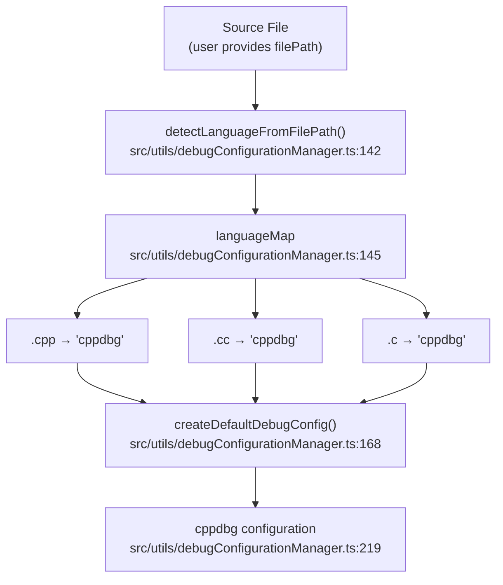
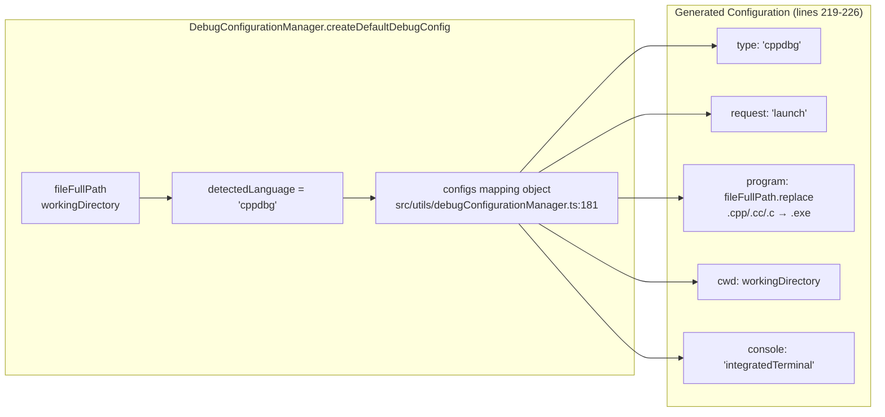
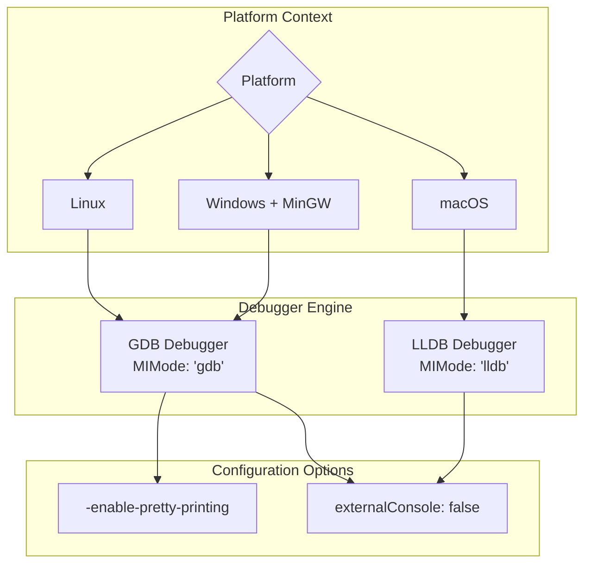
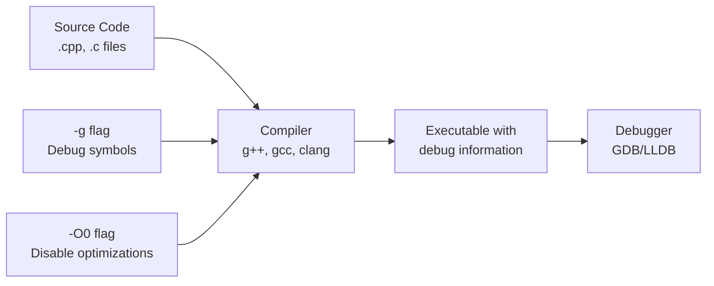
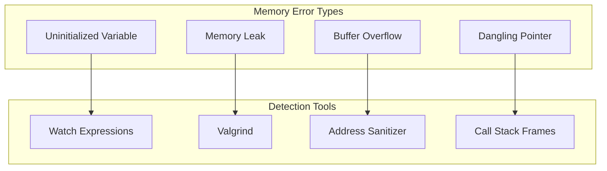

<!-- source: DeepWiki mcp.deepwiki.com · repo microsoft/DebugMCP · page 6.5 C and C++ · fetched 2026-10-26 -->

# C and C++

<details>
<summary>Relevant source files</summary>

The following files were used as context for generating this wiki page:

- [docs/agent-resources/troubleshooting/cpp.md](docs/agent-resources/troubleshooting/cpp.md)
- [src/utils/debugConfigurationManager.ts](src/utils/debugConfigurationManager.ts)

</details>


This page documents C and C++ debugging support in DebugMCP, including language detection, debug configuration generation, debugger integration (GDB/LLDB), and troubleshooting. For information about other compiled languages, see [Go Debugging](#6.6) and [Other Languages](#6.7). For general debugging operations applicable to all languages, see [Debugging Operations](#5).

## Overview

DebugMCP provides full debugging support for C and C++ programs through integration with the VS Code C/C++ extension and the `cppdbg` debug adapter. The system automatically detects C/C++ source files by extension and generates appropriate debug configurations that target either GDB (Linux/Windows with MinGW) or LLDB (macOS) debuggers.

**Key Requirements:**
- [C/C++ extension for VS Code](https://marketplace.visualstudio.com/items?itemName=ms-vscode.cpptools) (by Microsoft) [docs/agent-resources/troubleshooting/cpp.md:6]()
- GDB or LLDB debugger installed on the system [docs/agent-resources/troubleshooting/cpp.md:7]()
- Programs compiled with debug symbols (`-g` flag) [docs/agent-resources/troubleshooting/cpp.md:8]()

Sources: [docs/agent-resources/troubleshooting/cpp.md:1-79]()

## Language Detection

The `DebugConfigurationManager` identifies C/C++ source files by their file extensions and maps them to the `cppdbg` debug adapter type.

**C/C++ Detection Flow**


**Supported Extensions:**

| Extension | Language | Debug Type |
|-----------|----------|------------|
| `.cpp` | C++ | `cppdbg` [src/utils/debugConfigurationManager.ts:153]() |
| `.cc` | C++ | `cppdbg` [src/utils/debugConfigurationManager.ts:154]() |
| `.c` | C | `cppdbg` [src/utils/debugConfigurationManager.ts:155]() |
| `.h` | C/C++ header | N/A (use corresponding source file) [docs/agent-resources/troubleshooting/cpp.md:9]() |
| `.hpp` | C++ header | N/A (use corresponding source file) [docs/agent-resources/troubleshooting/cpp.md:9]() |

The detection logic is implemented in `detectLanguageFromFilePath` [src/utils/debugConfigurationManager.ts:142-163]() which performs a simple extension-based lookup.

Sources: [src/utils/debugConfigurationManager.ts:142-163](), [docs/agent-resources/troubleshooting/cpp.md:9]()

## Default Debug Configuration

When no `launch.json` configuration exists or when the AI agent requests the `AUTO_LAUNCH_CONFIG` [src/utils/debugConfigurationManager.ts:25](), DebugMCP generates a standard `cppdbg` configuration.

### Configuration Heuristics

**C++ Configuration Mapping**


### Generated Configuration

The default configuration generated for C/C++ files:

```typescript
{
    type: 'cppdbg',
    request: 'launch',
    name: 'DebugMCP C++ Launch',
    program: fileFullPath.replace(/\.(cpp|cc|c)$/, '.exe'),
    cwd: workingDirectory,
    console: 'integratedTerminal'
}
```

**Key Properties:**
- **type**: `cppdbg` - Uses the C/C++ debug adapter from the VS Code C/C++ extension [src/utils/debugConfigurationManager.ts:220]()
- **request**: `launch` - Starts a new debug session [src/utils/debugConfigurationManager.ts:221]()
- **program**: The executable path, automatically derived by replacing source extension with `.exe` [src/utils/debugConfigurationManager.ts:223]()
- **cwd**: Working directory set to the provided `workingDirectory` [src/utils/debugConfigurationManager.ts:224]()
- **console**: `integratedTerminal` - Uses VS Code's integrated terminal for I/O [src/utils/debugConfigurationManager.ts:225]()

**Important Note**: The heuristic assumes the executable has the same base name as the source file with an `.exe` extension [src/utils/debugConfigurationManager.ts:223](). Users may need to provide a custom `launch.json` if their build output follows a different naming convention.

Sources: [src/utils/debugConfigurationManager.ts:219-226]()

## Debugger Support: GDB vs LLDB

C/C++ debugging can use either GDB or LLDB depending on the platform. While the default heuristic is generic, users can configure platform-specific debuggers in their `launch.json`.

**Debugger Platform Selection**


### GDB Configuration (Linux/Windows)

For systems using GDB, the recommended configuration includes:

```json
{
    "type": "cppdbg",
    "request": "launch",
    "name": "Debug with GDB",
    "program": "${fileDirname}/${fileBasenameNoExtension}",
    "MIMode": "gdb",
    "setupCommands": [
        {
            "description": "Enable pretty-printing for gdb",
            "text": "-enable-pretty-printing",
            "ignoreFailures": true
        }
    ]
}
```

**GDB-Specific Features:**
- **Pretty printing**: Enabled via `setupCommands` for better data structure visualization [docs/agent-resources/troubleshooting/cpp.md:34-40]()
- **MI Mode**: Uses the Machine Interface protocol for communication (`MIMode: "gdb"`) [docs/agent-resources/troubleshooting/cpp.md:33]()

### LLDB Configuration (macOS)

For macOS systems using LLDB:

```json
{
    "type": "cppdbg",
    "request": "launch",
    "name": "Debug with LLDB",
    "program": "${fileDirname}/${fileBasenameNoExtension}",
    "MIMode": "lldb"
}
```

Sources: [docs/agent-resources/troubleshooting/cpp.md:20-58]()

## Compilation Requirements

C/C++ debugging requires source code to be compiled with specific flags to include debug information.

**Compilation Workflow**


**Required Compilation Flags:**

| Flag | Purpose | Importance |
|------|---------|------------|
| `-g` | Include debug symbols (line numbers, variable names) | **Required** [docs/agent-resources/troubleshooting/cpp.md:8]() |
| `-O0` | Disable optimizations for accurate stepping | **Recommended** [docs/agent-resources/troubleshooting/cpp.md:13]() |
| `-fno-omit-frame-pointer` | Keep frame pointers for accurate stack traces | Optional [docs/agent-resources/troubleshooting/cpp.md:77]() |
| `-fsanitize=address` | Enable Address Sanitizer for memory error detection | Optional [docs/agent-resources/troubleshooting/cpp.md:65]() |

Sources: [docs/agent-resources/troubleshooting/cpp.md:13-14](), [docs/agent-resources/troubleshooting/cpp.md:69-74](), [docs/agent-resources/troubleshooting/cpp.md:77]()

## Memory Debugging

C/C++ debugging often involves tracking memory-related issues. DebugMCP supports several memory debugging approaches through standard C++ tools.

**Memory Error Analysis**


### Debugging Strategies

**Variable Inspection:**
- Watch pointer values and dereferenced contents [docs/agent-resources/troubleshooting/cpp.md:15]()
- Use address sanitizer (`-fsanitize=address`) to detect memory errors at runtime [docs/agent-resources/troubleshooting/cpp.md:65]()
- Monitor uninitialized variables during stepping [docs/agent-resources/troubleshooting/cpp.md:62]()

**Stack Analysis:**
- Use the call stack to trace function calls and local variables [docs/agent-resources/troubleshooting/cpp.md:16]()
- Enable core dumps for post-mortem debugging of crashes [docs/agent-resources/troubleshooting/cpp.md:17]()

**External Tools:**
- **Valgrind** (Linux): `valgrind --leak-check=full ./program` [docs/agent-resources/troubleshooting/cpp.md:76]()
- **Address Sanitizer**: Compile with `-fsanitize=address -fno-omit-frame-pointer` [docs/agent-resources/troubleshooting/cpp.md:77]()

Sources: [docs/agent-resources/troubleshooting/cpp.md:14-18](), [docs/agent-resources/troubleshooting/cpp.md:60-66](), [docs/agent-resources/troubleshooting/cpp.md:75-78]()

## Common Issues and Troubleshooting

### Issue: Unable to Start Debugging

**Symptoms:**
- Debug session fails to start.
- Error message: "Unable to start debugging".

**Causes and Solutions:**
- **No debug symbols**: Ensure the executable is compiled with the `-g` flag [docs/agent-resources/troubleshooting/cpp.md:69]().
- **Missing Symbol Table**: Recompile with `-g` flag [docs/agent-resources/troubleshooting/cpp.md:70]().

### Issue: Breakpoints Grayed Out

**Symptoms:**
- Breakpoints appear gray/hollow in the editor.
- Debugger doesn't stop at breakpoints.

**Solutions:**
- **Source Mismatch**: Source file doesn't match the compiled binary. Rebuild the executable [docs/agent-resources/troubleshooting/cpp.md:71]().

### Issue: Variables Optimized Away

**Symptoms:**
- Variables display as `<optimized out>` or are missing from the variables view.

**Solution:**
- **Disable Optimizations**: Compile with `-O0` to ensure all variables are visible to the debugger [docs/agent-resources/troubleshooting/cpp.md:73]().

### Issue: Segmentation Fault

**Debugging Steps:**
1. Use the backtrace (call stack) to find the crashing line [docs/agent-resources/troubleshooting/cpp.md:72]().
2. Check pointer operations at the site of the crash [docs/agent-resources/troubleshooting/cpp.md:72]().
3. Inspect uninitialized variables or array bounds [docs/agent-resources/troubleshooting/cpp.md:62-63]().

Sources: [docs/agent-resources/troubleshooting/cpp.md:68-74]()

---

