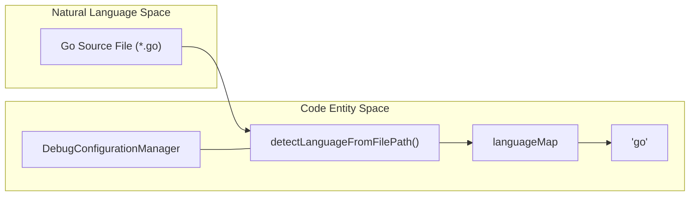
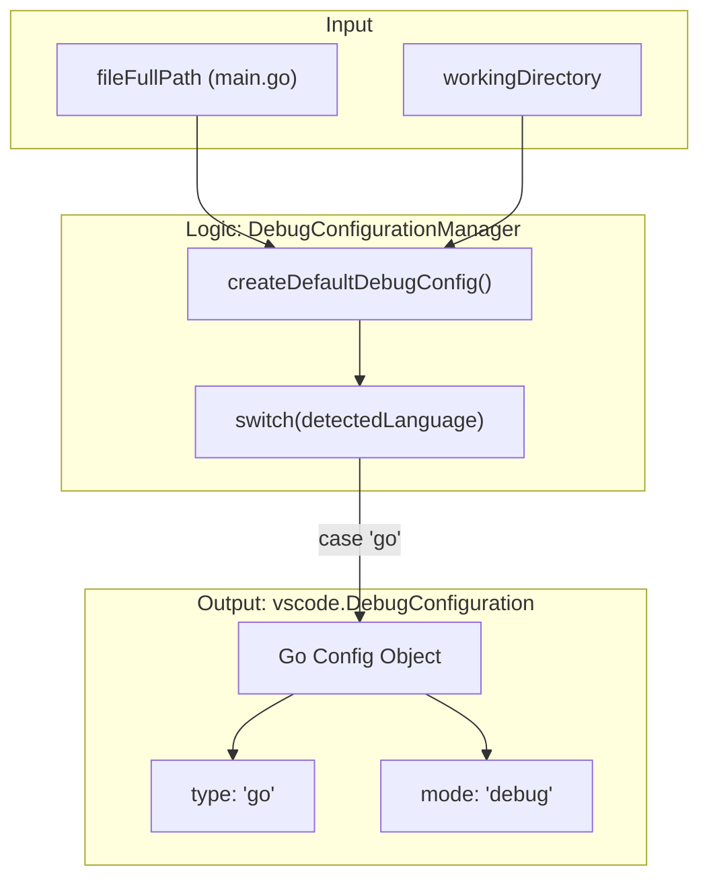

<!-- source: DeepWiki mcp.deepwiki.com · repo microsoft/DebugMCP · page 6.6 Go Debugging · fetched 2026-10-26 -->

# Go Debugging

<details>
<summary>Relevant source files</summary>

The following files were used as context for generating this wiki page:

- [docs/agent-resources/troubleshooting/go.md](docs/agent-resources/troubleshooting/go.md)
- [src/utils/debugConfigurationManager.ts](src/utils/debugConfigurationManager.ts)

</details>


## Purpose and Scope

This page documents DebugMCP's support for debugging Go programs using the Delve debugger. It covers debug configuration generation, language detection, and Go-specific debugging patterns. DebugMCP interfaces with the [Go extension for VS Code](https://marketplace.visualstudio.com/items?itemName=golang.Go) to provide a seamless debugging experience for AI agents.

For general debugging operations (breakpoints, stepping, variable inspection), see **5. Debugging Operations**. For information about configuring other languages, see **6. Language Support**.

## Prerequisites

Go debugging in DebugMCP requires the following components to be installed and configured on the host machine:

| Component | Requirement | Purpose |
|-----------|-------------|---------|
| **VS Code Extension** | [Go extension](https://marketplace.visualstudio.com/items?itemName=golang.Go) | Provides Go language support and DAP (Debug Adapter Protocol) integration. |
| **Delve Debugger** | `dlv` installed and in `PATH` | The actual debugger backend for Go programs. |
| **Go Toolchain** | Go 1.16+ recommended | Compiles Go programs with debug symbols. |
| **Environment** | `GOPATH` and `GOROOT` | Required for module resolution and build processes. |

To install Delve, run:
```bash
go install github.com/go-delve/delve/cmd/dlv@latest
```

Sources: [docs/agent-resources/troubleshooting/go.md:5-10]()

## Language Detection

DebugMCP automatically identifies Go source files by their extension and maps them to the `go` debug configuration type. This detection is handled by the `DebugConfigurationManager`.

**Language Detection Mapping**

The `detectLanguageFromFilePath` method in `DebugConfigurationManager` [src/utils/debugConfigurationManager.ts:142-163]() maps file extensions to debug types:

| File Extension | Debug Type | Debugger |
|----------------|------------|----------|
| `.go` | `go` | Delve |

### Code Entity Mapping: Language Detection

The following diagram bridges the natural language concept of "Go File Detection" to the specific code entities in `DebugConfigurationManager`.



Sources: [src/utils/debugConfigurationManager.ts:142-163]()

## Default Debug Configuration

When a user or agent invokes `start_debugging` without a pre-defined `launch.json` configuration, or specifically selects `Default Configuration` [src/utils/debugConfigurationManager.ts:25-25](), DebugMCP generates a Go debug configuration automatically via `createDefaultDebugConfig` [src/utils/debugConfigurationManager.ts:168-172]().

**Default Configuration Structure**

The generated configuration for Go includes:

| Field | Value | Purpose |
|-------|-------|---------|
| `type` | `'go'` | Specifies the Go debug adapter. |
| `request` | `'launch'` | Starts a new debug session. |
| `name` | `'DebugMCP Go Launch'` | Identifier for the session. |
| `mode` | `'debug'` | Runs in debug mode (as opposed to `test` or `exec`). |
| `program` | `fileFullPath` | The specific Go file or package to debug. |
| `cwd` | `workingDirectory` | The working directory for the process. |

### Code Entity Mapping: Configuration Generation

This diagram illustrates how the system transitions from a file path to a functional `vscode.DebugConfiguration` object.



Sources: [src/utils/debugConfigurationManager.ts:30-38](), [src/utils/debugConfigurationManager.ts:168-172](), [src/utils/debugConfigurationManager.ts:227-234]()

## Test Debugging Support

DebugMCP provides specialized support for debugging Go tests. When the `testName` parameter is provided to `getDebugConfig` [src/utils/debugConfigurationManager.ts:10-16](), the manager attempts to create a test-specific configuration.

**Manual Test Configuration**
If an agent needs to debug a specific test function, the following structure is recommended for `launch.json` or generated dynamically:

```json
{
    "type": "go",
    "request": "launch",
    "name": "Launch Test",
    "mode": "test",
    "program": "${fileDirname}",
    "args": ["-test.run", "TestFunctionName"]
}
```

Sources: [docs/agent-resources/troubleshooting/go.md:30-40](), [src/utils/debugConfigurationManager.ts:34-35]()

## Go-Specific Debugging Patterns

### Goroutine and Concurrency
Go's concurrency model requires specific debugging strategies:
- **Goroutines**: Use the VS Code Call Stack panel to switch between concurrent goroutines [docs/agent-resources/troubleshooting/go.md:52-52]().
- **Channels**: Set breakpoints at channel send/receive operations to debug synchronization issues [docs/agent-resources/troubleshooting/go.md:17-17]().
- **Race Detector**: It is recommended to use `go run -race` before a debug session to find data races [docs/agent-resources/troubleshooting/go.md:47-47]().

### Variable Inspection
- **Interfaces**: When inspecting interface values, Delve allows checking both the concrete type and the underlying value [docs/agent-resources/troubleshooting/go.md:15-15]().
- **Pointers**: Be mindful of value vs pointer receivers on methods when evaluating expressions [docs/agent-resources/troubleshooting/go.md:45-45]().

Sources: [docs/agent-resources/troubleshooting/go.md:12-18](), [docs/agent-resources/troubleshooting/go.md:42-47]()

## Troubleshooting Go Debugging

Common issues encountered when debugging Go with DebugMCP and their resolutions:

| Issue | Root Cause | Solution |
|-------|------------|----------|
| **"could not launch process"** | Delve (`dlv`) is missing or not in PATH. | Ensure Delve is installed: `go install github.com/go-delve/delve/cmd/dlv@latest` [docs/agent-resources/troubleshooting/go.md:50-50](). |
| **Breakpoints not hit** | Build optimizations or incorrect build mode. | Ensure `mode` is set to `debug` and optimizations are disabled if necessary [docs/agent-resources/troubleshooting/go.md:51-51](). |
| **GOPATH/GOROOT errors** | Environment variables not set correctly. | Verify environment variables in the terminal or VS Code settings [docs/agent-resources/troubleshooting/go.md:10-10](). |

Sources: [docs/agent-resources/troubleshooting/go.md:49-53]()

---

