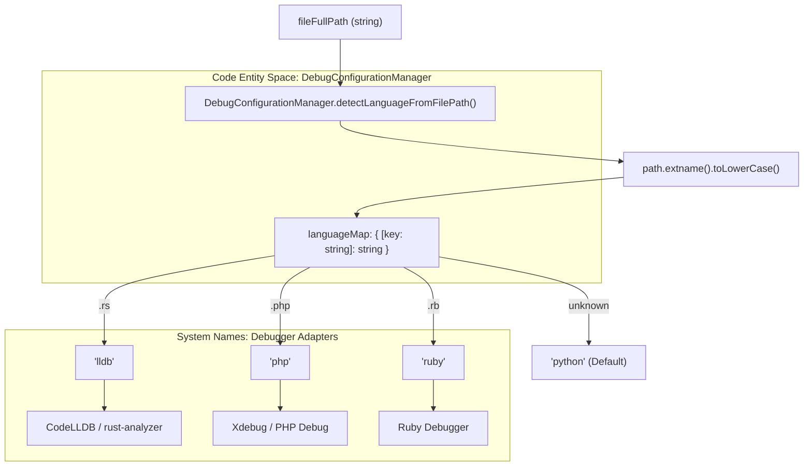

<!-- source: DeepWiki mcp.deepwiki.com · repo microsoft/DebugMCP · page 6.7 Other Languages · fetched 2026-10-26 -->

# Other Languages

<details>
<summary>Relevant source files</summary>

The following files were used as context for generating this wiki page:

- [src/utils/debugConfigurationManager.ts](src/utils/debugConfigurationManager.ts)

</details>


This document covers DebugMCP's debugging support for Rust (via LLDB), PHP, and Ruby. These languages are supported for standard debugging operations through VS Code's Debug Adapter Protocol (DAP) integration. While they lack the specialized test framework integrations found in Python or Java, they leverage the same core debugging tools for session management and state inspection.

For information about other supported languages, see [6.1 Python Debugging](), [6.2 JavaScript and TypeScript](), [6.3 Java Debugging](), [6.4 C# and .NET](), [6.5 C and C++](), and [6.6 Go Debugging]().

## Overview

DebugMCP provides automated language detection and debugger mapping for Rust, PHP, and Ruby. When an AI agent initiates a debugging session, the `DebugConfigurationManager` identifies the language by file extension and maps it to the appropriate VS Code debugger type.

| Language | File Extension | Debugger Type (`type`) | Required VS Code Extension |
| :--- | :--- | :--- | :--- |
| **Rust** | `.rs` | `lldb` | [rust-analyzer](https://marketplace.visualstudio.com/items?itemName=rust-lang.rust-analyzer) |
| **PHP** | `.php` | `php` | [PHP Debug](https://marketplace.visualstudio.com/items?itemName=xdebug.php-debug) |
| **Ruby** | `.rb` | `ruby` | [Ruby](https://marketplace.visualstudio.com/items?itemName=rebornix.ruby) |

Sources: [src/utils/debugConfigurationManager.ts:142-163](), [src/utils/debugConfigurationManager.ts:157-159]()

## Language Detection Mechanism

The `DebugConfigurationManager` class handles the translation from a file path to a debugger identifier. This occurs within the `detectLanguageFromFilePath` method using a static mapping.

### Language Mapping Logic



**Language Detection Mapping**

The mapping ensures that when an agent calls `start_debugging`, the `type` field in the generated `vscode.DebugConfiguration` matches the expected ID for the installed debugger extension.

Sources: [src/utils/debugConfigurationManager.ts:142-163]()

## Configuration Generation Strategy

Rust, PHP, and Ruby currently utilize a fallback mechanism within the `createDefaultDebugConfig` method. If a language-specific template is not explicitly defined in the `configs` object, the system defaults to a generic structure.

### Configuration Fallback Flow

```mermaid
sequenceDiagram
    participant Agent as "AI Agent (MCP Tool Call)"
    participant DCM as "DebugConfigurationManager"
    participant Create as "createDefaultDebugConfig"
    
    Agent->>DCM: getDebugConfig(fileFullPath, AUTO_LAUNCH_CONFIG)
    DCM->>DCM: detectLanguageFromFilePath(fileFullPath)
    Note over DCM: Returns 'lldb', 'php', or 'ruby'
    
    DCM->>Create: createDefaultDebugConfig(file, workingDir, testName)
    
    Note over Create: Check if language exists in configs object
    alt Language Not in Specialized Configs
        Create->>Create: Fallback to configs['python'] template
        Note right of Create: Uses 'python' template but<br/>overwrites 'type' with detected lang
    end
    
    Create-->>DCM: vscode.DebugConfiguration
    DCM-->>Agent: Returns Configuration
```

**Configuration Generation for Other Languages**

Even though these languages use the Python template as a base, the `type` property is correctly set to `lldb`, `php`, or `ruby`, which allows VS Code to route the request to the correct Debug Adapter.

Sources: [src/utils/debugConfigurationManager.ts:36-38](), [src/utils/debugConfigurationManager.ts:168-175]()

## Rust Debugging (LLDB)

### Implementation Details
Rust support is primarily targeted at the `lldb` debugger type. This is compatible with the `CodeLLDB` extension often used alongside `rust-analyzer`.

*   **Detection**: Triggered by `.rs` extension [src/utils/debugConfigurationManager.ts:157]().
*   **Default Behavior**: The `program` field is set to the current file path. Note that for compiled languages like Rust, this may require a pre-launch task to compile the binary, or a `launch.json` that points to the resulting executable in `target/debug/`.

### Requirements
1.  **rust-analyzer**: Provides the language server and integration.
2.  **CodeLLDB**: The actual debug adapter for Rust.

## PHP Debugging

### Implementation Details
PHP support maps to the `php` debugger type, which is the standard identifier for the Xdebug-based PHP Debug extension.

*   **Detection**: Triggered by `.php` extension [src/utils/debugConfigurationManager.ts:158]().
*   **Execution**: Launches the PHP script using the local PHP interpreter.

### Xdebug Requirements
For the debugger to hit breakpoints, Xdebug must be enabled in the local `php.ini`:
*   `xdebug.mode=debug`
*   `xdebug.start_with_request=yes`

## Ruby Debugging

### Implementation Details
Ruby support maps to the `ruby` debugger type.

*   **Detection**: Triggered by `.rb` extension [src/utils/debugConfigurationManager.ts:159]().
*   **Execution**: Relies on the Ruby extension to manage the debug process (e.g., via `rdebug-ide` or `debug` gem).

## Test Framework Support and Limitations

Unlike languages like Java or C#, Rust, PHP, and Ruby do not have specialized test filtering in the `createTestDebugConfig` method.

### Fallback Behavior for Tests
If an agent attempts to debug a specific test using the `testName` parameter for these languages, the system follows the `default` case in the test configuration logic:

1.  **Warning Generation**: The configuration name is appended with a warning: `" (test filtering not supported for ${detectedLanguage})"` [src/utils/debugConfigurationManager.ts:436-438]().
2.  **Full File Execution**: The system ignores the `testName` filter and launches the entire file/program [src/utils/debugConfigurationManager.ts:442-446]().

| Language | Test Parameter Support | Behavior |
| :--- | :--- | :--- |
| **Rust** | No | Launches file; ignore `testName` |
| **PHP** | No | Launches file; ignore `testName` |
| **Ruby** | No | Launches file; ignore `testName` |

Sources: [src/utils/debugConfigurationManager.ts:435-447]()

## Debugging Operations Support

Once a session is active (regardless of language), all core MCP tools are fully functional. The `DebuggingExecutor` interacts with the VS Code `DebugSession` object, which abstracts away language-specific differences for common operations.

### Supported MCP Tools
*   **Navigation**: `step_over`, `step_into`, `step_out`, `continue_execution`.
*   **State**: `get_variables`, `evaluate_expression`, `get_stack_trace`.
*   **Breakpoints**: `add_breakpoint`, `remove_breakpoint`, `list_breakpoints`.

The system uses `waitForStateChange` in the `DebuggingHandler` to ensure that the agent receives the updated state (variables and stack frames) after every step operation, ensuring a consistent experience across Rust, PHP, and Ruby.

Sources: [src/debuggingHandler.ts:251-260](), [src/debuggingExecutor.ts:120-140]()

---

