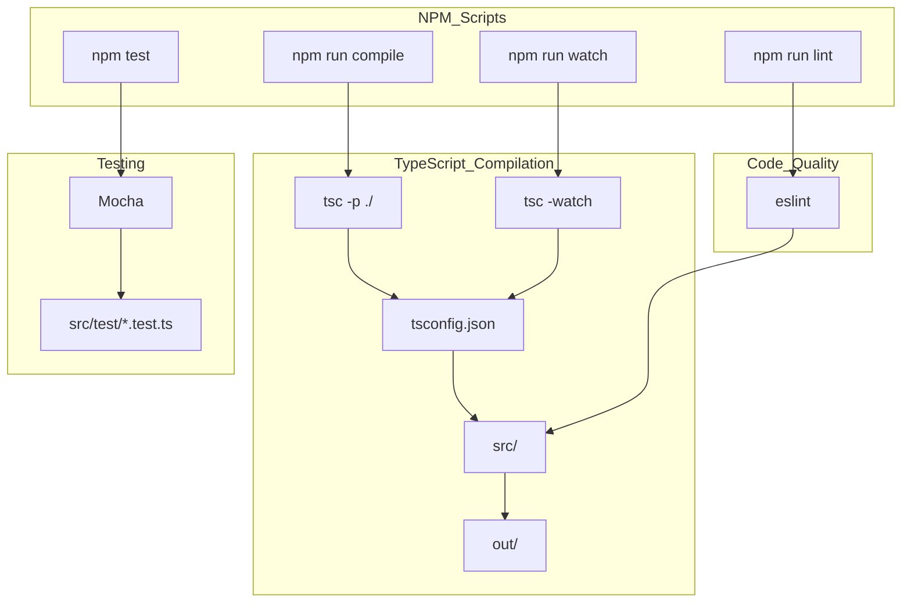
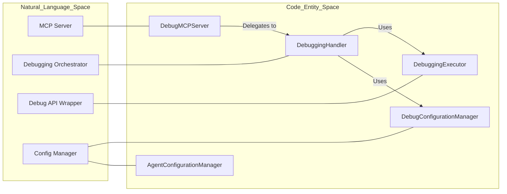

<!-- source: DeepWiki mcp.deepwiki.com · repo microsoft/DebugMCP · page 7 Developer Guide · fetched 2026-10-26 -->

# Developer Guide

Relevant source files

The following files were used as context for generating this wiki page:

- [AGENTS.md](AGENTS.md)
- [CONTRIBUTING.md](CONTRIBUTING.md)
- [LICENSE.txt](LICENSE.txt)
- [docs/architecture/debugMCPServer.md](docs/architecture/debugMCPServer.md)
- [tsconfig.json](tsconfig.json)

This document provides essential information for developers who want to contribute to or modify the DebugMCP extension itself. It covers the development environment setup, build system architecture, testing infrastructure, and CI/CD pipelines.

For step-by-step build instructions, see [Building from Source](#7.1). For testing procedures, see [Running Tests](#7.2). For CI/CD details, see [CI/CD Pipeline](#7.3). For contribution guidelines, see [Contributing](#7.4).

## Development Environment Overview

DebugMCP is a TypeScript-based VS Code extension that requires Node.js 20.x or later. The development environment includes TypeScript compilation, linting with ESLint, and packaging with VSCE (Visual Studio Code Extension CLI).

### Required Dependencies

The project uses the following key development dependencies:

| Dependency | Purpose |
|------------|---------|
| `typescript` | TypeScript compiler |
| `@types/vscode` | VS Code API type definitions |
| `eslint` | Code linting and style enforcement |
| `@vscode/test-cli` | VS Code extension testing framework |
| `@vscode/test-electron` | Electron-based test runner |
| `vsce` | VSIX packaging tool |

**Sources:** [AGENTS.md:41-49](), [tsconfig.json:1-18]()

### Runtime Dependencies

| Dependency | Purpose |
|------------|---------|
| `@modelcontextprotocol/sdk` | Official MCP server framework |
| `express` | HTTP server for Streamable HTTP transport |
| `zod` | Schema validation for tool parameters |

**Sources:** [AGENTS.md:62-67](), [docs/architecture/debugMCPServer.md:7-18]()

## Build System Architecture

The build system uses npm scripts to orchestrate TypeScript compilation, linting, and testing. The following diagram shows how these components interact:

### Build Process Flow

**Sources:** [AGENTS.md:41-49](), [tsconfig.json:1-11]()

### Key Build Scripts

The build system provides the following npm scripts:

1.  **`npm run compile`**: Compiles TypeScript to `out/` using `tsc`. [AGENTS.md:45]()
2.  **`npm run watch`**: Runs the compiler in watch mode for real-time development. [AGENTS.md:48]()
3.  **`npm run lint`**: Runs ESLint on the `src/` directory to enforce code style. [AGENTS.md:46]()
4.  **`npm test`**: Runs the test suite located in `src/test/*.test.ts`. [AGENTS.md:47]()

**Sources:** [AGENTS.md:41-49]()

## Code Style & Conventions

Developers should adhere to the following conventions when modifying the codebase:

*   **Language**: TypeScript in strict mode targeting ES2022. [AGENTS.md:52](), [tsconfig.json:4-12]()
*   **Naming**: camelCase for variables/functions, PascalCase for classes/interfaces. [AGENTS.md:54]()
*   **Logging**: Use the internal `logger` utility from `./utils/logger` instead of `console.log`. [AGENTS.md:59]()
*   **Async**: Prefer `async/await` and implement exponential backoff for retries. [AGENTS.md:58]()
*   **Formatting**: Use tabs for indentation and semicolons. [AGENTS.md:57]()

**Sources:** [AGENTS.md:50-60]()

## Component Architecture Mapping

The following diagram bridges the natural language concepts of the system to the specific code entities that implement them.

### System Component to Code Entity Map

**Sources:** [AGENTS.md:13-22](), [docs/architecture/debugMCPServer.md:1-34]()

## Development Workflow

The typical development workflow for contributors follows this pattern:

1.  **Environment Setup**: Clone the repository and install dependencies.
2.  **Coding**: Implement changes in `src/`. [AGENTS.md:70]()
3.  **Validation**: Run `npm run compile` and `npm run lint`. [AGENTS.md:45-46]()
4.  **Testing**: Execute `npm test` to ensure no regressions. [AGENTS.md:47]()

### Entry Points

*   **Extension Activation**: The extension starts in `src/extension.ts` via the `activate()` function. [AGENTS.md:70]()
*   **MCP Endpoint**: The server defaults to `http://localhost:3001/mcp`. [docs/architecture/debugMCPServer.md:45-47]()

**Sources:** [AGENTS.md:68-72](), [docs/architecture/debugMCPServer.md:50-56]()

## CI/CD Pipeline Architecture

DebugMCP uses GitHub Actions for continuous integration. For details, see [CI/CD Pipeline](#7.3).

### Workflow Descriptions

*   **PR Build**: Verifies that pull requests compile successfully and pass linting.
*   **Extension Build**: Packages the extension into a `.vsix` artifact for testing.
*   **Main Build**: Generates production-ready artifacts upon merging to the main branch.

**Sources:** [AGENTS.md:41-49]()

## Contribution Process

### Microsoft CLA Requirement

All contributors must agree to the Microsoft Contributor License Agreement (CLA) declaring they have the right to grant rights to use their contribution. [CONTRIBUTING.md:3-6]()

### Code of Conduct

The project has adopted the Microsoft Open Source Code of Conduct. [CONTRIBUTING.md:12-14]()

### License

The project is licensed under the MIT License. [LICENSE.txt:3-21]()

**Sources:** [CONTRIBUTING.md:1-15](), [LICENSE.txt:1-22]()

---

