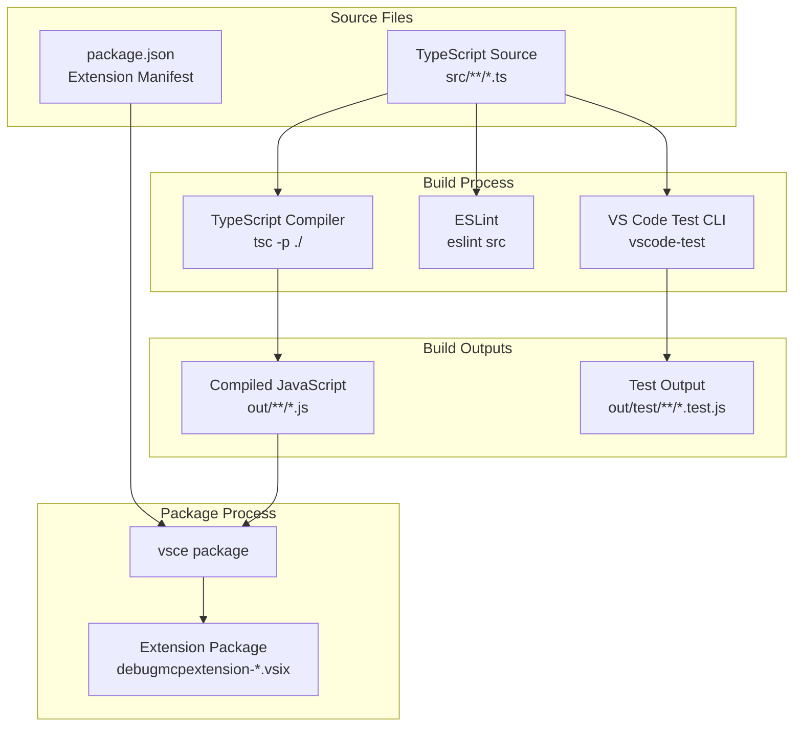
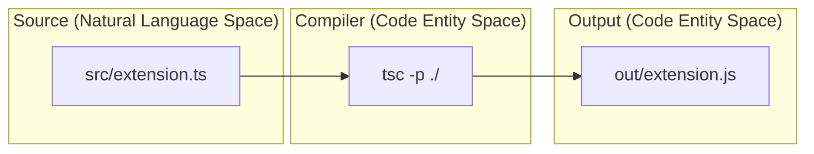

<!-- source: DeepWiki mcp.deepwiki.com · repo microsoft/DebugMCP · page 7.1 Building from Source · fetched 2026-10-26 -->

# Building from Source

<details>
<summary>Relevant source files</summary>

The following files were used as context for generating this wiki page:

- [.gitignore](.gitignore)
- [.vscodeignore](.vscodeignore)
- [package-lock.json](package-lock.json)
- [package.json](package.json)
- [vsc-extension-quickstart.md](vsc-extension-quickstart.md)

</details>


This page provides instructions for compiling, packaging, and testing the DebugMCP extension from source code. It is intended for developers who want to contribute to the project, customize the extension, or understand the build process.

## Prerequisites

Building DebugMCP requires the following tools and environment:

| Requirement | Version | Purpose |
|------------|---------|---------|
| Node.js | 20.x or higher | JavaScript runtime for building and running the extension |
| npm | Included with Node.js | Package manager for dependency installation |
| TypeScript | 5.9.3 or higher | TypeScript compiler (installed as dev dependency) |
| VS Code | 1.104.0 or higher | Required for testing and running the extension |
| Git | Any recent version | Version control for cloning the repository |

Sources: [package.json:33-34](), [package.json:106-107]()

## Cloning the Repository

Clone the DebugMCP repository from GitHub:

```bash
git clone https://github.com/microsoft/DebugMCP.git
cd DebugMCP
```

The repository structure follows standard VS Code extension conventions with TypeScript source in `src/` and compiled JavaScript output in `out/`.

Sources: [package.json:42-45](), [package.json:50-50]()

## Installing Dependencies

Install all required dependencies using npm:

```bash
npm ci
```

The `npm ci` command performs a clean installation based on the `package-lock.json` file, ensuring consistent dependency versions across all development environments. This installs:

**Runtime Dependencies:**
- `@modelcontextprotocol/sdk` (^1.26.0) - MCP protocol SDK [package.json:92-92]()
- `express` (^5.2.1) - HTTP server for transport [package.json:94-94]()
- `zod` (^3.25.76) - Schema validation [package.json:95-95]()

**Development Dependencies:**
- `typescript` (^5.9.3) - TypeScript compiler [package.json:106-106]()
- `eslint` (^10.0.1) - Code linting [package.json:105-105]()
- `@typescript-eslint/*` (^8.56.0) - TypeScript-specific ESLint rules [package.json:101-102]()
- `@vscode/test-cli` (^0.0.12) - VS Code extension testing infrastructure [package.json:103-103]()

Sources: [package.json:91-107](), [package-lock.json:7-27]()

## Build Pipeline Overview

The following diagram illustrates the complete build pipeline from source files to deployable artifacts:

### Build Architecture


Sources: [package.json:83-90]()

## Compiling TypeScript

The extension source code is written in TypeScript and must be compiled to JavaScript before it can run in VS Code.

### Standard Compilation

Compile the extension once:

```bash
npm run compile
```

This executes the TypeScript compiler (`tsc -p ./`) which:
1. Reads the `tsconfig.json` configuration.
2. Compiles all TypeScript files in `src/` to JavaScript in `out/`.
3. Reports any compilation errors.

The compiled entry point is `./out/extension.js`, which is specified in `package.json` as the extension's main entry point.

Sources: [package.json:85-85](), [package.json:50-50]()

### Watch Mode

For active development, run the compiler in watch mode to automatically recompile on file changes:

```bash
npm run watch
```

This runs `tsc -watch -p ./`, which monitors the source directory and incrementally recompiles changed files.

Sources: [package.json:86-86]()

### Component Compilation Flow



Sources: [package.json:50-50](), [package.json:85-85]()

## Running the Extension Locally

To test the extension during development, use VS Code's Extension Development Host:

1. Open the DebugMCP project folder in VS Code.
2. Press `F5` to open a new window with your extension loaded [vsc-extension-quickstart.md:14-14]().
3. VS Code will:
   - Compile the extension (via the `vscode:prepublish` script) [package.json:84-84]().
   - Launch a new VS Code window with the extension loaded.
   - Attach the debugger to the extension host process.

The extension activates automatically based on `activationEvents`, specifically `onStartupFinished` or `onDebug` [package.json:46-49]().

When running in development mode, the extension:
- Starts the MCP server on port 3001 (default) [package.json:75-79]().
- Logs debug information to the VS Code Debug Console [vsc-extension-quickstart.md:17-17]().

Sources: [package.json:46-49](), [package.json:67-81](), [vsc-extension-quickstart.md:12-18]()

## Code Linting

DebugMCP uses ESLint to maintain code quality and consistency.

### Running the Linter

Check for linting issues:

```bash
npm run lint
```

This executes `eslint src`, which analyzes all TypeScript files in the `src/` directory.

Sources: [package.json:88-88]()

## Packaging as VSIX

A VSIX file is the distributable package format for VS Code extensions.

### Creating a VSIX Package

Package the extension using `vsce`:

```bash
npx vsce package
```

This command:
1. Validates the `package.json` manifest.
2. Runs the `vscode:prepublish` script (which compiles the TypeScript) [package.json:84-84]().
3. Bundles all necessary files.
4. Creates a `.vsix` file.

Files excluded from the package are defined in `.vscodeignore`.

Sources: [package.json:84-84](), [.vscodeignore:1-12]()

## Build Artifacts

After a successful build, the following artifacts are generated:

### Compiled JavaScript Output

The `out/` directory contains the compiled JavaScript files. The main entry point is `out/extension.js`.

Sources: [package.json:50-50](), [.gitignore:33-33]()

### Extension Package

When packaged, a VSIX file is created in the root directory with the naming convention `debugmcpextension-<version>.vsix`. The version is sourced from `package.json`.

Sources: [package.json:2-5]()

## Build Output Validation

### TypeScript Compilation Success
Verify that the `out/` directory exists and contains the compiled `.js` files. The `.gitignore` ensures these are not committed to the repository.

Sources: [.gitignore:33-33]()

### VSIX Package Contents
The `.vscodeignore` file ensures that source files (`src/**`), configuration files (`tsconfig.json`), and test metadata are excluded from the final VSIX package to minimize size.

Sources: [.vscodeignore:1-12]()

## Build Troubleshooting

| Issue | Cause | Solution |
|-------|-------|----------|
| `tsc` not found | Dependencies not installed | Run `npm install` or `npm ci` |
| Port 3001 busy | MCP server port conflict | Change `debugmcp.serverPort` in VS Code settings [package.json:75-79]() |
| Tests not discovered | Watch task not running | Run `npm run watch` before running tests [vsc-extension-quickstart.md:31-31]() |

Sources: [package.json:75-79](), [vsc-extension-quickstart.md:29-35]()

---

