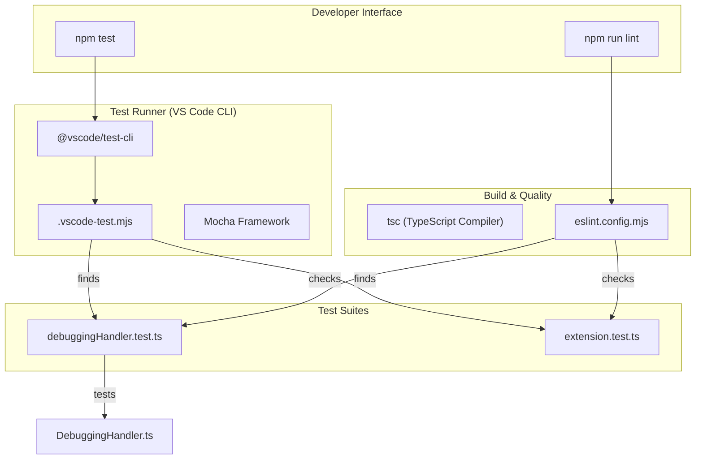

<!-- source: DeepWiki mcp.deepwiki.com · repo microsoft/DebugMCP · page 7.2 Running Tests · fetched 2026-10-26 -->

# Running Tests

<details>
<summary>Relevant source files</summary>

The following files were used as context for generating this wiki page:

- [.vscode-test.mjs](.vscode-test.mjs)
- [eslint.config.mjs](eslint.config.mjs)
- [src/test/debuggingHandler.test.ts](src/test/debuggingHandler.test.ts)
- [src/test/extension.test.ts](src/test/extension.test.ts)

</details>


This page documents the test infrastructure for the DebugMCP extension, including the test framework, test execution commands, linting procedures, and specific test suites for core logic like state change detection.

For information about building the extension from source, see [7.1 Building from Source](). For architecture details, see [3. Architecture Overview]().

## Test Infrastructure Overview

DebugMCP uses the standard VS Code extension testing stack, consisting of three primary components:

| Component | Package | Purpose |
|-----------|---------|---------|
| Test Framework | Mocha | Test runner and assertion library [src/test/extension.test.ts:10-10]() |
| Test Execution | `@vscode/test-cli` | CLI for running VS Code extension tests [.vscode-test.mjs:3-3]() |
| Test Environment | `@vscode/test-electron` | Launches tests in VS Code Electron instance |

The test infrastructure is configured through two primary files:
- `package.json` defines npm scripts for test execution.
- `.vscode-test.mjs` configures the VS Code test runner and file discovery patterns [.vscode-test.mjs:5-7]().

**Sources:** [.vscode-test.mjs:1-8](), [src/test/extension.test.ts:1-18]()

## Test Execution Architecture

The following diagram illustrates the relationship between the developer commands, the compilation step, and the VS Code test execution environment.



**Sources:** [.vscode-test.mjs:1-7](), [eslint.config.mjs:1-30](), [src/test/debuggingHandler.test.ts:1-10]()

## Running Tests Locally

### Prerequisites

Before running tests, ensure dependencies are installed:

```bash
npm install
```

This installs the test-related dev dependencies, including `@types/mocha`, `@vscode/test-cli`, and `@vscode/test-electron`.

### Test Execution Command

Execute the full test suite with:

```bash
npm test
```

This command triggers the `vscode-test` CLI, which:
1. Compiles TypeScript source files into the `out/` directory.
2. Reads configuration from `.vscode-test.mjs` [.vscode-test.mjs:5-7]().
3. Launches a VS Code Electron instance.
4. Discovers test files matching pattern `out/test/**/*.test.js` [.vscode-test.mjs:6-6]().
5. Executes tests using the Mocha framework.

**Sources:** [.vscode-test.mjs:1-7]()

## Core Test Suites

### DebuggingHandler State Detection

The `DebuggingHandler` test suite focuses on the logic used to determine if the debugger state has changed, which is critical for the `waitForStateChange` mechanism.

The `hasStateChanged` private method in `DebuggingHandler` is tested using reflection [src/test/debuggingHandler.test.ts:25-25](). It compares two `DebugState` objects to detect:

| Change Type | Test Case | Logic Verified |
|-------------|-----------|----------------|
| **Line Number** | `detect line number changes` | Returns `true` when line changes from 10 to 11 [src/test/debuggingHandler.test.ts:12-28]() |
| **File Path** | `detect file changes` | Returns `true` when file path changes [src/test/debuggingHandler.test.ts:30-44]() |
| **Session Status** | `detect session status changes` | Returns `true` when `sessionActive` toggles [src/test/debuggingHandler.test.ts:46-59]() |
| **Stack Frame** | `detect frame name changes` | Returns `true` when frame name changes (e.g., 'main' to 'helper') [src/test/debuggingHandler.test.ts:61-75]() |
| **Identity** | `return false for identical states` | Returns `false` when states are cloned without modification [src/test/debuggingHandler.test.ts:77-91]() |

**Sources:** [src/test/debuggingHandler.test.ts:10-108]()

### Extension Integration Tests

The `Extension Test Suite` [src/test/extension.test.ts:10-10]() provides a template for integration tests that require the full VS Code API.

- It uses `vscode.window.showInformationMessage` to signal test start [src/test/extension.test.ts:11-11]().
- It demonstrates the ability to import the `vscode` module to interact with the editor environment [src/test/extension.test.ts:7-7]().

**Sources:** [src/test/extension.test.ts:1-18]()

## Linting

ESLint is used to maintain code quality. The configuration is defined in `eslint.config.mjs`.

### Linting Configuration

| Configuration | Value |
|---------------|-------|
| **Parser** | `@typescript-eslint/parser` [eslint.config.mjs:14-14]() |
| **ECMA Version** | 2022 [eslint.config.mjs:15-15]() |
| **Source Type** | module [eslint.config.mjs:16-16]() |

### Active Rules

Key rules enforced during the build process [eslint.config.mjs:19-29]():
- **Naming Convention**: Enforces `camelCase` or `PascalCase` for imports [eslint.config.mjs:20-23]().
- **Strict Equality**: Requires `eqeqeq` [eslint.config.mjs:26-26]().
- **Formatting**: Requires semicolons and curly braces [eslint.config.mjs:25-28]().

**Sources:** [eslint.config.mjs:1-30]()

## Adding New Tests

To extend the test suite:

1. **Unit Tests**: Add files to `src/test/` following the `*.test.ts` naming convention. For logic testing without VS Code dependencies, mock the required classes as seen in the `DebuggingHandler` tests [src/test/debuggingHandler.test.ts:13-13]().
2. **Integration Tests**: Use the `vscode` module to trigger commands or inspect the state of the editor.
3. **State Verification**: Utilize the `DebugState` class and its `clone()` method to create "before" and "after" snapshots for comparison [src/test/debuggingHandler.test.ts:21-21]().

**Sources:** [src/test/debuggingHandler.test.ts:1-108](), [src/test/extension.test.ts:1-18]()

---

