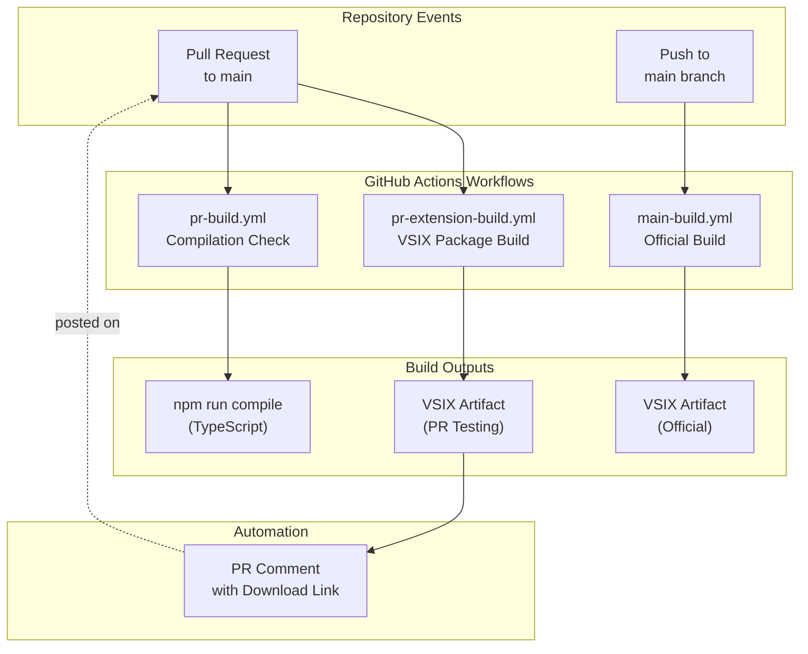
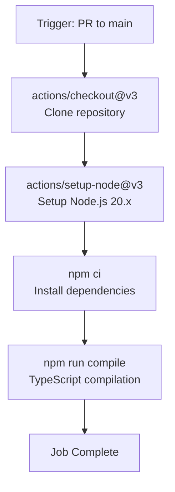
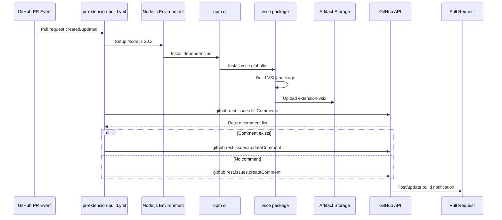
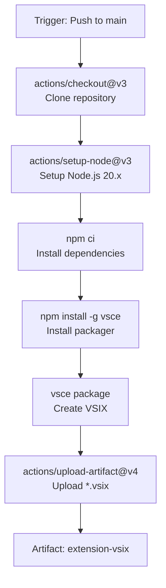

<!-- source: DeepWiki mcp.deepwiki.com · repo microsoft/DebugMCP · page 7.3 CI/CD Pipeline · fetched 2026-10-26 -->

# CI/CD Pipeline

Relevant source files

The following files were used as context for generating this wiki page:

- [.github/workflows/main-build.yml](.github/workflows/main-build.yml)
- [.github/workflows/pr-build.yml](.github/workflows/pr-build.yml)
- [.github/workflows/pr-extension-build.yml](.github/workflows/pr-extension-build.yml)

## Purpose and Scope

This document describes the Continuous Integration and Continuous Delivery (CI/CD) infrastructure for the DebugMCP extension. It covers the GitHub Actions workflows that automate building, testing, and packaging the extension for distribution. The pipeline ensures that every pull request is validated for compilation and provides a downloadable VSIX artifact for manual testing before merging into the main branch.

## Workflow Overview

The DebugMCP project uses GitHub Actions to automate the build process. The CI/CD pipeline consists of three primary workflows that execute on different triggers:

| Workflow | File | Trigger | Purpose |
|----------|------|---------|---------|
| **PR Build** | `pr-build.yml` | Pull requests to `main` | Validate compilation [pr-build.yml:1-6]() |
| **PR Extension Build** | `pr-extension-build.yml` | Pull requests to `main` | Build and distribute VSIX for testing [pr-extension-build.yml:1-6]() |
| **Main Extension Build** | `main-build.yml` | Pushes to `main` | Build official VSIX artifacts [main-build.yml:1-6]() |

All workflows run on `ubuntu-latest` runners using Node.js 20.x [pr-build.yml:9-19](), [pr-extension-build.yml:14-24](), [main-build.yml:9-19]().

Sources: [.github/workflows/pr-build.yml:1-26](), [.github/workflows/pr-extension-build.yml:1-87](), [.github/workflows/main-build.yml:1-35]()

### Workflow Trigger Flow

Sources: [.github/workflows/pr-build.yml:3-5](), [.github/workflows/pr-extension-build.yml:3-5](), [.github/workflows/main-build.yml:3-5](), [.github/workflows/pr-extension-build.yml:42-86]()

## PR Build Workflow

The **PR Build** workflow provides fast feedback on pull requests by validating that the code compiles successfully. It performs a clean install of dependencies and executes the TypeScript compiler.

### PR Build Steps

Sources: [.github/workflows/pr-build.yml:8-26]()

The workflow uses `npm ci` [pr-build.yml:22]() instead of `npm install` for reproducible builds based on the exact versions in `package-lock.json`. The compilation step [pr-build.yml:25]() ensures that no TypeScript errors are introduced in the PR.

## PR Extension Build Workflow

The **PR Extension Build** workflow creates a complete VSIX package for pull requests, allowing reviewers to test changes before merging. It uses `vsce` (Visual Studio Code Extension Manager) to package the extension.

### PR Extension Build Pipeline

Sources: [.github/workflows/pr-extension-build.yml:13-87]()

### Automated PR Comments

The workflow includes a GitHub Script [pr-extension-build.yml:44-86]() that posts a comment to the pull request with artifact download instructions. The script logic:
1. Generates a `runUrl` pointing to the current GitHub Actions run [pr-extension-build.yml:51]().
2. Searches for an existing bot comment containing "Extension Build Successful" [pr-extension-build.yml:60-68]().
3. If found, it updates the existing comment [pr-extension-build.yml:72-77]() to avoid notification spam.
4. If not found, it creates a new comment [pr-extension-build.yml:80-85]().

### Permissions Configuration

The workflow requires elevated permissions to interact with the PR [pr-extension-build.yml:7-10]():
- `contents: read`: To checkout the code.
- `pull-requests: write`: To post/update comments on the PR.
- `issues: write`: Required because PR comments are technically part of the Issues API.

Sources: [.github/workflows/pr-extension-build.yml:7-10](), [.github/workflows/pr-extension-build.yml:42-86]()

## Main Branch Build Workflow

The **Main Extension Build** workflow executes on every push to the `main` branch, creating official build artifacts for the stable codebase.

### Main Build Steps

Sources: [.github/workflows/main-build.yml:8-35]()

## Artifact Management

All workflows that generate VSIX packages use the `actions/upload-artifact@v4` action to store the resulting files.

### Artifact Configuration

Both the PR Extension Build and Main Extension Build workflows use identical artifact upload configuration [pr-extension-build.yml:36-40](), [main-build.yml:30-34]():

- **Name**: `extension-vsix`
- **Path**: `*.vsix`

The artifact is retained in GitHub Actions and can be downloaded by developers to test the extension via the "Install from VSIX..." command in VS Code.

Sources: [.github/workflows/pr-extension-build.yml:36-40](), [.github/workflows/main-build.yml:30-34]()

## Node.js Environment

All workflows are standardized on Node.js 20.x. The `pr-extension-build.yml` workflow specifically uses the `cache: 'npm'` feature of `actions/setup-node@v4` [pr-extension-build.yml:25]() to speed up the `npm ci` step by caching the `~/.npm` directory between runs.

Sources: [.github/workflows/pr-build.yml:19](), [.github/workflows/pr-extension-build.yml:24-25](), [.github/workflows/main-build.yml:19]()

---

