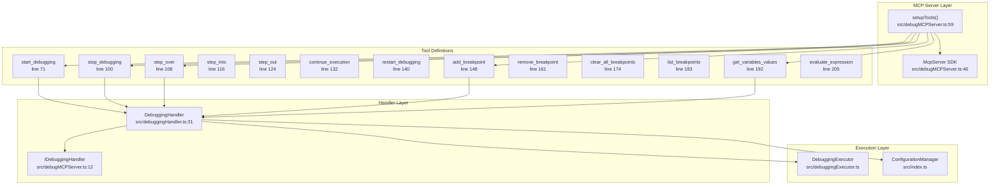
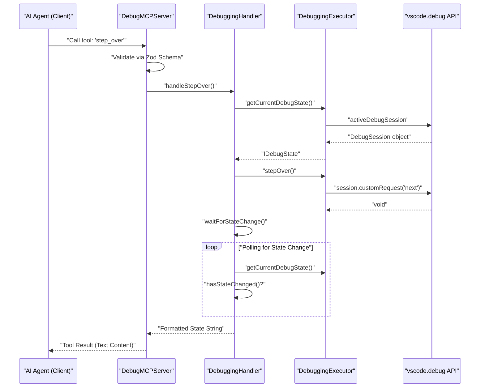

<!-- source: DeepWiki mcp.deepwiki.com · repo microsoft/DebugMCP · page 8.1 MCP Tools API · fetched 2026-10-26 -->

# MCP Tools API

<details>
<summary>Relevant source files</summary>

The following files were used as context for generating this wiki page:

- [README.md](README.md)
- [assets/DebugMCP.webp](assets/DebugMCP.webp)
- [assets/architecture.png](assets/architecture.png)
- [docs/agent-resources/debug_instructions.md](docs/agent-resources/debug_instructions.md)
- [src/debugMCPServer.ts](src/debugMCPServer.ts)

</details>


This document provides a complete reference for all 13 debugging tools exposed by the DebugMCP server through the Model Context Protocol (MCP). Each tool's parameters, return values, and behavior are documented in detail for AI agent integration and development purposes.

For information about how these tools fit into the overall system architecture, see **Architecture Overview (3.0)**. For guidance on using these tools in debugging workflows, see **Debugging Operations (5.0)**. For language-specific debugging configurations, see **Language Support (6.0)**.

## Overview

DebugMCP exposes debugging functionality as MCP tools that AI agents can invoke to control VS Code's debugging capabilities. The tools are registered in the `McpServer` during initialization and delegate to the `DebuggingHandler` for execution. All tools follow a consistent pattern: parameter validation via Zod schemas, asynchronous execution, and structured string responses.

**Sources:** [src/debugMCPServer.ts:22-36](), [src/debugMCPServer.ts:59-220]()

## Tool Registration Architecture

The following diagram shows how tools are registered in the `McpServer` and connected to the debugging execution layer:

**Tool Registration and Delegation**


**Sources:** [src/debugMCPServer.ts:30-36](), [src/debugMCPServer.ts:59-220](), [src/debugMCPServer.ts:12-13]()

## Tool Invocation Flow

This diagram traces a complete tool invocation from AI agent request through the MCP server to VS Code API execution:

**Natural Language to Code Execution Flow**


**Sources:** [src/debugMCPServer.ts:108-113](), [src/debuggingHandler.ts:126-145](), [src/debuggingHandler.ts:505-536]()

## Complete Tool Reference

The following table provides a complete overview of all 13 MCP tools:

| Tool Name | Category | Parameters | Requires Active Session | State Change Detection |
|-----------|----------|------------|------------------------|----------------------|
| `start_debugging` | Session Management | `fileFullPath`, `workingDirectory`, `testName?`, `configurationName?` | No | Yes (waits for activation) |
| `stop_debugging` | Session Management | None | Yes | No |
| `restart_debugging` | Session Management | None | Yes | No |
| `step_over` | Code Navigation | None | Yes | Yes |
| `step_into` | Code Navigation | None | Yes | Yes |
| `step_out` | Code Navigation | None | Yes | Yes |
| `continue_execution` | Code Navigation | None | Yes | Yes |
| `add_breakpoint` | Breakpoint Management | `fileFullPath`, `lineContent` | No | No |
| `remove_breakpoint` | Breakpoint Management | `fileFullPath`, `line` | No | No |
| `clear_all_breakpoints` | Breakpoint Management | None | No | No |
| `list_breakpoints` | Breakpoint Management | None | No | No |
| `get_variables_values` | Inspection | `scope?` ('local', 'global', 'all') | Yes | No |
| `evaluate_expression` | Inspection | `expression` | Yes | No |

**Sources:** [src/debugMCPServer.ts:71-220](), [README.md:41-57]()

## Session Management Tools

### start_debugging

Starts a new debugging session for a source code file. This is the primary entry point for all debugging operations.

**Tool Definition:** [src/debugMCPServer.ts:71-97]()

**Parameters:**
```typescript
{
  fileFullPath: string;      // Full absolute path to source file
  workingDirectory: string;  // Working directory for debug session
  testName?: string;         // Optional: specific test name to debug
  configurationName?: string; // Optional: name of launch.json config
}
```

**Zod Schema:** [src/debugMCPServer.ts:81-93]()

**Handler Method:** `handleStartDebugging()` [src/debuggingHandler.ts:47-85]()

**Behavior:**
1. Prompts for debug configuration selection if multiple exist [src/debuggingHandler.ts:55]()
2. Resolves configuration using `ConfigurationManager` [src/debuggingHandler.ts:58-63]()
3. Initiates VS Code debug session via `DebuggingExecutor` [src/debuggingHandler.ts:65]()
4. Waits for the session to become active using exponential backoff [src/debuggingHandler.ts:68-72]()

**Sources:** [src/debugMCPServer.ts:71-97](), [src/debuggingHandler.ts:47-85]()

### stop_debugging

Stops the currently active debugging session.

**Tool Definition:** [src/debugMCPServer.ts:100-105]()

**Handler Method:** `handleStopDebugging()` [src/debuggingHandler.ts:90-103]()

**Behavior:**
1. Checks for an active session [src/debuggingHandler.ts:92-94]()
2. Calls `stopDebugging()` on the executor [src/debuggingHandler.ts:96]()
3. Appends a Root Cause Analysis (RCA) reminder to the response [src/debuggingHandler.ts:99]()

**Sources:** [src/debugMCPServer.ts:100-105](), [src/debuggingHandler.ts:90-103]()

## Code Navigation Tools

All code navigation tools follow a pattern of checking for an active session, capturing the "before" state, executing the command, and waiting for a state change (e.g., hitting a new line or breakpoint).

### step_over

Executes the current line without diving into function calls.

**Tool Definition:** [src/debugMCPServer.ts:108-113]()

**Handler Method:** `handleStepOver()` [src/debuggingHandler.ts:126-145]()

**State Change Detection:** Uses `waitForStateChange()` to ensure the debugger has moved to the next line before returning [src/debuggingHandler.ts:140]().

**Sources:** [src/debugMCPServer.ts:108-113](), [src/debuggingHandler.ts:126-145]()

### continue_execution

Resumes program execution until the next breakpoint is hit or the program completes.

**Tool Definition:** [src/debugMCPServer.ts:132-137]()

**Handler Method:** `handleContinue()` [src/debuggingHandler.ts:198-219]()

**Sources:** [src/debugMCPServer.ts:132-137](), [src/debuggingHandler.ts:198-219]()

## Breakpoint Management Tools

### add_breakpoint

Adds a breakpoint at a specific line by matching its content. This is a robust strategy that avoids issues with shifting line numbers.

**Tool Definition:** [src/debugMCPServer.ts:148-158]()

**Parameters:**
```typescript
{
  fileFullPath: string;  // Full path to the file
  lineContent: string;   // Exact text or substring of the line to match
}
```

**Handler Method:** `handleAddBreakpoint()` [src/debuggingHandler.ts:244-280]()

**Behavior:**
1. Opens the file in the background [src/debuggingHandler.ts:249]()
2. Searches for all occurrences of `lineContent` [src/debuggingHandler.ts:254-258]()
3. Adds breakpoints at all matching line numbers [src/debuggingHandler.ts:267-269]()

**Sources:** [src/debugMCPServer.ts:148-158](), [src/debuggingHandler.ts:244-280]()

### list_breakpoints

Lists all active breakpoints across all files.

**Tool Definition:** [src/debugMCPServer.ts:183-189]()

**Handler Method:** `handleListBreakpoints()` [src/debuggingHandler.ts:315-338]()

**Sources:** [src/debugMCPServer.ts:183-189](), [src/debuggingHandler.ts:315-338]()

## Inspection Tools

### get_variables_values

Retrieves variables and their values at the current execution point.

**Tool Definition:** [src/debugMCPServer.ts:192-202]()

**Parameters:**
```typescript
{
  scope?: 'local' | 'global' | 'all'; // Default: 'all'
}
```

**Handler Method:** `handleGetVariables()` [src/debuggingHandler.ts:343-388]()

**Behavior:**
1. Retrieves the active stack frame ID [src/debuggingHandler.ts:354]()
2. Fetches variable scopes and values from the `DebuggingExecutor` [src/debuggingHandler.ts:356]()
3. Formats values with their types for agent context [src/debuggingHandler.ts:373]()

**Sources:** [src/debugMCPServer.ts:192-202](), [src/debuggingHandler.ts:343-388]()

### evaluate_expression

Evaluates an arbitrary expression in the current debug context (e.g., `x + y` or `obj.property`).

**Tool Definition:** [src/debugMCPServer.ts:205-217]()

**Parameters:**
```typescript
{
  expression: string; // Expression to evaluate
}
```

**Handler Method:** `handleEvaluateExpression()` [src/debuggingHandler.ts:393-422]()

**Sources:** [src/debugMCPServer.ts:205-217](), [src/debuggingHandler.ts:393-422]()

## State Change Detection

The `DebuggingHandler` implements a polling mechanism to ensure that tools which modify execution state don't return until the debugger has actually moved.

**Algorithm:** `waitForStateChange()` [src/debuggingHandler.ts:505-536]()
1. **Initial State:** Capture `IDebugState` before the operation.
2. **Action:** Execute the debug command (step, continue).
3. **Polling:** Perform exponential backoff polling (up to the `timeoutInSeconds` limit).
4. **Comparison:** Use `hasStateChanged()` to compare the new state against the old one [src/debuggingHandler.ts:541-584]().
5. **Criteria:** A change is detected if the line number, file path, frame ID, or session status changes.

**Sources:** [src/debuggingHandler.ts:505-584]()

## Error Handling

All tools are wrapped in try-catch blocks within the `McpServer` tool registration. Errors are returned to the agent as text content to maintain the conversation flow.

**Common Error Scenarios:**
- **No Active Session:** Occurs when calling `step_over` or `get_variables_values` before `start_debugging` [src/debuggingHandler.ts:128-130]().
- **Invalid Line Content:** Occurs when `add_breakpoint` cannot find the specified text in the file [src/debuggingHandler.ts:273-275]().
- **Timeout:** Occurs if the debugger takes longer than the configured timeout to reach a new state [src/debuggingHandler.ts:532]().

**Sources:** [src/debuggingHandler.ts:128-130](), [src/debuggingHandler.ts:273-275](), [src/debuggingHandler.ts:532]()

---

