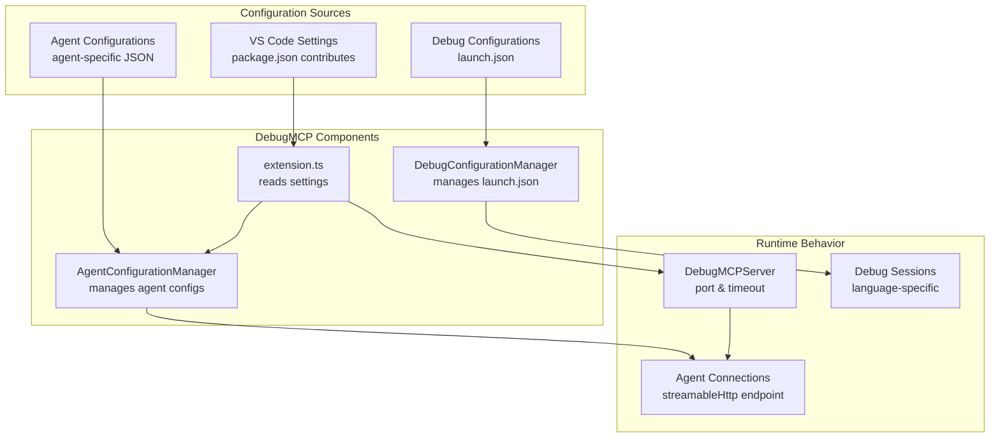
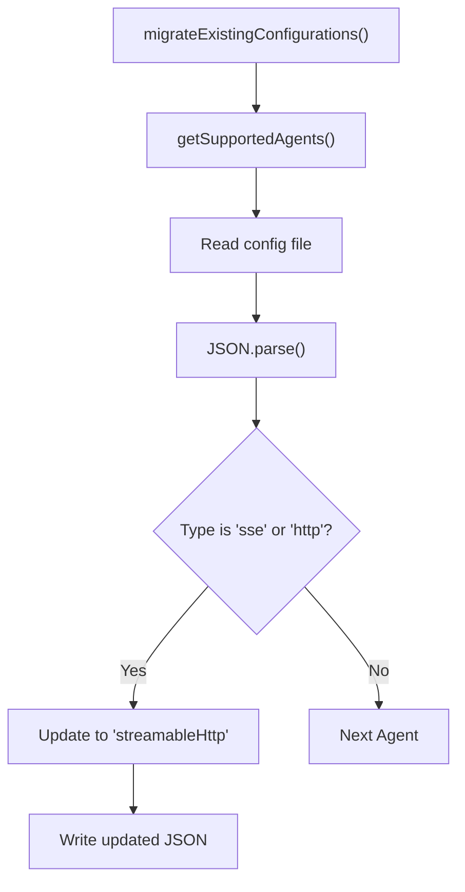

<!-- source: DeepWiki mcp.deepwiki.com · repo microsoft/DebugMCP · page 8.2 Configuration Reference · fetched 2026-10-26 -->

# Configuration Reference

<details>
<summary>Relevant source files</summary>

The following files were used as context for generating this wiki page:

- [package.json](package.json)
- [src/extension.ts](src/extension.ts)
- [src/utils/agentConfigurationManager.ts](src/utils/agentConfigurationManager.ts)
- [src/utils/logger.ts](src/utils/logger.ts)

</details>


This page provides a comprehensive reference for all configuration options in DebugMCP. It covers VS Code extension settings, debug configuration management, and AI agent integration configurations.

## Overview

DebugMCP uses a three-tier configuration system:

1. **Extension Settings**: VS Code user/workspace settings that control the MCP server behavior.
2. **Debug Configurations**: Standard VS Code `launch.json` configurations plus auto-generated defaults.
3. **Agent Configurations**: MCP server connection settings for AI agents (Cline, GitHub Copilot, Cursor), utilizing the `streamableHttp` transport.

### Configuration Architecture



Sources: [package.json:67-81](), [src/extension.ts:17-40](), [src/utils/agentConfigurationManager.ts:24-35]()

## Extension Settings

DebugMCP exposes configuration properties in VS Code settings that control the MCP server's runtime behavior. These are defined in the `contributes.configuration` section of `package.json` [package.json:67-81]().

### Configuration Properties

| Setting | Type | Default | Description |
|---------|------|---------|-------------|
| `debugmcp.serverPort` | number | `3001` | Port number for the DebugMCP server [package.json:75-79]() |
| `debugmcp.timeoutInSeconds` | number | `180` | Timeout in seconds for debug operations [package.json:70-74]() |

### Accessing Settings in Code

The extension reads these settings during the `activate` function in `src/extension.ts` [src/extension.ts:11-22]():

```typescript
const config = vscode.workspace.getConfiguration('debugmcp');
const timeoutInSeconds = config.get<number>('timeoutInSeconds', 180);
const serverPort = config.get<number>('serverPort', 3001);
```

These values are injected into the `AgentConfigurationManager` and `DebugMCPServer` constructors [src/extension.ts:25-38]().

## Agent Configuration Management

The `AgentConfigurationManager` handles the discovery and configuration of AI agents. It maps agent IDs to specific file system paths where MCP settings are stored [src/utils/agentConfigurationManager.ts:118-149]().

### Supported Agents and Paths

| Agent | Config File Name | Configuration Field |
|-------|------------------|---------------------|
| **Cline** | `cline_mcp_settings.json` | `mcpServers` |
| **GitHub Copilot** | `mcp.json` | `servers` |
| **Cursor** | `mcp_settings.json` | `mcpServers` |

Sources: [src/utils/agentConfigurationManager.ts:124-146]()

### Transport Configuration (`streamableHttp`)

DebugMCP uses the `streamableHttp` transport type for MCP communication [src/utils/agentConfigurationManager.ts:159](). The configuration written to agent files follows the `MCPServerConfig` interface [src/utils/agentConfigurationManager.ts:16-22]().

**Generated Configuration Object:**
```json
{
    "autoApprove": [],
    "disabled": false,
    "timeout": 180,
    "type": "streamableHttp",
    "url": "http://localhost:3001/mcp"
}
```
Sources: [src/utils/agentConfigurationManager.ts:154-162]()

### Platform-Specific Path Resolution

The `getConfigBasePath()` method resolves the root directory for agent configurations based on the operating system [src/utils/agentConfigurationManager.ts:97-113]().

| OS | Base Path Logic |
|----|-----------------|
| **Windows** | `process.env.APPDATA` |
| **macOS** | `~/Library/Application Support` |
| **Linux** | `process.env.XDG_CONFIG_HOME` or `~/.config` |

## Migration Logic

DebugMCP includes a migration utility to upgrade legacy `sse` or `http` configurations to the modern `streamableHttp` transport.

### Migration Flow

The `migrateExistingConfigurations()` method is called during extension activation [src/extension.ts:29](). It iterates through all supported agents and checks if their existing `debugmcp` configuration needs an update [src/utils/agentConfigurationManager.ts:168-200]().



Sources: [src/utils/agentConfigurationManager.ts:168-208]()

## Debug Configuration Management

DebugMCP utilizes the `DebugConfigurationManager` to resolve how a debug session should be launched. It prioritizes existing `launch.json` entries but can fall back to heuristic-based auto-generation.

### Configuration Resolution Priority

1. **Explicit `configName`**: If the agent provides a name, DebugMCP searches `launch.json` [src/utils/debugConfigurationManager.ts:38-43]().
2. **`AUTO_LAUNCH_CONFIG`**: If "Default Configuration" is selected, DebugMCP uses `createDefaultDebugConfig()` [src/utils/debugConfigurationManager.ts:46-49]().
3. **Language Heuristics**: If no config is found, it detects the language from the file extension (e.g., `.py` -> `python`, `.ts` -> `pwa-node`) [src/utils/debugConfigurationManager.ts:142-163]().

### Default Configuration Templates

When auto-generating a configuration, `createDefaultDebugConfig` populates the following standard fields [src/utils/debugConfigurationManager.ts:168-238]():

| Field | Value |
|-------|-------|
| `request` | `"launch"` |
| `console` | `"integratedTerminal"` |
| `internalConsoleOptions` | `"neverOpen"` |
| `cwd` | Directory of the target file |

Sources: [src/utils/debugConfigurationManager.ts:181-187]()

## Logging Configuration

The extension uses a centralized `Logger` class that outputs to a VS Code `LogOutputChannel` named "DebugMCP" [src/utils/logger.ts:12-19]().

### Log Levels
The logger supports four levels defined in the `LogLevel` enum [src/utils/logger.ts:5-10]():
- `DEBUG` (0)
- `INFO` (1) - Default level
- `WARN` (2)
- `ERROR` (3)

On activation, the system logs environment details including VS Code version, platform, and key environment variables like `PATH` and `APPDATA` [src/utils/logger.ts:84-101]().

Sources: [src/utils/logger.ts:5-10](), [src/utils/logger.ts:84-101](), [src/extension.ts:12-15]()

---

