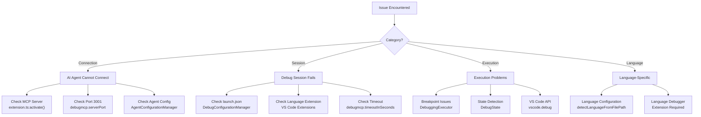
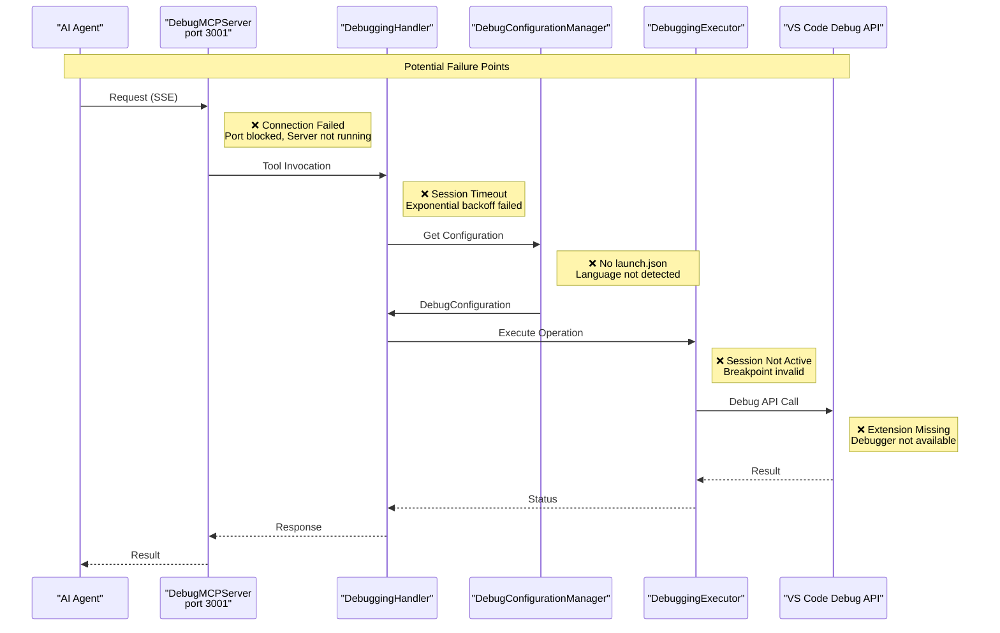
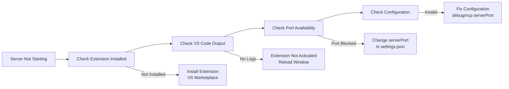
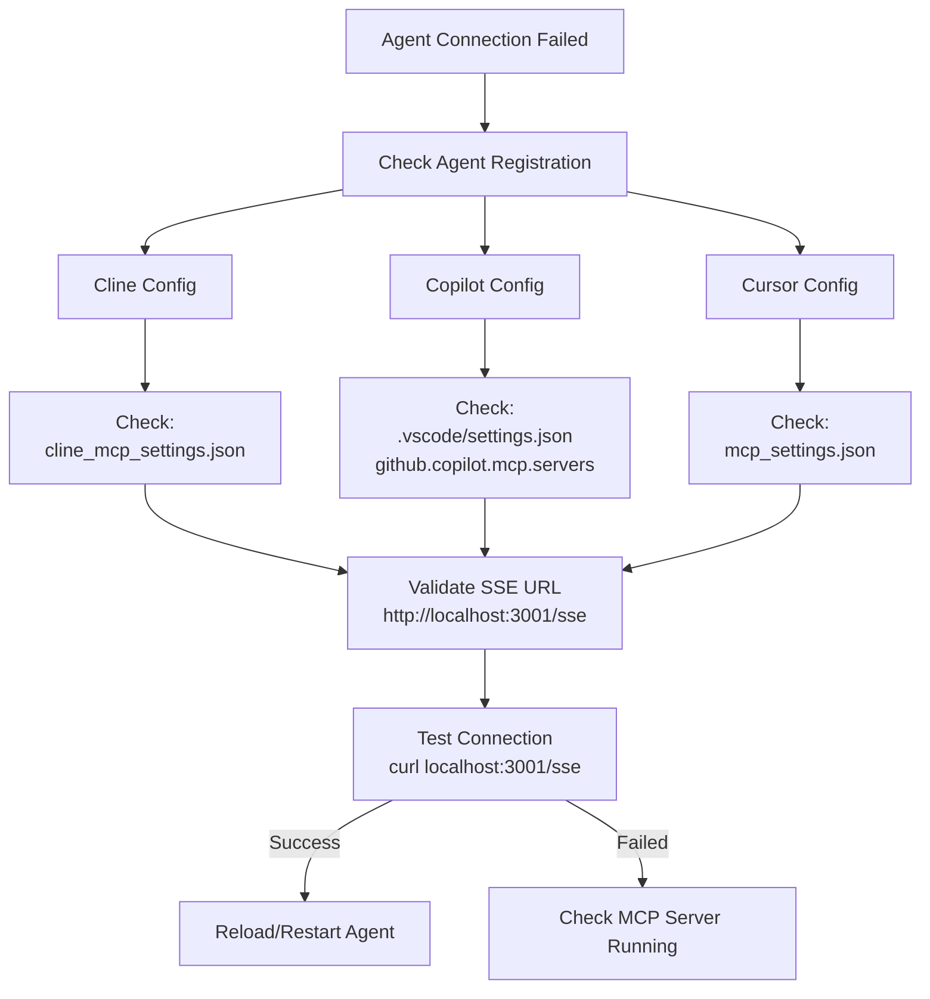
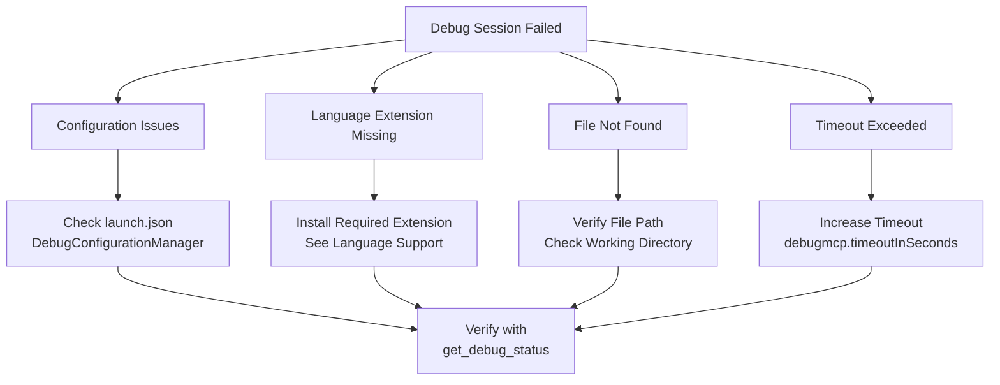
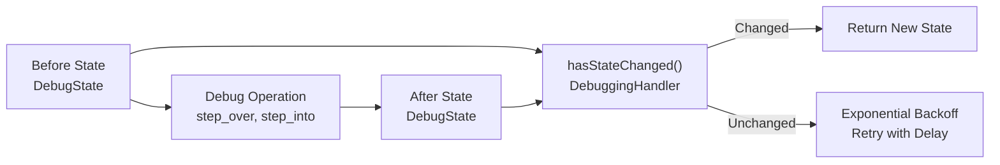

<!-- source: DeepWiki mcp.deepwiki.com · repo microsoft/DebugMCP · page 8.3 Troubleshooting Guide · fetched 2026-10-26 -->

# Troubleshooting Guide

<details>
<summary>Relevant source files</summary>

The following files were used as context for generating this wiki page:

- [docs/agent-resources/troubleshooting/python.md](docs/agent-resources/troubleshooting/python.md)

</details>


This document provides comprehensive troubleshooting information for common issues encountered when using DebugMCP. Issues are organized by symptom category to help you quickly identify and resolve problems. For general configuration information, see [Configuration Reference](#8.2). For API-level details, see [MCP Tools API](#8.1). For language-specific setup guidance, see the [Language Support](#6) section.

## Quick Diagnostic Overview

The following diagram illustrates the main failure points in the DebugMCP system and where to look for solutions:

**Diagnostic Flow and Code Entities**


**Sources:** [src/extension.ts:38-70](), [src/debuggingHandler.ts:12-40](), [src/debuggingExecutor.ts:15-30](), [src/debugConfigurationManager.ts:199-206]()

## System Architecture for Troubleshooting

Understanding the request flow helps identify where failures occur:

**Request Flow Failure Points**


**Sources:** [src/debugMCPServer.ts:30-70](), [src/debuggingHandler.ts:77-135](), [src/debugConfigurationManager.ts:26-60](), [src/debuggingExecutor.ts:120-152]()

## MCP Server Issues

### Server Not Starting

**Symptoms:**
- AI agent cannot connect to DebugMCP
- No response from `http://localhost:3001/sse`
- Extension appears installed but not active

**Diagnostic Steps:**



**Solutions:**

| Problem | Solution | Configuration |
|---------|----------|---------------|
| Extension not activated | Reload VS Code window (`Ctrl+Shift+P` → "Reload Window") | N/A |
| Port 3001 already in use | Change port in settings: `"debugmcp.serverPort": 3002` | [src/extension.ts:38-39]() |
| Server initialization failed | Check VS Code Output panel (select "DebugMCP" channel) | [src/utils/logger.ts:18]() |
| Missing dependencies | Run `npm install` in extension directory | N/A |

**Verification Commands:**

Check if server is running:
```bash
# Test server endpoint
curl http://localhost:3001/sse
```

Check VS Code logs:
1. Open Command Palette (`Ctrl+Shift+P`)
2. Select "Developer: Show Logs"
3. Select "Extension Host"
4. Search for "DebugMCP"

**Sources:** [src/extension.ts:38-70](), [src/utils/logger.ts:84-92]()

### Server Connection Timeout

**Symptoms:**
- AI agent reports connection timeout
- SSE connection drops
- Intermittent connectivity

**Root Causes and Solutions:**

| Cause | Diagnostic | Solution |
|-------|-----------|----------|
| Network firewall | Check firewall logs | Allow localhost connections on configured port |
| Proxy interference | Check proxy settings | Add `localhost` to proxy bypass list |
| VS Code suspended | Check extension host process | Increase VS Code memory limits |
| Timeout too short | Check `debugmcp.timeoutInSeconds` | Increase timeout value in settings |

**Configuration Reference:**
```json
{
  "debugmcp.serverPort": 3001,
  "debugmcp.timeoutInSeconds": 180
}
```

**Sources:** [src/extension.ts:38-39]()

## AI Agent Connection Issues

### Agent Cannot Connect to MCP Server

**Symptoms:**
- Agent shows "MCP server not available"
- Tools not appearing in agent interface
- Connection refused errors

**Troubleshooting Flow:**



**Agent-Specific Configuration Issues:**

The `AgentConfigurationManager` attempts automatic setup. If auto-configuration fails:

1. Check if configuration file exists manually
2. Verify file permissions (read/write access)
3. Look for backup files created during configuration
4. Check VS Code Output panel for configuration errors

**Sources:** [src/agentConfigurationManager.ts:15-45]()

### Tools Not Appearing in Agent

**Symptoms:**
- Agent connects but no debugging tools available
- Some tools missing from tool list
- "Tool not found" errors

**Diagnostic Steps:**

1. **Verify MCP Server Registration:**
   Check that all 13 tools are registered in [src/debugMCPServer.ts:registerTools()]()

2. **Check Agent Tool Discovery:**
   - Some agents cache tool lists
   - Restart agent to refresh tool catalog
   - Check agent logs for MCP errors

3. **Validate Tool Schemas:**
   Tool definitions use Zod schemas. Check for validation errors:
   - [src/debugMCPServer.ts:88-238]() for tool schemas

**Expected Tools List:**

| Tool Name | Schema Location | Common Issues |
|-----------|----------------|---------------|
| `start_debugging` | [src/debugMCPServer.ts:88-97]() | Missing `filePath` parameter |
| `stop_debugging` | [src/debugMCPServer.ts:99-104]() | N/A |
| `step_over` | [src/debugMCPServer.ts:106-111]() | Session not active |
| `step_into` | [src/debugMCPServer.ts:113-118]() | Session not active |
| `step_out` | [src/debugMCPServer.ts:120-125]() | Session not active |
| `continue_execution` | [src/debugMCPServer.ts:127-132]() | Session not active |
| `restart_debugging` | [src/debugMCPServer.ts:134-139]() | Session not active |
| `add_breakpoint` | [src/debugMCPServer.ts:141-150]() | Invalid file path |
| `remove_breakpoint` | [src/debugMCPServer.ts:152-161]() | Breakpoint not found |
| `clear_all_breakpoints` | [src/debugMCPServer.ts:163-168]() | N/A |
| `list_breakpoints` | [src/debugMCPServer.ts:170-175]() | N/A |
| `get_variables` | [src/debugMCPServer.ts:177-186]() | Invalid scope parameter |
| `evaluate_expression` | [src/debugMCPServer.ts:188-197]() | Session not active |

**Sources:** [src/debugMCPServer.ts:75-238]()

## Debug Session Issues

### Session Fails to Start

**Symptoms:**
- `start_debugging` returns error
- No active debug session after command
- Timeout waiting for session activation

**Common Causes and Solutions:**



**Configuration Issues:**

The `DebugConfigurationManager` handles configuration resolution:

1. **No launch.json found:**
   - System generates default configuration based on file extension
   - Check [src/debugConfigurationManager.ts:199-206]() for language detection logic.
   - Verify file extension is supported.

2. **Invalid launch.json:**
   - Configuration missing required fields
   - Wrong debugger type for language
   - Check [src/debugConfigurationManager.ts:208-400]() for default configurations.

3. **Configuration prompt fails:**
   - Multiple configurations in launch.json
   - User cancels configuration selection
   - Check [src/debugConfigurationManager.ts:133-158]() for prompt logic.

**Exponential Backoff Timeout:**

The `DebuggingHandler` uses exponential backoff waiting for session activation:
- Maximum attempts: Based on timeout configuration
- Default timeout: 180 seconds
- Check logs for "Waiting for debug session to become active" messages.

**Sources:** [src/debuggingHandler.ts:77-135](), [src/debugConfigurationManager.ts:26-198]()

### Session State Not Updating

**Symptoms:**
- Variables not refreshing
- Line number not changing after step operations
- State appears frozen

**State Detection Mechanism:**

The `DebugState` class tracks session state, and `DebuggingHandler` detects changes:



**State Change Detection:**

The system checks these fields for changes [src/debuggingHandler.ts:295-311]():
- `sessionActive` status
- `filePath` current file
- `line` current line number
- `frameName` current stack frame

**Sources:** [src/debuggingHandler.ts:137-181](), [src/debugState.ts:5-15]()

## Breakpoint Issues

### Breakpoints Not Being Hit

**Symptoms:**
- Execution continues past breakpoint
- Breakpoint appears set but not triggered
- "Unverified breakpoint" in VS Code

**Common Causes:**

| Cause | Diagnostic | Solution |
|-------|------------|----------|
| Non-executable line | Check if line is a comment or empty | Move to first line inside function body [docs/agent-resources/troubleshooting/python.md:7]() |
| Virtual Env mismatch | Check if correct interpreter is used | Verify environment activation [docs/agent-resources/troubleshooting/python.md:8]() |
| Decorator issues | Breakpoints on decorated functions | Place breakpoint inside the function body [docs/agent-resources/troubleshooting/python.md:17]() |

**Verification Steps:**

1. **List current breakpoints:**
   Use `list_breakpoints` tool to see all active breakpoints.
2. **Check breakpoint verification in VS Code:**
   Look for gray (unverified) vs red (verified) breakpoints in the VS Code UI.

**Sources:** [src/debuggingExecutor.ts:120-152](), [docs/agent-resources/troubleshooting/python.md:7-17]()

## Language-Specific Issues

### Python Debugging Issues

**Common Problems:**

| Issue | Cause | Solution |
|-------|-------|----------|
| Module loading issues | Breakpoint placed too early | Set breakpoints after import statements [docs/agent-resources/troubleshooting/python.md:14]() |
| Complex comprehensions | Hard to debug one-liners | Break into regular loops [docs/agent-resources/troubleshooting/python.md:16]() |
| Missing debugger | Python extension missing | Install Microsoft Python extension [docs/agent-resources/troubleshooting/python.md:6]() |

**Configuration Reference:**

Standard Python configuration used by the system [docs/agent-resources/troubleshooting/python.md:20-28]():
```json
{
    "type": "python",
    "request": "launch",
    "name": "Python: Current File",
    "program": "${file}",
    "console": "integratedTerminal"
}
```

**Sources:** [docs/agent-resources/troubleshooting/python.md:1-35]()

## Diagnostic Tools and Logging

### Enabling Debug Logging

The logger supports multiple levels [src/utils/logger.ts:5-10]():
- `DEBUG`: Verbose information for troubleshooting
- `INFO`: General operational information (default)
- `WARN`: Warning messages for potential issues
- `ERROR`: Error conditions

**Viewing Logs:**
The extension records system info on startup [src/utils/logger.ts:84-92]():
- VS Code version
- Platform and architecture
- Node.js version
- Process ID

**Sources:** [src/utils/logger.ts:5-92]()

### Using get_debug_status for Diagnostics

The `get_debug_status` tool provides comprehensive session information:

**Information Returned:**
- Session active status
- Current file and line number
- Current code line content
- Stack frame information

**Diagnostic Use Case:**
Use this tool to verify the system's view of the debug state matches what is expected after a step operation [src/debuggingHandler.ts:203-220]().

**Sources:** [src/debuggingHandler.ts:203-220]()

---

