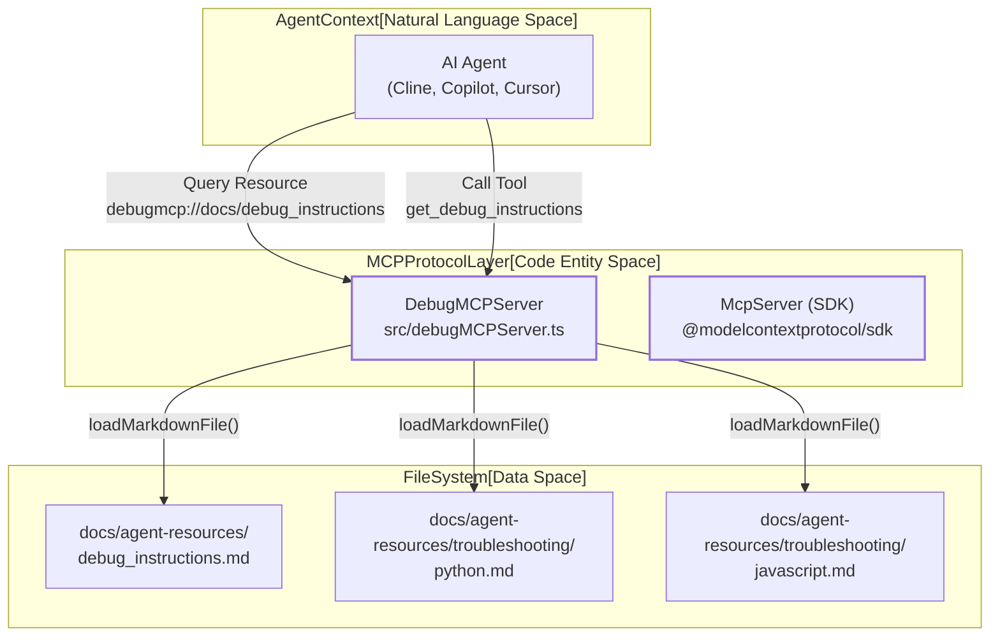
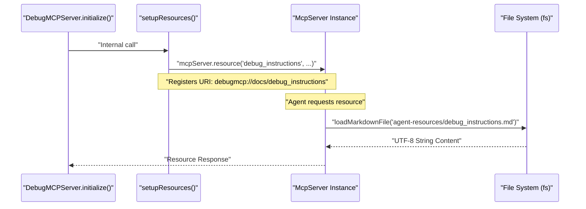

<!-- source: DeepWiki mcp.deepwiki.com · repo microsoft/DebugMCP · page 8.4 Agent Resources · fetched 2026-10-26 -->

# Agent Resources

<details>
<summary>Relevant source files</summary>

The following files were used as context for generating this wiki page:

- [docs/agent-resources/debug_instructions.md](docs/agent-resources/debug_instructions.md)
- [src/debugMCPServer.ts](src/debugMCPServer.ts)
- [src/test/debuggingHandler.test.ts](src/test/debuggingHandler.test.ts)

</details>


This document describes the documentation resources that the DebugMCP server exposes to AI agents via the Model Context Protocol (MCP). These resources provide guidance on debugging workflows, best practices, and language-specific troubleshooting information that agents can query at runtime to improve their debugging capabilities.

For information about the MCP tools API that agents use to perform debugging operations, see [8.1 MCP Tools API](). For troubleshooting issues with the DebugMCP extension itself, see [8.3 Troubleshooting Guide]().

## Overview

Agent resources are markdown documentation files that the `DebugMCPServer` loads and exposes as MCP resources. These resources serve as runtime documentation that AI agents can read to understand:

- How to structure an effective debugging workflow.
- Root cause analysis methodologies (Symptom vs. Root Cause).
- Breakpoint placement strategies.
- Language-specific debugging considerations.
- Common debugging pitfalls and best practices.

Unlike traditional documentation, these resources are designed to be machine-readable and queryable by AI agents during active debugging sessions. For clients that do not support MCP resources (such as GitHub Copilot), the server also exposes a tool `get_debug_instructions` to retrieve the primary guide.

**Sources:** [src/debugMCPServer.ts:19-22](), [src/debugMCPServer.ts:60-68](), [docs/agent-resources/debug_instructions.md:1-10]()

## Resource Architecture



**Diagram: Resource Access Flow**

The `DebugMCPServer` registers resources during initialization. When an AI agent queries a resource by URI, the MCP server invokes a callback that reads the markdown file from disk and returns its contents.

**Sources:** [src/debugMCPServer.ts:51-54](), [src/debugMCPServer.ts:60-68](), [src/debugMCPServer.ts:154-156]() (Note: setupResources logic is implied in the server initialization flow).

## Resource Registration Process



**Diagram: Resource Registration and Retrieval**

The registration occurs during the `initialize()` phase of the `DebugMCPServer`. The server uses `fs.promises.readFile` via the helper `loadMarkdownFile` to fetch content dynamically when requested by the agent.

**Sources:** [src/debugMCPServer.ts:41-54](), [src/debugMCPServer.ts:65-67](), [src/debugMCPServer.ts:154-156]()

## Available Resources

### Core Debugging Instructions

| Property | Value |
|----------|-------|
| **URI** | `debugmcp://docs/debug_instructions` |
| **Tool Fallback** | `get_debug_instructions` |
| **Description** | Step-by-step instructions for debugging with DebugMCP |
| **File Path** | `docs/agent-resources/debug_instructions.md` |
| **Purpose** | Comprehensive guide for debugging workflow and root cause analysis |

This is the primary resource that AI agents are instructed to read before starting any debugging session. The `start_debugging` tool description explicitly warns agents to read this resource first.

**Content Structure:**
- **Critical Instructions:** Sequential workflow: 1. `add_breakpoint` → 2. `start_debugging` → 3. Navigate/Inspect → 4. Root Cause Analysis. [docs/agent-resources/debug_instructions.md:3-8]()
- **Root Cause Analysis Framework:** Distinguishing symptoms (e.g., "variable is null") from root causes (e.g., "config string is wrong"). [docs/agent-resources/debug_instructions.md:10-50]()
- **Breakpoint Strategy Guide:** Guidance on where to place breakpoints (executable lines, function bodies, before loops). [docs/agent-resources/debug_instructions.md:106-116]()
- **Common Mistakes:** Warnings against starting without breakpoints or setting them on comments/signatures. [docs/agent-resources/debug_instructions.md:118-127]()

**Sources:** [src/debugMCPServer.ts:61-68](), [src/debugMCPServer.ts:80](), [docs/agent-resources/debug_instructions.md:1-136]()

### Language-Specific Troubleshooting Resources

The server provides specialized guidance for different programming environments. These are typically stored in `docs/agent-resources/troubleshooting/`.

| Language | URI | Name |
|----------|-----|------|
| **Python** | `debugmcp://docs/troubleshooting/python` | Python Debugging Tips |
| **JavaScript** | `debugmcp://docs/troubleshooting/javascript` | JavaScript Debugging Tips |
| **Java** | `debugmcp://docs/troubleshooting/java` | Java Debugging Tips |
| **C#** | `debugmcp://docs/troubleshooting/csharp` | C# Debugging Tips |

**Sources:** [src/debugMCPServer.ts:66]() (General pattern for resource loading).

## Resource Loading Implementation

The `DebugMCPServer` utilizes a helper method to resolve file paths relative to the extension's installation directory.

```typescript
// Conceptual logic based on tool implementation
async loadMarkdownFile(relativePath: string): Promise<string> {
    const fullPath = path.join(__dirname, '..', 'docs', relativePath);
    return await fs.promises.readFile(fullPath, 'utf8');
}
```

**Key Implementation Details:**
- **Path Resolution:** Uses `path.join` to navigate from the compiled `out/` directory to the `docs/` folder.
- **Async I/O:** Uses `fs.promises` to ensure the Node.js event loop is not blocked during file reads.
- **Integration:** The `get_debug_instructions` tool calls this directly.

**Sources:** [src/debugMCPServer.ts:65-67](), [src/debugMCPServer.ts:154-156]()

## Integration with Tool Descriptions

The main debugging instructions resource is referenced directly in the `start_debugging` tool description to ensure agent compliance:

```text
⚠️ CRITICAL: Before using this tool, first call get_debug_instructions or read debugmcp://docs/debug_instructions resource!
```

This creates a "documentation-first" requirement where the agent is prompted to understand the `DebugMCP` workflow (especially the requirement to set breakpoints *before* starting a session) before executing commands.

**Sources:** [src/debugMCPServer.ts:80](), [docs/agent-resources/debug_instructions.md:95-96]()

## Root Cause Analysis (RCA) Framework

The resources define a specific mental model for AI agents to follow during debugging sessions:

1.  **Identify Symptom:** Record the wrong value or error.
2.  **Ask "Why":** Trace the data flow backwards.
3.  **Trace to Source:** Use `restart_debugging` if necessary to step into the origin of the bad state.
4.  **Verify Root Cause:** Ensure the fix addresses the fundamental logic error, not just the symptom.

**Sources:** [docs/agent-resources/debug_instructions.md:10-93]()

## Cleanup and Verification

Agents are instructed to use `clear_all_breakpoints` once the root cause is verified. This ensures a clean state for subsequent tasks and prevents stale breakpoints from interfering with future sessions.

**Sources:** [docs/agent-resources/debug_instructions.md:128-135]()

---

