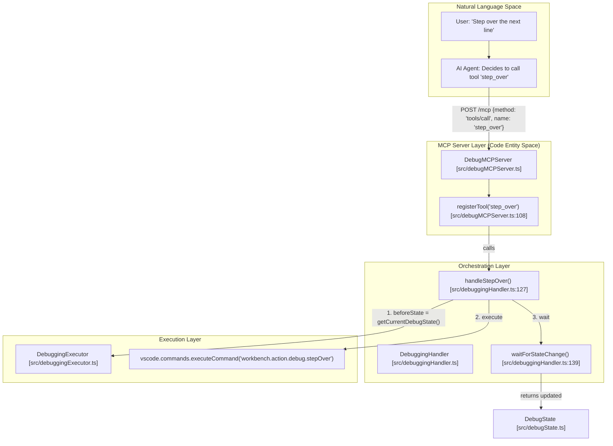
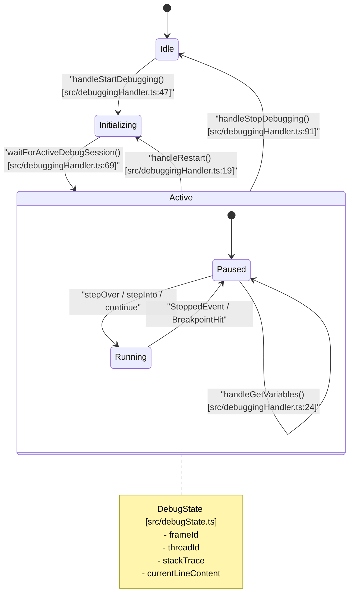

<!-- source: DeepWiki mcp.deepwiki.com · repo microsoft/DebugMCP · page 9 Glossary · fetched 2026-10-26 -->

# Glossary

Relevant source files

The following files were used as context for generating this wiki page:

- [AGENTS.md](AGENTS.md)
- [docs/architecture/debugMCPServer.md](docs/architecture/debugMCPServer.md)
- [src/debugMCPServer.ts](src/debugMCPServer.ts)
- [src/debugState.ts](src/debugState.ts)
- [src/debuggingHandler.ts](src/debuggingHandler.ts)
- [src/utils/agentConfigurationManager.ts](src/utils/agentConfigurationManager.ts)
- [tsconfig.json](tsconfig.json)

This page defines codebase-specific terms, jargon, and domain concepts used within the DebugMCP project. It serves as a technical reference for onboarding engineers to understand the mapping between abstract debugging concepts and their specific implementations in the code.

## Core Concepts

### Model Context Protocol (MCP)
The foundational protocol used to communicate between AI Agents (clients) and the VS Code extension (server). DebugMCP implements this using the official `@modelcontextprotocol/sdk` [src/debugMCPServer.ts:15-16]().
*   **Tools**: Executable functions exposed to the AI, such as `start_debugging` or `step_over` [src/debugMCPServer.ts:59-158]().
*   **Resources**: Static or dynamic data (like Markdown guides) that the AI can read to understand how to debug specific languages [src/debugMCPServer.ts:52]().

### Streamable HTTP Transport
A stateless transport mechanism for MCP that uses HTTP POST requests instead of persistent Server-Sent Events (SSE). Each request creates a short-lived `StreamableHTTPServerTransport` [src/debugMCPServer.ts:28](). This is the modern replacement for legacy SSE configurations [src/utils/agentConfigurationManager.ts:168-204]().

### Debug Adapter Protocol (DAP)
The underlying protocol VS Code uses to talk to debuggers (like GDB, LLDB, or PWA-Node). While DebugMCP uses the VS Code API, it effectively bridges MCP commands into DAP requests executed by the `DebuggingExecutor` [src/debuggingExecutor.ts]().

---

## Technical Terms & Components

| Term | Definition | Code Pointer |
| :--- | :--- | :--- |
| **Active Session** | A state where a debug session is initialized and attached to a process. Verified via `hasActiveSession()` | [src/debuggingHandler.ts:93-95]() |
| **Auto-Configuration** | The process of detecting installed AI agents (Cline, Copilot, Cursor) and writing their JSON config files | [src/utils/agentConfigurationManager.ts:118-149]() |
| **DebugState** | A snapshot object containing the current file, line, stack trace, and variable context | [src/debugState.ts:16-43]() |
| **Exponential Backoff** | A retry strategy used when waiting for a debug session to become active or for the state to change | [src/debuggingHandler.ts:69]() |
| **Frame ID** | A unique identifier for a specific level in the call stack, used for evaluating expressions in context | [src/debugState.ts:23]() |
| **Line Content Matching** | A strategy for setting breakpoints by searching for a specific string of code rather than a volatile line number | [src/debugMCPServer.ts:148-154]() |

---

## System Request Flow

The following diagram illustrates how a natural language request from a user is transformed into code entities and eventually a VS Code debug action.

### Natural Language to Code Entity Space
"AI Agent executes a Step Over command"

**Sources:** [src/debugMCPServer.ts:108-113](), [src/debuggingHandler.ts:127-145](), [src/debugState.ts:16-43]()

---

## Debug State Management

The `DebugState` class is the source of truth for the AI's "vision" of the debugging session. It bridges the gap between raw VS Code events and the JSON-RPC responses sent back to the agent.

### State Transition Diagram

**Sources:** [src/debugState.ts:48-61](), [src/debuggingHandler.ts:12-26](), [src/debugMCPServer.ts:71-145]()

---

## Agent Configuration Registry

The `AgentConfigurationManager` maintains a registry of where various AI agents store their MCP settings.

| Agent ID | Config File Name | Code Identifier | Path Heuristic |
| :--- | :--- | :--- | :--- |
| `cline` | `cline_mcp_settings.json` | `AgentInfo.id: 'cline'` | `saoudrizwan.claude-dev/settings/` |
| `copilot` | `mcp.json` | `AgentInfo.id: 'copilot'` | `Code/User/mcp.json` |
| `cursor` | `mcp_settings.json` | `AgentInfo.id: 'cursor'` | `cursor.mcp/settings/` |

**Sources:** [src/utils/agentConfigurationManager.ts:118-149]()