# Page: Home

# Home

<details>
<summary>Relevant source files</summary>

The following files were used as context for generating this wiki page:

- [CHANGELOG.md](CHANGELOG.md)
- [README.md](README.md)
- [assets/DebugMCP.webp](assets/DebugMCP.webp)
- [assets/architecture.png](assets/architecture.png)
- [package.json](package.json)

</details>


## Purpose and Scope

This wiki documents the DebugMCP system: a VS Code extension that exposes comprehensive multi-language debugging capabilities to AI agents via the Model Context Protocol (MCP). This page provides an overview of what DebugMCP is, why it exists, and how its components work together.

DebugMCP bridges professional debugging capabilities with AI-assisted development by embedding an MCP server within VS Code. It exposes 13 debugging tools and documentation resources to AI assistants via a **Streamable HTTP** transport on port 3001 (default).

**Sources:** [package.json:2-4](), [README.md:1-5](), [README.md:33-35]()

---

## What is DebugMCP?

DebugMCP is a VS Code extension that enables AI agents (such as Cline, GitHub Copilot, Cursor, and Roo Code) to autonomously control the VS Code debugger. Instead of reading logs or guessing, an AI assistant can set breakpoints, launch sessions, step through code, and inspect state.

### Key Characteristics
*   **Local-only operation:** Runs 100% locally with no external communications and requires no credentials [README.md:69-70]().
*   **Multi-language support:** Supports Python, JS/TS, Java, C#, C++, Go, Rust, PHP, and Ruby [README.md:112-121]().
*   **Protocol-based:** Implements the Model Context Protocol (MCP) using the official `@modelcontextprotocol/sdk` [package.json:92-92](), [CHANGELOG.md:27-27]().
*   **Streamable HTTP Transport:** Migrated from SSE to a faster, more reliable Streamable HTTP transport for communication [CHANGELOG.md:19-19]().

**Sources:** [README.md:33-36](), [package.json:16-30](), [CHANGELOG.md:18-28]()

---

## Why DebugMCP Exists

Traditional debugging requires manual interaction with IDE tools. While AI coding assistants can modify code, they historically lack the ability to verify logic through runtime inspection. DebugMCP fills this gap by providing a programmatic interface to VS Code's debugging infrastructure (the Debug Adapter Protocol).

**Problem:** AI agents can suggest fixes but cannot "see" the variable state or execution flow at runtime without manual developer intervention.
**Solution:** DebugMCP exposes tools like `start_debugging`, `add_breakpoint`, and `get_variables_values` directly to the LLM, allowing for systematic root cause analysis.

**Sources:** [README.md:33-36](), [README.md:61-67](), [CHANGELOG.md:73-75]()

---

## System Architecture

### High-Level Component Structure

The following diagram illustrates how the extension bridges the AI Agent's natural language requests to the VS Code Code Entity Space.

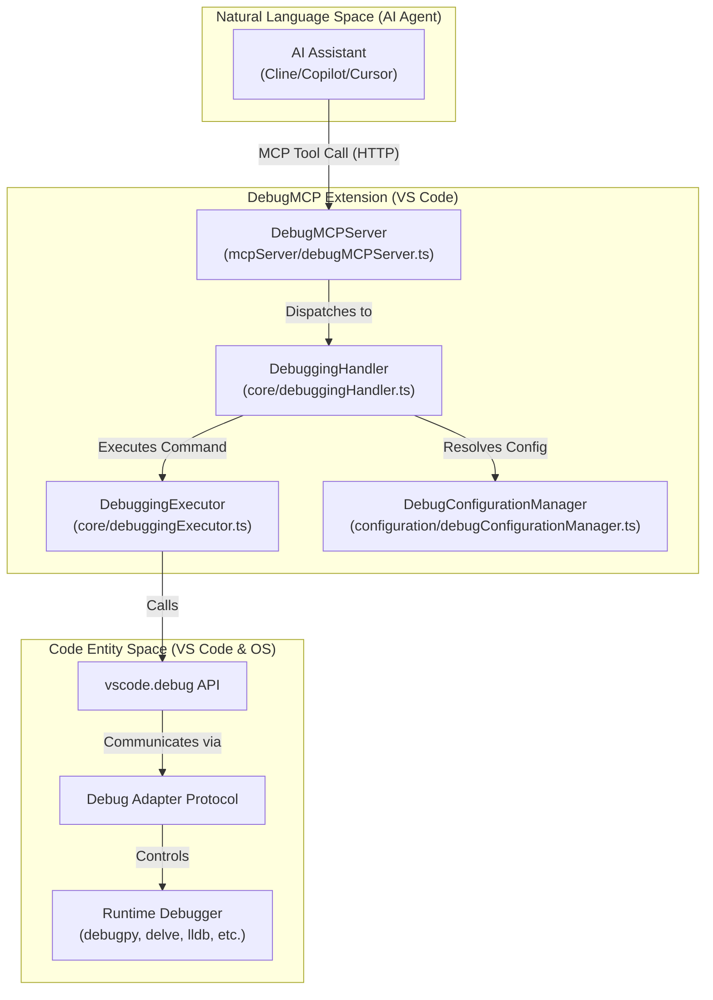

**Sources:** [package.json:46-50](), [CHANGELOG.md:19-21](), [CHANGELOG.md:27-28]()

### Request Flow: Starting a Debug Session

This trace shows the data flow when an AI agent initiates a debugging operation.

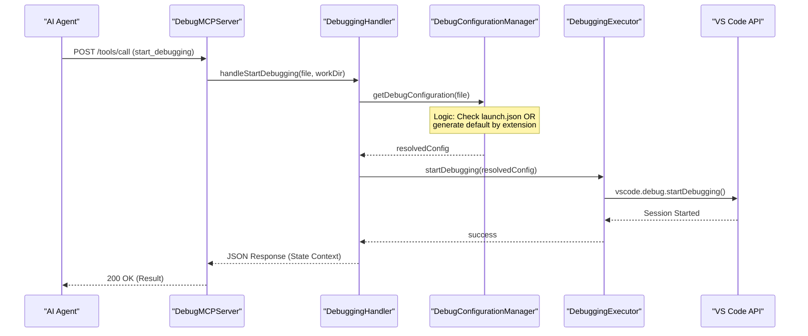

**Sources:** [README.md:44-44](), [CHANGELOG.md:10-11](), [CHANGELOG.md:66-68]()

---

## Key Capabilities

### Available MCP Tools

The extension registers 13 tools that allow the AI to manipulate the debugger state.

| Tool Name | Purpose | Key Parameters |
| :--- | :--- | :--- |
| `start_debugging` | Launches a debug session | `fileFullPath`, `workingDirectory`, `configurationName` |
| `add_breakpoint` | Sets a breakpoint using line content matching | `fileFullPath`, `lineContent` |
| `step_over` | Executes the next line | None |
| `get_variables_values` | Inspects state in current frame | `scope` ('local', 'global', 'all') |
| `evaluate_expression` | Runs arbitrary code in debug context | `expression` |
| `list_breakpoints` | Returns all active breakpoints | None |
| `get_debug_instructions` | Returns the debugging best practices guide | None |

**Sources:** [README.md:41-56](), [CHANGELOG.md:11-11](), [CHANGELOG.md:44-46]()

### Resource Loading
DebugMCP provides a `debug_instructions` resource (and a corresponding tool for clients like Copilot) that guides the AI on how to debug effectively, emphasizing root cause analysis over symptom fixing.

**Sources:** [README.md:58-58](), [README.md:60-67]()

---

## Language Support

The `DebugConfigurationManager` uses heuristics to map file extensions to the correct VS Code debugger type.

| Language | VS Code Extension Dependency | Debugger Type |
| :--- | :--- | :--- |
| **Python** | `ms-python.python` | `debugpy` |
| **Node.js** | `ms-vscode.js-debug` | `pwa-node` |
| **Java** | `vscjava.vscode-java-pack` | `java` |
| **C++** | `ms-vscode.cpptools` | `cppdbg` |
| **Go** | `golang.Go` | `go` |
| **C#** | `ms-dotnettools.csharp` | `coreclr` |

**Sources:** [README.md:112-121](), [CHANGELOG.md:55-55](), [CHANGELOG.md:61-65]()

---

## Configuration

The extension contributes settings to VS Code that control the server behavior.

*   **`debugmcp.serverPort`**: The port the MCP server listens on (Default: `3001`) [package.json:75-79]().
*   **`debugmcp.timeoutInSeconds`**: How long the server waits for debug operations to complete (Default: `180`) [package.json:70-74]().

### Agent Auto-Configuration
The extension includes an `AgentConfigurationManager` that triggers a popup (`debugmcp.showAgentSelectionPopup`) to automatically detect and configure AI assistants like Cline, Copilot, and Cursor.

**Sources:** [package.json:52-57](), [CHANGELOG.md:32-33](), [CHANGELOG.md:19-21]()

---

# Page: Getting Started

# Getting Started

<details>
<summary>Relevant source files</summary>

The following files were used as context for generating this wiki page:

- [README.md](README.md)
- [assets/DebugMCP.webp](assets/DebugMCP.webp)
- [assets/architecture.png](assets/architecture.png)
- [package.json](package.json)

</details>


This page provides an overview of the initial setup process for DebugMCP. After completing these steps, the extension will be running and ready to accept debugging requests from AI agents.

**Scope**: This page covers the high-level setup workflow and prerequisites. For detailed instructions, see:
- [Installation](#2.1) — Step-by-step instructions for installing the DebugMCP extension from the VS Code marketplace
- [Configuring AI Agents](#2.2) — How to configure supported AI agents (Cline, GitHub Copilot, Cursor) to connect to the DebugMCP server
- [Your First Debug Session](#2.3) — Walkthrough of starting a simple debugging session through an AI agent

For architecture details, see [Architecture Overview](#3). For the complete reference of configuration options, see [Configuration Reference](#8.2).

---

## Prerequisites

Before installing DebugMCP, ensure you have:

| Requirement | Version | Purpose |
|-------------|---------|---------|
| **VS Code** | ≥ 1.104.0 | Host environment for the extension |
| **Language Extensions** | Latest | Required for debugging specific languages (see [Language Support](#6)) |
| **AI Agent** | Any MCP-compatible | Cline, GitHub Copilot, Cursor, or other MCP client |
| **Network Port** | 3001 (default) | For MCP server communication (configurable) |

**Sources**: [package.json:32-34](), [package.json:75-79](), [README.md:112-121]()

---

## Setup Process Overview

The DebugMCP setup consists of three primary phases:

```mermaid
graph LR
    subgraph Phase1["Phase_1:_Install_Extension"]
        [MARKET] --> [INSTALL]
        [MARKET]["VS_Code_Marketplace"]
        [INSTALL]["Install_DebugMCP_ozzafar.debugmcpextension"]
    end
    
    subgraph Phase2["Phase_2:_Automatic_Activation"]
        [ACTIVATE] --> [SERVER]
        [SERVER] --> [POPUP]
        [ACTIVATE]["Extension_Activates_via_onStartupFinished"]
        [SERVER]["DebugMCPServer_Starts_Port_3001"]
        [POPUP]["Agent_Selection_Popup_debugmcp.showAgentSelectionPopup"]
    end
    
    subgraph Phase3["Phase_3:_Agent_Configuration"]
        [CONFIG] --> [AGENT]
        [CONFIG]["AgentConfigurationManager"]
        [AGENT]["AI_Agent_Config_mcp_settings.json"]
    end
    
    [INSTALL] --> [ACTIVATE]
    [AGENT] --> [READY]
    [READY]["Ready_for_Use"]
```

**DebugMCP Setup Flow**

This diagram shows the complete initialization sequence from marketplace installation through agent configuration. The process is largely automated, with the extension handling server startup and offering to configure supported AI agents.

**Sources**: [package.json:46-49](), [package.json:54-57](), [README.md:18-31]()

---

## Extension Activation Sequence

When VS Code starts or the extension is installed, DebugMCP follows this activation sequence:

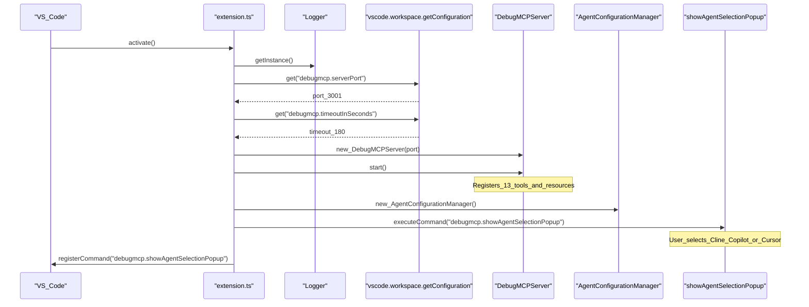

**Extension Activation and Server Initialization**

This sequence shows the exact order of operations during extension activation, mapping to actual code components. The system initializes the server first, followed by the configuration manager, and finally presents the UI for agent integration.

**Sources**: [package.json:46-58](), [package.json:70-80](), [README.md:39-57]()

---

## Configuration Structure

DebugMCP uses a hierarchical configuration system:

```mermaid
graph TB
    subgraph VSCodeSettings["VS_Code_Settings"]
        [ExtConfig] --> [ServerPort]
        [ExtConfig] --> [Timeout]
        [ExtConfig]["Extension_Configuration"]
        [ServerPort]["debugmcp.serverPort_default:_3001"]
        [Timeout]["debugmcp.timeoutInSeconds_default:_180"]
    end
    
    subgraph MCPConfig["MCP_Server_Configuration"]
        [Transport]
        [URL]
        [Transport]["transport:_sse"]
        [URL]["url:_http://localhost:3001/sse"]
    end
    
    subgraph AgentConfigs["AI_Agent_Configurations"]
        [Cline]
        [Copilot]
        [Cursor]
        [Cline]["cline_mcp_settings.json"]
        [Copilot][".vscode/settings.json"]
        [Cursor]["mcp_settings.json"]
    end
    
    [ServerPort] --> [URL]
    [URL] --> [Cline]
    [URL] --> [Copilot]
    [URL] --> [Cursor]
```

**Configuration Hierarchy**

The extension settings in `package.json` define the MCP server's port and timeout. These values propagate to the agent configuration files, which tell AI agents how to connect to the MCP server via HTTP/SSE transport.

**Sources**: [package.json:67-81](), [README.md:112-125]()

---

## Configuration Settings

The extension exposes two configurable settings through VS Code's settings UI:

| Setting | Type | Default | Description | Configuration Key |
|---------|------|---------|-------------|-------------------|
| Server Port | `number` | `3001` | TCP port for the DebugMCP server | `debugmcp.serverPort` |
| Timeout | `number` | `180` | Operation timeout in seconds | `debugmcp.timeoutInSeconds` |

These settings can be modified in:
- **User Settings**: Applies globally to all workspaces
- **Workspace Settings**: `.vscode/settings.json` for workspace-specific configuration

**Sources**: [package.json:67-81]()

---

## Verification Steps

After installation, verify DebugMCP is running correctly:

### 1. Extension Status
Check that the extension appears in your installed extensions list.
- **VS Code** → **Extensions** → Search "**DebugMCP**"
- Status should be **Enabled**.

### 2. Output Channel
The extension creates an output channel for diagnostics:
- **VS Code** → **Output** → Select "**DebugMCP**" from the dropdown.
- Expected: Logs showing the server starting on the configured port.

### 3. MCP Server Connectivity
The server runs on the configured port (default `3001`) and accepts connections at the root or `/sse` endpoints.
- **Endpoint**: `http://localhost:3001`
- **Protocol**: MCP (Model Context Protocol)

**Sources**: [package.json:75-79](), [README.md:92-97]()

---

## Agent Configuration Overview

DebugMCP includes logic to automatically configure supported AI agents. The configuration process involves:

1.  **Detection**: Identifying which AI agents (Cline, Cursor, Copilot) are installed.
2.  **Registration**: Writing the MCP server connection details to the respective agent's configuration files.
3.  **Command Execution**: Users can trigger this manually via the `debugmcp.showAgentSelectionPopup` command.

**Sources**: [package.json:54-57](), [README.md:102-106]()

---

## Activation Events

The extension registers two activation events in `package.json`:

```json
"activationEvents": [
  "onStartupFinished",
  "onDebug"
]
```

- **`onStartupFinished`**: Activates automatically when VS Code finishes starting up, ensuring the MCP server is available immediately.
- **`onDebug`**: Activates when any debug session starts, guaranteeing the extension is ready for debugging operations.

**Sources**: [package.json:46-49]()

---

## Next Steps

Once DebugMCP is installed and verified:

1.  **Configure Your AI Agent** — See [Configuring AI Agents](#2.2) for detailed setup instructions for Cline, GitHub Copilot, or Cursor.
2.  **Run Your First Debug Session** — Follow [Your First Debug Session](#2.3) for a guided walkthrough.
3.  **Install Language Extensions** — Ensure you have the required debugger extensions for your target languages (see [Language Support](#6)).

**Sources**: [README.md:102-108]()

---

# Page: Installation

# Installation

<details>
<summary>Relevant source files</summary>

The following files were used as context for generating this wiki page:

- [.gitignore](.gitignore)
- [.vscodeignore](.vscodeignore)
- [README.md](README.md)
- [assets/DebugMCP.webp](assets/DebugMCP.webp)
- [assets/architecture.png](assets/architecture.png)
- [package.json](package.json)

</details>


## Purpose and Scope

This page provides step-by-step instructions for installing the DebugMCP extension from the VS Code Marketplace. Installation is the first step in enabling AI agents to autonomously manage breakpoints, step through code, and inspect variables within your local environment.

For information about configuring AI agents to connect to DebugMCP after installation, see **2.2 Configuring AI Agents**. For a walkthrough of your first debugging session, see **2.3 Your First Debug Session**.

---

## Prerequisites

Before installing DebugMCP, ensure your system meets the following requirements:

| Requirement | Minimum Version | Notes |
|------------|----------------|-------|
| **VS Code** | 1.104.0 | Required engine version [package.json:33-34]() |
| **Node.js** | 22.x | Recommended for extension host stability [package.json:99-99]() |
| **Operating System** | Windows, macOS, or Linux | All platforms supported [README.md:123-131]() |
| **Available Port** | 3001 (default) | Configurable via `debugmcp.serverPort` [package.json:75-79]() |

Sources: [package.json:33-34](), [package.json:75-79](), [package.json:99-99](), [README.md:123-131]()

---

## Installation Methods

DebugMCP can be installed through three primary methods. The direct link method is fastest, while the VS Code Extensions panel provides the most familiar interface.

### Method 1: Direct Link (Recommended)

The fastest installation method uses the VS Code extension URI scheme:

1. Click this link: [vscode:extension/ozzafar.debugmcpextension](vscode:extension/ozzafar.debugmcpextension)
2. Your browser will prompt to open VS Code.
3. VS Code will display the extension page.
4. Click **Install**.

Sources: [README.md:77-79](), [package.json:2-3]()

### Method 2: VS Code Marketplace

Install directly from the web-based VS Code Marketplace:

1. Visit the [DebugMCP Marketplace Page](https://marketplace.visualstudio.com/items?itemName=ozzafar.debugmcpextension).
2. Click the **Install** button.
3. Confirm the browser prompt to launch VS Code.
4. Click **Install** within the VS Code interface.

Sources: [README.md:81-83](), [package.json:6]()

### Method 3: Within VS Code

Install using the built-in Extensions panel:

1. Launch VS Code.
2. Open the Extensions view (`Ctrl+Shift+X` or `Cmd+Shift+X`).
3. Search for **"DebugMCP"**.
4. Click **Install** on the entry published by `ozzafar`.

Sources: [README.md:85-90](), [package.json:2-3]()

---

## Installation Flow Diagram

The following diagram illustrates how different installation entry points converge into the VS Code extension lifecycle.

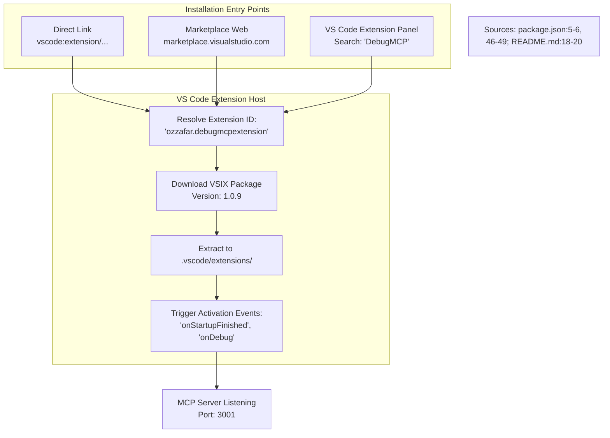

Sources: [package.json:5-6](), [package.json:46-49](), [README.md:18-20]()

---

## Extension Activation Process

Upon installation, DebugMCP activates automatically based on the defined `activationEvents` [package.json:46-49]().

### Activation Sequence

The activation logic is defined in the main entry point specified in `package.json` [package.json:50-50]().

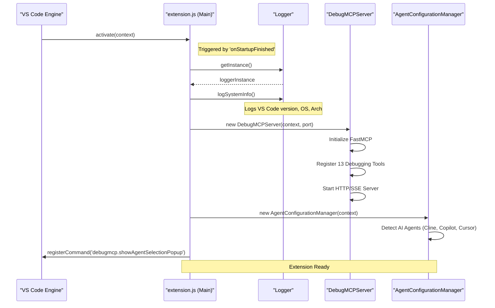

**Activation Triggers**
1. **`onStartupFinished`**: Ensures the MCP server starts as soon as the editor is ready [package.json:47-47]().
2. **`onDebug`**: Ensures the extension is active if a user starts a debug session manually [package.json:48-48]().

Sources: [package.json:46-50](), [package.json:54-57]()

---

## Post-Installation Verification

After installation, verify the extension is functioning correctly:

### Visual Indicators
*   **Command Palette**: Press `Ctrl+Shift+P` and type `DebugMCP`. You should see `DebugMCP: Show Agent Selection Popup` [package.json:54-57]().
*   **Output Channel**: Open **View > Output** and select **DebugMCP** from the dropdown. You should see system information logs including VS Code version and platform details.

### MCP Server Connectivity
The extension starts an MCP server on a local port (default `3001`). You can verify the server is running by checking the Output log for:
`DebugMCP server started on port 3001`

Sources: [package.json:75-79](), [README.md:93-97]()

---

## Configuration Options

Post-installation, you can customize the extension via VS Code Settings (`settings.json`):

| Setting | Type | Default | Description |
|---------|------|---------|-------------|
| `debugmcp.serverPort` | `number` | `3001` | The port the MCP server listens on [package.json:75-79](). |
| `debugmcp.timeoutInSeconds` | `number` | `180` | Maximum time allowed for debug operations [package.json:70-74](). |

### Directory Structure
The extension follows the standard VS Code structure:
*   `package.json`: Manifest and contribution points [package.json:1-112]().
*   `out/extension.js`: Compiled entry point [package.json:50-50]().
*   `assets/`: Icons and media [package.json:35-35]().

Sources: [package.json:35-35](), [package.json:50-50](), [package.json:70-79]()

---

## Troubleshooting Installation

### Common Issues
*   **Port Conflict**: If port `3001` is occupied, the MCP server will fail to start. Change `debugmcp.serverPort` in settings and restart VS Code [package.json:75-79]().
*   **Engine Version**: Ensure VS Code is at least version `1.104.0`. Older versions will refuse to install the extension [package.json:33-34]().
*   **Activation Failure**: Check the **Developer Tools** console (`Help > Toggle Developer Tools`) for stack traces if the extension fails to activate.

Sources: [package.json:33-34](), [package.json:75-79]()

---

# Page: Configuring AI Agents

# Configuring AI Agents

<details>
<summary>Relevant source files</summary>

The following files were used as context for generating this wiki page:

- [README.md](README.md)
- [assets/DebugMCP.webp](assets/DebugMCP.webp)
- [assets/architecture.png](assets/architecture.png)
- [src/utils/agentConfigurationManager.ts](src/utils/agentConfigurationManager.ts)

</details>


This document explains how to configure AI agents (Cline, GitHub Copilot, Cursor) to connect to the DebugMCP server. After installing the extension, you must configure at least one AI agent to use the debugging tools. This page covers both automatic and manual configuration approaches, including the migration from legacy SSE transport to the current `streamableHttp` transport.

For information about using the debugging tools after configuration, see [Your First Debug Session](2.3). For details about the MCP protocol and server architecture, see [MCP Protocol Integration](3.2).

## Overview

DebugMCP uses the `AgentConfigurationManager` class [src/utils/agentConfigurationManager.ts:24-24]() to automatically detect and configure supported AI agents. The configuration process adds an MCP server entry pointing to `http://localhost:{port}/mcp` using the `streamableHttp` transport type [src/utils/agentConfigurationManager.ts:154-162]().

### Data Flow: Agent Configuration
The following diagram illustrates how the `AgentConfigurationManager` bridges the Natural Language Space (User requests/Popups) to the Code Entity Space (Configuration Files/Filesystem).

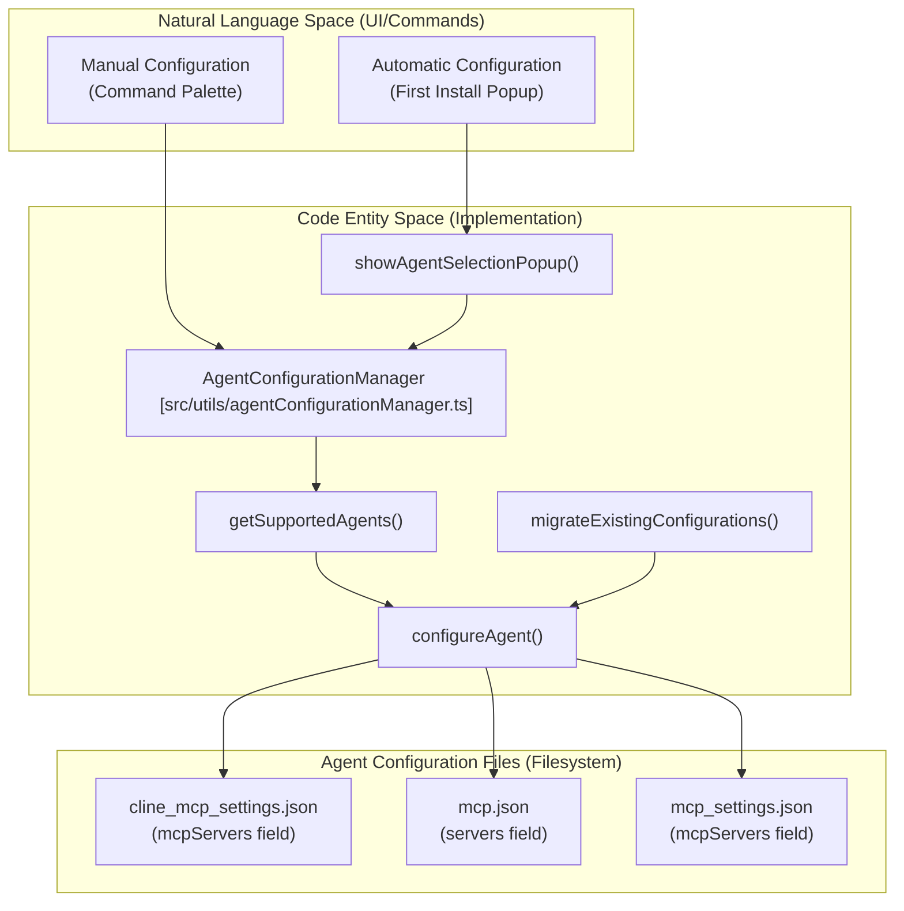
**Sources:** [src/utils/agentConfigurationManager.ts:24-162](), [README.md:115-176]()

## Supported AI Agents

DebugMCP supports three AI agents with automatic configuration detection. Each agent is represented by an `AgentInfo` object [src/utils/agentConfigurationManager.ts:8-14]().

| Agent | Config File Field | Config Path (Platform-Specific) |
|-------|-------------------|--------------------------------|
| **Cline** | `mcpServers` | `{configBase}/Code/User/globalStorage/saoudrizwan.claude-dev/settings/cline_mcp_settings.json` |
| **GitHub Copilot** | `servers` | `{configBase}/Code/User/mcp.json` |
| **Cursor** | `mcpServers` | `{configBase}/Cursor/User/globalStorage/cursor.mcp/settings/mcp_settings.json` |

The `{configBase}` location is resolved via `getConfigBasePath()` [src/utils/agentConfigurationManager.ts:97-113]():
- **Windows**: `process.env.APPDATA` or `~\AppData\Roaming`
- **macOS**: `~/Library/Application Support`
- **Linux**: `process.env.XDG_CONFIG_HOME` or `~/.config`

**Sources:** [src/utils/agentConfigurationManager.ts:118-149](), [src/utils/agentConfigurationManager.ts:97-113]()

## Automatic Configuration & Migration

### Migration from SSE/HTTP
The current version of DebugMCP uses `streamableHttp`. The `migrateExistingConfigurations()` method [src/utils/agentConfigurationManager.ts:168-211]() automatically scans agent config files for legacy `sse` or `http` types and updates them to the new standard.

### First Install Popup
On first activation, the extension checks the `debugmcp.popupShown` key in `globalState` [src/utils/agentConfigurationManager.ts:40-44](). If false, it triggers `showAgentSelectionPopup()` [src/utils/agentConfigurationManager.ts:49-60]().

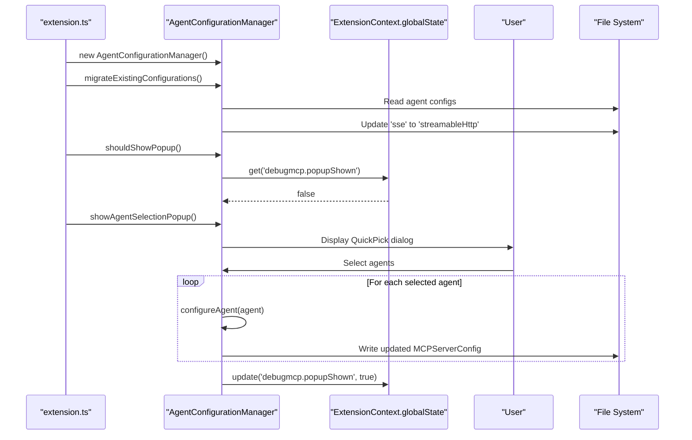
**Sources:** [src/utils/agentConfigurationManager.ts:40-60](), [src/utils/agentConfigurationManager.ts:168-211]()

## Manual Configuration

### Via Command Palette
Users can manually trigger configuration using the `debugmcp.configureAgent` command, which invokes `showManualConfiguration()` [src/utils/agentConfigurationManager.ts:72-92](). This presents a `QuickPick` of supported agents.

### Configuration File Structure
The `MCPServerConfig` interface [src/utils/agentConfigurationManager.ts:16-22]() defines the structure written to the agent's JSON files:

```json
{
  "autoApprove": [],
  "disabled": false,
  "timeout": 180,
  "type": "streamableHttp",
  "url": "http://localhost:3001/mcp"
}
```

The `url` is dynamically generated using the `serverPort` passed to the constructor [src/utils/agentConfigurationManager.ts:154-162]().

**Sources:** [src/utils/agentConfigurationManager.ts:16-22](), [src/utils/agentConfigurationManager.ts:154-162]()

## Agent-Specific Configuration Details

### Logic for Configuration Updates
The `configureAgent(agent: AgentInfo)` method [src/utils/agentConfigurationManager.ts:213-258]() performs the following:
1. **Directory Verification**: Uses `fs.existsSync` and `fs.promises.mkdir` to ensure the target path exists [src/utils/agentConfigurationManager.ts:217-221]().
2. **JSON Handling**: Reads the file, parses existing content (or initializes `{}` if missing/corrupt), and updates the specific field (e.g., `mcpServers` or `servers`) [src/utils/agentConfigurationManager.ts:224-245]().
3. **Atomic Write**: Writes the prettified JSON back to disk [src/utils/agentConfigurationManager.ts:248-248]().

### System Component Association
The following diagram bridges the high-level configuration concepts to the specific code classes and properties.

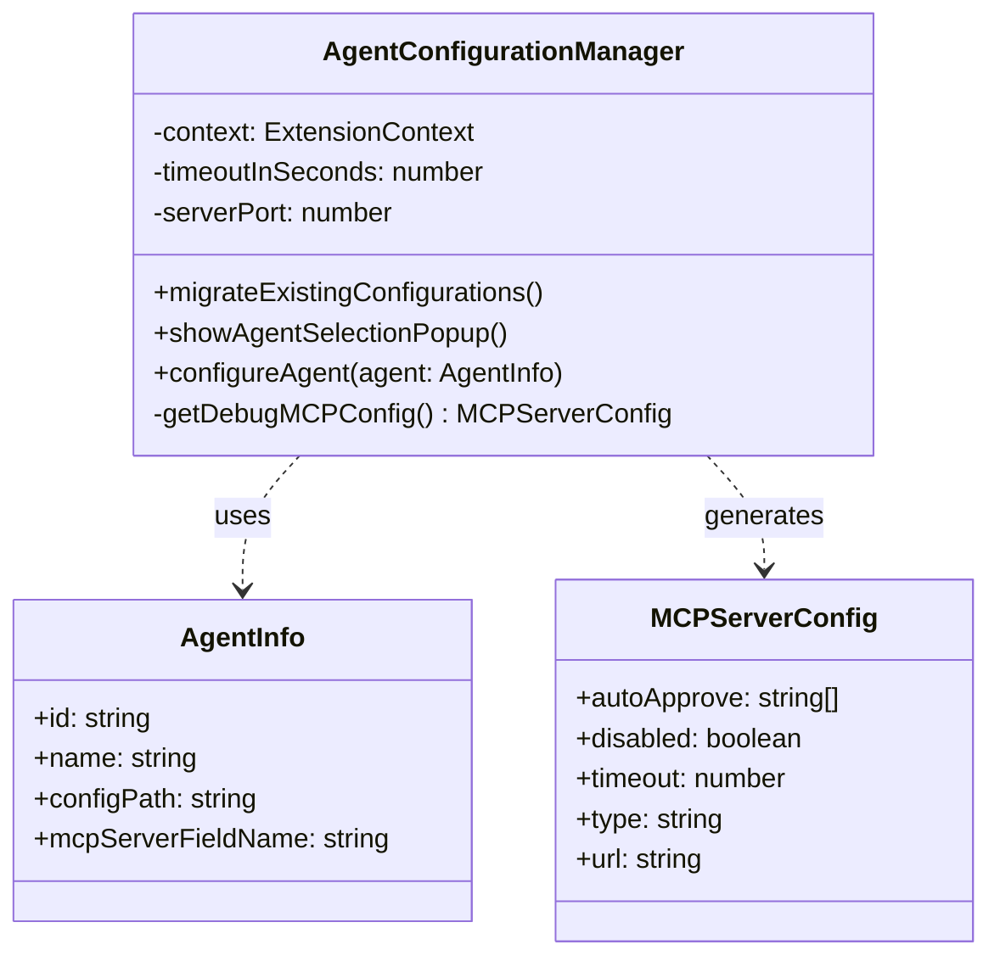
**Sources:** [src/utils/agentConfigurationManager.ts:8-22](), [src/utils/agentConfigurationManager.ts:24-35]()

## Troubleshooting Configuration

- **Port Mismatch**: If you change the `debugmcp.serverPort` setting in VS Code, you must re-run the configuration for your agent so the `url` in the agent's config file is updated [src/utils/agentConfigurationManager.ts:160-160]().
- **Migration Failures**: If an agent config is manually set to a read-only state, `migrateExistingConfigurations()` will log an error to the console [src/utils/agentConfigurationManager.ts:207-207]().
- **Popup Reset**: To re-trigger the setup flow, use `resetPopupState()` which clears the `globalState` key [src/utils/agentConfigurationManager.ts:65-67]().

**Sources:** [src/utils/agentConfigurationManager.ts:65-67](), [src/utils/agentConfigurationManager.ts:168-211](), [README.md:186-194]()

---

# Page: Your First Debug Session

# Your First Debug Session

<details>
<summary>Relevant source files</summary>

The following files were used as context for generating this wiki page:

- [README.md](README.md)
- [assets/DebugMCP.webp](assets/DebugMCP.webp)
- [assets/architecture.png](assets/architecture.png)
- [docs/agent-resources/debug_instructions.md](docs/agent-resources/debug_instructions.md)
- [src/test/debuggingHandler.test.ts](src/test/debuggingHandler.test.ts)

</details>


**Purpose:** This page provides a step-by-step walkthrough of starting and conducting your first debugging session using DebugMCP through an AI agent. It demonstrates the complete workflow from setting breakpoints to inspecting program state, showing both the user-facing commands and the underlying system operations.

**Scope:** This guide covers a single debugging session lifecycle using the MCP tools. For information about installing and configuring the extension, see **Installation (2.1)** and **Configuring AI Agents (2.2)**. For detailed information about all available debugging operations, see **Debugging Operations (5)**.

---

## Prerequisites

Before starting your first debug session, ensure:

| Requirement | Verification |
|-------------|--------------|
| **DebugMCP Extension** | Installed and activated in VS Code [README.md:85-91]() |
| **AI Agent** | Configured to connect to the MCP server (default port 3001) [README.md:92-97]() |
| **Language Extension** | Appropriate debugger installed (e.g., ms-python.python for `.py`) [README.md:110-122]() |
| **Source File** | A source code file ready to debug in an open workspace [README.md:104-106]() |

**Sources:** [README.md:85-122]()

---

## Basic Workflow Overview

The standard debugging workflow follows a systematic sequence designed to identify root causes rather than just symptoms.

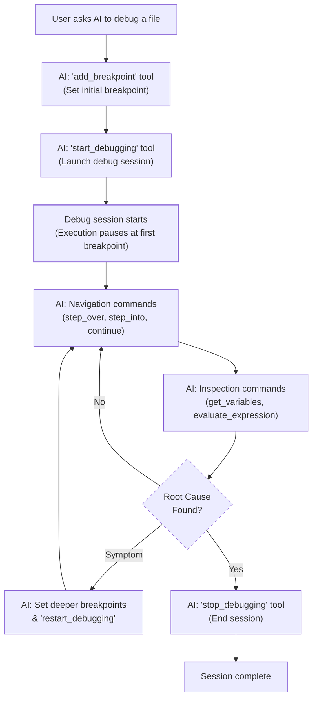

**Sources:** [docs/agent-resources/debug_instructions.md:3-8](), [README.md:41-56]()

---

## Step-by-Step Walkthrough

### Step 1: Set Initial Breakpoint
AI agents are instructed to set at least one breakpoint *before* starting the session to ensure execution pauses at a meaningful location [docs/agent-resources/debug_instructions.md:4-5]().

**MCP Tool Invocation:**
```json
{
  "tool": "add_breakpoint",
  "parameters": {
    "fileFullPath": "/path/to/app.py",
    "lineContent": "result = calculate_logic(data)"
  }
}
```

**Implementation Detail:**
The `DebuggingHandler.handleAddBreakpoint` method does not require a line number. It opens the document, searches for `lineContent`, and applies breakpoints to matching executable lines [src/debuggingHandler.ts:244-280]().

**Sources:** [src/debuggingHandler.ts:244-280](), [docs/agent-resources/debug_instructions.md:108-116]()

---

### Step 2: Start Debug Session
The agent invokes `start_debugging`, which triggers the configuration heuristic.

**Configuration Resolution Flow:**
The `DebugConfigurationManager` attempts to find a matching `launch.json` entry or generates a default based on the file extension (e.g., `python` for `.py`, `pwa-node` for `.js`) [src/utils/debugConfigurationManager.ts:60-95]().

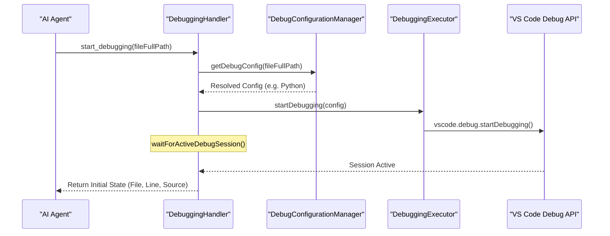

**Sources:** [src/debuggingHandler.ts:47-85](), [src/utils/debugConfigurationManager.ts:60-95]()

---

### Step 3: Navigate and Inspect
Once paused, the agent uses stepping tools. Each command (like `step_over`) triggers a `waitForStateChange` call in the `DebuggingHandler` [src/debuggingHandler.ts:126-145]().

**State Synchronization:**
The handler captures the `DebugState` before the command, executes the step, and polls `executor.getCurrentDebugState()` with exponential backoff until the line number or frame changes [src/debuggingHandler.ts:505-536]().

**Variable Inspection:**
The `get_variables_values` tool retrieves variables from the `activeStackItem`'s `frameId` [src/debuggingHandler.ts:343-388]().

**Sources:** [src/debuggingHandler.ts:126-145](), [src/debuggingHandler.ts:343-388](), [src/debuggingHandler.ts:505-536]()

---

### Step 4: Root Cause Analysis (RCA)
DebugMCP enforces a "Symptom vs Root Cause" framework [docs/agent-resources/debug_instructions.md:10-20]().

| Action | Purpose | Code Entity |
|--------|---------|-------------|
| **Identify Symptom** | Spot an unexpected value or null. | `get_variables_values` [src/debuggingHandler.ts:343]() |
| **Trace Backwards** | Set breakpoints earlier in the call stack. | `add_breakpoint` [src/debuggingHandler.ts:244]() |
| **Restart Session** | Re-run logic with new breakpoints active. | `restart_debugging` [src/debuggingHandler.ts:224]() |

**Sources:** [docs/agent-resources/debug_instructions.md:10-50](), [src/debuggingHandler.ts:224-239]()

---

## System Request Flow Diagram
This diagram bridges the Natural Language request from the AI to the specific Code Entities that handle the logic.

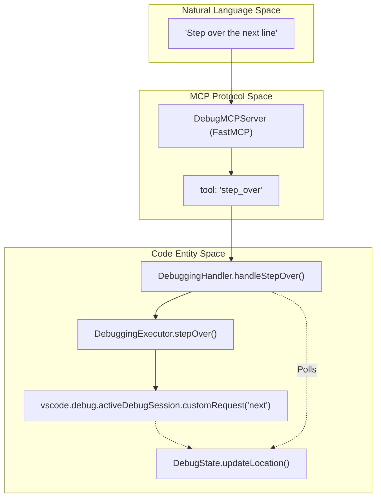

**Sources:** [src/debugMCPServer.ts:100-110](), [src/debuggingHandler.ts:126-145](), [src/debuggingExecutor.ts:180-195]()

---

## Troubleshooting the First Session

If the session fails to start or behavior is unexpected, check the following:

*   **Session Timeout:** The default timeout is configurable. If the debugger is slow to attach, the handler may return a timeout error [src/debuggingHandler.ts:476-500]().
*   **Active Frame Requirement:** Tools like `get_variables_values` and `evaluate_expression` will fail if the debugger is currently "running" and not "paused" at a breakpoint [src/debuggingHandler.ts:351-354]().
*   **Breakpoint Placement:** Ensure breakpoints are set inside function bodies, not on the `def` or `class` signature lines [docs/agent-resources/debug_instructions.md:109-110]().

**Sources:** [src/debuggingHandler.ts:351-500](), [docs/agent-resources/debug_instructions.md:109-110]()

---

# Page: Architecture Overview

# Architecture Overview

<details>
<summary>Relevant source files</summary>

The following files were used as context for generating this wiki page:

- [AGENTS.md](AGENTS.md)
- [README.md](README.md)
- [assets/DebugMCP.webp](assets/DebugMCP.webp)
- [assets/architecture.png](assets/architecture.png)
- [docs/architecture/debugMCPServer.md](docs/architecture/debugMCPServer.md)
- [tsconfig.json](tsconfig.json)

</details>


This page provides a high-level overview of the DebugMCP system architecture, describing how the major components work together to enable AI agents to control VS Code's debugging capabilities through the Model Context Protocol (MCP). For detailed information about individual components, see [System Components](#3.1). For specifics about the MCP protocol implementation, see [MCP Protocol Integration](#3.2). For execution flow details, see [Request Flow](#3.3).

## System Overview

DebugMCP is implemented as a VS Code extension that embeds an MCP server, exposing debugging operations as MCP tools. The architecture follows a layered design with clear separation of concerns:

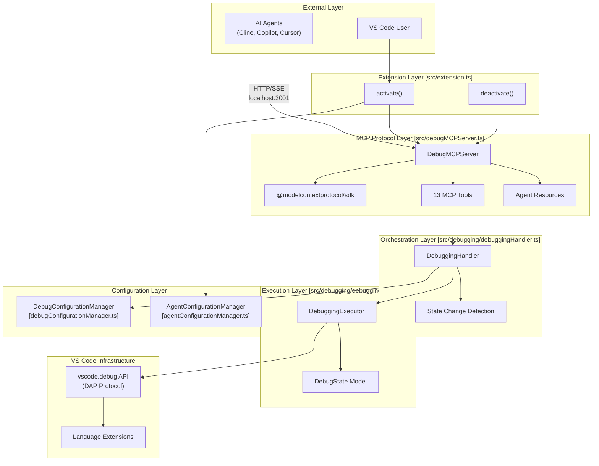

**Sources:** [src/extension.ts:70-115](), [README.md:33-56](), [AGENTS.md:7-22](), [docs/architecture/debugMCPServer.md:19-34]()

## Core Component Roles

The system consists of six primary components, each with distinct responsibilities:

| Component | File | Primary Responsibility |
|-----------|------|----------------------|
| **Extension** | `src/extension.ts` | Entry point; initializes and coordinates all components during `activate()` [src/extension.ts:70-115]() |
| **DebugMCPServer** | `src/debugMCPServer.ts` | MCP server implementation; exposes 13 tools and documentation resources via `@modelcontextprotocol/sdk` [docs/architecture/debugMCPServer.md:11-18]() |
| **DebuggingHandler** | `src/debugging/debuggingHandler.ts` | Orchestration layer; manages debug workflows, state change detection, and configuration selection [AGENTS.md:18-18]() |
| **DebuggingExecutor** | `src/debugging/debuggingExecutor.ts` | Execution layer; interfaces with VS Code Debug API and manages DAP requests [AGENTS.md:19-19]() |
| **DebugConfigurationManager** | `src/debugging/debugConfigurationManager.ts` | Manages `launch.json` configurations and generates language-specific defaults [AGENTS.md:21-21]() |
| **AgentConfigurationManager** | `src/utils/agentConfigurationManager.ts` | Auto-configures AI agents (Cline, Copilot, Cursor) to connect to the MCP server [AGENTS.md:22-22]() |

**Sources:** [AGENTS.md:14-22](), [docs/architecture/debugMCPServer.md:11-18]()

## Layered Architecture Pattern

DebugMCP implements a strict layered architecture where each layer has defined responsibilities and dependencies flow in one direction:

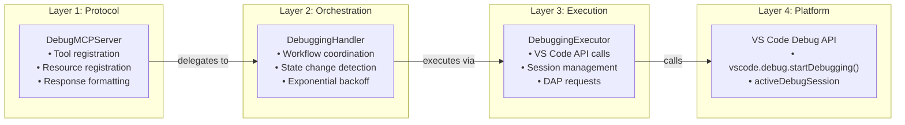

**Key Architectural Principles:**

- **Unidirectional Dependencies:** Upper layers depend on lower layers, never the reverse [AGENTS.md:7-11]().
- **Clear Boundaries:** `DebugMCPServer` handles the MCP protocol while `DebuggingHandler` handles the debugging logic [docs/architecture/debugMCPServer.md:11-18]().
- **Stateless Communication:** The `StreamableHTTPServerTransport` uses stateless HTTP POST requests for MCP communication [docs/architecture/debugMCPServer.md:43-48]().
- **Error Propagation:** Errors are caught and handled with descriptive messages throughout the stack [AGENTS.md:56-56]().

**Sources:** [AGENTS.md:7-11](), [docs/architecture/debugMCPServer.md:19-48]()

## Extension Lifecycle

The extension follows a deterministic initialization and shutdown sequence managed by `src/extension.ts`:

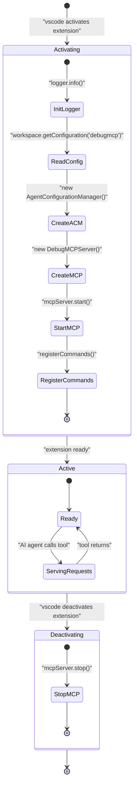

**Initialization Sequence:**

1. **Configuration Reading**: Reads `debugmcp.serverPort` (default: 3001) and `debugmcp.timeoutInSeconds` (default: 180) [AGENTS.md:75-79]().
2. **Manager Creation**: Instantiates `AgentConfigurationManager` to handle AI agent auto-detection [src/extension.ts:70-115]().
3. **Server Startup**: Creates `DebugMCPServer` and starts the express HTTP server for MCP communication [docs/architecture/debugMCPServer.md:55-55]().
4. **Command Registration**: Registers VS Code commands for manual configuration of agents [src/extension.ts:70-115]().

**Sources:** [src/extension.ts:70-115](), [AGENTS.md:75-79](), [docs/architecture/debugMCPServer.md:50-56]()

## Configuration Management Architecture

DebugMCP uses two specialized managers to handle different configuration concerns:

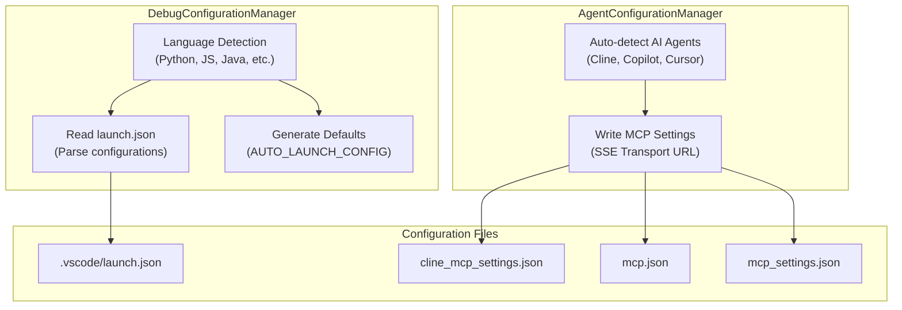

**AgentConfigurationManager**: Detects installed AI agents and writes the MCP server connection settings (default port 3001) to their respective configuration files [AGENTS.md:22-22]().

**DebugConfigurationManager**: Detects the programming language from file extensions and manages the resolution of debug configurations from `.vscode/launch.json` or generated heuristics [AGENTS.md:21-21]().

**Sources:** [AGENTS.md:21-22](), [README.md:112-122]()

## Data Flow Through Layers

The following diagram shows how a typical debug request flows through the system:

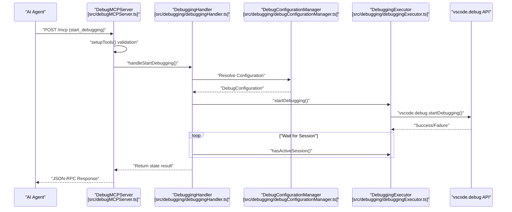

**Sources:** [AGENTS.md:7-11](), [docs/architecture/debugMCPServer.md:19-34](), [README.md:41-56]()

## Technology Stack

The system is built on the following key dependencies:

| Technology | Purpose | Usage Location |
|------------|---------|----------------|
| **@modelcontextprotocol/sdk** | MCP server framework | `src/debugMCPServer.ts` [AGENTS.md:64-64]() |
| **zod** | Schema validation | `src/debugMCPServer.ts` [AGENTS.md:65-65]() |
| **express** | HTTP server for SSE | `src/debugMCPServer.ts` [AGENTS.md:66-66]() |
| **vscode API** | VS Code extension API | Throughout [AGENTS.md:60-60]() |
| **TypeScript** | Type-safe development | ES2022 Target [AGENTS.md:52-52]() |

**Sources:** [AGENTS.md:52-67](), [docs/architecture/debugMCPServer.md:9-17]()

## Security and Isolation

DebugMCP operates with the following security characteristics:

- **Local Operation**: The MCP server runs 100% locally with no external communications [README.md:70-70]().
- **Secure Communication**: All MCP communications use secure protocols (SSE/HTTP) [README.md:69-69]().
- **State Validation**: Robust validation of debugging states and operations [README.md:71-71]().
- **Zero Credentials**: Requires no external credentials or cloud access [README.md:70-70]().

**Sources:** [README.md:68-71]()

---

# Page: System Components

# System Components

<details>
<summary>Relevant source files</summary>

The following files were used as context for generating this wiki page:

- [AGENTS.md](AGENTS.md)
- [docs/architecture/debugMCPServer.md](docs/architecture/debugMCPServer.md)
- [src/extension.ts](src/extension.ts)
- [src/utils/logger.ts](src/utils/logger.ts)
- [tsconfig.json](tsconfig.json)

</details>


## Purpose and Scope

This document describes the core architectural components that comprise the DebugMCP system. It focuses on the primary classes, their responsibilities, and how they interact to bridge AI agents with the VS Code Debugging infrastructure.

The DebugMCP architecture follows a layered design pattern with clear separation of concerns across four primary components:

1.  **DebugMCPServer**: The protocol entry point that exposes MCP tools and resources via HTTP.
2.  **DebuggingHandler**: The orchestration layer managing high-level debugging workflows and state change detection.
3.  **DebuggingExecutor**: The execution layer that directly interfaces with VS Code APIs and the Debug Adapter Protocol (DAP).
4.  **Configuration Managers**: Supporting components for managing `launch.json` heuristics and AI agent auto-configuration.

---

## Component Architecture Overview

The following diagram illustrates the primary components and their relationships, mapping system names to their implementation files and key classes.

### Code Entity Map

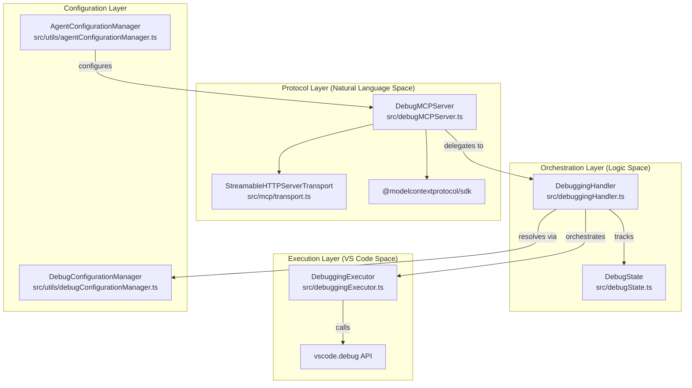

**Sources:** [src/debugMCPServer.ts:38-40](), [src/extension.ts:25-40](), [AGENTS.md:9-22]()

---

## Component Lifecycle and Injection

DebugMCP uses a centralized initialization pattern in the extension's `activate` function. The `DebugMCPServer` acts as the root container for the debugging logic.

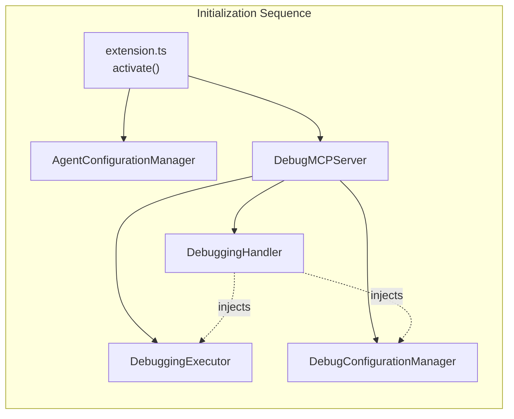

The `DebugMCPServer` constructor initializes the sub-components to ensure a consistent execution context:
*   **DebuggingExecutor**: Handles raw VS Code API calls [src/debugMCPServer.ts:43]().
*   **DebugConfigurationManager**: Handles `launch.json` and language detection [src/debugMCPServer.ts:44]().
*   **DebuggingHandler**: Orchestrates the two above to process MCP tool requests [src/debugMCPServer.ts:45]().

**Sources:** [src/extension.ts:11-48](), [src/debugMCPServer.ts:38-48]()

---

## DebugMCPServer

The `DebugMCPServer` class implements the Model Context Protocol (MCP) and serves as the primary interface for AI agents (Cline, Copilot, Cursor).

### Responsibilities
*   **Tool Registration**: Exposes 13 debugging tools (e.g., `start_debugging`, `step_over`) using `McpServer.tool()` [src/debugMCPServer.ts:76-220]().
*   **Resource Management**: Provides documentation resources like `debug_instructions` for agents [src/debugMCPServer.ts:224-263]().
*   **Transport Handling**: Implements a Streamable HTTP transport over an Express server on a configurable port (default: 3001) [src/debugMCPServer.ts:320-345]().

### Key Implementation Details
*   **Stateless HTTP**: Uses `POST /mcp` for JSON-RPC messages [src/debugMCPServer.ts:333]().
*   **Validation**: Uses `zod` schemas to validate tool parameters from the AI agent [src/debugMCPServer.ts:79-88]().

**Sources:** [src/debugMCPServer.ts:35-71](), [docs/architecture/debugMCPServer.md:13-18]()

---

## DebuggingHandler

The `DebuggingHandler` is the "brain" of the system. It translates high-level MCP tool requests into sequences of debugger actions.

### Responsibilities
*   **Workflow Orchestration**: Manages the sequence of starting a session, waiting for it to attach, and returning the initial state [src/debuggingHandler.ts:47-85]().
*   **State Change Detection**: After a step operation (e.g., `step_over`), it polls the debugger to ensure the execution has actually moved before returning to the AI agent [src/debuggingHandler.ts:543-584]().
*   **Exponential Backoff**: Implements `waitForStateChange` and `waitForActiveDebugSession` to handle the asynchronous nature of VS Code debugging [src/debuggingHandler.ts:476-536]().

### State Comparison Logic
The handler compares `DebugState` objects to detect transitions:
*   `sessionActive` status.
*   `fileFullPath` and `currentLine`.
*   `frameId` to detect stack changes.

**Sources:** [src/debuggingHandler.ts:31-42](), [docs/architecture/debuggingHandler.md:1-20]()

---

## DebuggingExecutor

The `DebuggingExecutor` interacts directly with the `vscode.debug` namespace and executes workbench commands.

### Key Functions
*   **Session Control**: `startDebugging`, `stopDebugging`, and `restart` [src/debuggingExecutor.ts:36-122]().
*   **Breakpoint Management**: Wraps `vscode.debug.addBreakpoints` and `removeBreakpoints`. It uses content-based matching to find breakpoints in files [src/debuggingExecutor.ts:124-180]().
*   **DAP Interaction**: Sends custom requests to the Debug Adapter for `stackTrace`, `scopes`, and `variables` to build the `DebugState` [src/debuggingExecutor.ts:212-260]().
*   **Expression Evaluation**: Uses `session.customRequest('evaluate', ...)` to allow agents to inspect complex objects [src/debuggingExecutor.ts:275-295]().

**Sources:** [src/debuggingExecutor.ts:9-31](), [docs/architecture/debuggingExecutor.md:1-20]()

---

## Configuration Managers

### DebugConfigurationManager
Manages the complexity of `launch.json`. It includes heuristics to:
*   Auto-detect languages (Python, JS/TS, Java, C#, Go, etc.) [src/utils/debugConfigurationManager.ts]().
*   Generate "AUTO_LAUNCH" configurations when no `launch.json` is present [AGENTS.md:21]().
*   Resolve test-specific configurations for frameworks like `pytest` or `jest`.

### AgentConfigurationManager
Handles the "Zero-Config" onboarding experience:
*   **Auto-detection**: Finds configuration paths for Cline, Cursor, and GitHub Copilot [src/utils/agentConfigurationManager.ts]().
*   **Migration**: Updates legacy SSE configurations to the new Streamable HTTP format [src/extension.ts:28-32]().
*   **UI**: Manages the VS Code popups for agent selection [src/extension.ts:54-62]().

**Sources:** [src/extension.ts:25-32](), [AGENTS.md:21-22]()

---

## Data Flow: Tool Execution

The following sequence demonstrates how a request moves through the components.

```mermaid
sequenceDiagram
    participant Agent as AI Agent
    participant Server as DebugMCPServer
    participant Handler as DebuggingHandler
    participant Executor as DebuggingExecutor
    participant VSCode as VS Code Debug API

    Agent->>Server: POST /mcp (tool: step_over)
    Server->>Server: Validate Args (Zod)
    Server->>Handler: handleStepOver()
    Handler->>Executor: getCurrentDebugState()
    Executor->>VSCode: session.customRequest('stackTrace')
    VSCode-->>Executor: Frame Info
    Executor-->>Handler: beforeState
    Handler->>Executor: stepOver()
    Executor->>VSCode: executeCommand('debug.stepOver')
    Handler->>Handler: waitForStateChange(beforeState)
    loop Polling
        Handler->>Executor: getCurrentDebugState()
        Executor-->>Handler: currentState
    end
    Handler-->>Server: Formatted Debug Response
    Server-->>Agent: 200 OK (JSON-RPC Result)
```

**Sources:** [src/debugMCPServer.ts:126-145](), [src/debuggingHandler.ts:126-145](), [src/debuggingExecutor.ts:69-85]()

---

# Page: MCP Protocol Integration

# MCP Protocol Integration

<details>
<summary>Relevant source files</summary>

The following files were used as context for generating this wiki page:

- [package-lock.json](package-lock.json)
- [src/debugMCPServer.ts](src/debugMCPServer.ts)

</details>


This page explains how DebugMCP implements the Model Context Protocol (MCP) using the official MCP SDK and a streamable HTTP transport. It covers the technical details of server initialization, tool and resource registration, and the implementation of the communication layer between AI agents and the VS Code debugging engine.

## Model Context Protocol Overview

The Model Context Protocol (MCP) is a standardized protocol for exposing tools and resources to AI agents. DebugMCP implements MCP to allow AI assistants like Cline, GitHub Copilot, and Cursor to invoke debugging operations programmatically.

The MCP server in DebugMCP exposes:
- **Tools**: 14 debugging operations that AI agents can invoke (e.g., `start_debugging`, `add_breakpoint`, `get_variables_values`). [src/debugMCPServer.ts:61-248]()
- **Resources**: Documentation files that AI agents can read to understand debugging workflows (e.g., `debugmcp://docs/debug_instructions`). [src/debugMCPServer.ts:253-289]()

Sources: [src/debugMCPServer.ts:19-21](), [src/debugMCPServer.ts:61-289]()

## MCP SDK Integration

DebugMCP uses the official `@modelcontextprotocol/sdk` (version ^1.26.0) to implement the MCP protocol. Unlike previous versions that used `fastmcp`, the current implementation utilizes the core SDK classes for finer control over transport and server behavior.

### Server Initialization

The `DebugMCPServer.initialize()` method creates the `McpServer` instance with metadata:

**MCP Server Configuration**
```mermaid
graph LR
    init["initialize()"] --> create["new McpServer()"]
    create --> config["Server Config"]
    
    config --> name["name: 'debugmcp'"]
    config --> version["version: '1.0.0'"]
    
    create --> setup1["setupTools()"]
    create --> setup2["setupResources()"]
    
    setup1 --> tools["14 debugging tools"]
    setup2 --> resources["Documentation resources"]
```

Sources: [src/debugMCPServer.ts:41-54](), [package-lock.json:12]()

## Streamable HTTP Transport

DebugMCP implements a custom transport layer using `StreamableHTTPServerTransport` from the MCP SDK, integrated with a standard Node.js `http.Server`.

### Transport Architecture

The server handles two primary types of requests:
1.  **SSE Connection**: A `GET` request to `/sse` that establishes a long-running event stream. [src/debugMCPServer.ts:342-358]()
2.  **Message Posting**: `POST` requests to `/messages` that send MCP JSON-RPC payloads to the server. [src/debugMCPServer.ts:360-373]()

**HTTP Transport Architecture**
```mermaid
graph TB
    subgraph "AI Agent (Client)"
        agent["Cline/Copilot/Cursor"]
    end
    
    subgraph "DebugMCPServer"
        httpSrv["http.Server"]
        mcpSrv["McpServer Instance"]
        transports["Map<sessionId, StreamableHTTPServerTransport>"]
        
        httpSrv --> route{"Path?"}
        route -->|"/sse"| handleSSE["handleSSE()"]
        route -->|"/messages"| handlePost["handlePost()"]
        
        handleSSE --> newTrans["new StreamableHTTPServerTransport"]
        newTrans --> connect["mcpServer.connect(transport)"]
        
        handlePost --> lookup["transports.get(sessionId)"]
        lookup --> push["transport.handlePostMessage(req, res)"]
    end
    
    agent -->|"GET /sse"| handleSSE
    agent -->|"POST /messages?sessionId=..."| handlePost
    handleSSE -->|"text/event-stream"| agent
```

Sources: [src/debugMCPServer.ts:28](), [src/debugMCPServer.ts:342-373]()

### Connection Management

The server maintains a `Map` of active transports indexed by a unique `sessionId`. When a client connects to the `/sse` endpoint, a new `StreamableHTTPServerTransport` is instantiated and associated with that session.

```typescript
const transport = new StreamableHTTPServerTransport('/messages', res);
this.transports.set(transport.sessionId, transport);
await this.mcpServer!.connect(transport);
```

Sources: [src/debugMCPServer.ts:28](), [src/debugMCPServer.ts:352-354]()

## Tool Registration and Schema Validation

### Tool Structure

Each debugging tool is registered using `mcpServer.registerTool()`. The SDK uses `zod` for schema validation, ensuring that AI agents provide correctly typed arguments.

**Tool Registration Flow**
```mermaid
graph TB
    setupTools["setupTools()"] --> tools
    
    subgraph tools["Key Tool Registrations"]
        t1["registerTool('start_debugging')"]
        t2["registerTool('add_breakpoint')"]
        t3["registerTool('get_variables_values')"]
        t4["registerTool('evaluate_expression')"]
    end
    
    t1 --> schema1["z.object()<br/>fileFullPath: string<br/>workingDirectory: string<br/>testName?: string<br/>configurationName?: string"]
    t2 --> schema2["z.object()<br/>fileFullPath: string<br/>lineContent: string"]
    t3 --> schema3["z.object()<br/>scope?: enum"]
    t4 --> schema4["z.object()<br/>expression: string"]
    
    schema1 --> handler1["debuggingHandler.handleStartDebugging()"]
    schema2 --> handler2["debuggingHandler.handleAddBreakpoint()"]
    schema3 --> handler3["debuggingHandler.handleGetVariables()"]
    schema4 --> handler4["debuggingHandler.handleEvaluateExpression()"]
```

Sources: [src/debugMCPServer.ts:61-248]()

### Tool-to-Handler Mapping

| Tool Name | Parameters | Handler Method | Line Reference |
|-----------|-----------|----------------|----------------|
| `get_debug_instructions` | None | `loadMarkdownFile()` | [src/debugMCPServer.ts:61-68]() |
| `start_debugging` | `fileFullPath`, `workingDirectory`, `testName?`, `configurationName?` | `handleStartDebugging()` | [src/debugMCPServer.ts:71-97]() |
| `stop_debugging` | None | `handleStopDebugging()` | [src/debugMCPServer.ts:100-105]() |
| `step_over` | None | `handleStepOver()` | [src/debugMCPServer.ts:108-113]() |
| `step_into` | None | `handleStepInto()` | [src/debugMCPServer.ts:116-121]() |
| `step_out` | None | `handleStepOut()` | [src/debugMCPServer.ts:124-129]() |
| `continue_execution` | None | `handleContinue()` | [src/debugMCPServer.ts:132-137]() |
| `restart_debugging` | None | `handleRestart()` | [src/debugMCPServer.ts:140-145]() |
| `add_breakpoint` | `fileFullPath`, `lineContent` | `handleAddBreakpoint()` | [src/debugMCPServer.ts:148-158]() |
| `remove_breakpoint` | `fileFullPath`, `line` | `handleRemoveBreakpoint()` | [src/debugMCPServer.ts:161-171]() |
| `clear_all_breakpoints` | None | `handleClearAllBreakpoints()` | [src/debugMCPServer.ts:174-179]() |
| `list_breakpoints` | None | `handleListBreakpoints()` | [src/debugMCPServer.ts:182-187]() |
| `get_variables_values` | `scope?` | `handleGetVariables()` | [src/debugMCPServer.ts:190-201]() |
| `evaluate_expression` | `expression` | `handleEvaluateExpression()` | [src/debugMCPServer.ts:204-215]() |

Sources: [src/debugMCPServer.ts:61-248]()

## Resource Registration

### Resource URI Scheme

DebugMCP uses a custom URI scheme (`debugmcp://`) to expose documentation resources. This is implemented via `mcpServer.registerResource()`.

**Resource Registration Architecture**
```mermaid
graph TB
    setupResources["setupResources()"]
    
    setupResources --> main["registerResource()<br/>debugmcp://docs/debug_instructions"]
    setupResources --> languages["Language Troubleshooting"]
    
    languages --> py["debugmcp://docs/troubleshooting/python"]
    languages --> js["debugmcp://docs/troubleshooting/javascript"]
    
    main --> load1["loadMarkdownFile()<br/>agent-resources/debug_instructions.md"]
    py --> load2["loadMarkdownFile()<br/>agent-resources/troubleshooting/python.md"]
    
    load1 --> fs["fs.promises.readFile()"]
```

Sources: [src/debugMCPServer.ts:253-289]()

### Registered Resources

| URI | Name | Description | File Path |
|-----|------|-------------|-----------|
| `debugmcp://docs/debug_instructions` | Debugging Instructions | Step-by-step debugging workflow | `agent-resources/debug_instructions.md` |
| `debugmcp://docs/troubleshooting/python` | Python Debugging Tips | Python-specific guidance | `agent-resources/troubleshooting/python.md` |
| `debugmcp://docs/troubleshooting/javascript` | JavaScript Debugging Tips | JS/TS-specific guidance | `agent-resources/troubleshooting/javascript.md` |
| `debugmcp://docs/troubleshooting/java` | Java Debugging Tips | Java-specific guidance | `agent-resources/troubleshooting/java.md` |
| `debugmcp://docs/troubleshooting/csharp` | C# Debugging Tips | C#-specific guidance | `agent-resources/troubleshooting/csharp.md` |

Sources: [src/debugMCPServer.ts:255-288]()

## Server Lifecycle

The server is managed as a singleton within the VS Code extension.

1.  **Start**: The `start()` method creates the Node.js `http.Server` and listens on the configured port. [src/debugMCPServer.ts:321-382]()
2.  **Request Handling**: Incoming requests are parsed and routed to either the SSE handler or the message handler. [src/debugMCPServer.ts:340-375]()
3.  **Stop**: The `stop()` method closes the HTTP server and clears the transport map. [src/debugMCPServer.ts:387-396]()

Sources: [src/debugMCPServer.ts:321-396]()

---

# Page: Request Flow

# Request Flow

<details>
<summary>Relevant source files</summary>

The following files were used as context for generating this wiki page:

- [AGENTS.md](AGENTS.md)
- [docs/architecture/debugMCPServer.md](docs/architecture/debugMCPServer.md)
- [src/debugMCPServer.ts](src/debugMCPServer.ts)
- [src/debuggingHandler.ts](src/debuggingHandler.ts)
- [tsconfig.json](tsconfig.json)

</details>


## Purpose and Scope

This document traces the complete lifecycle of debugging requests as they flow from AI agents through the DebugMCP system to VS Code's Debug API. It covers request processing layers, timing mechanisms, state change detection, and response formatting. This page focuses on the internal mechanics of the `DebugMCPServer`, `DebuggingHandler`, and `DebuggingExecutor`.

## Request Processing Architecture

DebugMCP uses a multi-layered architecture to process debugging requests, bridging the asynchronous nature of MCP with the event-driven VS Code Debug API.

| Layer | Component | Responsibility | Implementation |
|-------|-----------|----------------|-----------|
| **Protocol Layer** | `DebugMCPServer` | Hosts the MCP server, registers tools/resources, and manages HTTP transport. | [src/debugMCPServer.ts:22-54]() |
| **Orchestration Layer** | `DebuggingHandler` | Manages high-level workflows, state change detection, and result formatting. | [src/debuggingHandler.ts:31-42]() |
| **Execution Layer** | `DebuggingExecutor` | Interfaces with `vscode.debug` API, manages breakpoints, and executes DAP requests. | [src/debuggingExecutor.ts:16-34]() |
| **VS Code Layer** | VS Code Debug API | Communicates with language-specific debug adapters via DAP. | Native VS Code |

### System Data Flow

The following diagram maps the logical flow to specific code entities and methods.

```mermaid
graph TB
    AI["AI Agent<br/>(Cline/Copilot/Cursor)"]
    
    subgraph "src/debugMCPServer.ts"
        MCP["DebugMCPServer<br/>setupTools()"]
        Transport["StreamableHTTPServerTransport<br/>POST /mcp"]
    end
    
    subgraph "src/debuggingHandler.ts"
        Handler["DebuggingHandler<br/>handleStartDebugging()<br/>handleStepOver()"]
        Wait["waitForStateChange()<br/>waitForActiveDebugSession()"]
    end
    
    subgraph "src/debuggingExecutor.ts"
        Executor["DebuggingExecutor<br/>startDebugging()<br/>getCurrentDebugState()"]
        DAP["customRequest()"]
    end
    
    subgraph "VS Code Entity Space"
        VSDebug["vscode.debug<br/>activeDebugSession"]
        VSCommands["vscode.commands<br/>executeCommand()"]
    end
    
    AI -->|"HTTP POST"| Transport
    Transport -->|"JSON-RPC"| MCP
    MCP -->|"delegate"| Handler
    Handler -->|"poll"| Wait
    Wait -->|"query"| Executor
    Handler -->|"execute"| Executor
    Executor -->|"API Call"| VSDebug
    Executor -->|"Command"| VSCommands
```

**Sources:** [src/debugMCPServer.ts:59-65](), [src/debuggingHandler.ts:31-42](), [src/debuggingExecutor.ts:16-34]()

## Starting a Debug Session

The `start_debugging` tool implementation illustrates how the system coordinates configuration resolution and session initialization.

### Request Flow Sequence

```mermaid
sequenceDiagram
    participant AI as "AI Agent"
    participant MCP as "DebugMCPServer"
    participant Handler as "DebuggingHandler"
    participant Config as "ConfigurationManager"
    participant Executor as "DebuggingExecutor"
    participant VS as "vscode.debug"
    
    AI->>MCP: callTool("start_debugging", args)
    MCP->>Handler: handleStartDebugging(args)
    
    alt No Configuration Provided
        Handler->>Config: promptForConfiguration(workingDir)
        Config-->>Handler: selectedConfig
    end
    
    Handler->>Config: getDebugConfig(workingDir, file, configName)
    Config-->>Handler: vscode.DebugConfiguration
    
    Handler->>Executor: startDebugging(workingDir, config)
    Executor->>VS: startDebugging(folder, config)
    VS-->>Executor: Promise<boolean>
    
    Note over Handler: waitForActiveDebugSession()<br/>(Exponential Backoff)
    
    loop Polling
        Handler->>Executor: hasActiveSession()
        Executor-->>Handler: boolean
    end
    
    Handler->>Executor: getCurrentDebugState()
    Executor-->>Handler: DebugState
    Handler-->>MCP: Formatted Result String
    MCP-->>AI: ToolResponse
```

**Key Code Pointers:**
- Tool Registration: [src/debugMCPServer.ts:71-97]()
- Logic Entry: [src/debuggingHandler.ts:47-86]()
- Config Resolution: [src/debuggingHandler.ts:56-64]()
- VS Code Invocation: [src/debuggingExecutor.ts:36-53]()

**Sources:** [src/debugMCPServer.ts:71-97](), [src/debuggingHandler.ts:47-86](), [src/debuggingExecutor.ts:36-53]()

## State Change Detection and Timing

Unlike standard API calls, debugging operations (like `step_over`) are asynchronous in the debug adapter. The `DebuggingHandler` implements a polling mechanism to ensure the AI agent receives the updated state only after the debugger has paused at the next location.

### The `waitForStateChange` Loop

When a stepping command is issued, the handler captures the `beforeState` and polls until the `afterState` differs.

```mermaid
graph TD
    Step["Executor.stepOver()"]
    GetBefore["Executor.getCurrentDebugState()"]
    Loop["waitForStateChange(beforeState)"]
    GetAfter["Executor.getCurrentDebugState()"]
    Compare{"hasStateChanged<br/>(before, after)?"}
    Backoff["Exponential Backoff<br/>(baseDelay * 2^n)"]
    Success["Return AfterState"]
    Timeout["Timeout Error"]

    GetBefore --> Step
    Step --> Loop
    Loop --> GetAfter
    GetAfter --> Compare
    Compare -->|No| Backoff
    Backoff -->|Check Timeout| Loop
    Compare -->|Yes| Success
    Backoff -->|Expired| Timeout
```

**Implementation Details:**
- **Comparison Logic**: `hasStateChanged` checks `sessionActive`, `fileFullPath`, `currentLine`, `frameName`, and `frameId` [src/debuggingHandler.ts:541-584]().
- **Backoff Constants**: Base delay of 1000ms, max delay of 10000ms [src/debuggingHandler.ts:477-478]().
- **Jitter**: A random jitter of up to 200ms is added to polling intervals [src/debuggingHandler.ts:493]().

**Sources:** [src/debuggingHandler.ts:476-536](), [src/debuggingHandler.ts:541-584]()

## Breakpoint Management Flow

Breakpoint requests bridge the gap between "Natural Language Space" (searching for code content) and "Code Entity Space" (VS Code URI/Line numbers).

1. **Content Search**: The handler receives a `lineContent` string [src/debuggingHandler.ts:152]().
2. **File Resolution**: It opens the document via `vscode.workspace.openTextDocument` [src/debuggingHandler.ts:249]().
3. **Line Matching**: It iterates through the file to find all line numbers matching the content [src/debuggingHandler.ts:254-258]().
4. **DAP Registration**: For each match, it calls `executor.addBreakpoint`, which creates a `vscode.SourceBreakpoint` [src/debuggingExecutor.ts:127-136]().

**Sources:** [src/debuggingHandler.ts:244-280](), [src/debuggingExecutor.ts:127-136]()

## Variable Inspection and DAP Requests

When an agent requests variables, the flow descends into raw Debug Adapter Protocol (DAP) messages via the `customRequest` interface.

1. **Frame Context**: The system identifies the `activeStackItem` to get the current `frameId` [src/debuggingExecutor.ts:168-174]().
2. **Scope Retrieval**: A DAP `scopes` request is sent to find 'Local', 'Global', etc. [src/debuggingExecutor.ts:241]().
3. **Variable Expansion**: For each scope, a DAP `variables` request is sent using the `variablesReference` [src/debuggingExecutor.ts:257]().
4. **Serialization**: The `DebuggingHandler` formats the nested DAP response into a human-readable string for the LLM [src/debuggingHandler.ts:362-384]().

**Sources:** [src/debuggingExecutor.ts:235-273](), [src/debuggingHandler.ts:343-388]()

---

# Page: Extension Lifecycle

# Extension Lifecycle

<details>
<summary>Relevant source files</summary>

The following files were used as context for generating this wiki page:

- [package.json](package.json)
- [src/extension.ts](src/extension.ts)
- [src/utils/logger.ts](src/utils/logger.ts)

</details>


This page documents the complete lifecycle of the DebugMCP VS Code extension, from activation through initialization to deactivation. It covers the activation triggers, the sequential initialization process of components, configuration loading, command registration, and cleanup procedures.

For information about the MCP server initialization and runtime behavior, see **4.1 DebugMCP Server**. For details about agent configuration setup, see **4.5 Agent Configuration Manager**.

## Activation Events

The DebugMCP extension is activated by VS Code when specific events occur, as defined in the extension manifest `package.json`.

| Activation Event | Trigger Condition | Purpose |
|-----------------|-------------------|---------|
| `onStartupFinished` | VS Code completes startup | Ensures extension is available immediately after VS Code loads [package.json:47]() |
| `onDebug` | User initiates any debug session | Activates extension when debugging capabilities are needed [package.json:48]() |

The extension uses `onStartupFinished` as the primary activation event to ensure the MCP server is available for AI agents as soon as possible. The `onDebug` event provides a fallback activation mechanism when debugging activity begins.

**Sources:** [package.json:46-49]()

---

## Activation Sequence

When VS Code triggers activation, the `activate()` function in the extension entry point executes a carefully ordered sequence of initialization steps.

### Extension Initialization Flow
The following diagram illustrates the transition from the VS Code environment into the specific logic of `src/extension.ts`.

```mermaid
sequenceDiagram
    participant VSCode as "VS Code Runtime"
    participant activate as "activate(context)"
    participant logger as "Logger.ts"
    participant config as "vscode.workspace.getConfiguration"
    participant ACM as "AgentConfigurationManager.ts"
    participant MCP as "DebugMCPServer.ts"
    participant commands as "registerCommands()"

    VSCode->>activate: "Extension activation event"
    
    activate->>logger: "getInstance()"
    activate->>logger: "info('DebugMCP extension is now active!')"
    activate->>logger: "logSystemInfo()"
    activate->>logger: "logEnvironment()"
    
    activate->>config: "getConfiguration('debugmcp')"
    config-->>activate: "timeoutInSeconds, serverPort"
    
    activate->>ACM: "new AgentConfigurationManager(context, timeout, port)"
    activate->>ACM: "migrateExistingConfigurations()"
    
    activate->>MCP: "new DebugMCPServer(serverPort, timeoutInSeconds)"
    activate->>MCP: "initialize()"
    activate->>MCP: "start()"
    
    activate->>VSCode: "window.showInformationMessage(endpoint)"
    
    activate->>commands: "registerCommands(context)"
    
    activate->>activate: "setTimeout(2000ms) -> shouldShowPopup()"
    
    activate-->>VSCode: "Activation complete"
```

**Sources:** [src/extension.ts:11-65](), [src/utils/logger.ts:12-26]()

---

## Initialization Steps

### 1. Logger Initialization
The first action during activation is retrieving the `Logger` singleton instance and recording system diagnostics.
[src/extension.ts:11-15]()

```typescript
// Initial logging sequence
logger.info('DebugMCP extension is now active!');
logger.logSystemInfo();
logger.logEnvironment();
```

The `Logger.logSystemInfo()` method outputs:
- VS Code Version (`vscode.version`) [src/utils/logger.ts:86]()
- Platform and Architecture (`process.platform`, `process.arch`) [src/utils/logger.ts:87-88]()
- Node.js Version and PID [src/utils/logger.ts:89-90]()

**Sources:** [src/utils/logger.ts:84-101](), [src/extension.ts:13-15]()

### 2. Configuration Loading
The extension reads user-configurable settings from VS Code's workspace configuration under the `debugmcp` namespace. [package.json:67-81]()

| Configuration Key | Default Value | Purpose |
|------------------|---------------|---------|
| `debugmcp.timeoutInSeconds` | 180 | Maximum time to wait for debug operations [package.json:72]() |
| `debugmcp.serverPort` | 3001 | Port number for the MCP server [package.json:77]() |

**Sources:** [src/extension.ts:17-22](), [package.json:67-81]()

### 3. Agent Configuration Manager and Migration
The `AgentConfigurationManager` is instantiated to handle AI agent integration. A critical early step is migrating legacy SSE configurations to the modern `streamableHttp` transport. [src/extension.ts:25-32]()

```typescript
agentConfigManager = new AgentConfigurationManager(context, timeoutInSeconds, serverPort);
await agentConfigManager.migrateExistingConfigurations();
```

**Sources:** [src/extension.ts:25-32]()

### 4. MCP Server Initialization and Startup
The `DebugMCPServer` is initialized through a two-phase process. [src/extension.ts:38-40]()

- **Phase 1: `initialize()`**: Sets up the internal `DebuggingHandler`, registers tools, and prepares resources.
- **Phase 2: `start()`**: Binds the Express server to the configured `serverPort`.

Upon success, a notification is shown to the user via `vscode.window.showInformationMessage`. [src/extension.ts:44]()

**Sources:** [src/extension.ts:34-48]()

### 5. Command Registration
The extension registers three internal commands, only one of which is exposed to the Command Palette. [package.json:52-66]()

```mermaid
graph TD
    subgraph "Extension Commands"
        C1["debugmcp.configureAgents"]
        C2["debugmcp.showAgentSelectionPopup"]
        C3["debugmcp.resetPopupState"]
    end

    C1 --> |"Triggers"| M1["agentConfigManager.showManualConfiguration()"]
    C2 --> |"Triggers"| M2["agentConfigManager.showAgentSelectionPopup()"]
    C3 --> |"Triggers"| M3["agentConfigManager.resetPopupState()"]

    style C2 stroke-width:4px
```

| Command ID | Source Call | Palette Category |
|-----------|-------------|------------------|
| `debugmcp.configureAgents` | `showManualConfiguration()` | N/A [src/extension.ts:73-79]() |
| `debugmcp.showAgentSelectionPopup` | `showAgentSelectionPopup()` | DebugMCP [package.json:54-57]() |
| `debugmcp.resetPopupState` | `resetPopupState()` | N/A [src/extension.ts:92-100]() |

**Sources:** [src/extension.ts:70-107](), [package.json:51-66]()

---

## Module-Level State

The extension maintains two module-level variables to track core component instances across the activation/deactivation lifecycle. [src/extension.ts:8-9]()

```typescript
let mcpServer: DebugMCPServer | null = null;
let agentConfigManager: AgentConfigurationManager | null = null;
```

These variables are initialized to `null`, assigned during `activate()`, and cleaned up during `deactivate()`.

**Sources:** [src/extension.ts:8-118]()

---

## Deactivation Process

When VS Code unloads the extension (e.g., on shutdown), the `deactivate()` function ensures the MCP server is gracefully stopped. [src/extension.ts:109-121]()

```mermaid
flowchart TD
    start["deactivate() called"] --> log["Log deactivation start"]
    log --> check{"mcpServer exists?"}
    check -- Yes --> stop["mcpServer.stop()"]
    stop --> nullify["mcpServer = null"]
    check -- No --> finish["Log deactivation complete"]
    nullify --> finish
```

**Cleanup Steps:**
1. Log the deactivation event. [src/extension.ts:110]()
2. Invoke `mcpServer.stop()` to close HTTP listeners and clear timeouts. [src/extension.ts:114]()
3. Nullify references to prevent memory leaks. [src/extension.ts:117]()

**Sources:** [src/extension.ts:109-121]()

---

## Error Handling Strategy

The activation process implements defensive error handling to ensure VS Code remains stable even if the MCP server fails to start.

| Failure Point | Logic | Outcome |
|--------------|-------|---------|
| Configuration Migration | `try-catch` block around `migrateExistingConfigurations()` [src/extension.ts:28-32]() | Error logged; activation continues. |
| Server Initialization | `try-catch` block around `initialize()` and `start()` [src/extension.ts:35-48]() | Error message shown to user; server remains offline. |
| Delayed Popup | `try-catch` block inside `setTimeout` [src/extension.ts:54-62]() | Error logged; popup is skipped. |
| Deactivation | `.catch()` on `mcpServer.stop()` [src/extension.ts:114-116]() | Error logged; extension host continues shutdown. |

**Sources:** [src/extension.ts:28-116]()

---

# Page: Core Components

# Core Components

<details>
<summary>Relevant source files</summary>

The following files were used as context for generating this wiki page:

- [AGENTS.md](AGENTS.md)
- [docs/architecture/debugMCPServer.md](docs/architecture/debugMCPServer.md)
- [src/index.ts](src/index.ts)
- [tsconfig.json](tsconfig.json)

</details>


This document provides detailed documentation of the major components that make up the DebugMCP system. Each component has a specific responsibility in the layered architecture that bridges MCP protocol communication with VS Code's Debug Adapter Protocol (DAP).

For information about the overall architecture and how these components work together, see [Architecture Overview](#3). For detailed information about individual components, see the subsections: [DebugMCP Server](#4.1), [Debugging Handler](#4.2), [Debugging Executor](#4.3), [Debug Configuration Manager](#4.4), and [Agent Configuration Manager](#4.5).

## Component Overview

The DebugMCP system consists of six core components organized into three architectural layers:

| Component | Layer | Primary Responsibility | File Location |
|-----------|-------|----------------------|---------------|
| `DebugMCPServer` | Protocol Layer | MCP server implementation, tool/resource registration, FastMCP integration | [src/debugMCPServer.ts]() |
| `DebuggingHandler` | Orchestration Layer | Command orchestration, state change detection, workflow management | [src/debuggingHandler.ts]() |
| `DebuggingExecutor` | Execution Layer | VS Code Debug API interface, DAP request execution | [src/debuggingExecutor.ts]() |
| `DebugConfigurationManager` | Configuration Layer | Debug configuration management, language detection | [src/utils/debugConfigurationManager.ts]() |
| `AgentConfigurationManager` | Configuration Layer | AI agent auto-configuration and setup | [src/utils/agentConfigurationManager.ts]() |
| `DebugState` | State Management | Debug session state model and tracking | [src/debugState.ts]() |

Sources: [src/debugMCPServer.ts:1-376](), [src/debuggingHandler.ts:1-617](), [AGENTS.md:13-22](), [src/index.ts:4-11]()

## Layered Architecture

```mermaid
graph TB
    subgraph "Protocol Layer"
        DMS["DebugMCPServer<br/>(src/debugMCPServer.ts)"]
        FMCP["FastMCP<br/>(external library)"]
        TOOLS["13 MCP Tools<br/>start_debugging, step_over, etc"]
        RESOURCES["MCP Resources<br/>debug_instructions.md, troubleshooting/*.md"]
    end
    
    subgraph "Orchestration Layer"
        DH["DebuggingHandler<br/>(src/debuggingHandler.ts)"]
        IHANDLER["IDebuggingHandler<br/>interface"]
    end
    
    subgraph "Execution Layer"
        DE["DebuggingExecutor<br/>(src/debuggingExecutor.ts)"]
        IEXEC["IDebuggingExecutor<br/>interface"]
    end
    
    subgraph "Configuration Layer"
        DCM["DebugConfigurationManager<br/>(src/utils/debugConfigurationManager.ts)"]
        ACM["AgentConfigurationManager<br/>(src/utils/agentConfigurationManager.ts)"]
        IDCM["IDebugConfigurationManager<br/>interface"]
    end
    
    subgraph "State Management"
        DS["DebugState<br/>(src/debugState.ts)"]
    end
    
    subgraph "VS Code Infrastructure"
        VSCODE["vscode.debug API<br/>(VS Code Extension API)"]
        DAP["Debug Adapter Protocol<br/>(DAP)"]
    end
    
    DMS -->|"uses"| FMCP
    DMS -->|"registers"| TOOLS
    DMS -->|"loads"| RESOURCES
    DMS -->|"creates"| DH
    
    DH -->|"implements"| IHANDLER
    DH -->|"creates"| DE
    DH -->|"creates"| DCM
    DH -->|"reads/updates"| DS
    
    DE -->|"implements"| IEXEC
    DE -->|"uses"| DCM
    DE -->|"updates"| DS
    DE -->|"calls"| VSCODE
    
    DCM -->|"implements"| IDCM
    
    VSCODE -->|"communicates via"| DAP
    
    TOOLS -.->|"delegates to"| IHANDLER
```

This diagram maps the natural language component names to their actual code entities (classes, interfaces, and files). The three-layer separation ensures clear boundaries: the Protocol Layer handles MCP communication, the Orchestration Layer manages workflows and state changes, and the Execution Layer directly interfaces with VS Code's debugging infrastructure.

Sources: [src/debugMCPServer.ts:35-47](), [src/debuggingHandler.ts:12-31](), [AGENTS.md:9-11]()

## Component Dependencies

```mermaid
graph LR
    subgraph "Entry Point"
        EXT["extension.ts<br/>activate()"]
    end
    
    subgraph "Main Components"
        DMS["DebugMCPServer<br/>constructor(port, timeout)"]
        DH["DebuggingHandler<br/>constructor(executor, configMgr, timeout)"]
        DE["DebuggingExecutor<br/>constructor()"]
        DCM["ConfigurationManager<br/>constructor()"]
        ACM["AgentConfigurationManager<br/>constructor()"]
    end
    
    subgraph "External Dependencies"
        FASTMCP["fastmcp<br/>FastMCP class"]
        VSCODE["vscode<br/>Extension API"]
        ZOD["zod<br/>Schema validation"]
    end
    
    EXT -->|"creates"| DMS
    EXT -->|"creates"| ACM
    
    DMS -->|"new DebuggingExecutor()"| DE
    DMS -->|"new ConfigurationManager()"| DCM
    DMS -->|"new DebuggingHandler(executor, configMgr, timeout)"| DH
    
    DMS -->|"dynamic import"| FASTMCP
    DMS -->|"z.object() validation"| ZOD
    
    DH -->|"depends on"| DE
    DH -->|"depends on"| DCM
    
    DE -->|"calls"| VSCODE
    DCM -->|"calls"| VSCODE
    ACM -->|"calls"| VSCODE
```

The dependency graph shows how components are constructed through dependency injection. `DebugMCPServer` acts as a factory that creates the executor and configuration manager, then injects them into `DebuggingHandler`. This pattern promotes testability and loose coupling.

Sources: [src/debugMCPServer.ts:41-47](), [src/index.ts:4-11](), [AGENTS.md:62-66]()

## Component Initialization Flow

```mermaid
sequenceDiagram
    participant EXT as "extension.ts<br/>activate()"
    participant DMS as "DebugMCPServer"
    participant FMCP as "FastMCP"
    participant DH as "DebuggingHandler"
    participant DE as "DebuggingExecutor"
    participant DCM as "ConfigurationManager"
    
    EXT->>DMS: new DebugMCPServer(port, timeout)
    
    Note over DMS: Constructor creates components
    DMS->>DE: new DebuggingExecutor()
    DMS->>DCM: new ConfigurationManager()
    DMS->>DH: new DebuggingHandler(executor, configMgr, timeout)
    
    EXT->>DMS: initialize()
    DMS->>FMCP: dynamic import('fastmcp')
    FMCP-->>DMS: FastMCP class
    
    DMS->>FMCP: new FastMCP({name, version, ping})
    DMS->>DMS: setupTools()
    
    Note over DMS: Register 13 tools
    loop For each tool
        DMS->>FMCP: addTool({name, description, parameters, execute})
    end
    
    DMS->>DMS: setupResources()
    
    Note over DMS: Register documentation resources
    loop For each resource
        DMS->>FMCP: addResource({uri, name, description, load})
    end
    
    EXT->>DMS: start()
    DMS->>FMCP: start({transportType: 'httpStream', port, endpoint: '/sse'})
    FMCP-->>DMS: Server started
    
    Note over DMS,FMCP: Server ready to accept MCP connections
```

This sequence diagram shows the exact initialization flow from extension activation through component creation to server startup. The `DebugMCPServer` constructor [src/debugMCPServer.ts:41-47]() performs dependency injection, creating the executor and configuration manager before passing them to the handler.

Sources: [src/debugMCPServer.ts:41-71](), [docs/architecture/debugMCPServer.md:50-56]()

## Tool Registration and Delegation

```mermaid
graph TB
    subgraph "MCP Tool Layer"
        T1["start_debugging<br/>tool"]
        T2["stop_debugging<br/>tool"]
        T3["step_over<br/>tool"]
        T4["add_breakpoint<br/>tool"]
        T5["get_variables_values<br/>tool"]
        T6["evaluate_expression<br/>tool"]
        TOTHER["...7 more tools"]
    end
    
    subgraph "Handler Methods"
        H1["handleStartDebugging()<br/>line 47-85"]
        H2["handleStopDebugging()<br/>line 90-103"]
        H3["handleStepOver()<br/>line 126-145"]
        H4["handleAddBreakpoint()<br/>line 244-280"]
        H5["handleGetVariables()<br/>line 343-388"]
        H6["handleEvaluateExpression()<br/>line 393-422"]
        HOTHER["...7 more handlers"]
    end
    
    subgraph "Executor Methods"
        E1["startDebugging()<br/>vscode.debug.startDebugging"]
        E2["stopDebugging()<br/>vscode.debug.stopDebugging"]
        E3["stepOver()<br/>session.customRequest('next')"]
        E4["addBreakpoint()<br/>vscode.debug.addBreakpoints"]
        E5["getVariables()<br/>session.customRequest('scopes')<br/>session.customRequest('variables')"]
        E6["evaluateExpression()<br/>session.customRequest('evaluate')"]
        EOTHER["...more executor methods"]
    end
    
    T1 -->|"execute: async (args)"| H1
    T2 -->|"execute: async ()"| H2
    T3 -->|"execute: async ()"| H3
    T4 -->|"execute: async (args)"| H4
    T5 -->|"execute: async (args)"| H5
    T6 -->|"execute: async (args)"| H6
    TOTHER --> HOTHER
    
    H1 --> E1
    H2 --> E2
    H3 --> E3
    H4 --> E4
    H5 --> E5
    H6 --> E6
    HOTHER --> EOTHER
    
    E1 -.->|"DAP Protocol"| VSCODE["VS Code Debug API"]
    E2 -.-> VSCODE
    E3 -.-> VSCODE
    E4 -.-> VSCODE
    E5 -.-> VSCODE
    E6 -.-> VSCODE
    EOTHER -.-> VSCODE
```

The tool registration happens in `setupTools()` [src/debugMCPServer.ts:76-220](). Each tool's `execute` callback delegates directly to a corresponding handler method, which orchestrates the operation and calls the executor. This three-tier delegation ensures separation of concerns: protocol parsing (tools), workflow orchestration (handlers), and API execution (executor).

Sources: [src/debugMCPServer.ts:76-220](), [src/debuggingHandler.ts:12-26](), [docs/architecture/debugMCPServer.md:58-71]()

## Request Processing Flow

```mermaid
sequenceDiagram
    participant AI as "AI Agent"
    participant TOOL as "MCP Tool<br/>(start_debugging)"
    participant DH as "DebuggingHandler<br/>handleStartDebugging()"
    participant DCM as "ConfigurationManager<br/>getDebugConfig()"
    participant DE as "DebuggingExecutor<br/>startDebugging()"
    participant VS as "vscode.debug API"
    participant DS as "DebugState"
    
    AI->>TOOL: POST /sse with tool call
    TOOL->>DH: execute(args: {fileFullPath, workingDirectory, testName})
    
    DH->>DCM: promptForConfiguration(workingDirectory)
    DCM-->>DH: selectedConfigName
    
    DH->>DCM: getDebugConfig(workingDirectory, fileFullPath, configName, testName)
    Note over DCM: Check launch.json or generate default
    DCM-->>DH: DebugConfiguration
    
    DH->>DE: startDebugging(workingDirectory, debugConfig)
    DE->>VS: vscode.debug.startDebugging(folder, config)
    VS-->>DE: boolean (started)
    
    Note over DH: Wait for session activation
    DH->>DH: waitForActiveDebugSession()
    
    loop Exponential backoff polling
        DH->>DE: hasActiveSession()
        DE->>VS: vscode.debug.activeDebugSession
        VS-->>DE: session | undefined
        DE-->>DH: boolean
        Note over DH: Sleep with exponential backoff
    end
    
    Note over DH: Session active, get state
    DH->>DE: getCurrentDebugState(numNextLines)
    DE->>VS: activeDebugSession.customRequest('stackTrace')
    VS-->>DE: stack frames
    DE->>DS: new DebugState(...)
    DS-->>DE: state
    DE-->>DH: DebugState
    
    DH->>DH: formatDebugState(state)
    DH-->>TOOL: formatted string response
    TOOL-->>AI: Tool result
```

This detailed sequence shows the complete request processing flow for `start_debugging`. Key aspects:
- Configuration resolution happens before debugging starts [src/debuggingHandler.ts:55-63]()
- Exponential backoff with jitter waits for session activation [src/debuggingHandler.ts:476-500]()
- State capture happens immediately after session becomes active [src/debuggingHandler.ts:77]()
- Formatted state is returned to the AI agent [src/debuggingHandler.ts:78]()

Sources: [src/debuggingHandler.ts:47-85](), [src/debuggingHandler.ts:476-500](), [docs/architecture/debugMCPServer.md:43-48]()

## State Change Detection

```mermaid
graph TB
    subgraph "Step Command Flow"
        CMD["step_over/step_into/step_out<br/>handler method"]
        BEFORE["getCurrentDebugState()<br/>capture before state"]
        EXEC["executor.stepOver/Into/Out()<br/>session.customRequest('next'/'stepIn'/'stepOut')"]
        WAIT["waitForStateChange(beforeState)<br/>exponential backoff polling"]
        AFTER["getCurrentDebugState()<br/>capture after state"]
        CHECK["hasStateChanged(before, after)<br/>compare states"]
        FORMAT["formatDebugState(afterState)<br/>return formatted result"]
    end
    
    subgraph "State Comparison Checks"
        C1["sessionActive changed?"]
        C2["fileFullPath changed?"]
        C3["currentLine changed?"]
        C4["frameName changed?"]
        C5["frameId changed?"]
    end
    
    CMD --> BEFORE
    BEFORE --> EXEC
    EXEC --> WAIT
    
    WAIT --> AFTER
    AFTER --> CHECK
    
    CHECK --> C1
    C1 -->|"yes"| FORMAT
    C1 -->|"no"| C2
    C2 -->|"yes"| FORMAT
    C2 -->|"no"| C3
    C3 -->|"yes"| FORMAT
    C3 -->|"no"| C4
    C4 -->|"yes"| FORMAT
    C4 -->|"no"| C5
    C5 -->|"yes or timeout"| FORMAT
    
    FORMAT --> RETURN["Return to AI agent"]
```

State change detection [src/debuggingHandler.ts:505-536]() ensures that step commands don't return until the debugger state has actually changed. The `hasStateChanged()` method [src/debuggingHandler.ts:541-584]() compares multiple attributes: session status, file path, line number, frame name, and frame ID. This prevents race conditions where the VS Code API returns before the debugger has actually moved.

Sources: [src/debuggingHandler.ts:505-584](), [src/debuggingHandler.ts:126-145](), [AGENTS.md:58]()

## Resource Loading

```mermaid
graph LR
    subgraph "MCP Resources"
        R1["debugmcp://docs/debug_instructions<br/>uri"]
        R2["debugmcp://docs/troubleshooting/python<br/>uri"]
        R3["debugmcp://docs/troubleshooting/javascript<br/>uri"]
        R4["debugmcp://docs/troubleshooting/java<br/>uri"]
        R5["debugmcp://docs/troubleshooting/csharp<br/>uri"]
    end
    
    subgraph "Resource Loader"
        LOAD["loadMarkdownFile(relativePath)<br/>line 268-285"]
    end
    
    subgraph "File System"
        F1["docs/agent-resources/debug_instructions.md"]
        F2["docs/agent-resources/troubleshooting/python.md"]
        F3["docs/agent-resources/troubleshooting/javascript.md"]
        F4["docs/agent-resources/troubleshooting/java.md"]
        F5["docs/agent-resources/troubleshooting/csharp.md"]
    end
    
    R1 -->|"load callback"| LOAD
    R2 -->|"load callback"| LOAD
    R3 -->|"load callback"| LOAD
    R4 -->|"load callback"| LOAD
    R5 -->|"load callback"| LOAD
    
    LOAD -->|"fs.promises.readFile()"| F1
    LOAD -->|"fs.promises.readFile()"| F2
    LOAD -->|"fs.promises.readFile()"| F3
    LOAD -->|"fs.promises.readFile()"| F4
    LOAD -->|"fs.promises.readFile()"| F5
```

MCP resources provide AI agents with documentation about how to use the debugging tools effectively. The `setupResources()` method [src/debugMCPServer.ts:225-263]() registers resources with lazy-loading callbacks. When an agent requests a resource, `loadMarkdownFile()` [src/debugMCPServer.ts:268-285]() reads the content from the `docs/agent-resources/` directory.

Sources: [src/debugMCPServer.ts:225-285](), [AGENTS.md:86-93](), [docs/architecture/debugMCPServer.md:73-79]()

## Configuration Management

```mermaid
graph TB
    subgraph "Configuration Types"
        LAUNCH["launch.json<br/>(user-defined configs)"]
        DEFAULT["Default Configs<br/>(language-specific)"]
        TEST["Test Configs<br/>(framework-specific)"]
    end
    
    subgraph "ConfigurationManager Methods"
        PROMPT["promptForConfiguration()<br/>Get user selection"]
        GET["getDebugConfig()<br/>Resolve configuration"]
        DETECT["detectLanguageFromFilePath()<br/>File extension mapping"]
        CREATE_DEFAULT["createDefaultDebugConfig()<br/>Language-specific defaults"]
        CREATE_TEST["createTestDebugConfig()<br/>Test framework configs"]
    end
    
    subgraph "Language Detection"
        PY[".py → python"]
        JS[".js, .ts → javascript/typescript"]
        JAVA[".java → java"]
        CS[".cs → csharp"]
        CPP[".cpp, .c → cpp"]
        GO[".go → go"]
        RUST[".rs → rust"]
        PHP[".php → php"]
        RUBY[".rb → ruby"]
    end
    
    PROMPT --> GET
    GET --> LAUNCH
    GET --> DETECT
    
    DETECT --> PY
    DETECT --> JS
    DETECT --> JAVA
    DETECT --> CS
    DETECT --> CPP
    DETECT --> GO
    DETECT --> RUST
    DETECT --> PHP
    DETECT --> RUBY
    
    PY --> CREATE_DEFAULT
    JS --> CREATE_DEFAULT
    JAVA --> CREATE_DEFAULT
    CS --> CREATE_DEFAULT
    CPP --> CREATE_DEFAULT
    GO --> CREATE_DEFAULT
    RUST --> CREATE_DEFAULT
    PHP --> CREATE_DEFAULT
    RUBY --> CREATE_DEFAULT
    
    PY --> CREATE_TEST
    JS --> CREATE_TEST
    JAVA --> CREATE_TEST
    CS --> CREATE_TEST
    
    CREATE_DEFAULT --> DEFAULT
    CREATE_TEST --> TEST
```

The `DebugConfigurationManager` provides a hierarchical configuration system. It first checks for user-defined configurations in `launch.json`, then falls back to language-specific defaults. Language detection uses file extensions, and each language has tailored debug configurations including test framework support (unittest for Python, Jest/Mocha for JavaScript, JUnit for Java, dotnet test for C#).

Sources: [src/utils/debugConfigurationManager.ts](), [AGENTS.md:21](), [src/index.ts:6]()

## Component Communication Patterns

The components implement three key communication patterns:

### 1. Dependency Injection Pattern
Components are constructed with their dependencies injected via constructor parameters:
- `DebuggingHandler(executor, configManager, timeout)` [src/debuggingHandler.ts:36-42]()
- Promotes testability by allowing mock implementations
- Ensures loose coupling between layers

### 2. Interface-Based Contracts
Each layer defines interfaces to formalize contracts:
- `IDebuggingHandler` [src/debuggingHandler.ts:12-26]()
- `IDebuggingExecutor` [src/index.ts:5]()
- `IDebugConfigurationManager` [src/debuggingHandler.ts:4]()
- Allows implementation swapping without affecting consumers

### 3. Exponential Backoff Polling
Asynchronous operations use exponential backoff with jitter:
- `waitForActiveDebugSession()` [src/debuggingHandler.ts:476-500]()
- `waitForStateChange()` [src/debuggingHandler.ts:505-536]()
- Balances responsiveness with resource usage

Sources: [src/debuggingHandler.ts:36-42](), [src/debuggingHandler.ts:476-536](), [AGENTS.md:58]()

## Error Handling Strategy

All components implement consistent error handling:

| Layer | Error Handling Approach | Example |
|-------|------------------------|---------|
| Protocol Layer | Catch and format errors for MCP response | Tool `execute` callbacks wrap handler calls |
| Orchestration Layer | Throw descriptive errors with context | `throw new Error(\`Error starting debug session: ${error}\`)` [src/debuggingHandler.ts:83]() |
| Execution Layer | Validate preconditions, throw on invalid state | Check `hasActiveSession()` before operations |

Errors propagate up the stack with added context at each layer, providing AI agents with actionable error messages.

Sources: [src/debuggingHandler.ts:82-84](), [src/debuggingHandler.ts:128-130](), [AGENTS.md:56]()

## Next Steps

For detailed information about each component:
- [DebugMCP Server](#4.1) - MCP protocol implementation, tool/resource registration
- [Debugging Handler](#4.2) - Operation orchestration and state management  
- [Debugging Executor](#4.3) - VS Code API interface and DAP communication
- [Debug Configuration Manager](#4.4) - Configuration resolution and language detection
- [Agent Configuration Manager](#4.5) - AI agent auto-configuration

For understanding how these components work together in practice, see [Request Flow](#3.3) and [Debugging Operations](#5).

---

# Page: DebugMCP Server

# DebugMCP Server

<details>
<summary>Relevant source files</summary>

The following files were used as context for generating this wiki page:

- [src/debugMCPServer.ts](src/debugMCPServer.ts)

</details>


## Purpose and Scope

The `DebugMCPServer` class is the core MCP (Model Context Protocol) server component that exposes VS Code debugging capabilities to AI agents. It serves as the primary integration point between external AI assistants and the internal debugging infrastructure. This server listens on a configurable HTTP port (default 3001) and uses the `@modelcontextprotocol/sdk` to provide a `StreamableHTTPServerTransport` for communication.

This document covers the server's architecture, tool and resource registration, HTTP endpoint handling, and lifecycle management.

**Sources:** [src/debugMCPServer.ts:1-36]()

## Architecture Overview

The `DebugMCPServer` acts as a facade that exposes debugging functionality through the MCP protocol. It coordinates three key components: the `DebuggingExecutor`, `ConfigurationManager`, and `DebuggingHandler`. The server registers 13 debugging tools and a set of documentation resources, delegating all tool execution to the `DebuggingHandler`.

### Natural Language to Code Entity Space

The following diagram maps high-level debugging concepts to the specific code entities that implement them within the `DebugMCPServer` context.

```mermaid
graph TB
    subgraph "External Layer (Natural Language Space)"
        AI["AI Agents<br/>'Start debugging this file'"]
    end
    
    subgraph "DebugMCPServer (Code Entity Space)"
        Server["DebugMCPServer<br/>src/debugMCPServer.ts"]
        MCPSDK["McpServer Instance<br/>@modelcontextprotocol/sdk"]
        Tools["registerTool()<br/>e.g., 'start_debugging'"]
        Resources["registerResource()<br/>e.g., 'debug_instructions'"]
    end
    
    subgraph "Logic Implementation"
        Handler["DebuggingHandler<br/>this.debuggingHandler"]
        Executor["DebuggingExecutor<br/>src/debuggingExecutor.ts"]
        ConfigMgr["ConfigurationManager<br/>src/configurationManager.ts"]
    end
    
    AI -->|"HTTP POST /sse"| Server
    Server -->|"manages"| MCPSDK
    MCPSDK -->|"exposes"| Tools
    MCPSDK -->|"exposes"| Resources
    Tools -->|"calls"| Handler
    Handler -->|"executes via"| Executor
    Handler -->|"resolves via"| ConfigMgr
```

**Sources:** [src/debugMCPServer.ts:22-36](), [src/debugMCPServer.ts:59-61]()

## Class Structure

The `DebugMCPServer` class manages the MCP server instance and debugging components through dependency injection.

### Key Properties

| Property | Type | Description |
|----------|------|-------------|
| `mcpServer` | `McpServer \| null` | Official MCP SDK server instance. [src/debugMCPServer.ts:23-23]() |
| `httpServer` | `http.Server \| null` | Node.js HTTP server for transport. [src/debugMCPServer.ts:24-24]() |
| `port` | `number` | HTTP server port (default 3001). [src/debugMCPServer.ts:25-25]() |
| `transports` | `Map<string, StreamableHTTPServerTransport>` | Active client connections. [src/debugMCPServer.ts:28-28]() |
| `debuggingHandler` | `IDebuggingHandler` | Logic orchestration layer. [src/debugMCPServer.ts:27-27]() |

### Constructor and Dependency Injection

The constructor initializes the debugging stack. It creates a `DebuggingExecutor` and `ConfigurationManager`, which are then injected into the `DebuggingHandler`.

```mermaid
graph LR
    Constructor["DebugMCPServer.constructor()<br/>src/debugMCPServer.ts:30"]
    Executor["new DebuggingExecutor()<br/>src/debuggingExecutor.ts"]
    Config["new ConfigurationManager()<br/>src/configurationManager.ts"]
    Handler["new DebuggingHandler()<br/>src/debuggingHandler.ts"]
    
    Constructor -->|"instantiates"| Executor
    Constructor -->|"instantiates"| Config
    Constructor -->|"injects into"| Handler
```

**Sources:** [src/debugMCPServer.ts:30-36]()

## Tool Registration

The server exposes 13 debugging tools through the `setupTools()` method. Each tool is registered with the `McpServer` instance using `registerTool()`, specifying the tool name, description, and a Zod-based input schema.

### Tool Catalog

| Tool Name | Input Schema (Zod) | Handler Method |
|-----------|--------------------|----------------|
| `get_debug_instructions` | none | Loads `debug_instructions.md` |
| `start_debugging` | `fileFullPath`, `workingDirectory`, `testName?`, `configurationName?` | `handleStartDebugging()` |
| `stop_debugging` | none | `handleStopDebugging()` |
| `step_over` | none | `handleStepOver()` |
| `step_into` | none | `handleStepInto()` |
| `step_out` | none | `handleStepOut()` |
| `continue_execution` | none | `handleContinue()` |
| `restart_debugging` | none | `handleRestart()` |
| `add_breakpoint` | `fileFullPath`, `lineContent` | `handleAddBreakpoint()` |
| `remove_breakpoint` | `fileFullPath`, `line` | `handleRemoveBreakpoint()` |
| `clear_all_breakpoints` | none | `handleClearAllBreakpoints()` |
| `list_breakpoints` | none | `handleListBreakpoints()` |
| `get_variables_values` | `scope?` | `handleGetVariables()` |
| `evaluate_expression` | `expression` | `handleEvaluateExpression()` |

### Critical Tool: start_debugging

The `start_debugging` tool is the entry point for AI-driven debugging. Its registration includes a comprehensive description that instructs agents to use it for any "unexpected behavior" and mandates reading the `debug_instructions` first.

**Sources:** [src/debugMCPServer.ts:59-188]()

## Resource Registration

Resources are registered via `setupResources()` to provide static or dynamic documentation to the AI agent.

### Documentation Resources

The server registers URIs using `this.mcpServer!.registerResource()`. These resources are primarily markdown files served from the `agent-resources` directory.

| URI | Description | Source File |
|-----|-------------|-------------|
| `debugmcp://docs/debug_instructions` | Core debugging guide | `debug_instructions.md` |
| `debugmcp://docs/troubleshooting/python` | Python-specific tips | `troubleshooting/python.md` |
| `debugmcp://docs/troubleshooting/javascript` | JS/TS-specific tips | `troubleshooting/javascript.md` |
| `debugmcp://docs/troubleshooting/java` | Java-specific tips | `troubleshooting/java.md` |
| `debugmcp://docs/troubleshooting/csharp` | C#-specific tips | `troubleshooting/csharp.md` |

The implementation uses `loadMarkdownFile()` to read these files from the extension's local path.

**Sources:** [src/debugMCPServer.ts:193-231](), [src/debugMCPServer.ts:236-253]()

## HTTP Endpoint and Transport

The server uses a `StreamableHTTPServerTransport` to handle MCP communication over HTTP.

### Connection Flow

```mermaid
sequenceDiagram
    participant Agent as AI Agent
    participant HTTP as Node.js http.Server
    participant Transport as StreamableHTTPServerTransport
    participant MCP as McpServer (SDK)

    Agent->>HTTP: POST /sse
    HTTP->>Transport: Handle Request
    Transport->>MCP: Connect Client
    MCP-->>Transport: Accept
    Transport-->>Agent: 200 OK (SSE Stream)
    
    Agent->>HTTP: POST /messages
    HTTP->>Transport: Forward Message
    Transport->>MCP: Process Tool Call
    MCP->>Transport: Result
    Transport-->>Agent: 200 OK
```

### Implementation Details

The `start()` method initializes the `http.Server`. It handles two primary routes:
1. **SSE Endpoint (`/sse`)**: Creates a new `StreamableHTTPServerTransport` and connects it to the `mcpServer`. [src/debugMCPServer.ts:300-307]()
2. **Message Endpoint (`/messages`)**: Routes incoming JSON-RPC messages to the specific transport instance identified by the `sessionId` query parameter. [src/debugMCPServer.ts:309-317]()

**Sources:** [src/debugMCPServer.ts:288-323]()

## Server Lifecycle

### Initialization
The `initialize()` method sets up the `McpServer` instance, registers all tools, and registers resources. It uses a boolean flag `initialized` to prevent redundant setups. [src/debugMCPServer.ts:41-54]()

### Startup
The `start()` method performs a port check using `isServerRunning()` before binding the HTTP server. If the port is already in use, it logs a warning and returns. Otherwise, it starts the HTTP server on `this.port`. [src/debugMCPServer.ts:288-297]()

### Shutdown
The `stop()` method closes the HTTP server and clears the `transports` map, ensuring all SSE connections are terminated gracefully. [src/debugMCPServer.ts:328-335]()

**Sources:** [src/debugMCPServer.ts:41-54](), [src/debugMCPServer.ts:258-283](), [src/debugMCPServer.ts:288-335]()

---

# Page: Debugging Handler

# Debugging Handler

<details>
<summary>Relevant source files</summary>

The following files were used as context for generating this wiki page:

- [docs/architecture/debuggingHandler.md](docs/architecture/debuggingHandler.md)
- [src/debuggingHandler.ts](src/debuggingHandler.ts)

</details>


The Debugging Handler is the orchestration layer in DebugMCP that coordinates all debugging operations between the MCP server and VS Code's Debug API. It implements business logic for debug commands, manages asynchronous state changes with exponential backoff, and formats responses for AI agents.

For implementation details of the VS Code API integration, see [Debugging Executor](#4.3). For configuration management, see [Debug Configuration Manager](#4.4). For information about the MCP tools that invoke these handlers, see [MCP Tools API](#8.1).

## Overview and Responsibilities

The `DebuggingHandler` class in [src/debuggingHandler.ts:31-42]() serves as the central coordinator for all debugging operations. It receives requests from the `DebugMCPServer`, delegates low-level operations to the `DebuggingExecutor`, and manages debug configurations through the `DebugConfigurationManager`.

**Core Responsibilities:**

| Responsibility | Description | Key Methods |
|---------------|-------------|-------------|
| Session Lifecycle | Starting, stopping, and restarting debug sessions | `handleStartDebugging`, `handleStopDebugging`, `handleRestart` |
| Navigation | Stepping through code execution | `handleStepOver`, `handleStepInto`, `handleStepOut`, `handleContinue` |
| Breakpoint Management | Adding, removing, and listing breakpoints | `handleAddBreakpoint`, `handleRemoveBreakpoint`, `handleClearAllBreakpoints`, `handleListBreakpoints` |
| Inspection | Retrieving variables and evaluating expressions | `handleGetVariables`, `handleEvaluateExpression` |
| State Management | Tracking debug state changes and formatting output | `waitForStateChange`, `hasStateChanged`, `formatDebugState` |
| Timeout Management | Implementing exponential backoff for asynchronous operations | `waitForActiveDebugSession`, `waitForStateChange` |

Sources: [src/debuggingHandler.ts:9-26](), [src/debuggingHandler.ts:31-42](), [docs/architecture/debuggingHandler.md:11-17]()

## Architecture and Dependencies

**System Component Interaction**
```mermaid
graph TB
    subgraph "MCP Layer"
        MCP["DebugMCPServer<br/>(src/debugMCPServer.ts)"]
    end
    
    subgraph "Orchestration Layer"
        Handler["DebuggingHandler<br/>(src/debuggingHandler.ts)"]
        Interface["IDebuggingHandler<br/>interface"]
    end
    
    subgraph "Dependencies"
        Executor["IDebuggingExecutor<br/>(src/debuggingExecutor.ts)"]
        ConfigMgr["IDebugConfigurationManager<br/>(src/utils/debugConfigurationManager.ts)"]
        State["DebugState<br/>(src/debugState.ts)"]
        Logger["logger<br/>(src/utils/logger.ts)"]
    end
    
    subgraph "VS Code"
        VSCodeAPI["vscode.debug<br/>vscode.workspace"]
    end
    
    MCP -->|"calls handler methods"| Interface
    Handler -.->|implements| Interface
    Handler -->|"delegates to"| Executor
    Handler -->|"gets configs from"| ConfigMgr
    Handler -->|"reads/formats"| State
    Handler -->|"logs to"| Logger
    Handler -->|"uses for document access"| VSCodeAPI
    
    Executor -->|"updates"| State
    Executor -->|"calls"| VSCodeAPI
```

**Constructor Dependencies:**

The `DebuggingHandler` is constructed with three dependencies injected [src/debuggingHandler.ts:36-42]():

```typescript
constructor(
    private readonly executor: IDebuggingExecutor,
    private readonly configManager: IDebugConfigurationManager,
    timeoutInSeconds: number
)
```

| Parameter | Type | Purpose |
|-----------|------|---------|
| `executor` | `IDebuggingExecutor` | Executes low-level debug operations via VS Code API |
| `configManager` | `IDebugConfigurationManager` | Retrieves and generates debug configurations |
| `timeoutInSeconds` | `number` | Maximum wait time for asynchronous operations |

**Configuration Constants:**

The handler defines key timing constants [src/debuggingHandler.ts:32-34]():

| Constant | Value | Purpose |
|----------|-------|---------|
| `numNextLines` | 3 | Number of subsequent lines to include in debug state |
| `executionDelay` | 300ms | Wait time for debugger updates |
| `timeoutInSeconds` | Constructor parameter | Maximum timeout for state changes and session activation |

Sources: [src/debuggingHandler.ts:31-42](), [docs/architecture/debuggingHandler.md:21-35]()

## Session Management Operations

### Starting Debug Sessions

The `handleStartDebugging` method [src/debuggingHandler.ts:47-85]() orchestrates the complete debug session initialization workflow:

**Debug Session Initialization Flow**
```mermaid
sequenceDiagram
    participant MCP as "DebugMCPServer"
    participant Handler as "DebuggingHandler"
    participant ConfigMgr as "DebugConfigurationManager"
    participant Executor as "DebuggingExecutor"
    participant VSCode as "vscode.debug"
    
    MCP->>Handler: "handleStartDebugging(fileFullPath, workingDirectory, testName?)"
    Handler->>ConfigMgr: "promptForConfiguration(workingDirectory)"
    ConfigMgr-->>Handler: "selectedConfigName"
    
    Handler->>ConfigMgr: "getDebugConfig(workingDirectory, fileFullPath, selectedConfigName, testName)"
    ConfigMgr->>ConfigMgr: "Check launch.json or generate default"
    ConfigMgr-->>Handler: "DebugConfiguration"
    
    Handler->>Executor: "startDebugging(workingDirectory, debugConfig)"
    Executor->>VSCode: "vscode.debug.startDebugging()"
    VSCode-->>Executor: "session started"
    Executor-->>Handler: "started: boolean"
    
    alt started == true
        Handler->>Handler: "waitForActiveDebugSession()"
        loop "Exponential backoff polling"
            Handler->>Executor: "hasActiveSession()"
            Executor->>VSCode: "check activeDebugSession"
            VSCode-->>Executor: "boolean"
            Executor-->>Handler: "session ready"
        end
        
        Handler->>Executor: "getCurrentDebugState(numNextLines)"
        Executor-->>Handler: "DebugState"
        Handler->>Handler: "formatDebugState(state)"
        Handler-->>MCP: "Success message with current state"
    else started == false
        Handler-->>MCP: "Error: Failed to start debug session"
    end
```

**Key Steps:**

1. **Configuration Selection** [src/debuggingHandler.ts:56](): Prompts user to select a debug configuration.
2. **Configuration Retrieval** [src/debuggingHandler.ts:59-64](): Gets configuration from `launch.json` or generates default via `configManager.getDebugConfig`.
3. **Session Start** [src/debuggingHandler.ts:66](): Delegates to executor to start VS Code debug session.
4. **Active Session Wait** [src/debuggingHandler.ts:69](): Polls with exponential backoff until session is active.
5. **State Retrieval** [src/debuggingHandler.ts:78](): Fetches current debug state and formats response.

Sources: [src/debuggingHandler.ts:47-85](), [docs/architecture/debuggingHandler.md:69]()

### Stopping and Restarting Sessions

**Stop Operation** [src/debuggingHandler.ts:91-104]():
- Validates active session exists using `executor.hasActiveSession()`.
- Delegates to executor's `stopDebugging()`.
- Returns root cause analysis checkpoint message to guide AI agents [src/debuggingHandler.ts:100]().

**Restart Operation** [src/debuggingHandler.ts:224-239]():
- Validates active session exists.
- Calls executor's `restart()` method.
- Waits fixed `executionDelay` (300ms) for restart completion.

Sources: [src/debuggingHandler.ts:91-104](), [src/debuggingHandler.ts:224-239]()

## Navigation Commands

All navigation commands follow a consistent pattern for state change detection:

```mermaid
graph LR
    subgraph "Navigation Command Pattern"
        Check["Check active session<br/>(executor.hasActiveSession)"]
        Before["Get state before execution<br/>(executor.getCurrentDebugState)"]
        Execute["Execute command via executor<br/>(stepOver, stepInto, etc)"]
        Wait["Wait for state change<br/>(waitForStateChange)"]
        Format["Format and return new state<br/>(formatDebugState)"]
        
        Check --> Before
        Before --> Execute
        Execute --> Wait
        Wait --> Format
    end
```

### State Change Detection Flow

Navigation commands (`handleStepOver`, `handleStepInto`, `handleStepOut`, `handleContinue`) all use the same state change detection mechanism [src/debuggingHandler.ts:127-220]():

| Command | Method | Executor Call | Lines |
|---------|--------|---------------|-------|
| Step Over | `handleStepOver` | `executor.stepOver()` | [src/debuggingHandler.ts:127-145]() |
| Step Into | `handleStepInto` | `executor.stepInto()` | [src/debuggingHandler.ts:150-169]() |
| Step Out | `handleStepOut` | `executor.stepOut()` | [src/debuggingHandler.ts:174-193]() |
| Continue | `handleContinue` | `executor.continue()` | [src/debuggingHandler.ts:198-220]() |

Sources: [src/debuggingHandler.ts:127-220](), [docs/architecture/debuggingHandler.md:39-46]()

### Wait for State Change Implementation

The `waitForStateChange` method [src/debuggingHandler.ts:505-536]() implements exponential backoff polling to detect when the debugger state has changed:

**State Change Polling State Machine**
```mermaid
stateDiagram-v2
    [*] --> "Poll Current State"
    "Poll Current State" --> "Compare States": "getCurrentDebugState()"
    "Compare States" --> "Return New State": "hasStateChanged() == true"
    "Compare States" --> "Check Session": "hasStateChanged() == false"
    "Check Session" --> "Return Inactive": "session not active"
    "Check Session" --> "Check Timeout": "session active"
    "Check Timeout" --> "Return Current": "timeout reached"
    "Check Timeout" --> "Exponential Backoff": "timeout not reached"
    "Exponential Backoff" --> "Poll Current State": "wait with jitter"
    "Return New State" --> [*]
    "Return Inactive" --> [*]
    "Return Current" --> [*]
```

**Key Parameters** [src/debuggingHandler.ts:506-509]():
- `baseDelay`: 1000ms (1 second)
- `maxDelay`: 1000ms (capped at 1 second)
- Jitter: Random 0-200ms added to each delay [src/debuggingHandler.ts:522]()
- Timeout: `timeoutInSeconds * 1000` milliseconds

**State Change Detection Criteria** [src/debuggingHandler.ts:541-584]():

The `hasStateChanged` method compares states based on multiple criteria:

| Criterion | Comparison | Significance |
|-----------|------------|--------------|
| Session Status | `beforeState.sessionActive !== afterState.sessionActive` | Session started/stopped |
| File Path | `beforeState.fileFullPath !== afterState.fileFullPath` | Moved to different file |
| Line Number | `beforeState.currentLine !== afterState.currentLine` | Moved to different line |
| Frame Name | `beforeState.frameName !== afterState.frameName` | Moved to different function |
| Frame ID | `beforeState.frameId !== afterState.frameId` | Internal frame change |
| Location Info | `beforeState.hasLocationInfo() !== afterState.hasLocationInfo()` | Location became available/unavailable |

Sources: [src/debuggingHandler.ts:505-536](), [src/debuggingHandler.ts:541-584](), [docs/architecture/debuggingHandler.md:47-59]()

## Breakpoint Management

### Adding Breakpoints

The `handleAddBreakpoint` method [src/debuggingHandler.ts:244-280]() adds breakpoints by matching line content:

```mermaid
graph TB
    Start["handleAddBreakpoint(fileFullPath, lineContent)"]
    Open["Open document via vscode.workspace.openTextDocument"]
    Parse["Split document into lines"]
    Search["Search for lines containing lineContent"]
    
    CheckMatches{Matching lines found?}
    Error["Throw error: Could not find lines"]
    
    AddLoop["For each matching line number"]
    AddBP["executor.addBreakpoint(uri, lineNumber)"]
    
    CheckCount{How many matches?}
    Single["Return: Breakpoint added at file:line"]
    Multiple["Return: Breakpoints added at N locations"]
    
    Start --> Open
    Open --> Parse
    Parse --> Search
    Search --> CheckMatches
    CheckMatches -->|No| Error
    CheckMatches -->|Yes| AddLoop
    AddLoop --> AddBP
    AddBP --> CheckCount
    CheckCount -->|1| Single
    CheckCount -->|>1| Multiple
```

**Key Features:**
- Opens document using `vscode.workspace.openTextDocument()` [src/debuggingHandler.ts:249]().
- Searches all lines for content match using `includes()` [src/debuggingHandler.ts:254-258]().
- Supports multiple matches, adding breakpoints to all matching lines [src/debuggingHandler.ts:267-269]().
- Converts 0-based internal line numbers to 1-based display numbers [src/debuggingHandler.ts:256]().

Sources: [src/debuggingHandler.ts:244-280]()

### Removing and Listing Breakpoints

**Remove Breakpoint** [src/debuggingHandler.ts:285-310]():
- Validates breakpoint exists at specified location.
- Compares URI and line number (converted to 0-based) [src/debuggingHandler.ts:293-299]().
- Returns helpful message if no breakpoint found [src/debuggingHandler.ts:302]().

**List Breakpoints** [src/debuggingHandler.ts:315-338]():
- Retrieves all breakpoints from executor via `executor.getBreakpoints()`.
- Formats each breakpoint with file name and line number.
- Supports both `SourceBreakpoint` and `FunctionBreakpoint` types [src/debuggingHandler.ts:325-331]().

**Clear All Breakpoints** [src/debuggingHandler.ts:109-122]():
- Gets current breakpoint count.
- Calls `executor.clearAllBreakpoints()`.
- Returns count of cleared breakpoints.

Sources: [src/debuggingHandler.ts:109-122](), [src/debuggingHandler.ts:285-338]()

## Inspection Operations

### Variable Retrieval

The `handleGetVariables` method [src/debuggingHandler.ts:343-388]() retrieves variables from the current debug context:

**Variable Inspection Logic**
```mermaid
graph TB
    Start["handleGetVariables(scope?)"]
    CheckSession{Active session?}
    ErrorSession["Throw: Debug session not ready"]
    
    CheckStack{Active stack frame?}
    ErrorStack["Throw: No active stack frame"]
    
    GetVars["executor.getVariables(frameId, scope)"]
    CheckScopes{Scopes available?}
    NoScopes["Return: No variable scopes available"]
    
    FormatLoop["For each scope"]
    CheckError{Scope has error?}
    ShowError["Show error message"]
    CheckVars{Variables exist?}
    ShowVars["Format: name, value, type"]
    ShowEmpty["Show: No variables"]
    
    Return["Return formatted variables string"]
    
    Start --> CheckSession
    CheckSession -->|No| ErrorSession
    CheckSession -->|Yes| CheckStack
    CheckStack -->|No| ErrorStack
    CheckStack -->|Yes| GetVars
    GetVars --> CheckScopes
    CheckScopes -->|No| NoScopes
    CheckScopes -->|Yes| FormatLoop
    FormatLoop --> CheckError
    CheckError -->|Yes| ShowError
    CheckError -->|No| CheckVars
    CheckVars -->|Yes| ShowVars
    CheckVars -->|No| ShowEmpty
    ShowError --> Return
    ShowVars --> Return
    ShowEmpty --> Return
```

**Scope Options** [src/debuggingHandler.ts:344]():
- `'local'`: Local variables only.
- `'global'`: Global variables only.
- `'all'`: All scopes (default).

Sources: [src/debuggingHandler.ts:343-388]()

### Expression Evaluation

The `handleEvaluateExpression` method [src/debuggingHandler.ts:393-422]() evaluates arbitrary expressions:

**Validation Steps:**
1. Check active session [src/debuggingHandler.ts:397-399]().
2. Verify active stack frame exists [src/debuggingHandler.ts:401-404]().
3. Call `executor.evaluateExpression(expression, frameId)` [src/debuggingHandler.ts:406]().

Sources: [src/debuggingHandler.ts:393-422]()

## State Management and Formatting

### Debug State Formatting

The `formatDebugState` method [src/debuggingHandler.ts:427-457]() converts `DebugState` objects into human-readable text for AI agents:

**Output Format** [src/debuggingHandler.ts:432-456]():
```
Debug State:
==========

Frame: <frameName>
File: <fileName>
Line: <currentLine>
<currentLine>: <currentLineContent>
```

Sources: [src/debuggingHandler.ts:427-457](), [docs/architecture/debuggingHandler.md:15]()

### Wait for Active Session

The `waitForActiveDebugSession` method [src/debuggingHandler.ts:476-500]() implements exponential backoff polling to wait for a debug session to become active:

**Backoff Parameters** [src/debuggingHandler.ts:477-479]():
| Parameter | Value |
|-----------|-------|
| Base Delay | 1000ms (1 second) |
| Max Delay | 10000ms (10 seconds) |
| Jitter | 0-200ms random |

Sources: [src/debuggingHandler.ts:476-500](), [docs/architecture/debuggingHandler.md:69]()

## Error Handling and Guidance

### Root Cause Analysis Checkpoint

When stopping a debug session, the handler provides a comprehensive guidance message [src/debuggingHandler.ts:589-615]() to encourage thorough debugging:

This message is returned by `handleStopDebugging` [src/debuggingHandler.ts:100]() to guide AI agents toward deeper analysis, prompting them to consider if they found the root cause or just a symptom.

Sources: [src/debuggingHandler.ts:100](), [src/debuggingHandler.ts:589-615](), [docs/architecture/debuggingHandler.md:60-63]()

---

# Page: Debugging Executor

# Debugging Executor

<details>
<summary>Relevant source files</summary>

The following files were used as context for generating this wiki page:

- [docs/architecture/debuggingExecutor.md](docs/architecture/debuggingExecutor.md)
- [src/debuggingExecutor.ts](src/debuggingExecutor.ts)

</details>


The Debugging Executor is the lowest-level component in the DebugMCP architecture, serving as the direct interface to the VS Code Debug API. It translates high-level debugging operations into specific VS Code API calls and DAP (Debug Adapter Protocol) requests. This component executes all debugging commands and manages the lifecycle of debug sessions.

For orchestration logic that coordinates multiple executor operations, see [Debugging Handler](4.2). For configuration of debug sessions, see [Debug Configuration Manager](4.4).

## Overview

The `DebuggingExecutor` class implements the `IDebuggingExecutor` interface defined in [src/debuggingExecutor.ts:9-26](). It provides a thin abstraction layer over VS Code's debugging APIs, handling session management, execution control, breakpoint manipulation, and state inspection.

The executor is instantiated by the `DebuggingHandler` and receives commands from it. Unlike the handler, the executor does not implement workflow logic, waiting strategies, or state change detection—it simply executes commands and returns results.

**Sources:** [src/debuggingExecutor.ts:1-346](), [docs/architecture/debuggingExecutor.md:3-18]()

## Architecture

### Component Relationships

```mermaid
graph TB
    DH["DebuggingHandler<br/>(src/debuggingHandler.ts)"]
    DE["DebuggingExecutor<br/>(src/debuggingExecutor.ts)"]
    VSCODE["vscode.debug API"]
    DAP["Debug Adapter Protocol<br/>(DAP requests)"]
    DS["DebugState<br/>(src/debugState.ts)"]
    
    DH -->|"calls methods"| DE
    DE -->|"invokes"| VSCODE
    VSCODE -->|"DAP requests"| DAP
    DE -->|"creates/updates"| DS
    DE -->|"reads from"| VSCODE
    
    subgraph "VS Code Infrastructure"
        VSCODE
        DAP
    end
```

**Sources:** [src/debuggingExecutor.ts:31](), [src/debuggingHandler.ts:36-42](), [docs/architecture/debuggingExecutor.md:22-37]()

### Interface Definition

The `IDebuggingExecutor` interface defines 14 methods organized into five functional categories:

| Category | Methods | Purpose |
|----------|---------|---------|
| **Session Management** | `startDebugging`, `stopDebugging`, `hasActiveSession`, `getActiveSession` | Control debug session lifecycle |
| **Execution Control** | `stepOver`, `stepInto`, `stepOut`, `continue`, `restart` | Navigate through code execution |
| **Breakpoint Operations** | `addBreakpoint`, `removeBreakpoint`, `getBreakpoints`, `clearAllBreakpoints` | Manage breakpoints |
| **State Inspection** | `getCurrentDebugState` | Retrieve current execution state |
| **Variable Operations** | `getVariables`, `evaluateExpression` | Inspect and evaluate runtime values |

**Sources:** [src/debuggingExecutor.ts:9-26](), [docs/architecture/debuggingExecutor.md:13-18]()

### Class Structure

```mermaid
classDiagram
    class IDebuggingExecutor {
        <<interface>>
        +startDebugging(workingDirectory, config) Promise~boolean~
        +stopDebugging(session?) Promise~void~
        +stepOver() Promise~void~
        +stepInto() Promise~void~
        +stepOut() Promise~void~
        +continue() Promise~void~
        +restart() Promise~void~
        +addBreakpoint(uri, line) Promise~void~
        +removeBreakpoint(uri, line) Promise~void~
        +getCurrentDebugState(numNextLines) Promise~DebugState~
        +getVariables(frameId, scope?) Promise~any~
        +evaluateExpression(expression, frameId) Promise~any~
        +getBreakpoints() readonly Breakpoint[]
        +clearAllBreakpoints() void
        +hasActiveSession() Promise~boolean~
        +getActiveSession() DebugSession | undefined
    }
    
    class DebuggingExecutor {
        +startDebugging(workingDirectory, config) Promise~boolean~
        +stopDebugging(session?) Promise~void~
        +stepOver() Promise~void~
        +stepInto() Promise~void~
        +stepOut() Promise~void~
        +continue() Promise~void~
        +restart() Promise~void~
        +addBreakpoint(uri, line) Promise~void~
        +removeBreakpoint(uri, line) Promise~void~
        +getCurrentDebugState(numNextLines) Promise~DebugState~
        +getVariables(frameId, scope?) Promise~any~
        +evaluateExpression(expression, frameId) Promise~any~
        +getBreakpoints() readonly Breakpoint[]
        +clearAllBreakpoints() void
        +hasActiveSession() Promise~boolean~
        +getActiveSession() DebugSession | undefined
        -extractFrameName(session, frameId, state) Promise~void~
    }
    
    class DebugState {
        +sessionActive boolean
        +frameId number | null
        +threadId number | null
        +frameName string | null
        +fileFullPath string | null
        +fileName string | null
        +currentLine number | null
        +currentLineContent string | null
        +nextLines string[]
        +updateContext(frameId, threadId) void
        +updateFrameName(name) void
        +updateLocation(...) void
        +hasLocationInfo() boolean
        +hasFrameName() boolean
    }
    
    IDebuggingExecutor <|.. DebuggingExecutor
    DebuggingExecutor ..> DebugState : creates/updates
```

**Sources:** [src/debuggingExecutor.ts:9-345](), [src/debugState.ts:1-123]()

## Session Management

### Starting a Debug Session

The `startDebugging` method initiates a new debug session. It handles a special case for C# CoreCLR debugging (`config.type === 'coreclr'`), which requires opening the test file and using a specific VS Code command `testing.debugCurrentFile`.

```mermaid
sequenceDiagram
    participant Handler as DebuggingHandler
    participant Executor as DebuggingExecutor
    participant VSCode as vscode.debug API
    participant DAP as Debug Adapter
    
    Handler->>Executor: startDebugging(workingDirectory, config)
    
    alt config.type === 'coreclr'
        Executor->>VSCode: vscode.open(testFileUri)
        Executor->>VSCode: testing.debugCurrentFile
        Executor-->>Handler: true
    else other types
        Executor->>VSCode: vscode.debug.startDebugging(folder, config)
        VSCode->>DAP: Start debug adapter
        DAP-->>VSCode: Session started
        VSCode-->>Executor: boolean (success/failure)
        Executor-->>Handler: boolean
    end
```

**Implementation details:**
- [src/debuggingExecutor.ts:36-53]()
- For CoreCLR (C# .NET), opens test file and executes `testing.debugCurrentFile` command [src/debuggingExecutor.ts:41-47]().
- For other languages, invokes `vscode.debug.startDebugging` with workspace folder and config [src/debuggingExecutor.ts:48-49]().
- Returns `true` on success, throws error on failure.

**Sources:** [src/debuggingExecutor.ts:36-53](), [docs/architecture/debuggingExecutor.md:94-101]()

### Stopping a Debug Session

The `stopDebugging` method terminates the current or specified debug session.

**Implementation:**
- [src/debuggingExecutor.ts:58-67]()
- Accepts optional `session` parameter, defaults to `vscode.debug.activeDebugSession` [src/debuggingExecutor.ts:60]().
- Calls `vscode.debug.stopDebugging(activeSession)` [src/debuggingExecutor.ts:62]().

**Sources:** [src/debuggingExecutor.ts:58-67]()

### Checking Session Readiness

The `hasActiveSession` method determines if a debug session is active and ready for operations. A session is considered "ready" when `vscode.debug.activeDebugSession` exists and location info (file name/line number) is available via `getCurrentDebugState`.

```mermaid
flowchart TD
    Start["hasActiveSession() called"]
    CheckSession{"vscode.debug.activeDebugSession<br/>exists?"}
    GetState["getCurrentDebugState()"]
    CheckLocation{"state.sessionActive &&<br/>state.hasLocationInfo()?"}
    ReturnTrue["return true<br/>(Session ready)"]
    ReturnFalse["return false<br/>(Session not ready)"]
    
    Start --> CheckSession
    CheckSession -->|No| ReturnFalse
    CheckSession -->|Yes| GetState
    GetState --> CheckLocation
    CheckLocation -->|Yes| ReturnTrue
    CheckLocation -->|No| ReturnFalse
```

**Sources:** [src/debuggingExecutor.ts:318-337](), [docs/architecture/debuggingExecutor.md:61-67]()

## Execution Control

The executor provides methods for controlling code execution. All methods invoke VS Code commands via `vscode.commands.executeCommand`.

| Method | VS Code Command | Purpose |
|--------|-----------------|---------|
| `stepOver()` | `workbench.action.debug.stepOver` | Execute current line, skip function calls |
| `stepInto()` | `workbench.action.debug.stepInto` | Step into function calls |
| `stepOut()` | `workbench.action.debug.stepOut` | Return from current function |
| `continue()` | `workbench.action.debug.continue` | Resume execution until next breakpoint |
| `restart()` | `workbench.action.debug.restart` | Restart debug session from beginning |

**Sources:** [src/debuggingExecutor.ts:72-122](), [docs/architecture/debuggingExecutor.md:41-49]()

## Breakpoint Operations

### Management Logic

- **Add Breakpoint**: Creates a `vscode.SourceBreakpoint` at the specified URI and line (converted to 0-indexed internally). [src/debuggingExecutor.ts:127-136]()
- **Remove Breakpoint**: Filters `vscode.debug.breakpoints` for matching URI and line, then removes them. [src/debuggingExecutor.ts:141-157]()
- **List/Clear**: `getBreakpoints()` returns the global list [src/debuggingExecutor.ts:301-303](), while `clearAllBreakpoints()` removes every active breakpoint [src/debuggingExecutor.ts:308-313]().

**Sources:** [src/debuggingExecutor.ts:127-157](), [src/debuggingExecutor.ts:301-313](), [docs/architecture/debuggingExecutor.md:85-91]()

## State Inspection

### Getting Current Debug State

The `getCurrentDebugState` method captures a snapshot of the debugging context including frame IDs, thread IDs, and source location.

**Data captured:**
1. **Context**: Frame ID and thread ID from `vscode.debug.activeStackItem` [src/debuggingExecutor.ts:171-173]().
2. **Frame name**: Extracted via DAP `stackTrace` request in `extractFrameName` [src/debuggingExecutor.ts:212-230]().
3. **Location**: File name, line number, and line content from `vscode.window.activeTextEditor` [src/debuggingExecutor.ts:179-183]().
4. **Context Lines**: Retrieves `numNextLines` of subsequent code for agent context [src/debuggingExecutor.ts:186-194]().

**Sources:** [src/debuggingExecutor.ts:162-207](), [docs/architecture/debuggingExecutor.md:69-76]()

## Variable Operations

### Variable and Expression Retrieval

The executor uses DAP custom requests for data retrieval:

- **`getVariables(frameId, scope)`**: First requests `scopes` for the frame [src/debuggingExecutor.ts:242](), then requests `variables` for each matching scope [src/debuggingExecutor.ts:259](). It supports filtering by 'local', 'global', or 'all' [src/debuggingExecutor.ts:245-251]().
- **`evaluateExpression(expression, frameId)`**: Sends an `evaluate` request to the DAP with context `'repl'` [src/debuggingExecutor.ts:285-289]().

**Sources:** [src/debuggingExecutor.ts:235-295](), [docs/architecture/debuggingExecutor.md:50-60]()

## Typical Operation Flow

```mermaid
sequenceDiagram
    participant Handler as DebuggingHandler
    participant Executor as DebuggingExecutor
    participant VSCode as vscode API
    
    Handler->>Executor: stepOver()
    Executor->>VSCode: executeCommand('workbench.action.debug.stepOver')
    VSCode-->>Executor: void
    Executor-->>Handler: void
    
    Note over Handler: Waits for state change...
    
    Handler->>Executor: getCurrentDebugState(3)
    Executor->>VSCode: Get activeStackItem
    Executor->>VSCode: customRequest('stackTrace')
    VSCode-->>Executor: Frame info
    Executor-->>Handler: DebugState object
```

**Sources:** [src/debuggingExecutor.ts:72-78](), [src/debuggingExecutor.ts:162-207](), [src/debuggingHandler.ts:126-145]()

---

# Page: Debug Configuration Manager

# Debug Configuration Manager

<details>
<summary>Relevant source files</summary>

The following files were used as context for generating this wiki page:

- [docs/architecture/debugConfigurationManager.md](docs/architecture/debugConfigurationManager.md)
- [src/utils/debugConfigurationManager.ts](src/utils/debugConfigurationManager.ts)

</details>


## Purpose and Scope

The **Debug Configuration Manager** is responsible for managing debug configurations and determining how to launch debug sessions. It handles language detection, reads from existing `launch.json` files when available, generates appropriate default configurations for nine programming languages, and creates specialized test configurations. This component bridges user intent (debugging a file) with VS Code's debug infrastructure by providing a valid `vscode.DebugConfiguration` object. [src/utils/debugConfigurationManager.ts:22-25]()

For information about how these configurations are used to start debug sessions, see [Session Management](#5.1). For language-specific debugging features, see [Language Support](#6).

**Sources:** [src/utils/debugConfigurationManager.ts:1-456](), [docs/architecture/debugConfigurationManager.md:3-5]()

---

## System Overview

The `DebugConfigurationManager` follows a hierarchy of configuration sources to ensure every debugging request receives a valid configuration:

1.  **Named configurations** from `launch.json` (if specified and found). [src/utils/debugConfigurationManager.ts:54-63]()
2.  **Auto-detected default configuration** (the `AUTO_LAUNCH_CONFIG` heuristic). [src/utils/debugConfigurationManager.ts:36-38]()
3.  **Test-specific configurations** (when a `testName` parameter is provided). [src/utils/debugConfigurationManager.ts:173-176]()

### Request to Configuration Flow

```mermaid
graph TB
    Request["Debug Request<br/>(file, workingDir, configName?, testName?)"]
    DCM["DebugConfigurationManager::getDebugConfig()"]
    Check{{"configName ==<br/>'Default Configuration'?"}}
    TestCheck{{"testName<br/>provided?"}}
    LaunchJSON["Read .vscode/launch.json"]
    FindNamed{{"Find named<br/>config?"}}
    CreateTest["createTestDebugConfig()"]
    CreateDefault["createDefaultDebugConfig()"]
    Detect["detectLanguageFromFilePath()"]
    Config["vscode.DebugConfiguration"]
    
    Request --> DCM
    DCM --> Check
    Check -->|Yes| TestCheck
    Check -->|No| LaunchJSON
    LaunchJSON --> FindNamed
    FindNamed -->|Yes| Config
    FindNamed -->|No| TestCheck
    TestCheck -->|Yes| CreateTest
    TestCheck -->|No| CreateDefault
    CreateTest --> Detect
    CreateDefault --> Detect
    Detect --> Config
```

**Sources:** [src/utils/debugConfigurationManager.ts:30-73](), [src/utils/debugConfigurationManager.ts:168-238](), [docs/architecture/debugConfigurationManager.md:22-27]()

---

## Configuration Resolution Strategy

The `getDebugConfig()` method implements a multi-tiered resolution strategy to find the best matching configuration. [src/utils/debugConfigurationManager.ts:30-35]()

### Resolution Logic

1.  **Direct Heuristic**: If `configurationName` is `'Default Configuration'`, it bypasses `launch.json` entirely and generates a default based on file type. [src/utils/debugConfigurationManager.ts:36-38]()
2.  **Launch.json Lookup**: It attempts to read `.vscode/launch.json` using `vscode.workspace.openTextDocument`. [src/utils/debugConfigurationManager.ts:42-43]()
3.  **JSON Sanitization**: Before parsing, it strips C-style comments and removes trailing commas to prevent `JSON.parse` failures. [src/utils/debugConfigurationManager.ts:47-50]()
4.  **Fallback**: If no configuration is found or an error occurs, it falls back to `createDefaultDebugConfig()`. [src/utils/debugConfigurationManager.ts:72]()

### Configuration Hierarchy

| Priority | Source | Condition | Method |
| :--- | :--- | :--- | :--- |
| 1 | Auto-detected default | `configName === 'Default Configuration'` | `createDefaultDebugConfig()` |
| 2 | Named configuration | `configName` provided and found in `launch.json` | Parsed from `launch.json` |
| 3 | Fallback default | Named config not found or file error | `createDefaultDebugConfig()` |

**Sources:** [src/utils/debugConfigurationManager.ts:36-73](), [docs/architecture/debugConfigurationManager.md:65-69]()

---

## Language Detection

The manager detects programming languages from file extensions using a mapping table in `detectLanguageFromFilePath()`. [src/utils/debugConfigurationManager.ts:142-163]()

### Language Mapping Table

| File Extension | Detected Language | Debugger Type |
| :--- | :--- | :--- |
| `.py` | `python` | `python` |
| `.js`, `.ts`, `.jsx`, `.tsx` | `node` | `pwa-node` |
| `.java` | `java` | `java` |
| `.cs` | `coreclr` | `coreclr` |
| `.cpp`, `.cc`, `.c` | `cppdbg` | `cppdbg` |
| `.go` | `go` | `go` |
| `.rs` | `lldb` | `lldb` |
| `.php` | `php` | `php` |
| `.rb` | `ruby` | `ruby` |
| Other | `python` (default) | `python` |

```mermaid
graph LR
    File["Source File Path"]
    Detect["detectLanguageFromFilePath()"]
    Map["languageMap Object"]
    Result["Language String<br/>(e.g., 'node', 'java')"]
    
    File --> Detect
    Detect --> Map
    Map --> Result
    
    subgraph "Extension Mappings"
        PY[".py -> python"]
        JS[".js/.ts -> node"]
        JAVA[".java -> java"]
        CS[".cs -> coreclr"]
        CPP[".cpp/.c -> cppdbg"]
    end
    
    Map -.-> PY
    Map -.-> JS
    Map -.-> JAVA
    Map -.-> CS
    Map -.-> CPP
```

**Sources:** [src/utils/debugConfigurationManager.ts:145-162](), [docs/architecture/debugConfigurationManager.md:28-39]()

---

## Default Debug Configurations

The `createDefaultDebugConfig()` method generates language-specific templates. [src/utils/debugConfigurationManager.ts:168-172]()

### Configuration Templates

| Language | Debug Type | Key Configuration Fields |
| :--- | :--- | :--- |
| **Python** | `python` | `program`, `console: 'integratedTerminal'`, `cwd` |
| **Node.js** | `pwa-node` | `program`, `console: 'integratedTerminal'`, `cwd` |
| **Java** | `java` | `mainClass` (derived from basename), `cwd` |
| **C#** | `coreclr` | `program: 'dotnet'`, `args: ['run']`, `cwd` |
| **C++** | `cppdbg` | `program` (heuristic based on binary name), `MIMode` |

**Sources:** [src/utils/debugConfigurationManager.ts:181-237](), [docs/architecture/debugConfigurationManager.md:14-17]()

---

## Test-Specific Configurations

When a `testName` is provided, `createTestDebugConfig()` generates configurations optimized for test runners. [src/utils/debugConfigurationManager.ts:296-307]()

### Python Test Name Construction

Python tests require special formatting to resolve the class name within the file. [src/utils/debugConfigurationManager.ts:335-343]()

```mermaid
graph TB
    Format["formatPythonTestName()"]
    Extract["extractPythonClassName()"]
    FS["fs.promises.readFile()"]
    Regex["Regex: /class\s+([A-Z][a-zA-Z0-9_]*)/"]
    Result["module.ClassName.test_method"]
    
    Format --> Extract
    Extract --> FS
    FS --> Regex
    Regex --> Result
```

1.  **Heuristic**: It reads the file content to find the first class definition matching `class [A-Z]...`. [src/utils/debugConfigurationManager.ts:349-354]()
2.  **Formatting**: If a class is found, it constructs `module.ClassName.test_method`. Otherwise, it uses `module.test_method`. [src/utils/debugConfigurationManager.ts:323-328]()

**Sources:** [src/utils/debugConfigurationManager.ts:313-330](), [src/utils/debugConfigurationManager.ts:345-363](), [docs/architecture/debugConfigurationManager.md:71-73]()

---

## Configuration Selection UI

The `promptForConfiguration()` method provides an interactive `QuickPick` for users to select from `launch.json` or the auto-detected default. [src/utils/debugConfigurationManager.ts:78-83]()

### QuickPick Logic

```mermaid
sequenceDiagram
    participant DH as DebuggingHandler
    participant DCM as DebugConfigurationManager
    participant UI as VS Code QuickPick
    
    DH->>DCM: promptForConfiguration(workingDir)
    DCM->>DCM: Read launch.json configurations
    DCM->>DCM: Append 'Default Configuration' item
    DCM->>UI: showQuickPick(configOptions)
    UI-->>DCM: User Selection
    DCM-->>DH: Selected Label (string)
```

-   **Items**: Existing configurations from `launch.json` are listed first, followed by the `AUTO_LAUNCH_CONFIG` option. [src/utils/debugConfigurationManager.ts:106-119]()
-   **Cancellation**: If the user cancels the picker, an error is thrown to stop the debug flow. [src/utils/debugConfigurationManager.ts:127-130]()

**Sources:** [src/utils/debugConfigurationManager.ts:102-132](), [docs/architecture/debugConfigurationManager.md:50-54]()

---

## Implementation Details

### Class Structure

```mermaid
classDiagram
    class IDebugConfigurationManager {
        <<interface>>
        +getDebugConfig()
        +promptForConfiguration()
        +detectLanguageFromFilePath()
    }
    
    class DebugConfigurationManager {
        -AUTO_LAUNCH_CONFIG: string
        +getDebugConfig(workingDirectory, fileFullPath, configName?, testName?)
        +promptForConfiguration(workingDirectory)
        +detectLanguageFromFilePath(fileFullPath)
        -createDefaultDebugConfig()
        -createTestDebugConfig()
        -extractPythonClassName()
        -formatPythonTestName()
    }
    
    IDebugConfigurationManager <|.. DebugConfigurationManager : implements
```

### Key Methods

| Method | Description |
| :--- | :--- |
| `getAvailableConfigurations()` | Returns an array of configuration names from `launch.json`. [src/utils/debugConfigurationManager.ts:282-290]() |
| `hasLaunchJson()` | Checks for the existence of `.vscode/launch.json`. [src/utils/debugConfigurationManager.ts:256-277]() |
| `validateWorkspace()` | Checks if the workspace is valid for debugging operations. [src/utils/debugConfigurationManager.ts:243-251]() |

**Sources:** [src/utils/debugConfigurationManager.ts:10-19](), [src/utils/debugConfigurationManager.ts:24-456]()

---

# Page: Agent Configuration Manager

# Agent Configuration Manager

<details>
<summary>Relevant source files</summary>

The following files were used as context for generating this wiki page:

- [docs/architecture/agentConfigurationManager.md](docs/architecture/agentConfigurationManager.md)
- [src/utils/agentConfigurationManager.ts](src/utils/agentConfigurationManager.ts)

</details>


The Agent Configuration Manager is responsible for automatically detecting supported AI agents and configuring them to connect to the DebugMCP server. It handles cross-platform file system paths, manages configuration file formats for different agents, and provides both automatic (first-run popup) and manual (command palette) configuration workflows. 

A key responsibility of this component is the migration from legacy SSE/HTTP transport types to the modern `streamableHttp` transport required by the current server implementation.

## Purpose and Responsibilities

The `AgentConfigurationManager` class serves four primary functions:

1.  **Agent Detection**: Identifies which AI agents (Cline, GitHub Copilot, Cursor) are installed on the system by checking for their configuration directories [src/utils/agentConfigurationManager.ts:118-149]().
2.  **Configuration Writing**: Creates or updates agent-specific configuration files to register the DebugMCP server using the `streamableHttp` transport type [src/utils/agentConfigurationManager.ts:154-162]().
3.  **Legacy Migration**: Automatically detects and upgrades old `sse` or `http` configurations to `streamableHttp` [src/utils/agentConfigurationManager.ts:168-211]().
4.  **User Interaction**: Presents configuration options through VS Code quick pick UI and tracks whether configuration has been completed [src/utils/agentConfigurationManager.ts:49-60]().

Sources: [src/utils/agentConfigurationManager.ts:8-211]()

## Architecture and Integration

### Component Structure

```mermaid
graph TB
    EXT["extension.ts"]
    ACM["AgentConfigurationManager"]
    VSCODE["vscode.ExtensionContext<br/>globalState"]
    FS["Node.js fs module"]
    
    subgraph "Configuration Entities"
        AGENT["AgentInfo<br/>(id, configPath, mcpServerFieldName)"]
        MCP["MCPServerConfig<br/>(type: 'streamableHttp', url)"]
    end
    
    subgraph "Target Configuration Files"
        CLINE["cline_mcp_settings.json"]
        COPILOT["mcp.json"]
        CURSOR["mcp_settings.json"]
    end
    
    EXT -->|"instantiates"| ACM
    ACM -->|"persists popup state"| VSCODE
    ACM -->|"reads/writes"| FS
    ACM -->|"defines"| AGENT
    ACM -->|"generates"| MCP
    
    ACM -->|"updates"| CLINE
    ACM -->|"updates"| COPILOT
    ACM -->|"updates"| CURSOR
```

**Diagram: Agent Configuration Manager Component Structure**

The manager is instantiated with the extension context, timeout settings, and server port. It uses these values to construct the `streamableHttp` URL used by agents to communicate with the MCP server.

Sources: [src/utils/agentConfigurationManager.ts:24-35](), [src/utils/agentConfigurationManager.ts:154-162]()

### Data Structures

```mermaid
classDiagram
    class AgentConfigurationManager {
        -context: vscode.ExtensionContext
        -POPUP_SHOWN_KEY: string
        -timeoutInSeconds: number
        -serverPort: number
        +shouldShowPopup() Promise~boolean~
        +migrateExistingConfigurations() Promise~void~
        +showAgentSelectionPopup() Promise~void~
        -getDebugMCPConfig() MCPServerConfig
        -addDebugMCPToAgent(agent) Promise~boolean~
    }
    
    class AgentInfo {
        +id: string
        +name: string
        +displayName: string
        +configPath: string
        +mcpServerFieldName: string
    }
    
    class MCPServerConfig {
        +autoApprove: string[]
        +disabled: boolean
        +timeout: number
        +type: string
        +url: string
    }
    
    AgentConfigurationManager ..> AgentInfo : "identifies"
    AgentConfigurationManager ..> MCPServerConfig : "generates"
```

**Diagram: AgentConfigurationManager Class Structure**

The `AgentInfo` interface maps an agent to its specific configuration file and the JSON key (e.g., `mcpServers` or `servers`) used to store MCP definitions.

Sources: [src/utils/agentConfigurationManager.ts:8-22](), [src/utils/agentConfigurationManager.ts:24-35]()

## Supported Agents

The manager supports three AI agents, each with specific configuration requirements:

| Agent | ID | Config File | MCP Field Name |
| :--- | :--- | :--- | :--- |
| **Cline** | `cline` | `cline_mcp_settings.json` | `mcpServers` |
| **GitHub Copilot** | `copilot` | `mcp.json` | `servers` |
| **Cursor** | `cursor` | `mcp_settings.json` | `mcpServers` |

Sources: [src/utils/agentConfigurationManager.ts:124-146]()

### Cross-Platform Path Resolution

The `getConfigBasePath()` method resolves the root configuration directory based on the operating system:

*   **Windows**: `%APPDATA%` or `~/AppData/Roaming` [src/utils/agentConfigurationManager.ts:102-103]()
*   **macOS**: `~/Library/Application Support` [src/utils/agentConfigurationManager.ts:104-105]()
*   **Linux**: `$XDG_CONFIG_HOME` or `~/.config` [src/utils/agentConfigurationManager.ts:106-107]()

Sources: [src/utils/agentConfigurationManager.ts:97-113]()

## Configuration Migration (SSE to Streamable HTTP)

A critical feature is the `migrateExistingConfigurations()` method. It scans all supported agent config files for legacy DebugMCP entries and updates them to the `streamableHttp` transport.

### Migration Logic
1.  Iterate through all agents in `getSupportedAgents()` [src/utils/agentConfigurationManager.ts:172]().
2.  Check if `debugmcp` exists in the agent's MCP server field [src/utils/agentConfigurationManager.ts:188]().
3.  Identify if `type` is `sse` or `http`, or if the URL ends in `/sse` [src/utils/agentConfigurationManager.ts:195-198]().
4.  If migration is needed, overwrite the entry with the result of `getDebugMCPConfig()` [src/utils/agentConfigurationManager.ts:204-205]().

Sources: [src/utils/agentConfigurationManager.ts:168-211]()

## Configuration Workflows

### Automatic Configuration (First Run)

On extension activation, the system checks `globalState` for `debugmcp.popupShown` [src/utils/agentConfigurationManager.ts:40-44](). If false, it triggers `showAgentSelectionPopup()` which:
1.  Retrieves supported agents [src/utils/agentConfigurationManager.ts:51]().
2.  Displays a multi-select QuickPick [src/utils/agentConfigurationManager.ts:228-243]().
3.  Calls `addDebugMCPToAgent()` for each selection [src/utils/agentConfigurationManager.ts:247-251]().

Sources: [src/utils/agentConfigurationManager.ts:40-60](), [src/utils/agentConfigurationManager.ts:214-258]()

### Manual Configuration

Users can trigger `showManualConfiguration()` via the command palette to force-update or add DebugMCP to a specific agent.

Sources: [src/utils/agentConfigurationManager.ts:72-92]()

## Generated Configuration Structure

The manager produces a standard MCP server configuration object:

```json
{
  "autoApprove": [],
  "disabled": false,
  "timeout": 180,
  "type": "streamableHttp",
  "url": "http://localhost:3001/mcp"
}
```

The `type` is hardcoded to `streamableHttp` to support the custom transport implemented in the DebugMCP server [src/utils/agentConfigurationManager.ts:159]().

Sources: [src/utils/agentConfigurationManager.ts:154-162]()

## Error Handling and State

*   **Persistence**: Uses `vscode.ExtensionContext.globalState` to ensure the onboarding popup only appears once [src/utils/agentConfigurationManager.ts:42]().
*   **Robust Parsing**: When reading existing JSON files, the manager uses try-catch blocks to handle malformed JSON, falling back to a fresh configuration if parsing fails [src/utils/agentConfigurationManager.ts:180-185]().
*   **Directory Management**: Uses `fs.promises.mkdir(..., { recursive: true })` to ensure the target configuration path exists before writing [src/utils/agentConfigurationManager.ts:265]().

Sources: [src/utils/agentConfigurationManager.ts:24-286]()

---

# Page: Debugging Operations

# Debugging Operations

<details>
<summary>Relevant source files</summary>

The following files were used as context for generating this wiki page:

- [README.md](README.md)
- [assets/DebugMCP.webp](assets/DebugMCP.webp)
- [assets/architecture.png](assets/architecture.png)
- [src/debugMCPServer.ts](src/debugMCPServer.ts)

</details>


## Purpose and Scope

This page provides a comprehensive guide to all debugging operations available through the DebugMCP tools. It covers the complete set of 13 debugging tools exposed by the system, their parameters, execution flow, and how they interact with the VS Code Debug API.

For implementation details of specific operation categories, see:
- Session lifecycle operations: [Session Management](#5.1)
- Breakpoint operations: [Breakpoint Management](#5.2)
- Step operations: [Code Navigation](#5.3)
- Variable retrieval: [Variable Inspection](#5.4)
- Expression evaluation: [Expression Evaluation](#5.5)

For the orchestration layer that implements these operations, see [Debugging Handler](#4.2).

---

## Available Operations Overview

DebugMCP exposes 13 debugging tools through the MCP protocol. Each tool is registered in `DebugMCPServer` and delegates execution to `DebuggingHandler`, which orchestrates the operation using `DebuggingExecutor`.

### Complete Tool Reference

| Tool Name | Handler Method | Purpose | Requires Active Session |
|-----------|---------------|---------|------------------------|
| `start_debugging` | `handleStartDebugging()` | Start a debug session for a file | No |
| `stop_debugging` | `handleStopDebugging()` | Stop the current debug session | Yes |
| `step_over` | `handleStepOver()` | Execute current line without entering functions | Yes |
| `step_into` | `handleStepInto()` | Step into function calls | Yes |
| `step_out` | `handleStepOut()` | Exit current function | Yes |
| `continue_execution` | `handleContinue()` | Resume until next breakpoint | Yes |
| `restart_debugging` | `handleRestart()` | Restart session with same configuration | Yes |
| `add_breakpoint` | `handleAddBreakpoint()` | Set breakpoint at specified line content | No |
| `remove_breakpoint` | `handleRemoveBreakpoint()` | Remove breakpoint at specific line number | No |
| `clear_all_breakpoints` | `handleClearAllBreakpoints()` | Remove all breakpoints | No |
| `list_breakpoints` | `handleListBreakpoints()` | Display all active breakpoints | No |
| `get_variables_values` | `handleGetVariables()` | Retrieve variable values in scope | Yes |
| `evaluate_expression` | `handleEvaluateExpression()` | Evaluate arbitrary expression | Yes |

Sources: [src/debugMCPServer.ts:71-219](), [src/debuggingHandler.ts:12-26]()

---

## Operation Categories

### Session Control Operations

Operations that manage the debug session lifecycle:

```mermaid
graph LR
    START["start_debugging"] --> ACTIVE["Active Session"]
    ACTIVE --> RESTART["restart_debugging"]
    RESTART --> ACTIVE
    ACTIVE --> STOP["stop_debugging"]
    STOP --> INACTIVE["Inactive"]
```

**Key Methods:**
- `handleStartDebugging()` at [src/debuggingHandler.ts:47-85]()
- `handleStopDebugging()` at [src/debuggingHandler.ts:90-103]()
- `handleRestart()` at [src/debuggingHandler.ts:224-239]()

### Execution Control Operations

Operations that control code execution flow during an active debug session:

| Operation | Behavior | Use Case |
|-----------|----------|----------|
| `step_over` | Execute current line, skip function internals | Fast execution through known code |
| `step_into` | Enter function calls | Investigate function implementation |
| `step_out` | Complete current function, return to caller | Exit deep call stack |
| `continue_execution` | Run until next breakpoint or completion | Skip to areas of interest |

### Breakpoint Operations

Operations for managing breakpoints:

| Operation | Parameters | Returns |
|-----------|-----------|---------|
| `add_breakpoint` | `fileFullPath`, `lineContent` | Confirmation with line number(s) |
| `remove_breakpoint` | `fileFullPath`, `line` | Confirmation or not found message |
| `clear_all_breakpoints` | None | Count of cleared breakpoints |
| `list_breakpoints` | None | Formatted list of all breakpoints |

Sources: [src/debuggingHandler.ts:244-338]()

### Inspection Operations

Operations for examining program state:

- **`get_variables_values`**: Retrieves variables from local, global, or all scopes. [src/debugMCPServer.ts:198-207]()
- **`evaluate_expression`**: Evaluates arbitrary expressions in the current debug context. [src/debugMCPServer.ts:210-219]()

Sources: [src/debuggingHandler.ts:343-422]()

---

## Operation Execution Flow

### Tool Invocation to Handler Delegation

```mermaid
sequenceDiagram
    participant AI as "AI Agent"
    participant MCP as "DebugMCPServer"
    participant Tool as "MCP Tool Definition"
    participant Handler as "DebuggingHandler"
    participant Executor as "DebuggingExecutor"
    participant VS as "VS Code Debug API"
    
    AI->>MCP: "Tool Request (e.g., step_over)"
    MCP->>Tool: "execute() callback"
    Tool->>Handler: "handleStepOver()"
    Handler->>Handler: "Check hasActiveSession()"
    Handler->>Executor: "getCurrentDebugState()"
    Executor->>VS: "vscode.debug.activeDebugSession"
    VS-->>Executor: "session state"
    Executor-->>Handler: "DebugState (before)"
    Handler->>Executor: "stepOver()"
    Executor->>VS: "session.customRequest('stepOver')"
    VS-->>Executor: "command executed"
    Handler->>Handler: "waitForStateChange()"
    Handler->>Executor: "getCurrentDebugState()"
    Executor->>VS: "query session"
    VS-->>Executor: "updated state"
    Executor-->>Handler: "DebugState (after)"
    Handler->>Handler: "formatDebugState()"
    Handler-->>Tool: "formatted response"
    Tool-->>MCP: "result"
    MCP-->>AI: "Tool response"
```

**Key Implementation Details:**

1. **Tool Definition**: [src/debugMCPServer.ts:108-113]() - `step_over` tool registration
2. **Handler Method**: [src/debuggingHandler.ts:126-145]() - `handleStepOver()` implementation
3. **Executor Call**: Delegates to `IDebuggingExecutor.stepOver()`
4. **State Detection**: [src/debuggingHandler.ts:505-536]() - `waitForStateChange()` with exponential backoff

Sources: [src/debugMCPServer.ts:71-220](), [src/debuggingHandler.ts:126-145]()

---

## Code Entity Mapping: Tools to Implementation

### Tool Registration Architecture

```mermaid
graph TB
    subgraph "MCP Tool Layer (debugMCPServer.ts)"
        T1["mcpServer.registerTool()<br/>name: 'start_debugging'"]
        T2["mcpServer.registerTool()<br/>name: 'step_over'"]
        T3["mcpServer.registerTool()<br/>name: 'add_breakpoint'"]
        T4["mcpServer.registerTool()<br/>name: 'get_variables_values'"]
    end
    
    subgraph "Handler Layer (debuggingHandler.ts)"
        H1["handleStartDebugging()<br/>Line 47-85"]
        H2["handleStepOver()<br/>Line 126-145"]
        H3["handleAddBreakpoint()<br/>Line 244-280"]
        H4["handleGetVariables()<br/>Line 343-388"]
    end
    
    subgraph "Executor Layer (debuggingExecutor.ts)"
        E1["startDebugging()"]
        E2["stepOver()"]
        E3["addBreakpoint()"]
        E4["getVariables()"]
    end
    
    subgraph "VS Code API"
        V1["vscode.debug.startDebugging()"]
        V2["session.customRequest('stepOver')"]
        V3["vscode.debug.addBreakpoints()"]
        V4["session.customRequest('variables')"]
    end
    
    T1 -->|"execute callback"| H1
    T2 -->|"execute callback"| H2
    T3 -->|"execute callback"| H3
    T4 -->|"execute callback"| H4
    
    H1 --> E1
    H2 --> E2
    H3 --> E3
    H4 --> E4
    
    E1 --> V1
    E2 --> V2
    E3 --> V3
    E4 --> V4
```

**Tool-to-Code Mapping Table:**

| MCP Tool | Registration Line | Handler Method | Handler Line Range |
|----------|------------------|----------------|-------------------|
| `start_debugging` | [src/debugMCPServer.ts:71-97]() | `handleStartDebugging()` | [src/debuggingHandler.ts:47-85]() |
| `stop_debugging` | [src/debugMCPServer.ts:100-105]() | `handleStopDebugging()` | [src/debuggingHandler.ts:90-103]() |
| `step_over` | [src/debugMCPServer.ts:108-113]() | `handleStepOver()` | [src/debuggingHandler.ts:126-145]() |
| `step_into` | [src/debugMCPServer.ts:116-121]() | `handleStepInto()` | [src/debuggingHandler.ts:150-169]() |
| `step_out` | [src/debugMCPServer.ts:124-129]() | `handleStepOut()` | [src/debuggingHandler.ts:174-193]() |
| `continue_execution` | [src/debugMCPServer.ts:132-137]() | `handleContinue()` | [src/debuggingHandler.ts:198-219]() |
| `restart_debugging` | [src/debugMCPServer.ts:140-145]() | `handleRestart()` | [src/debuggingHandler.ts:224-239]() |
| `add_breakpoint` | [src/debugMCPServer.ts:148-164]() | `handleAddBreakpoint()` | [src/debuggingHandler.ts:244-280]() |
| `remove_breakpoint` | [src/debugMCPServer.ts:167-177]() | `handleRemoveBreakpoint()` | [src/debuggingHandler.ts:285-310]() |
| `clear_all_breakpoints` | [src/debugMCPServer.ts:180-186]() | `handleClearAllBreakpoints()` | [src/debuggingHandler.ts:108-121]() |
| `list_breakpoints` | [src/debugMCPServer.ts:189-195]() | `handleListBreakpoints()` | [src/debuggingHandler.ts:315-338]() |
| `get_variables_values` | [src/debugMCPServer.ts:198-207]() | `handleGetVariables()` | [src/debuggingHandler.ts:343-388]() |
| `evaluate_expression` | [src/debugMCPServer.ts:210-219]() | `handleEvaluateExpression()` | [src/debuggingHandler.ts:393-422]() |

Sources: [src/debugMCPServer.ts:71-220](), [src/debuggingHandler.ts:47-422]()

---

## State Management During Operations

### State Change Detection Flow

```mermaid
graph TB
    subgraph "Step Operation"
        OP1["Step Command<br/>(stepOver/stepInto/stepOut/continue)"]
        OP2["Get beforeState<br/>getCurrentDebugState()"]
        OP3["Execute command<br/>via executor"]
        OP4["waitForStateChange(beforeState)"]
    end
    
    subgraph "State Change Detection Loop"
        LOOP1["Get currentState"]
        LOOP2["hasStateChanged()?"]
        LOOP3{"Changed?"}
        LOOP4["Return currentState"]
        LOOP5["Wait with exponential backoff"]
        LOOP6{"Timeout?"}
        
        LOOP1 --> LOOP2
        LOOP2 --> LOOP3
        LOOP3 -->|Yes| LOOP4
        LOOP3 -->|No| LOOP6
        LOOP6 -->|No| LOOP5
        LOOP5 --> LOOP1
        LOOP6 -->|Yes| LOOP4
    end
    
    subgraph "State Comparison (hasStateChanged)"
        CMP1["Compare sessionActive"]
        CMP2["Compare fileFullPath"]
        CMP3["Compare currentLine"]
        CMP4["Compare frameName"]
        CMP5["Compare frameId"]
    end
    
    OP1 --> OP2
    OP2 --> OP3
    OP3 --> OP4
    OP4 --> LOOP1
    
    LOOP2 --> CMP1
    LOOP2 --> CMP2
    LOOP2 --> CMP3
    LOOP2 --> CMP4
    LOOP2 --> CMP5
```

**State Change Detection Implementation:**

The `waitForStateChange()` method at [src/debuggingHandler.ts:505-536]() implements exponential backoff polling:

- **Base delay**: 1000ms
- **Max delay**: 1000ms (no growth in this case)
- **Jitter**: Up to 200ms added randomly
- **Timeout**: Configurable via `timeoutInSeconds` (default 180 seconds)

**State Comparison Logic** at [src/debuggingHandler.ts:541-584]():

| Comparison | Indicates Change? | Implementation |
|------------|------------------|----------------|
| `sessionActive` status changed | Yes | Line 547-549 |
| Session became inactive | Yes | Line 551-554 |
| Different `fileFullPath` | Yes | Line 563-565 |
| Different `currentLine` | Yes | Line 567-570 |
| Different `frameName` | Yes | Line 572-575 |
| Different `frameId` | Yes | Line 577-580 |

Sources: [src/debuggingHandler.ts:505-584]()

---

## Session Validation Patterns

### Active Session Requirements

Operations that require an active debug session implement validation at the handler level:

```mermaid
graph LR
    CALL["Operation Called"] --> CHECK{"hasActiveSession()"}
    CHECK -->|"false"| ERROR["Throw Error:<br/>'Debug session is not ready'"]
    CHECK -->|"true"| FRAME{"activeStackItem exists?"}
    FRAME -->|"No (for variable ops)"| ERROR2["Throw Error:<br/>'No active stack frame'"]
    FRAME -->|"Yes"| EXEC["Execute Operation"]
```

**Implementation Examples:**

- **Step Operations**: [src/debuggingHandler.ts:128-130]() - Check session before executing
- **Variable Inspection**: [src/debuggingHandler.ts:347-354]() - Check session AND stack frame
- **Expression Evaluation**: [src/debuggingHandler.ts:397-404]() - Check session AND stack frame

**Session Check Delegation:**

Handler calls `executor.hasActiveSession()` which checks `vscode.debug.activeDebugSession` existence.

Sources: [src/debuggingHandler.ts:128-130, 347-354, 397-404]()

---

## Response Formatting

### Debug State Formatting

All stepping operations return formatted debug state via `formatDebugState()` at [src/debuggingHandler.ts:427-457]():

**Output Structure:**
```
Debug State:
==========

Frame: <frameName>
File: <fileName>
Line: <currentLine>
<currentLine>: <currentLineContent>
```

**Conditional Content:**
- Frame name included if `state.hasFrameName()` returns true
- Location info included if `state.hasLocationInfo()` returns true
- Fallback message if session inactive or no location available

### Variable Formatting

The `handleGetVariables()` method at [src/debuggingHandler.ts:362-382]() formats variable output:

```
Variables:
==========

<Scope Name>:
  <variable1>: <value1> (<type1>)
  <variable2>: <value2> (<type2>)

<Scope Name 2>:
  ...
```

**Scope Handling:**
- Iterates through all scopes in `variablesData.scopes`
- Shows scope name, variables with values and types
- Displays error message if scope retrieval fails
- Shows "No variables in this scope" for empty scopes

### Breakpoint List Formatting

The `handleListBreakpoints()` method at [src/debuggingHandler.ts:323-332]() formats breakpoints:

```
Active Breakpoints:
1. <fileName>:<line>
2. <fileName>:<line>
```

- Extracts filename from full path
- Converts 0-based to 1-based line numbers
- Handles both `SourceBreakpoint` and `FunctionBreakpoint` types

Sources: [src/debuggingHandler.ts:323-332, 362-382, 427-457]()

---

## Error Handling

### Error Propagation Pattern

All handler methods follow a consistent error handling pattern:

```typescript
try {
    // Validate preconditions
    // Execute operation
    // Format response
    return response;
} catch (error) {
    throw new Error(`Error <operation name>: ${error}`);
}
```

**Implementation Locations:**

| Operation | Error Handler | Location |
|-----------|--------------|----------|
| Start Debugging | `catch` block with context | [src/debuggingHandler.ts:82-84]() |
| Stop Debugging | `catch` block with context | [src/debuggingHandler.ts:100-102]() |
| Step Over | `catch` block with context | [src/debuggingHandler.ts:142-144]() |
| Add Breakpoint | `catch` block with context | [src/debuggingHandler.ts:277-279]() |
| Get Variables | `catch` block with context | [src/debuggingHandler.ts:385-387]() |
| Evaluate Expression | `catch` block with context | [src/debuggingHandler.ts:419-421]() |

### Common Error Scenarios

| Error Condition | Checked By | Thrown Error Message |
|----------------|-----------|---------------------|
| No active session (stepping) | `hasActiveSession()` | "Debug session is not ready. Please wait for initialization to complete." |
| No active session (variables) | `hasActiveSession()` | "Debug session is not ready. Start debugging first and ensure execution is paused." |
| No stack frame | `activeStackItem` check | "No active stack frame. Make sure execution is paused at a breakpoint." |
| Session activation timeout | `waitForActiveDebugSession()` | "Debug session started but failed to become active within timeout period" |
| Start failure | `startDebugging()` returns false | "Failed to start debug session. Make sure the appropriate language extension is installed." |

Sources: [src/debuggingHandler.ts:70-84, 128-130, 347-354]()

---

## Special Operation Behaviors

### Breakpoint Line Matching

The `handleAddBreakpoint()` method at [src/debuggingHandler.ts:244-280]() uses content-based line matching:

1. Opens document via `vscode.workspace.openTextDocument()`
2. Splits document into lines
3. Searches for all lines containing `lineContent` parameter
4. Adds breakpoints to **all matching lines**
5. Returns success message listing all line numbers

This allows setting multiple breakpoints when the same code pattern appears on multiple lines.

### Session Activation Waiting

The `waitForActiveDebugSession()` method at [src/debuggingHandler.ts:476-500]() uses exponential backoff:

- **Base delay**: 1000ms (1 second)
- **Max delay**: 10000ms (10 seconds)
- **Backoff calculation**: `Math.min(baseDelay * Math.pow(2, attempt), maxDelay)`
- **Jitter**: Adds up to 200ms random delay
- **Logging**: Logs each attempt for debugging

This ensures robust session activation even when debugger initialization is slow.

### Root Cause Analysis Reminder

The `handleStopDebugging()` method at [src/debuggingHandler.ts:99]() appends a special message via `getRootCauseAnalysisCheckpointMessage()` at [src/debuggingHandler.ts:589-615]() to remind AI agents to verify they found the root cause, not just a symptom.

Sources: [src/debuggingHandler.ts:244-280, 476-500, 589-615]()

---

## Configuration and Timeouts

### Operation Timeout Configuration

The `DebuggingHandler` constructor at [src/debuggingHandler.ts:36-42]() accepts `timeoutInSeconds` parameter, which controls:

- Session activation timeout in `waitForActiveDebugSession()`
- State change detection timeout in `waitForStateChange()`

**Default Value**: 180 seconds (configured in extension settings)

**Configuration Source**: [README.md:174]() shows `debugmcp.timeoutInSeconds` setting

### Execution Delay

Constant `executionDelay` at [src/debuggingHandler.ts:33]() set to 300ms:
- Used after restart operation to allow debugger to stabilize
- Applied in `handleRestart()` at [src/debuggingHandler.ts:233]()

### Context Lines

Constant `numNextLines` at [src/debuggingHandler.ts:32]() set to 3:
- Determines how many lines after current position to retrieve
- Passed to `getCurrentDebugState()` calls
- Provides execution context in formatted output

Sources: [src/debuggingHandler.ts:32-42](), [README.md:174]()

---

# Page: Session Management

# Session Management

<details>
<summary>Relevant source files</summary>

The following files were used as context for generating this wiki page:

- [src/debuggingHandler.ts](src/debuggingHandler.ts)

</details>


## Purpose and Scope

This document describes the debugging session lifecycle operations in DebugMCP: starting, stopping, and restarting debug sessions. These operations form the foundation of all debugging workflows, controlling when code execution begins under debugger control and when it ends.

For information about code navigation operations during an active session, see [5.3 Code Navigation](). For breakpoint operations that control where execution pauses, see [5.2 Breakpoint Management]().

## Overview

Session management in DebugMCP controls the lifecycle of debug sessions through three primary operations exposed as MCP tools. The system handles configuration selection, session activation waiting with exponential backoff, and state tracking to ensure reliable debugging workflows.

**Session Management Architecture**

```mermaid
graph TB
    AI["AI Agent"]
    MCP["DebugMCPServer"]
    DH["DebuggingHandler"]
    DCM["DebugConfigurationManager"]
    DE["DebuggingExecutor"]
    VS["vscode.debug API"]
    
    AI -->|"start_debugging"| MCP
    AI -->|"stop_debugging"| MCP
    AI -->|"restart_debugging"| MCP
    
    MCP -->|"handleStartDebugging()"| DH
    MCP -->|"handleStopDebugging()"| DH
    MCP -->|"handleRestart()"| DH
    
    DH -->|"promptForConfiguration()"| DCM
    DH -->|"getDebugConfig()"| DCM
    DH -->|"startDebugging()"| DE
    DH -->|"stopDebugging()"| DE
    DH -->|"restart()"| DE
    DH -->|"hasActiveSession()"| DE
    DH -->|"waitForActiveDebugSession()"| DH
    
    DE -->|"vscode.debug.startDebugging()"| VS
    DE -->|"vscode.debug.stopDebugging()"| VS
    DE -->|"vscode.debug.activeDebugSession"| VS
```

Sources: [src/debugMCPServer.ts:76-151](), [src/debuggingHandler.ts:12-26](), [src/debuggingExecutor.ts:40-100]()

## Starting a Debug Session

The `start_debugging` tool initiates a debug session for a specified source file. This is typically the first operation in any debugging workflow.

### Tool Interface

| Parameter | Type | Required | Description |
|-----------|------|----------|-------------|
| `fileFullPath` | string | Yes | Full path to the source code file to debug |
| `workingDirectory` | string | Yes | Working directory for the debug session |
| `testName` | string | No | Name of specific test to debug |
| `configurationName`| string | No | Name of the configuration to use from launch.json |

Sources: [src/debugMCPServer.ts:78-97](), [src/debuggingHandler.ts:47-52]()

### Start Debugging Flow

**Start Debugging Sequence**

```mermaid
sequenceDiagram
    participant AI as "AI Agent"
    participant MCP as "DebugMCPServer<br/>addTool('start_debugging')"
    participant DH as "DebuggingHandler<br/>handleStartDebugging()"
    participant DCM as "DebugConfigurationManager"
    participant DE as "DebuggingExecutor"
    participant VS as "vscode.debug"
    
    AI->>MCP: start_debugging(fileFullPath, workingDirectory, testName?, configurationName?)
    MCP->>DH: handleStartDebugging(args)
    
    DH->>DCM: promptForConfiguration(workingDirectory)
    DCM-->>DH: selectedConfigName
    
    DH->>DCM: getDebugConfig(workingDirectory, fileFullPath, selectedConfigName, testName)
    DCM-->>DH: debugConfig
    
    DH->>DE: startDebugging(workingDirectory, debugConfig)
    DE->>VS: vscode.debug.startDebugging(folder, config)
    VS-->>DE: boolean (started)
    DE-->>DH: started
    
    alt session started
        loop Exponential Backoff
            DH->>DH: waitForActiveDebugSession()
            DH->>DE: hasActiveSession()
            DE->>VS: vscode.debug.activeDebugSession
            VS-->>DE: session | undefined
            DE-->>DH: boolean
        end
        
        alt session active
            DH->>DE: getCurrentDebugState(numNextLines)
            DE-->>DH: DebugState
            DH->>DH: formatDebugState(state)
            DH-->>MCP: success message with state
            MCP-->>AI: formatted response
        else timeout
            DH-->>MCP: error: timeout
            MCP-->>AI: error response
        end
    else start failed
        DH-->>MCP: error: failed to start
        MCP-->>AI: error response
    end
```

Sources: [src/debuggingHandler.ts:47-85](), [src/debugMCPServer.ts:78-97](), [src/debuggingExecutor.ts:60-80]()

### Configuration Selection

Before starting, the system selects a debug configuration. If `configurationName` is not provided in the tool arguments, it calls `DebugConfigurationManager.promptForConfiguration()`. This either uses an existing configuration from `launch.json` or generates a default configuration via `getDebugConfig()`.

Sources: [src/debuggingHandler.ts:55-64](), [src/utils/debugConfigurationManager.ts:48-112]()

### Session Activation Waiting

After calling `vscode.debug.startDebugging()`, the session may not be immediately active. The `DebuggingHandler` implements `waitForActiveDebugSession()` using exponential backoff to wait for activation.

**Exponential Backoff Algorithm**

```mermaid
stateDiagram-v2
    [*] --> CheckSession: "waitForActiveDebugSession()"
    
    CheckSession --> Active: "hasActiveSession() == true"
    CheckSession --> Wait: "hasActiveSession() == false"
    
    Wait --> CalculateDelay: "Calculate delay"
    CalculateDelay --> Sleep: "delay = min(baseDelay * 2^attempt, maxDelay)"
    Sleep --> ApplyJitter: "sleep(delay)"
    ApplyJitter --> IncrementAttempt: "jitteredDelay = delay + random(0, 200ms)"
    IncrementAttempt --> CheckTimeout: "attempt++"
    
    CheckTimeout --> CheckSession: "time < timeout"
    CheckTimeout --> Timeout: "time >= timeout"
    
    Active --> [*]: "return true"
    Timeout --> [*]: "return false"
```

| Parameter | Value | Description |
|-----------|-------|-------------|
| `baseDelay` | 1000 ms | Initial delay between checks |
| `maxDelay` | 10000 ms | Maximum delay cap |
| `jitter` | 0-200 ms | Random delay added to prevent thundering herd |
| `timeout` | `this.timeoutInSeconds * 1000` | Maximum total wait time |

Sources: [src/debuggingHandler.ts:476-500]()

### Return Value

On success, returns a formatted string containing:
- File path being debugged
- Configuration name used (or "default configuration")
- Test name (if specified)
- Current debug state (file, line, frame) via `executor.getCurrentDebugState()`

Sources: [src/debuggingHandler.ts:75-79]()

## Stopping a Debug Session

The `stop_debugging` tool terminates the active debug session.

### Tool Interface

No parameters required.

Sources: [src/debugMCPServer.ts:100-106]()

### Stop Debugging Flow

**Stop Debugging Process**

```mermaid
sequenceDiagram
    participant AI as "AI Agent"
    participant MCP as "DebugMCPServer<br/>addTool('stop_debugging')"
    participant DH as "DebuggingHandler<br/>handleStopDebugging()"
    participant DE as "DebuggingExecutor"
    participant VS as "vscode.debug"
    
    AI->>MCP: stop_debugging()
    MCP->>DH: handleStopDebugging()
    
    DH->>DE: hasActiveSession()
    DE->>VS: vscode.debug.activeDebugSession
    VS-->>DE: session | undefined
    DE-->>DH: boolean
    
    alt no active session
        DH-->>MCP: "No active debug session to stop"
        MCP-->>AI: message
    else has active session
        DH->>DE: stopDebugging()
        DE->>VS: vscode.debug.stopDebugging(session)
        VS-->>DE: Thenable<void>
        DE-->>DH: void
        
        DH->>DH: getRootCauseAnalysisCheckpointMessage()
        DH-->>MCP: success + checkpoint message
        MCP-->>AI: formatted response
    end
```

Sources: [src/debuggingHandler.ts:90-104](), [src/debuggingExecutor.ts:82-90]()

### Root Cause Analysis Checkpoint

When stopping a session, the handler appends a root cause analysis checkpoint message to remind the agent to verify they found the actual cause rather than just a symptom. This is generated by `getRootCauseAnalysisCheckpointMessage()`.

Sources: [src/debuggingHandler.ts:99-100](), [src/debuggingHandler.ts:589-615]()

## Restarting a Debug Session

The `restart_debugging` tool restarts the current debug session from the beginning with the same configuration.

### Tool Interface

No parameters required. Uses the active session's configuration.

Sources: [src/debugMCPServer.ts:144-151]()

### Restart Flow

**Restart Debugging Process**

```mermaid
sequenceDiagram
    participant AI as "AI Agent"
    participant MCP as "DebugMCPServer<br/>addTool('restart_debugging')"
    participant DH as "DebuggingHandler<br/>handleRestart()"
    participant DE as "DebuggingExecutor"
    participant VS as "vscode.debug"
    
    AI->>MCP: restart_debugging()
    MCP->>DH: handleRestart()
    
    DH->>DE: hasActiveSession()
    DE->>VS: vscode.debug.activeDebugSession
    VS-->>DE: session | undefined
    DE-->>DH: boolean
    
    alt no active session
        DH-->>MCP: error: "No active debug session to restart"
        MCP-->>AI: error response
    else has active session
        DH->>DE: restart()
        DE->>VS: vscode.commands.executeCommand('workbench.action.debug.restart')
        VS-->>DE: Thenable<any>
        DE-->>DH: void
        
        DH->>DH: sleep(executionDelay=300ms)
        DH-->>MCP: "Debug session restarted successfully"
        MCP-->>AI: success message
    end
```

Sources: [src/debuggingHandler.ts:224-239](), [src/debuggingExecutor.ts:92-95]()

### Restart Delay

After issuing the restart command, the handler waits 300ms (`executionDelay`) for the debugger to stabilize before returning. This fixed delay differs from the exponential backoff used during initial session activation.

Sources: [src/debuggingHandler.ts:33](), [src/debuggingHandler.ts:233]()

## Session State Tracking

### Session Lifecycle States

**Debug Session State Machine**

```mermaid
stateDiagram-v2
    [*] --> Inactive: "Initial state"
    
    Inactive --> Starting: "handleStartDebugging()"
    Starting --> Activating: "vscode.debug.startDebugging()"
    
    Activating --> Active: "activeDebugSession != undefined"
    Activating --> Inactive: "timeout or failure"
    
    Active --> Active: "step_over, step_into, step_out,<br/>continue_execution, add_breakpoint"
    Active --> Restarting: "handleRestart()"
    Active --> Stopping: "handleStopDebugging()"
    
    Restarting --> Activating: "restart command"
    
    Stopping --> Inactive: "session terminated"
    
    Active --> Inactive: "program completes"
```

Sources: [src/debuggingHandler.ts:47-239](), [src/debuggingExecutor.ts:40-100]()

### Active Session Detection

The `hasActiveSession()` method in `DebuggingExecutor` checks whether a debug session is currently active by querying `vscode.debug.activeDebugSession`.

```typescript
public async hasActiveSession(): Promise<boolean> {
    return vscode.debug.activeDebugSession !== undefined;
}
```

This check is performed by the handler before most debugging operations to ensure the session is ready.

Sources: [src/debuggingExecutor.ts:40-42](), [src/debuggingHandler.ts:469-471]()

## Implementation Details

### Key Classes and Methods

| Class | Method | Purpose |
|-------|--------|---------|
| `DebugMCPServer` | `setupTools()` | Registers MCP tools for session management |
| `DebuggingHandler` | `handleStartDebugging()` | Orchestrates debug session startup |
| `DebuggingHandler` | `handleStopDebugging()` | Orchestrates debug session shutdown |
| `DebuggingHandler` | `handleRestart()` | Orchestrates debug session restart |
| `DebuggingHandler` | `waitForActiveDebugSession()` | Implements exponential backoff for activation |
| `DebuggingExecutor` | `startDebugging()` | Calls VS Code debug API |
| `DebuggingExecutor` | `stopDebugging()` | Calls VS Code debug API |
| `DebuggingExecutor` | `restart()` | Executes restart command |
| `DebuggingExecutor` | `hasActiveSession()` | Checks session status |

Sources: [src/debugMCPServer.ts:76-151](), [src/debuggingHandler.ts:12-26](), [src/debuggingExecutor.ts:40-100]()

### Timeout Configuration

The timeout for session activation is configurable via the `timeoutInSeconds` constructor parameter in `DebuggingHandler`, which is passed from the extension configuration.

```typescript
constructor(
    private readonly executor: IDebuggingExecutor,
    private readonly configManager: IDebugConfigurationManager,
    timeoutInSeconds: number
) {
    this.timeoutInSeconds = timeoutInSeconds;
}
```

Sources: [src/debuggingHandler.ts:36-42]()

### Error Handling

All session management operations wrap their logic in try-catch blocks and throw descriptive errors:

- **Start fails**: `"Failed to start debug session. Make sure the appropriate language extension is installed."`
- **Timeout**: `"Debug session started but failed to become active within timeout period"`
- **No active session** (stop/restart): Returns informative message or throws error.

Sources: [src/debuggingHandler.ts:80-84](), [src/debuggingHandler.ts:70-72](), [src/debuggingHandler.ts:93-95]()

### Logging

Session management operations log their progress using the `logger` utility:

```typescript
logger.info('Debug session is now active!');
logger.info(`[Attempt ${attempt + 1}] Waiting for debug session to become active...`);
```

Sources: [src/debuggingHandler.ts:485-489](), [src/utils/logger.ts:1-109]()

---

# Page: Breakpoint Management

# Breakpoint Management

<details>
<summary>Relevant source files</summary>

The following files were used as context for generating this wiki page:

- [src/debugMCPServer.ts](src/debugMCPServer.ts)
- [src/debuggingHandler.ts](src/debuggingHandler.ts)

</details>


This page documents the breakpoint management subsystem of DebugMCP, which provides capabilities for adding, removing, listing, and clearing breakpoints during debugging sessions. Breakpoints are fundamental to interactive debugging as they allow execution to pause at specific locations in source code for inspection.

For information about starting and managing debugging sessions, see [Session Management](5.1). For navigating through code after hitting breakpoints, see [Code Navigation](5.3).

## Overview

The breakpoint management system in DebugMCP exposes four MCP tools that allow AI agents to control breakpoints:

| Tool | Handler Method | Purpose |
|------|----------------|---------|
| `add_breakpoint` | `handleAddBreakpoint()` | Add breakpoint(s) by matching line content |
| `remove_breakpoint` | `handleRemoveBreakpoint()` | Remove breakpoint at specific line number |
| `list_breakpoints` | `handleListBreakpoints()` | Display all active breakpoints |
| `clear_all_breakpoints` | `handleClearAllBreakpoints()` | Remove all breakpoints at once |

Breakpoints persist across execution commands (step, continue, etc.) but are maintained only for the current VS Code session. They are managed through VS Code's native debugging API, ensuring compatibility with all supported language debuggers.

**Sources:** [src/debuggingHandler.ts:20-23](), [src/debugMCPServer.ts:148-185]()

## Architecture

### Component Layering

Breakpoint operations follow the standard DebugMCP layering pattern with two distinct levels:

```mermaid
graph TB
    subgraph "MCP Protocol Layer"
        TOOL["MCP Tools<br/>add_breakpoint<br/>remove_breakpoint<br/>list_breakpoints<br/>clear_all_breakpoints"]
    end
    
    subgraph "Orchestration Layer"
        DH["DebuggingHandler"]
        HADD["handleAddBreakpoint()"]
        HREM["handleRemoveBreakpoint()"]
        HLIST["handleListBreakpoints()"]
        HCLEAR["handleClearAllBreakpoints()"]
    end
    
    subgraph "Execution Layer"
        DE["DebuggingExecutor"]
        EADD["addBreakpoint()"]
        EREM["removeBreakpoint()"]
        EGET["getBreakpoints()"]
        ECLEAR["clearAllBreakpoints()"]
    end
    
    subgraph "VS Code API"
        VSCODE["vscode.debug"]
        API1["addBreakpoints()"]
        API2["removeBreakpoints()"]
        API3[".breakpoints property"]
    end
    
    TOOL --> DH
    DH --> HADD
    DH --> HREM
    DH --> HLIST
    DH --> HCLEAR
    
    HADD --> EADD
    HREM --> EREM
    HLIST --> EGET
    HCLEAR --> ECLEAR
    
    EADD --> API1
    EREM --> API2
    EGET --> API3
    ECLEAR --> API2
```

**Component Responsibilities:**

- **DebuggingHandler**: Validates inputs, performs file content matching, and formats responses [src/debuggingHandler.ts:31-42]().
- **DebuggingExecutor**: Direct interaction with `vscode.debug` API [src/debuggingExecutor.ts:25-33]().
- **VS Code API**: Underlying breakpoint storage and debugger communication.

**Sources:** [src/debuggingHandler.ts:31-42](), [src/debuggingExecutor.ts:25-33]()

## Adding Breakpoints

### Content-Based Matching

The `handleAddBreakpoint()` method accepts a line of code content rather than an explicit line number. This design accommodates AI agents that understand code semantically but may not know exact line numbers.

```mermaid
sequenceDiagram
    participant AI as "AI Agent"
    participant Handler as "DebuggingHandler.handleAddBreakpoint()"
    participant WS as "vscode.workspace"
    participant Exec as "DebuggingExecutor.addBreakpoint()"
    participant API as "vscode.debug"
    
    AI->>Handler: "fileFullPath, lineContent"
    Handler->>WS: "openTextDocument(fileFullPath)"
    WS-->>Handler: "document"
    
    Handler->>Handler: "Split into lines, find matches"
    Note over Handler: "Can match multiple lines"
    
    loop "For each matching line"
        Handler->>Exec: "addBreakpoint(uri, lineNumber)"
        Exec->>Exec: "new vscode.SourceBreakpoint()"
        Exec->>API: "vscode.debug.addBreakpoints([bp])"
    end
    
    Handler-->>AI: "Breakpoint(s) added at lines X, Y, Z"
```

**Implementation Details:**

1. **File Reading**: Opens the document using `vscode.workspace.openTextDocument()` [src/debuggingHandler.ts:252]().
2. **Line Matching**: Searches all lines for the provided content using `includes()` [src/debuggingHandler.ts:257-261]().
3. **Multiple Matches**: If content appears on multiple lines, breakpoints are added to all locations [src/debuggingHandler.ts:270-279]().
4. **1-Based Indexing**: Converts 0-based array indices to 1-based line numbers [src/debuggingHandler.ts:259]().

**Sources:** [src/debuggingHandler.ts:246-283](), [src/debuggingExecutor.ts:129-139]()

### SourceBreakpoint Creation

The executor creates `vscode.SourceBreakpoint` objects with precise location information:

```mermaid
graph LR
    INPUT["URI + Line Number"]
    LOC["vscode.Location<br/>(uri, position)"]
    POS["vscode.Position<br/>(line-1, 0)"]
    BP["vscode.SourceBreakpoint<br/>(location)"]
    API["vscode.debug.addBreakpoints()"]
    
    INPUT --> POS
    INPUT --> LOC
    POS --> LOC
    LOC --> BP
    BP --> API
```

**Key Implementation Points:**

- Position uses `line - 1` because VS Code uses 0-based line indexing [src/debuggingExecutor.ts:133]().
- Column position is always `0` (start of line) [src/debuggingExecutor.ts:133]().
- `vscode.Location` combines URI and position into a single object [src/debuggingExecutor.ts:133]().

**Sources:** [src/debuggingExecutor.ts:130-135]()

## Removing Breakpoints

### Exact Location Matching

The `handleRemoveBreakpoint()` method requires an exact file path and line number, ensuring precise removal:

```mermaid
sequenceDiagram
    participant AI as "AI Agent"
    participant Handler as "DebuggingHandler.handleRemoveBreakpoint()"
    participant Exec as "DebuggingExecutor"
    participant API as "vscode.debug"
    
    AI->>Handler: "fileFullPath, line"
    Handler->>Exec: "getBreakpoints()"
    API-->>Exec: "vscode.debug.breakpoints"
    Exec-->>Handler: "all breakpoints"
    
    Handler->>Handler: "Find matching breakpoint"
    Note over Handler: "URI and line must match exactly"
    
    alt "Breakpoint exists"
        Handler->>Exec: "removeBreakpoint(uri, line)"
        Exec->>API: "vscode.debug.removeBreakpoints([bp])"
        Handler-->>AI: "Breakpoint removed from file:line"
    else "No breakpoint found"
        Handler-->>AI: "No breakpoint found at file:line"
    end
```

**Matching Logic:**

The handler verifies breakpoint existence before attempting removal [src/debuggingHandler.ts:295-302]():

1. Retrieves all breakpoints via `this.executor.getBreakpoints()`.
2. Filters for `vscode.SourceBreakpoint` instances.
3. Compares URI strings using `toString()` for consistency.
4. Matches line position (converted from 1-based to 0-based).

**Sources:** [src/debuggingHandler.ts:288-313](), [src/debuggingExecutor.ts:144-160]()

### Executor-Level Removal

The `DebuggingExecutor.removeBreakpoint()` method filters and removes matching breakpoints:

```mermaid
graph TB
    INPUT["Input: uri, line"]
    GET["vscode.debug.breakpoints"]
    FILTER["Filter breakpoints"]
    CHECK1{"Is SourceBreakpoint?"}
    CHECK2{"URI matches?"}
    CHECK3{"Line matches?"}
    REMOVE["vscode.debug.removeBreakpoints()"]
    
    INPUT --> GET
    GET --> FILTER
    FILTER --> CHECK1
    CHECK1 -->|"Yes"| CHECK2
    CHECK1 -->|"No"| FILTER
    CHECK2 -->|"Yes"| CHECK3
    CHECK2 -->|"No"| FILTER
    CHECK3 -->|"Yes"| REMOVE
    CHECK3 -->|"No"| FILTER
```

**Sources:** [src/debuggingExecutor.ts:144-160]()

## Listing Breakpoints

### Breakpoint Enumeration

The `handleListBreakpoints()` method formats all active breakpoints into a human-readable list:

```mermaid
graph TB
    CALL["handleListBreakpoints()"]
    GET["executor.getBreakpoints()"]
    CHECK{"Any breakpoints?"}
    EMPTY["Return 'No breakpoints'"]
    FORMAT["Format list"]
    LOOP["For each breakpoint"]
    TYPE{"Breakpoint type?"}
    SOURCE["Format: filename:line"]
    FUNC["Format: Function: name"]
    RESULT["Return formatted list"]
    
    CALL --> GET
    GET --> CHECK
    CHECK -->|"length === 0"| EMPTY
    CHECK -->|"length > 0"| FORMAT
    FORMAT --> LOOP
    LOOP --> TYPE
    TYPE -->|"SourceBreakpoint"| SOURCE
    TYPE -->|"FunctionBreakpoint"| FUNC
    SOURCE --> LOOP
    FUNC --> LOOP
    LOOP --> RESULT
```

**Output Format:**

```
Active Breakpoints:
1. calculator.py:25
2. main.py:42
3. Function: processData
```

**Implementation Details:**

- Extracts filename using path splitting: `bp.location.uri.fsPath.split(/[/\\]/).pop()` [src/debuggingHandler.ts:329]().
- Converts 0-based line to 1-based: `bp.location.range.start.line + 1` [src/debuggingHandler.ts:330]().
- Supports both `SourceBreakpoint` and `FunctionBreakpoint` types [src/debuggingHandler.ts:328-334]().

**Sources:** [src/debuggingHandler.ts:318-341]()

### Breakpoint Types

DebugMCP supports two VS Code breakpoint types:

| Type | Class | Description | List Format |
|------|-------|-------------|-------------|
| Source | `vscode.SourceBreakpoint` | Line-based breakpoint | `filename:lineNumber` |
| Function | `vscode.FunctionBreakpoint` | Function name breakpoint | `Function: functionName` |

**Sources:** [src/debuggingHandler.ts:328-334]()

## Clearing All Breakpoints

### Batch Removal

The `handleClearAllBreakpoints()` method removes all breakpoints in a single operation:

```mermaid
sequenceDiagram
    participant AI as "AI Agent"
    participant Handler as "DebuggingHandler.handleClearAllBreakpoints()"
    participant Exec as "DebuggingExecutor.clearAllBreakpoints()"
    participant API as "vscode.debug"
    
    AI->>Handler: "clear_all_breakpoints"
    Handler->>Exec: "getBreakpoints()"
    API-->>Exec: "vscode.debug.breakpoints"
    Exec-->>Handler: "breakpoints array"
    
    alt "Breakpoints exist"
        Handler->>Exec: "clearAllBreakpoints()"
        Exec->>API: "removeBreakpoints(all)"
        Handler-->>AI: "Cleared N breakpoint(s)"
    else "No breakpoints"
        Handler-->>AI: "No breakpoints to clear"
    end
```

**Implementation:**

The executor-level implementation is straightforward [src/debuggingExecutor.ts:311-316]():

```typescript
public clearAllBreakpoints(): void {
    const breakpoints = vscode.debug.breakpoints;
    if (breakpoints.length > 0) {
        vscode.debug.removeBreakpoints(breakpoints);
    }
}
```

**Sources:** [src/debuggingHandler.ts:109-122](), [src/debuggingExecutor.ts:311-316]()

## Breakpoint State Management

### State Queries

The `DebuggingExecutor.getBreakpoints()` method provides read-only access to the breakpoint collection:

```mermaid
graph LR
    QUERY["Query Request"]
    API["vscode.debug.breakpoints"]
    READONLY["readonly Breakpoint[]"]
    
    QUERY --> API
    API --> READONLY
    
    style READONLY fill:#f9f9f9,stroke:#333,stroke-dasharray: 5 5
```

**Characteristics:**

- Returns `readonly vscode.Breakpoint[]` to prevent direct modification [src/debuggingExecutor.ts:304]().
- Array includes all breakpoint types (Source, Function, Data, etc.).
- Reflects current state maintained by VS Code debugger.

**Sources:** [src/debuggingExecutor.ts:304-306]()

### Persistence and Scope

Breakpoints managed through DebugMCP have specific lifecycle characteristics:

| Aspect | Behavior |
|--------|----------|
| **Persistence** | Session-only (not saved to launch.json) |
| **Scope** | All workspace files |
| **Debugger Integration** | Automatic synchronization with active debug adapter |
| **Modification Source** | MCP tools, VS Code UI, or debug adapter |

**Sources:** [src/debuggingExecutor.ts:304-316]()

## Error Handling

### Input Validation

Each breakpoint operation includes validation and error handling:

```mermaid
graph TB
    ADD["Add Breakpoint"]
    REM["Remove Breakpoint"]
    LIST["List Breakpoints"]
    CLEAR["Clear All"]
    
    VFILE["Validate file exists"]
    VCONTENT["Find line content"]
    VLINE["Check breakpoint exists"]
    VCOUNT["Check count > 0"]
    
    ERR1["Error: Could not find line content"]
    ERR2["Error: No breakpoint found"]
    ERR3["Error: Failed to add/remove"]
    
    WRAP["Wrap in try-catch"]
    
    ADD --> VFILE
    VFILE --> VCONTENT
    VCONTENT -->|"Not found"| ERR1
    
    REM --> VLINE
    VLINE -->|"Not found"| ERR2
    
    ALL["All Operations"] --> WRAP
    WRAP -->|"Exception"| ERR3
```

**Error Messages:**

- **Add**: `"Could not find any lines containing: {lineContent}"` [src/debuggingHandler.ts:264]().
- **Remove**: `"No breakpoint found at {fileFullPath}:{line}"` [src/debuggingHandler.ts:305]().
- **Generic**: `"Error {operation} breakpoint: {error}"` [src/debuggingHandler.ts:281,311,340]().

**Sources:** [src/debuggingHandler.ts:246-341]()

## Usage Patterns

### Typical Workflow

AI agents typically use breakpoint operations in this sequence:

1. Analyze code for potential failure points.
2. Call `add_breakpoint` to set pause points [src/debugMCPServer.ts:148-157]().
3. Call `start_debugging` to begin execution [src/debugMCPServer.ts:71-97]().
4. Inspect state when execution pauses.
5. Optionally call `remove_breakpoint` or `clear_all_breakpoints` to clean up [src/debugMCPServer.ts:159-176]().

**Sources:** [src/debugMCPServer.ts:71-185]()

### Multiple Breakpoint Scenario

When line content appears multiple times, all instances receive breakpoints:

**Example:** Adding breakpoint for `logger.info()` might set breakpoints at:
- `logger.info('Starting process')`  → Line 15
- `logger.info('Process complete')`  → Line 42
- `logger.info('Error occurred')`    → Line 58

**Response:** `"Breakpoints added at 3 locations in file.py: lines 15, 42, 58"`

**Sources:** [src/debuggingHandler.ts:274-279]()

## Integration with VS Code

### Debug Adapter Protocol

All breakpoint operations ultimately communicate through VS Code's Debug Adapter Protocol (DAP):

```mermaid
graph TB
    MCP["MCP Tools"]
    HANDLER["DebuggingHandler"]
    EXECUTOR["DebuggingExecutor"]
    VSCODE["vscode.debug API"]
    DAP["Debug Adapter Protocol"]
    ADAPTER["Language-Specific Debug Adapter"]
    DEBUGGER["Native Debugger<br/>(debugpy, gdb, delve, etc.)"]
    
    MCP --> HANDLER
    HANDLER --> EXECUTOR
    EXECUTOR --> VSCODE
    VSCODE --> DAP
    DAP --> ADAPTER
    ADAPTER --> DEBUGGER
    
    DEBUGGER -.->|"Breakpoint hit notification"| ADAPTER
    ADAPTER -.->|"DAP stopped event"| DAP
    DAP -.->|"VS Code event"| VSCODE
```

This architecture ensures:
- **Language Independence**: Same API works for Python, JavaScript, Java, etc.
- **UI Consistency**: Breakpoints appear in VS Code's breakpoint view.
- **Adapter Control**: Debug adapters validate and translate breakpoint locations.

**Sources:** [src/debuggingExecutor.ts:130-160]()

---

# Page: Code Navigation

# Code Navigation

<details>
<summary>Relevant source files</summary>

The following files were used as context for generating this wiki page:

- [src/debuggingHandler.ts](src/debuggingHandler.ts)

</details>


## Purpose and Scope

This document describes the code navigation operations available in DebugMCP, which enable AI agents to control program execution flow during debugging sessions. These operations include stepping through code line-by-line, entering and exiting functions, and continuing execution until breakpoints are encountered.

For information about starting and stopping debug sessions, see [5.1 Session Management](). For breakpoint management, see [5.2 Breakpoint Management](). For inspecting program state, see [5.4 Variable Inspection]() and [5.5 Expression Evaluation]().

## Overview

Code navigation operations allow fine-grained control over program execution during debugging. All navigation operations follow a consistent pattern: they execute a debugger command, wait for the debugger state to change via `waitForStateChange`, and return the new execution state to the caller.

### Available Operations

| Operation | MCP Tool | Handler Method | Description |
|-----------|----------|----------------|-------------|
| Step Over | `step_over` | `handleStepOver()` | Execute the current line, stepping over function calls |
| Step Into | `step_into` | `handleStepInto()` | Execute the current line, entering into function calls |
| Step Out | `step_out` | `handleStepOut()` | Execute until returning from the current function |
| Continue | `continue_execution` | `handleContinue()` | Resume execution until the next breakpoint or program end |

Sources: [src/debuggingHandler.ts:12-26](), [src/debuggingHandler.ts:127-219]()

## Navigation Operation Architecture

The following diagram illustrates the flow from an AI agent's request through the MCP Server to the VS Code Debug API.

```mermaid
graph TB
    AI["AI Agent<br/>(via MCP)"]
    MCPServer["DebugMCPServer"]
    Handler["DebuggingHandler"]
    Executor["DebuggingExecutor"]
    VSCode["VS Code Debug API<br/>vscode.debug"]
    
    subgraph "Navigation Methods"
        StepOver["handleStepOver()"]
        StepInto["handleStepInto()"]
        StepOut["handleStepOut()"]
        Continue["handleContinue()"]
    end
    
    subgraph "State Management"
        GetStateBefore["getCurrentDebugState()<br/>(before)"]
        ExecuteCmd["Execute via Executor"]
        WaitChange["waitForStateChange()"]
        GetStateAfter["getCurrentDebugState()<br/>(after)"]
    end
    
    AI -->|"step_over<br/>step_into<br/>step_out<br/>continue"| MCPServer
    MCPServer --> Handler
    
    Handler --> StepOver
    Handler --> StepInto
    Handler --> StepOut
    Handler --> Continue
    
    StepOver --> GetStateBefore
    StepInto --> GetStateBefore
    StepOut --> GetStateBefore
    Continue --> GetStateBefore
    
    GetStateBefore --> ExecuteCmd
    ExecuteCmd --> Executor
    Executor --> VSCode
    
    ExecuteCmd --> WaitChange
    WaitChange --> GetStateAfter
    GetStateAfter -->|"Return formatted<br/>DebugState"| AI
```

Sources: [src/debuggingHandler.ts:126-219](), [src/debuggingExecutor.ts:11-25]()

## Step Over Operation

### Purpose

Step Over executes the current line of code and advances to the next line in the same function or scope. If the current line contains a function call, the entire function executes without stopping, and execution pauses at the line following the function call.

### Implementation

The `handleStepOver()` method in `DebuggingHandler` orchestrates the step over operation:

**Method signature:** [src/debuggingHandler.ts:127]()

**Flow:**
1. Validates an active debug session exists via `executor.hasActiveSession()` [src/debuggingHandler.ts:129-131]()
2. Captures the current `DebugState` before stepping [src/debuggingHandler.ts:134]()
3. Invokes `executor.stepOver()` to execute the VS Code debug command [src/debuggingHandler.ts:136]()
4. Waits for debugger state to change using `waitForStateChange(beforeState)` [src/debuggingHandler.ts:139]()
5. Returns the string representation of the new state [src/debuggingHandler.ts:141]()

```mermaid
sequenceDiagram
    participant AI as "AI Agent"
    participant Handler as "DebuggingHandler<br/>handleStepOver()"
    participant Executor as "DebuggingExecutor<br/>stepOver()"
    participant VSCode as "vscode.debug"
    participant State as "DebugState"
    
    AI->>Handler: step_over request
    Handler->>Handler: Check hasActiveSession()
    
    Handler->>Executor: getCurrentDebugState(numNextLines)
    Executor->>State: Capture before state
    State-->>Handler: beforeState
    
    Handler->>Executor: stepOver()
    Executor->>VSCode: activeDebugSession.customRequest('next')
    VSCode-->>Executor: command executed
    
    Handler->>Handler: waitForStateChange(beforeState)
    
    loop "Exponential backoff polling"
        Handler->>Executor: getCurrentDebugState()
        Executor->>State: Get current state
        State-->>Handler: currentState
        Handler->>Handler: hasStateChanged(before, current)?
    end
    
    Handler->>Handler: afterState.toString()
    Handler-->>AI: Formatted state string
```

Sources: [src/debuggingHandler.ts:127-145](), [src/debuggingExecutor.ts:161-167]()

## Step Into Operation

### Purpose

Step Into executes the current line and, if the line contains a function call, enters that function and pauses at its first executable line.

### Implementation

The `handleStepInto()` method follows the same pattern as Step Over but uses the `stepIn` debug command:

**Method signature:** [src/debuggingHandler.ts:150]()

**Key differences from Step Over:**
- Uses `executor.stepInto()` [src/debuggingHandler.ts:159]() which sends the `stepIn` custom request to VS Code [src/debuggingExecutor.ts:169-175]().
- Execution stops at the first line inside a called function rather than stepping over it.

Sources: [src/debuggingHandler.ts:150-169](), [src/debuggingExecutor.ts:169-175]()

## Step Out Operation

### Purpose

Step Out continues execution until the current function returns, then pauses at the line following the function call in the calling function.

### Implementation

The `handleStepOut()` method executes until returning from the current stack frame:

**Method signature:** [src/debuggingHandler.ts:174]()

**Command execution:** [src/debuggingHandler.ts:183]() calls `executor.stepOut()`, which triggers the `stepOut` DAP command [src/debuggingExecutor.ts:177-183]().

Sources: [src/debuggingHandler.ts:174-193](), [src/debuggingExecutor.ts:177-183]()

## Continue Execution

### Purpose

Continue resumes program execution from the current paused state and runs until a breakpoint is hit, the program terminates, or an exception occurs.

### Implementation

The `handleContinue()` method resumes execution:

**Method signature:** [src/debuggingHandler.ts:198]()

**Command execution:** [src/debuggingHandler.ts:207]() calls `executor.continue()`, which triggers the `continue` DAP command [src/debuggingExecutor.ts:185-191]().

Sources: [src/debuggingHandler.ts:198-219](), [src/debuggingExecutor.ts:185-191]()

## State Change Detection Mechanism

All navigation operations depend on detecting when the debugger state has changed after executing a command. This is critical because debugger operations are asynchronous.

### Wait for State Change

The `waitForStateChange` method implements an exponential backoff polling mechanism to detect when the debugger has finished its operation and paused again.

```mermaid
graph TB
    Start["waitForStateChange(beforeState)"]
    GetCurrent["getCurrentDebugState()"]
    CheckChanged["hasStateChanged(before, current)"]
    CheckSession["currentState.sessionActive?"]
    Wait["Exponential backoff wait<br/>baseDelay * 2^attempt + jitter"]
    Timeout["Check timeout<br/>(timeoutInSeconds)"]
    ReturnChanged["Return changed state"]
    ReturnCurrent["Return current state"]
    ReturnTimeout["Return current state<br/>(timed out)"]
    
    Start --> GetCurrent
    GetCurrent --> CheckChanged
    
    CheckChanged -->|"State changed"| ReturnChanged
    CheckChanged -->|"No change"| CheckSession
    
    CheckSession -->|"Session ended"| ReturnCurrent
    CheckSession -->|"Still active"| Timeout
    
    Timeout -->|"Timeout reached"| ReturnTimeout
    Timeout -->|"Within timeout"| Wait
    Wait --> GetCurrent
```

**Implementation:** [src/debuggingHandler.ts:505-536]()

**Configuration:**
- `baseDelay`: 1000ms (1 second) [src/debuggingHandler.ts:506]()
- `maxDelay`: 1000ms (capped at 1 second) [src/debuggingHandler.ts:507]()
- `timeoutInSeconds`: Configurable via constructor [src/debuggingHandler.ts:39-41]()

Sources: [src/debuggingHandler.ts:505-536]()

### State Change Detection Logic

The `hasStateChanged()` method determines if a meaningful state change occurred by comparing the current `DebugState` with the previous one:

**Method signature:** [src/debuggingHandler.ts:541]()

**Comparison criteria (in priority order):**

| Check | Location | Description |
|-------|----------|-------------|
| Session status | [src/debuggingHandler.ts:547-549]() | If session active state changed |
| Session inactive | [src/debuggingHandler.ts:552-554]() | If session is no longer active |
| Location info availability | [src/debuggingHandler.ts:557-560]() | If location info presence changed |
| File path | [src/debuggingHandler.ts:563-565]() | If execution moved to different file |
| Line number | [src/debuggingHandler.ts:568-570]() | If execution moved to different line |
| Frame name | [src/debuggingHandler.ts:573-575]() | If execution entered different function |
| Frame ID | [src/debuggingHandler.ts:578-580]() | If internal frame changed |

Sources: [src/debuggingHandler.ts:541-584](), [src/debugState.ts:11-30]()

## Common Patterns and Error Handling

### Active Session Validation

All navigation operations validate that an active debug session exists before attempting to execute commands using `executor.hasActiveSession()` [src/debuggingHandler.ts:129-131]().

### Error Propagation

All navigation methods wrap their operations in try-catch blocks to provide context-specific error messages, such as:
`throw new Error('Error executing step over: ${error}')` [src/debuggingHandler.ts:143]().

### State Formatting

After state changes are detected, the `DebugState` object's `toString()` method is called to provide a human-readable summary for the AI agent [src/debuggingHandler.ts:141](). This includes the frame name, file path, line number, and a snippet of the source code [src/debugState.ts:60-93]().

Sources: [src/debuggingHandler.ts:126-219](), [src/debugState.ts:60-93]()

---

# Page: Variable Inspection

# Variable Inspection

<details>
<summary>Relevant source files</summary>

The following files were used as context for generating this wiki page:

- [docs/architecture/debugState.md](docs/architecture/debugState.md)
- [src/debugState.ts](src/debugState.ts)
- [src/debuggingHandler.ts](src/debuggingHandler.ts)

</details>


This page documents the variable inspection capabilities of DebugMCP, which enable AI agents to retrieve and examine variable values during debugging sessions. Variable inspection is available when execution is paused at a breakpoint or after a step operation. For information about evaluating arbitrary expressions, see [Expression Evaluation](5.5). For information about pausing execution, see [Code Navigation](5.3) and [Breakpoint Management](5.2).

---

## Overview

Variable inspection allows AI agents to query the current values of variables in different scopes (local, global, or all) when a debug session is paused. This operation is implemented through the `get_variables` MCP tool, which retrieves variables from the Debug Adapter Protocol (DAP) and formats them into a human-readable response.

The variable inspection system operates through three layers:
1. **MCP Tool Layer**: Exposes `get_variables` tool with scope filtering.
2. **Handler Layer**: [`DebuggingHandler.handleGetVariables()`](src/debuggingHandler.ts:343-388)() validates session state and formats output.
3. **Executor Layer**: [`DebuggingExecutor.getVariables()`](src/debuggingExecutor.ts:235-273)() communicates with DAP to retrieve variable data.

**Sources:** [src/debuggingHandler.ts:343-388](), [src/debuggingExecutor.ts:235-273]()

---

## Variable Inspection Request Flow

```mermaid
sequenceDiagram
    participant AI as "AI Agent"
    participant MCP as "DebugMCPServer"
    participant DH as "DebuggingHandler"
    participant DE as "DebuggingExecutor"
    participant VSC as "vscode.debug"
    participant DAP as "Debug Adapter"

    AI->>MCP: "get_variables(scope: 'local')"
    MCP->>DH: "handleGetVariables({scope: 'local'})"
    
    DH->>DE: "hasActiveSession()"
    DE->>VSC: "check activeDebugSession"
    VSC-->>DE: "session exists"
    DE-->>DH: "true"
    
    DH->>VSC: "check activeStackItem"
    VSC-->>DH: "stackItem with frameId"
    
    DH->>DE: "getVariables(frameId, 'local')"
    DE->>VSC: "activeDebugSession.customRequest('scopes', {frameId})"
    VSC->>DAP: "DAP scopes request"
    DAP-->>VSC: "{scopes: [...]}"
    VSC-->>DE: "scopes response"
    
    DE->>DE: "filter scopes by type"
    
    loop "For each filtered scope"
        DE->>VSC: "customRequest('variables', {variablesReference})"
        VSC->>DAP: "DAP variables request"
        DAP-->>VSC: "{variables: [...]}"
        VSC-->>DE: "variables response"
        DE->>DE: "add variables to scope"
    end
    
    DE-->>DH: "{scopes: [{name, variables: [...]}]}"
    DH->>DH: "format as readable string"
    DH-->>MCP: "formatted variable info"
    MCP-->>AI: "Variables:\n==========\n\nLocal:\n  x: 10 (int)\n..."
```

**Diagram: Complete flow of a variable inspection request from AI agent to Debug Adapter Protocol**

This diagram illustrates how a variable inspection request flows through the system layers, showing the key validation steps (session check, frame check), the DAP protocol interactions (scopes and variables requests), and the scope filtering logic.

**Sources:** [src/debuggingHandler.ts:343-388](), [src/debuggingExecutor.ts:235-273]()

---

## Scope Types and Filtering

The `get_variables` tool supports three scope types that filter which variable scopes are returned:

| Scope Type | Description | Filtering Logic |
|------------|-------------|-----------------|
| `'local'` | Variables in the current function/method | Includes scopes where `scopeName.toLowerCase().includes('local')` |
| `'global'` | Module-level or global variables | Includes scopes where `scopeName.toLowerCase().includes('global')` |
| `'all'` | All available scopes | No filtering - returns all scopes |

### Scope Filtering Implementation

```mermaid
graph TB
    subgraph "DebuggingExecutor.getVariables"
        REQ["customRequest('scopes', {frameId})"]
        RESP["response.scopes[]"]
        FILTER["Filter scopes by type"]
        LOCAL["scope === 'local'<br/>scopeName.includes('local')"]
        GLOBAL["scope === 'global'<br/>scopeName.includes('global')"]
        ALL["scope === 'all'<br/>return true"]
    end
    
    REQ --> RESP
    RESP --> FILTER
    FILTER --> LOCAL
    FILTER --> GLOBAL
    FILTER --> ALL
    LOCAL --> GETVARS["Get variables for each scope"]
    GLOBAL --> GETVARS
    ALL --> GETVARS
    GETVARS --> RETURN["Return filtered scopes"]
```

**Diagram: Scope filtering logic in getVariables method**

The filtering occurs at [src/debuggingExecutor.ts:248-254]() and uses case-insensitive substring matching on the scope name provided by the debug adapter.

**Sources:** [src/debuggingExecutor.ts:248-254]()

---

## Data Structures

### Input Arguments

The `handleGetVariables` method accepts an arguments object:

```typescript
args: { scope?: 'local' | 'global' | 'all' }
```

- **scope** (optional): Defaults to `'all'` if not specified [src/debuggingHandler.ts:344]().
- Only accepts the three predefined scope types.

### Variables Response Structure

The DAP returns variables with the following structure:

```typescript
{
  scopes: [
    {
      name: string,              // e.g., "Locals", "Globals"
      variablesReference: number, // DAP reference for fetching variables
      variables: [
        {
          name: string,          // Variable name
          value: string,         // String representation of value
          type?: string          // Optional type information
        }
      ],
      error?: any                // Set if variable retrieval failed
    }
  ]
}
```

**Sources:** [src/debuggingExecutor.ts:235-273](), [src/debuggingHandler.ts:356-384]()

---

## Implementation Details

### Pre-Execution Validation

Before retrieving variables, [`handleGetVariables`](src/debuggingHandler.ts:343-388)() performs two critical validation checks:

1. **Active Session Check** [src/debuggingHandler.ts:347-349]()
   - Calls `executor.hasActiveSession()`.
   - Throws error: `"Debug session is not ready. Start debugging first and ensure execution is paused."`

2. **Active Stack Frame Check** [src/debuggingHandler.ts:351-354]()
   - Verifies `vscode.debug.activeStackItem` exists.
   - Verifies the stack item contains a `frameId` property.
   - Throws error: `"No active stack frame. Make sure execution is paused at a breakpoint."`

### DAP Communication

The [`getVariables`](src/debuggingExecutor.ts:235-273)() method uses two DAP custom requests:

1. **Scopes Request** [src/debuggingExecutor.ts:242]()
   ```typescript
   const response = await activeSession.customRequest('scopes', { frameId });
   ```
   Returns available scopes for the current stack frame.

2. **Variables Request** [src/debuggingExecutor.ts:259-261]()
   ```typescript
   const variablesResponse = await activeSession.customRequest('variables', {
       variablesReference: scopeItem.variablesReference
   });
   ```
   Returns variables within a specific scope using its reference.

**Sources:** [src/debuggingExecutor.ts:235-273]()

---

## Output Formatting

The [`handleGetVariables`](src/debuggingHandler.ts:343-388)() method formats the structured data into a readable string:

### Format Structure

```
Variables:
==========

<ScopeName>:
  <variableName>: <value> (<type>)
  <variableName>: <value>
  ...

<ScopeName>:
  <variableName>: <value> (<type>)
  ...
```

### Formatting Logic

```mermaid
graph TB
    START["Start formatting"]
    HEADER["Add 'Variables:\n==========\n\n'"]
    LOOP["For each scope in scopes"]
    ADDNAME["Add scope.name + ':'"]
    CHECKERR{"scope.error<br/>exists?"}
    ADDERR["Add error message"]
    CHECKVARS{"scope.variables<br/>length > 0?"}
    LOOPVARS["For each variable"]
    ADDVAR["Add '  name: value'"]
    CHECKTYPE{"variable.type<br/>exists?"}
    ADDTYPE["Append ' (type)'"]
    NOVARS["Add 'No variables in this scope'"]
    ADDLINE["Add newline"]
    DONE["Return formatted string"]
    
    START --> HEADER
    HEADER --> LOOP
    LOOP --> ADDNAME
    ADDNAME --> CHECKERR
    CHECKERR -->|Yes| ADDERR
    CHECKERR -->|No| CHECKVARS
    ADDERR --> ADDLINE
    CHECKVARS -->|Yes| LOOPVARS
    CHECKVARS -->|No| NOVARS
    LOOPVARS --> ADDVAR
    ADDVAR --> CHECKTYPE
    CHECKTYPE -->|Yes| ADDTYPE
    CHECKTYPE -->|No| ADDLINE
    ADDTYPE --> ADDLINE
    NOVARS --> ADDLINE
    ADDLINE --> LOOP
    LOOP -->|Done| DONE
```

**Diagram: Variable formatting algorithm in handleGetVariables**

The formatting code is located at [src/debuggingHandler.ts:362-384]().

**Sources:** [src/debuggingHandler.ts:362-384]()

---

## Error Handling

### Error Scenarios

| Scenario | Detection Point | Error Message |
|----------|-----------------|---------------|
| No active debug session | [src/debuggingHandler.ts:347-349]() | `"Debug session is not ready. Start debugging first and ensure execution is paused."` |
| No active stack frame | [src/debuggingHandler.ts:351-354]() | `"No active stack frame. Make sure execution is paused at a breakpoint."` |
| No scopes available | [src/debuggingHandler.ts:358-360]() | `"No variable scopes available at current execution point."` |
| Scope retrieval failure | [src/debuggingExecutor.ts:263-266]() | Error stored in `scope.error`, empty variables array |
| General failure | [src/debuggingHandler.ts:385-387]() | `"Error getting variables: <error>"` |

### Graceful Degradation

When variable retrieval fails for a specific scope, the system:
1. Sets `scopeItem.variables = []` [src/debuggingExecutor.ts:264]().
2. Stores the error in `scopeItem.error` [src/debuggingExecutor.ts:265]().
3. Continues processing other scopes.
4. Displays the error in formatted output [src/debuggingHandler.ts:367-368]().

**Sources:** [src/debuggingHandler.ts:343-388](), [src/debuggingExecutor.ts:263-266]()

---

## Integration with Debug State

Variable inspection is tightly coupled with the debug state management system. The `DebugState` class tracks whether a session is active and holds context like `frameId` and `threadId` [src/debugState.ts:16-43]().

```mermaid
graph LR
    subgraph "Required State (src/debugState.ts)"
        SESSION["Active Debug Session<br/>(vscode.debug.activeDebugSession)"]
        FRAME["Active Stack Frame<br/>(vscode.debug.activeStackItem)"]
        FRAMEID["Frame ID<br/>(activeStackItem.frameId)"]
    end
    
    subgraph "Variable Inspection (src/debuggingHandler.ts)"
        HANDLER["handleGetVariables()"]
        EXECUTOR["getVariables(frameId, scope)"]
    end
    
    SESSION --> HANDLER
    FRAME --> HANDLER
    FRAMEID --> EXECUTOR
    HANDLER --> EXECUTOR
```

**Diagram: Dependencies between debug state and variable inspection**

The `frameId` from the active stack item is critical - it identifies which stack frame's variables to retrieve from the debug adapter. Without a valid frame ID, variable inspection cannot proceed.

**Sources:** [src/debuggingHandler.ts:351-356](), [src/debugState.ts:16-43]()

---

## Usage Example

Here's a typical usage flow:

1. **AI Agent Request**:
   ```json
   {
     "tool": "get_variables",
     "arguments": {
       "scope": "local"
     }
   }
   ```

2. **System Response** (when paused at a breakpoint):
   ```
   Variables:
   ==========

   Locals:
     x: 10 (int)
     y: 'hello' (str)
     result: None (NoneType)
   
   ```

3. **Error Response** (when not paused):
   ```
   Error getting variables: No active stack frame. Make sure execution is paused at a breakpoint.
   ```

**Sources:** [src/debuggingHandler.ts:362-384]()

---

## Related Components

The variable inspection system interacts with several other components:

- **Debugging Handler**: Orchestrates variable inspection and formats output [src/debuggingHandler.ts:31-42]().
- **Debugging Executor**: Executes DAP requests to retrieve variable data [src/debuggingExecutor.ts:235-273]().
- **DebugState**: Provides session and frame context required for inspection [src/debugState.ts:16-43]().
- **Code Navigation**: Step operations that pause execution for inspection [src/debuggingHandler.ts:127-185]().
- **Breakpoint Management**: Sets breakpoints where execution pauses for inspection [src/debuggingHandler.ts:202-231]().
- **Expression Evaluation**: Complementary feature for evaluating custom expressions [src/debuggingHandler.ts:393-416]().

**Sources:** [src/debuggingHandler.ts:1-616](), [src/debuggingExecutor.ts:1-346](), [src/debugState.ts:1-200]()

---

# Page: Expression Evaluation

# Expression Evaluation

<details>
<summary>Relevant source files</summary>

The following files were used as context for generating this wiki page:

- [src/debuggingHandler.ts](src/debuggingHandler.ts)

</details>


## Purpose and Scope

This page documents the expression evaluation capability in DebugMCP, which allows AI agents to evaluate arbitrary expressions in the current debug context using the active frame ID. Expression evaluation enables dynamic inspection beyond simple variable values, including computed expressions, method calls, property access, and complex language-specific operations.

For retrieving predefined variables and their values, see [Variable Inspection](5.4). For information about navigating through code during debugging, see [Code Navigation](5.3).

Sources: [src/debuggingHandler.ts:24-25](), [src/debuggingHandler.ts:390-391]()

## Overview

Expression evaluation provides a runtime expression evaluator that operates within the active debug session's current execution context. Unlike variable inspection which retrieves predefined variables from scopes, expression evaluation can:

- Evaluate computed expressions (e.g., `x + y * 2`)
- Call methods on objects (e.g., `user.getName()`)
- Access object properties (e.g., `config.settings.timeout`)
- Test conditional expressions (e.g., `items.length > 0`)
- Execute any valid expression in the target programming language

The evaluation occurs in the context of the current stack frame, with access to all variables visible at that execution point.

Sources: [src/debugMCPServer.ts:209-219](), [src/debuggingHandler.ts:390-422]()

## MCP Tool Registration

The expression evaluation capability is exposed through the `evaluate_expression` MCP tool, registered in `DebugMCPServer.setupTools`.

### Tool Definition to Code Entity Mapping

This diagram bridges the Natural Language tool definition to the specific code entities in `src/debugMCPServer.ts`.

```mermaid
graph TB
    subgraph "src/debugMCPServer.ts"
        Server["DebugMCPServer.setupTools()"]
        Tool["'evaluate_expression' Tool Definition"]
    end
    
    subgraph "Implementation Entities"
        HandlerMethod["DebuggingHandler.handleEvaluateExpression"]
        Schema["z.object({ expression: z.string() })"]
    end
    
    Server --> Tool
    Tool -- "schema" --> Schema
    Tool -- "implementation" --> HandlerMethod
```

**Tool Registration Details**

| Property | Value | Description |
|----------|-------|-------------|
| **name** | `evaluate_expression` | MCP tool identifier [src/debugMCPServer.ts:209]() |
| **description** | "Powerful runtime expression evaluator..." | Explains capabilities beyond variable inspection [src/debugMCPServer.ts:210-213]() |
| **parameters** | `{ expression: string }` | Single required parameter: the expression to evaluate [src/debugMCPServer.ts:214-216]() |
| **execute** | `handleEvaluateExpression` | Delegates to `DebuggingHandler` method [src/debugMCPServer.ts:218]() |

Sources: [src/debugMCPServer.ts:209-219]()

## Request Flow

The following sequence diagram illustrates the complete flow from MCP tool invocation to result delivery, highlighting the interaction between the `DebuggingHandler` and `DebuggingExecutor`.

```mermaid
sequenceDiagram
    participant AI as AI Agent
    participant MCP as DebugMCPServer
    participant Handler as DebuggingHandler
    participant Executor as DebuggingExecutor
    participant VSCode as VS Code Debug API
    
    AI->>MCP: evaluate_expression({expression})
    MCP->>Handler: handleEvaluateExpression(args)
    
    Handler->>Executor: hasActiveSession()
    Executor->>VSCode: vscode.debug.activeDebugSession
    VSCode-->>Executor: session or undefined
    Executor-->>Handler: boolean
    
    alt No Active Session
        Handler-->>MCP: Error: Debug session not ready
        MCP-->>AI: Error response
    end
    
    Handler->>VSCode: vscode.debug.activeStackItem
    VSCode-->>Handler: DebugStackFrame
    
    alt No Active Stack Frame
        Handler-->>MCP: Error: No active stack frame
        MCP-->>AI: Error response
    end
    
    Handler->>Executor: evaluateExpression(expression, frameId)
    Executor->>VSCode: session.customRequest('evaluate', ...)
    VSCode-->>Executor: EvaluateResponse
    
    alt Evaluation Failed
        Executor-->>Handler: undefined result
        Handler-->>MCP: Error: Failed to evaluate
        MCP-->>AI: Error response
    end
    
    Executor-->>Handler: {result, type}
    Handler->>Handler: Format response text
    Handler-->>MCP: "Expression: ...\nResult: ... (type)"
    MCP-->>AI: Success with result
```

Sources: [src/debuggingHandler.ts:393-422]()

## Implementation Architecture

### Handler Layer

The `DebuggingHandler.handleEvaluateExpression()` method in `src/debuggingHandler.ts` orchestrates the evaluation process. It validates the environment before delegating to the executor.

```mermaid
graph TB
    subgraph "DebuggingHandler.ts"
        Entry["handleEvaluateExpression(args)"]
        
        subgraph "Validation Logic"
            CheckSession["executor.hasActiveSession()"]
            GetStack["vscode.debug.activeStackItem"]
            CheckFrame["Validate frameId exists"]
        end
        
        subgraph "Execution Logic"
            CallExec["executor.evaluateExpression(expression, frameId)"]
            Format["Format Result String"]
        end
    end
    
    Entry --> CheckSession
    CheckSession -- "true" --> GetStack
    GetStack --> CheckFrame
    CheckFrame -- "valid" --> CallExec
    CallExec --> Format
```

**Validation Sequence**

1. **Session Validation**: Confirms active debug session exists via `executor.hasActiveSession()` [src/debuggingHandler.ts:397-399]().
2. **Stack Frame Validation**: Ensures execution is paused by checking `vscode.debug.activeStackItem` and verifying a `frameId` is present [src/debuggingHandler.ts:401-404]().
3. **Evaluation Execution**: Calls `executor.evaluateExpression` with the provided expression and the context-specific `frameId` [src/debuggingHandler.ts:406]().
4. **Result Validation**: Verifies the response contains a defined result [src/debuggingHandler.ts:408-410]().

Sources: [src/debuggingHandler.ts:393-422]()

### Executor Layer

The `DebuggingExecutor` interfaces with VS Code's Debug API. While the internal implementation of `evaluateExpression` is abstracted, the handler expects it to return an object containing the result string and an optional type.

| Method | Source Definition | Purpose |
|--------|-------------------|---------|
| `hasActiveSession()` | [src/debuggingExecutor.ts:25]() | Validates if a session is currently running |
| `evaluateExpression()` | [src/debuggingExecutor.ts:32]() | Executes evaluation via Debug Adapter Protocol (DAP) |

Sources: [src/debuggingHandler.ts:397-406]()

## Evaluation Context

Expression evaluation occurs within a specific execution context determined by the current stack frame. The `frameId` is crucial as it allows the debugger to resolve local variables and "this" pointers correctly.

- **Frame Scope**: Only variables visible in the current stack frame can be referenced [src/debuggingHandler.ts:401-404]().
- **DAP Context**: The evaluation is typically performed with a context of `watch` or `repl` depending on the executor implementation.
- **Language Semantics**: Syntax must match the language of the active debug session.

Sources: [src/debuggingHandler.ts:401-406]()

## Response Format

The evaluation result is formatted by the handler into a human-readable string before being returned to the MCP client.

```typescript
// Format implementation in handleEvaluateExpression
const typeInfo = response.type ? ` (${response.type})` : '';
return `Expression: ${expression}\nResult: ${response.result}${typeInfo}`;
```

**Example Output:**
```
Expression: user.age + 10
Result: 35 (number)
```

Sources: [src/debuggingHandler.ts:412-415]()

## Error Handling

The system handles several failure modes during evaluation:

| Error Condition | Error Message | Source |
|----------------|---------------|--------|
| No active session | "Debug session is not ready. Start debugging first..." | [src/debuggingHandler.ts:398]() |
| No active stack frame | "No active stack frame. Make sure execution is paused..." | [src/debuggingHandler.ts:403]() |
| Evaluation failed | "Failed to evaluate expression" | [src/debuggingHandler.ts:409]() |
| General Exception | "Error evaluating expression: {error}" | [src/debuggingHandler.ts:420]() |

Sources: [src/debuggingHandler.ts:393-422]()

## Comparison with Variable Inspection

| Aspect | Variable Inspection ([5.4](5.4)) | Expression Evaluation |
|--------|-----------------------------------|----------------------|
| **Purpose** | Retrieve predefined variables | Evaluate arbitrary expressions |
| **Input** | Scope selection (local/global/all) | Expression string |
| **Side Effects** | None | Possible (e.g., method calls) |
| **Use Case** | General state overview | Specific hypothesis testing |
| **MCP Tool** | `get_variables_values` | `evaluate_expression` |

Sources: [src/debuggingHandler.ts:343-388](), [src/debuggingHandler.ts:393-422]()

---

# Page: Language Support

# Language Support

<details>
<summary>Relevant source files</summary>

The following files were used as context for generating this wiki page:

- [README.md](README.md)
- [assets/DebugMCP.webp](assets/DebugMCP.webp)
- [assets/architecture.png](assets/architecture.png)
- [src/utils/debugConfigurationManager.ts](src/utils/debugConfigurationManager.ts)

</details>


This document provides an overview of DebugMCP's multi-language debugging capabilities. It explains how the system detects programming languages, generates appropriate debug configurations, and interfaces with VS Code's language-specific debuggers. For detailed information about individual language configurations and troubleshooting, see the language-specific pages ([Python Debugging](#6.1), [JavaScript and TypeScript](#6.2), [Java Debugging](#6.3), [C# and .NET](#6.4), [C and C++](#6.5), [Go Debugging](#6.6), [Other Languages](#6.7)).

## Supported Languages

DebugMCP supports nine programming languages with their respective VS Code debugging extensions. Each language requires its corresponding VS Code extension to be installed for debugging functionality.

| Language | Debugger Type | File Extensions | VS Code Extension Required | Test Framework Support |
|----------|---------------|-----------------|---------------------------|----------------------|
| Python | `python` | `.py` | ms-python.python | unittest |
| JavaScript/TypeScript | `node` | `.js`, `.ts`, `.jsx`, `.tsx` | Built-in / ms-vscode.js-debug | Jest, Mocha |
| Java | `java` | `.java` | vscjava.vscode-java-pack | JUnit |
| C#/.NET | `coreclr` | `.cs` | ms-dotnettools.csharp | xUnit, NUnit, MSTest |
| C/C++ | `cppdbg` | `.c`, `.cpp`, `.cc` | ms-vscode.cpptools | Not supported |
| Go | `go` | `.go` | golang.Go | Not supported |
| Rust | `lldb` | `.rs` | rust-lang.rust-analyzer | Not supported |
| PHP | `php` | `.php` | xdebug.php-debug | Not supported |
| Ruby | `ruby` | `.rb` | rebornix.ruby | Not supported |

Sources: [README.md:112-122](), [src/utils/debugConfigurationManager.ts:145-160]()

## Language Detection Architecture

The `DebugConfigurationManager` class implements automatic language detection based on file extensions. When a debug session is initiated via the `start_debugging` tool, the system determines the appropriate debugger type before generating a configuration.

```mermaid
graph TB
    Start["start_debugging tool invoked"]
    GetPath["Extract fileFullPath parameter"]
    Detect["DebugConfigurationManager.detectLanguageFromFilePath()"]
    ExtMap["languageMap lookup"]
    Return["Return debugger type string"]
    CreateConfig["createDefaultDebugConfig()"]
    
    Start --> GetPath
    GetPath --> Detect
    Detect --> ExtMap
    ExtMap --> Return
    Return --> CreateConfig
    
    ExtMap -.".py → python".-> Return
    ExtMap -.".js/.ts → node".-> Return
    ExtMap -.".java → java".-> Return
    ExtMap -.".cs → coreclr".-> Return
    ExtMap -.".cpp/.c → cppdbg".-> Return
    ExtMap -.".go → go".-> Return
    ExtMap -.".rs → lldb".-> Return
    ExtMap -.".php → php".-> Return
    ExtMap -.".rb → ruby".-> Return
```

**Language Detection Flow**: The process begins when a debugging tool is invoked, extracts the file path, and maps the extension to a debugger type used by VS Code.

Sources: [src/utils/debugConfigurationManager.ts:142-163]()

### Language Detection Implementation

The `detectLanguageFromFilePath` method performs a simple extension-based lookup using the `path` module:

```mermaid
graph LR
    FilePath["fileFullPath<br/>/path/to/script.py"]
    ExtractExt["path.extname()<br/>Extract extension"]
    Normalize["toLowerCase()<br/>Normalize to lowercase"]
    LangMap["languageMap dictionary"]
    Result["Debugger Type<br/>'python'"]
    Default["Default: 'python'"]
    
    FilePath --> ExtractExt
    ExtractExt --> Normalize
    Normalize --> LangMap
    LangMap -->|"Found"| Result
    LangMap -->|"Not found"| Default
```

**Extension Mapping Process**: File extensions are normalized to lowercase and mapped to debugger types using a predefined dictionary. If an extension is unknown, it defaults to `python`.

Sources: [src/utils/debugConfigurationManager.ts:142-163]()

## Debug Configuration Generation

DebugMCP generates debug configurations through a two-tier strategy: it first attempts to use existing `launch.json` configurations from the workspace, then falls back to language-specific defaults if none are found or if the user selects the `AUTO_LAUNCH_CONFIG` ("Default Configuration") option.

```mermaid
graph TB
    Request["getDebugConfig() called"]
    CheckName{"configurationName<br/>parameter provided?"}
    IsAuto{"Name == 'Default Configuration'?"}
    CreateDefault["createDefaultDebugConfig()"]
    ReadLaunch["Read .vscode/launch.json"]
    LaunchExists{"launch.json exists?"}
    FindConfig["Search for named configuration"]
    ConfigFound{"Configuration found?"}
    UseConfig["Use found configuration"]
    
    Request --> CheckName
    CheckName -->|"Yes"| IsAuto
    CheckName -->|"No"| ReadLaunch
    IsAuto -->|"Yes"| CreateDefault
    IsAuto -->|"No"| ReadLaunch
    ReadLaunch --> LaunchExists
    LaunchExists -->|"Yes"| FindConfig
    LaunchExists -->|"No"| CreateDefault
    FindConfig --> ConfigFound
    ConfigFound -->|"Yes"| UseConfig
    ConfigFound -->|"No"| CreateDefault
    
    CreateDefault -.-> Return["Return vscode.DebugConfiguration"]
    UseConfig -.-> Return
```

**Configuration Resolution Strategy**: The system prioritizes user-defined configurations in `launch.json` but provides automatic fallback defaults based on the detected language.

Sources: [src/utils/debugConfigurationManager.ts:25-73]()

## Default Configuration Strategy

When no `launch.json` configuration is available or the user selects automatic configuration, DebugMCP generates language-appropriate defaults. The `createDefaultDebugConfig` method builds configurations based on the detected language type.

### Configuration Generation Logic

```mermaid
graph TB
    CreateDefault["createDefaultDebugConfig()"]
    DetectLang["detectLanguageFromFilePath()"]
    CheckTest{"testName<br/>parameter provided?"}
    CreateTest["createTestDebugConfig()"]
    BuildStandard["Build standard configuration"]
    
    subgraph "Standard Configurations"
        Python["Python config:<br/>type: 'python'<br/>program: fileFullPath"]
        Node["Node.js config:<br/>type: 'node'<br/>program: fileFullPath"]
        Java["Java config:<br/>type: 'java'<br/>mainClass: basename"]
        Coreclr["C# config:<br/>type: 'coreclr'<br/>program: fileFullPath"]
        Cpp["C++ config:<br/>type: 'cppdbg'<br/>program: .exe file"]
        Go["Go config:<br/>type: 'go'<br/>mode: 'debug'"]
    end
    
    CreateDefault --> DetectLang
    DetectLang --> CheckTest
    CheckTest -->|"Yes"| CreateTest
    CheckTest -->|"No"| BuildStandard
    
    BuildStandard --> Python
    BuildStandard --> Node
    BuildStandard --> Java
    BuildStandard --> Coreclr
    BuildStandard --> Cpp
    BuildStandard --> Go
```

**Default Configuration Architecture**: The system generates language-appropriate configurations with sensible defaults for program execution and terminal integration.

Sources: [src/utils/debugConfigurationManager.ts:168-238]()

### Common Configuration Properties

All default configurations generated by `createDefaultDebugConfig` include these common properties:

| Property | Purpose | Typical Values |
|----------|---------|----------------|
| `type` | Debugger type identifier | `python`, `node`, `java`, `coreclr`, etc. |
| `request` | Debug session type | Always `launch` |
| `name` | Configuration display name | `DebugMCP <Language> Launch` |
| `program` | Entry point file path | Absolute path to the source file |
| `console` | Output console type | `integratedTerminal` |
| `cwd` | Working directory | The `workingDirectory` provided to the tool |

Sources: [src/utils/debugConfigurationManager.ts:181-235]()

## Test-Specific Configurations

DebugMCP provides specialized configurations for debugging individual tests in supported languages. When the `testName` parameter is provided to the `start_debugging` tool, the system invokes `createTestDebugConfig` to generate framework-specific settings.

For details, see the following child pages:
- **Python**: Supports `unittest` with automatic class name extraction. [Python Debugging](#6.1)
- **JavaScript/TypeScript**: Supports `Jest` and `Mocha` based on file name patterns. [JavaScript and TypeScript](#6.2)
- **Java**: Supports `JUnit` test execution. [Java Debugging](#6.3)
- **C#**: Supports `dotnet test` with filter patterns. [C# and .NET](#6.4)

Sources: [src/utils/debugConfigurationManager.ts:335-448]()

## Configuration User Prompt

When a debug session is started without a specific `configurationName`, DebugMCP prompts the user via `promptForConfiguration`. This prompt lists all configurations found in `launch.json` and adds the `AUTO_LAUNCH_CONFIG` heuristic as an option.

```mermaid
graph TB
    StartDebug["start_debugging tool invoked"]
    Prompt["DebugConfigurationManager.promptForConfiguration()"]
    ReadLaunch["Read .vscode/launch.json"]
    ParseConfigs["Parse existing configurations"]
    BuildOptions["Build vscode.QuickPickItem array"]
    AddAuto["Add 'Default Configuration' option"]
    ShowPicker["vscode.window.showQuickPick()"]
    UserSelect{"User selection"}
    Cancel["Throw error:<br/>selection cancelled"]
    ReturnName["Return selected.label"]
    
    StartDebug --> Prompt
    Prompt --> ReadLaunch
    ReadLaunch --> ParseConfigs
    ParseConfigs --> BuildOptions
    BuildOptions --> AddAuto
    AddAuto --> ShowPicker
    ShowPicker --> UserSelect
    UserSelect -->|"Cancelled"| Cancel
    UserSelect -->|"Selected"| ReturnName
```

**Configuration Selection Flow**: The system allows users to explicitly choose their preferred debugging environment or rely on DebugMCP's internal heuristics.

Sources: [src/utils/debugConfigurationManager.ts:78-137]()

---

# Page: Python Debugging

# Python Debugging

<details>
<summary>Relevant source files</summary>

The following files were used as context for generating this wiki page:

- [docs/agent-resources/troubleshooting/python.md](docs/agent-resources/troubleshooting/python.md)
- [src/utils/debugConfigurationManager.ts](src/utils/debugConfigurationManager.ts)

</details>


This document describes Python-specific debugging capabilities in DebugMCP, including debug configuration generation, unittest integration, and test execution support. For general debugging operations applicable to all languages, see [5. Debugging Operations](). For information about configuring AI agents to use these debugging features, see [2.2. Configuring AI Agents]().

## Purpose and Scope

DebugMCP provides first-class support for Python debugging through automatic configuration generation and integration with the VS Code Python extension. This page covers:

- Python language detection and configuration selection.
- Default debug configurations for script execution.
- Unittest framework integration for test debugging.
- Automatic class name extraction for test methods.
- Support for both class-based and function-based tests.

The Python debugging functionality is primarily implemented in the `DebugConfigurationManager` class [src/utils/debugConfigurationManager.ts:24-24](), which handles configuration creation and test name formatting.

Sources: [src/utils/debugConfigurationManager.ts:24-24](), [docs/agent-resources/troubleshooting/python.md:1-35]()

## Language Detection

Python files are detected by the `.py` file extension through the `detectLanguageFromFilePath` method [src/utils/debugConfigurationManager.ts:142-142](). When a debug session is started for a Python file, the language is mapped to the `python` debug type [src/utils/debugConfigurationManager.ts:146-146](), which corresponds to the VS Code Python debugger.

| Extension | Debug Type | Debugger |
|-----------|-----------|----------|
| `.py` | `python` | VS Code Python Extension |

Sources: [src/utils/debugConfigurationManager.ts:142-163]()

## Default Debug Configuration

When no test name is provided, DebugMCP creates a default configuration for executing Python scripts. This configuration launches the Python file directly using the integrated terminal [src/utils/debugConfigurationManager.ts:182-191]().

### Configuration Structure

The default Python debug configuration includes the following parameters:

| Parameter | Value | Purpose |
|-----------|-------|---------|
| `type` | `python` | Specifies the VS Code Python debugger [src/utils/debugConfigurationManager.ts:183-183]() |
| `request` | `launch` | Indicates a new process launch [src/utils/debugConfigurationManager.ts:184-184]() |
| `name` | `DebugMCP Python Launch` | Human-readable configuration name [src/utils/debugConfigurationManager.ts:185-185]() |
| `program` | `fileFullPath` | Path to the Python file to execute [src/utils/debugConfigurationManager.ts:186-186]() |
| `console` | `integratedTerminal` | Uses VS Code's integrated terminal [src/utils/debugConfigurationManager.ts:187-187]() |
| `cwd` | `path.dirname(fileFullPath)` | Working directory set to file's directory [src/utils/debugConfigurationManager.ts:188-188]() |

Title: Python Configuration Selection Logic
```mermaid
graph TB
    Start["start_debugging(file.py)"] --> GetConfig["DebugConfigurationManager.getDebugConfig()"]
    GetConfig --> CheckTest{"testName provided?"}
    CheckTest -->|No| Default["createDefaultDebugConfig()"]
    CheckTest -->|Yes| Test["createTestDebugConfig()"]
    
    Default --> PythonConfig["Python Launch Config<br/>{type: 'python', program: fileFullPath}"]
    
    Test --> UnittestConfig["Python Test Config<br/>{module: 'unittest', args: [testName, '-v']}"]
    
    PythonConfig --> Launch["vscode.debug.startDebugging()"]
    UnittestConfig --> Launch
```

Sources: [src/utils/debugConfigurationManager.ts:30-38](), [src/utils/debugConfigurationManager.ts:182-191]()

## Test Debug Configuration

When a `testName` parameter is provided to the debug session, DebugMCP creates a specialized configuration that uses Python's `unittest` module to run a specific test [src/utils/debugConfigurationManager.ts:344-363](). This enables debugging individual test methods without executing the entire test suite.

### Unittest Integration

The test configuration launches Python with the `unittest` module as the entry point, passing the formatted test name and verbose flag as arguments:

| Parameter | Value | Purpose |
|-----------|-------|---------|
| `module` | `unittest` | Use unittest as the entry module [src/utils/debugConfigurationManager.ts:349-349]() |
| `args` | `[formattedTestName, '-v']` | Test name and verbose output [src/utils/debugConfigurationManager.ts:350-350]() |
| `justMyCode` | `false` | Debug into library code if needed [src/utils/debugConfigurationManager.ts:353-353]() |
| `purpose` | `['debug-test']` | Marks this as a test configuration [src/utils/debugConfigurationManager.ts:354-354]() |

Sources: [src/utils/debugConfigurationManager.ts:344-363]()

## Test Name Formatting

Python test names in `unittest` follow a hierarchical dot-notation format: `module.Class.method` for class-based tests or `module.function` for standalone functions. DebugMCP automatically formats test names based on the file structure and test definition.

### Automatic Class Name Extraction

The `extractPythonClassName` method [src/utils/debugConfigurationManager.ts:313-313]() reads the Python source file and extracts the test class name using pattern matching:

Title: Python Test Name Formatting Logic
```mermaid
graph TB
    TestName["testName parameter"] --> Check{"Contains '.'?"}
    Check -->|Yes| UseDirect["Use as-is"]
    Check -->|No| Extract["extractPythonClassName()"]
    
    Extract --> ReadFile["fs.readFileSync(fileFullPath)"]
    ReadFile --> Regex["Regex: /class\s+([A-Z][a-zA-Z0-9_]*)/"]
    Regex --> ClassFound{"Class found?"}
    
    ClassFound -->|Yes| WithClass["module.ClassName.testMethod"]
    ClassFound -->|No| NoClass["module.testFunction"]
    
    UseDirect --> Final["formattedTestName"]
    WithClass --> Final
    NoClass --> Final
    
    Final --> Unittest["unittest module args"]
```

The class detection pattern matches Python classes that start with a capital letter using the regex `/class\s+([A-Z][a-zA-Z0-9_]*)/` [src/utils/debugConfigurationManager.ts:323-323]().

Sources: [src/utils/debugConfigurationManager.ts:293-330](), [src/utils/debugConfigurationManager.ts:313-330]()

## Configuration Hierarchy

DebugMCP follows a prioritized configuration hierarchy when starting a Python debug session [src/utils/debugConfigurationManager.ts:30-73]():

1. **User Selection**: If a specific `configurationName` is provided, DebugMCP searches `launch.json` [src/utils/debugConfigurationManager.ts:54-57]().
2. **Auto-Launch Heuristic**: If `Default Configuration` is selected or no match is found, it uses `createDefaultDebugConfig` [src/utils/debugConfigurationManager.ts:36-38]().
3. **Test Context**: Within auto-detection, if a `testName` is present, it generates a `unittest` configuration [src/utils/debugConfigurationManager.ts:176-179]().

Sources: [src/utils/debugConfigurationManager.ts:30-73](), [src/utils/debugConfigurationManager.ts:176-179]()

## Troubleshooting Python Debugging

The following guidance is provided for common Python debugging issues:

- **Virtual Environments**: Ensure the correct Python interpreter is selected in VS Code [docs/agent-resources/troubleshooting/python.md:13-13]().
- **Breakpoints**: Set breakpoints inside function bodies; be aware that decorators can affect breakpoint placement [docs/agent-resources/troubleshooting/python.md:7-17]().
- **Module Imports**: If debugging module loading, set breakpoints after import statements [docs/agent-resources/troubleshooting/python.md:14-14]().
- **Exception Handling**: Use breakpoints in `except` blocks to catch errors during execution [docs/agent-resources/troubleshooting/python.md:15-15]().

Sources: [docs/agent-resources/troubleshooting/python.md:1-35]()

---

# Page: JavaScript and TypeScript

# JavaScript and TypeScript

<details>
<summary>Relevant source files</summary>

The following files were used as context for generating this wiki page:

- [docs/agent-resources/troubleshooting/javascript.md](docs/agent-resources/troubleshooting/javascript.md)
- [src/utils/debugConfigurationManager.ts](src/utils/debugConfigurationManager.ts)

</details>


This page documents DebugMCP's support for debugging JavaScript and TypeScript code running in Node.js environments. It covers language detection, default debug configurations using the `pwa-node` debugger type, and test-specific configurations for Jest and Mocha frameworks.

For client-side browser debugging, see the troubleshooting resources at [docs/agent-resources/troubleshooting/javascript.md:30-39](). For general debugging operations available across all languages, see [Section 5: Debugging Operations]().

## Language Detection

DebugMCP detects JavaScript and TypeScript files based on their file extensions and maps them to the Node.js debug type.

The detection logic in `DebugConfigurationManager` handles four file extensions:

| File Extension | Detected Language | Debug Type |
|---------------|-------------------|------------|
| `.js` | `node` | `pwa-node` |
| `.ts` | `node` | `pwa-node` |
| `.jsx` | `node` | `pwa-node` |
| `.tsx` | `node` | `pwa-node` |

When a file with one of these extensions is passed to the debugging system, the `detectLanguageFromFilePath` method returns `'node'`, which triggers Node.js-specific debug configuration generation.

### Language Detection Flow

```mermaid
graph TD
    File["File Path<br/>(example.js, app.ts)"]
    Detect["detectLanguageFromFilePath()"]
    ExtMap["Extension Map<br/>.js/.ts/.jsx/.tsx -> 'node'"]
    Result["Language: 'node'"]
    ConfigGen["createDefaultDebugConfig()"]
    NodeConfig["type: 'pwa-node'"]
    
    File --> Detect
    Detect --> ExtMap
    ExtMap --> Result
    Result --> ConfigGen
    ConfigGen --> NodeConfig
```

Sources: [src/utils/debugConfigurationManager.ts:142-163](), [docs/agent-resources/troubleshooting/javascript.md:8-9]()

## Default Debug Configuration

When no test-specific configuration is requested, DebugMCP generates a standard Node.js launch configuration using the `pwa-node` debug type. This configuration is suitable for running standalone JavaScript/TypeScript files.

The configuration structure created by the system:

```typescript
{
    type: 'pwa-node',
    request: 'launch',
    name: 'DebugMCP Node.js Launch',
    program: fileFullPath,
    console: 'integratedTerminal',
    cwd: path.dirname(fileFullPath),
    env: {},
    stopOnEntry: false
}
```

Key properties:
- **type**: `pwa-node` specifies the modern Node.js debugger (PWA = Progressive Web App debugger) [docs/agent-resources/troubleshooting/javascript.md:9]().
- **program**: Absolute path to the JavaScript/TypeScript file to execute.
- **console**: `integratedTerminal` ensures output appears in VS Code's terminal [docs/agent-resources/troubleshooting/javascript.md:26]().
- **cwd**: Current working directory set to the file's directory.
- **stopOnEntry**: `false` allows the program to run immediately to the first breakpoint.

Sources: [src/utils/debugConfigurationManager.ts:18-19](), [docs/agent-resources/troubleshooting/javascript.md:19-28]()

## Test Framework Support

DebugMCP provides specialized debug configurations for two popular Node.js test frameworks: Jest and Mocha. The system automatically detects which framework to use based on file naming conventions.

### Test Framework Detection Logic

```mermaid
graph LR
    FileName["File Name<br/>(example.test.js)"]
    TestCheck["Check file name patterns"]
    JestPattern["Contains '.test.' or '.spec.'"]
    MochaPattern["Does not match Jest patterns"]
    JestConfig["Jest Configuration"]
    MochaConfig["Mocha Configuration"]
    
    FileName --> TestCheck
    TestCheck --> JestPattern
    TestCheck --> MochaPattern
    JestPattern --> JestConfig
    MochaPattern --> MochaConfig
```

The detection logic checks if the filename includes `.test.` or `.spec.` patterns, which are common Jest conventions. If these patterns are not found, it defaults to Mocha configuration.

Sources: [src/utils/debugConfigurationManager.ts:10-16](), [src/utils/debugConfigurationManager.ts:30-35]()

### Jest Configuration

For files matching Jest naming patterns (e.g., `component.test.js`, `utils.spec.ts`), DebugMCP generates a configuration that runs Jest with test name filtering:

```typescript
{
    type: 'pwa-node',
    request: 'launch',
    name: 'DebugMCP Jest Test: ${testName}',
    program: '${workspaceFolder}/node_modules/.bin/jest',
    args: [
        '--testNamePattern', testName,
        '--runInBand',
        fileFullPath
    ],
    console: 'integratedTerminal',
    cwd: cwd,
    env: {},
    stopOnEntry: false
}
```

Key Jest-specific properties:
- **program**: Points to the Jest binary in `node_modules/.bin/jest`.
- **--testNamePattern**: Filters tests to run only the specified test by name.
- **--runInBand**: Runs tests serially in the current process (required for reliable debugging).
- **fileFullPath**: Restricts Jest to run only tests in the specified file.

Sources: [src/utils/debugConfigurationManager.ts:11-16]()

### Mocha Configuration

For files not matching Jest patterns, DebugMCP generates a Mocha test configuration:

```typescript
{
    type: 'pwa-node',
    request: 'launch',
    name: 'DebugMCP Mocha Test: ${testName}',
    program: '${workspaceFolder}/node_modules/.bin/mocha',
    args: [
        '--grep', testName,
        fileFullPath
    ],
    console: 'integratedTerminal',
    cwd: cwd,
    env: {},
    stopOnEntry: false
}
```

Key Mocha-specific properties:
- **program**: Points to the Mocha binary in `node_modules/.bin/mocha`.
- **--grep**: Filters tests using a regular expression pattern matching the test name.
- **fileFullPath**: Specifies which test file to run.

Sources: [src/utils/debugConfigurationManager.ts:11-16]()

## Configuration Creation Flow

The following diagram shows how the system creates JavaScript/TypeScript debug configurations, mapping specific functions and parameters to the configuration generation process:

```mermaid
sequenceDiagram
    participant Handler as "DebuggingHandler"
    participant DCM as "DebugConfigurationManager"
    participant Detect as "detectLanguageFromFilePath()"
    participant CreateDefault as "createDefaultDebugConfig()"
    
    Handler->>DCM: "getDebugConfig(workingDir, filePath, config, testName)"
    
    alt "configurationName is AUTO_LAUNCH_CONFIG"
        DCM->>CreateDefault: "createDefaultDebugConfig(filePath, workingDir, testName)"
        
        CreateDefault->>Detect: "detectLanguageFromFilePath(filePath)"
        Detect-->>CreateDefault: "'node' (for .js/.ts/.jsx/.tsx)"
        
        alt "testName provided"
            CreateDefault->>CreateDefault: "Detect Jest vs Mocha via filename"
            CreateDefault-->>DCM: "Test Debug Config (pwa-node)"
        else "no testName"
            CreateDefault-->>DCM: "Standard Node Config (pwa-node)"
        end
        
    else "specific configuration name"
        DCM->>DCM: "Check launch.json for named config"
        DCM-->>Handler: "Named config or fallback to default"
    end
```

Sources: [src/utils/debugConfigurationManager.ts:30-73](), [src/utils/debugConfigurationManager.ts:142-163]()

## Troubleshooting and Best Practices

For JavaScript/TypeScript debugging to work properly, ensure the following conditions are met:

1.  **Node.js Installation**: Node.js must be installed on the host machine [docs/agent-resources/troubleshooting/javascript.md:10]().
2.  **Source Maps**: When debugging TypeScript, transpiled code must include source maps to allow the debugger to map execution back to the original `.ts` files [docs/agent-resources/troubleshooting/javascript.md:46]().
3.  **Async Operations**: Use breakpoints inside `.then()`, `.catch()`, or within `async/await` functions to debug asynchronous logic [docs/agent-resources/troubleshooting/javascript.md:13-17]().
4.  **Launch Configurations**: Users can override the auto-detected configuration by defining a named configuration in `.vscode/launch.json` [src/utils/debugConfigurationManager.ts:42-66]().

### Common Troubleshooting Tips
- **Undefined Values**: Watch for `undefined` and `null` values which are frequent sources of errors in JS/TS [docs/agent-resources/troubleshooting/javascript.md:43]().
- **Integrated Terminal**: Output is directed to the `integratedTerminal` by default to handle interactive CLI programs [docs/agent-resources/troubleshooting/javascript.md:26]().
- **Browser Debugging**: For client-side code, use `pwa-chrome` or `pwa-msedge` types in `launch.json` [docs/agent-resources/troubleshooting/javascript.md:31-39]().

Sources: [docs/agent-resources/troubleshooting/javascript.md:1-47](), [src/utils/debugConfigurationManager.ts:41-69]()

---

# Page: Java Debugging

# Java Debugging

<details>
<summary>Relevant source files</summary>

The following files were used as context for generating this wiki page:

- [docs/agent-resources/troubleshooting/java.md](docs/agent-resources/troubleshooting/java.md)
- [src/utils/debugConfigurationManager.ts](src/utils/debugConfigurationManager.ts)

</details>


This document describes Java-specific debugging support in DebugMCP, including language detection, debug configuration generation, JUnit test support, and classpath handling. For general debugging operations such as breakpoints and variable inspection, see [5. Debugging Operations](). For information about configuring launch.json files, see [4.4. Debug Configuration Manager]().

## Purpose and Scope

DebugMCP provides first-class support for debugging Java applications and JUnit tests through automatic configuration generation and integration with VS Code's Java debugger. This page covers:

- Java file detection and language identification.
- Default debug configuration structure for Java applications.
- JUnit test debugging with method-level filtering.
- Classpath configuration and project structure considerations.
- Common Java debugging issues and solutions.

## Prerequisites

Java debugging in DebugMCP requires the following:

| Requirement | Details |
|-------------|---------|
| **VS Code Extension** | [Extension Pack for Java](https://marketplace.visualstudio.com/items?itemName=vscjava.vscode-java-pack) |
| **File Extensions** | `.java` |
| **Debug Type** | `java` |
| **Environment** | `JAVA_HOME` must be configured |
| **Compilation** | Source files must be compiled to `.class` files before debugging |

Sources: [docs/agent-resources/troubleshooting/java.md:5-10]()

## Language Detection

DebugMCP automatically detects Java files based on file extension and maps them to the appropriate debug configuration type.

**Language Mapping Logic**
The `DebugConfigurationManager` uses a lookup map to associate file extensions with debugger types.

```mermaid
graph TD
    subgraph "Natural Language Space"
        UserFile["'MyClass.java'"]
    end

    subgraph "Code Entity Space"
        DCM["DebugConfigurationManager"]
        DetectFunc["detectLanguageFromFilePath(fileFullPath)"]
        LangMap["languageMap { '.java': 'java' }"]
    end

    UserFile --> DetectFunc
    DetectFunc --> LangMap
    LangMap --> Result["'java'"]

    style DCM stroke-dasharray: 5 5
```

Sources: [src/utils/debugConfigurationManager.ts:142-163]()

## Configuration Flow

When an AI agent requests to debug a Java file, DebugMCP follows this configuration resolution process:

```mermaid
sequenceDiagram
    participant Agent as "AI Agent"
    participant Handler as "DebuggingHandler"
    participant DCM as "DebugConfigurationManager"
    
    Agent->>Handler: "start_debugging(MyClass.java)"
    Handler->>DCM: "promptForConfiguration(workingDir)"
    DCM-->>Handler: "configurationName or AUTO_LAUNCH_CONFIG"
    
    Handler->>DCM: "getDebugConfig(dir, file, configName)"
    
    alt configName == "Default Configuration"
        DCM->>DCM: "createDefaultDebugConfig()"
        DCM->>DCM: "detectLanguageFromFilePath() -> 'java'"
    else launch.json exists
        DCM->>DCM: "Parse .vscode/launch.json"
        DCM->>DCM: "Find named configuration"
    end
    
    DCM-->>Handler: "vscode.DebugConfiguration"
    Handler->>Agent: "Session started"
```

Sources: [src/utils/debugConfigurationManager.ts:30-73](), [src/utils/debugConfigurationManager.ts:168-180]()

## Default Debug Configuration

When no `launch.json` exists or when `AUTO_LAUNCH_CONFIG` ("Default Configuration") is selected, DebugMCP generates a default Java debug configuration.

### Standard Application Configuration

The default configuration for Java applications is generated within `createDefaultDebugConfig`:

| Field | Value | Description |
|-------|-------|-------------|
| `type` | `"java"` | VS Code Java debugger type |
| `request` | `"launch"` | Launch mode (vs. attach) |
| `name` | `"DebugMCP Java Launch"` | Configuration display name |
| `mainClass` | Derived from filename | Main class to execute (without `.java` extension) |
| `console` | `"integratedTerminal"` | Use VS Code integrated terminal |
| `cwd` | File's directory | Working directory for execution |

**Main Class Resolution**
The `mainClass` is extracted from the file path using `path.basename`. For example, a file at `/src/Main.java` results in `mainClass: "Main"`.

Sources: [src/utils/debugConfigurationManager.ts:202-209]()

## JUnit Test Debugging

DebugMCP supports debugging individual JUnit test methods when a `testName` parameter is provided to the `start_debugging` tool.

```mermaid
graph TD
    subgraph "Input Context"
        FilePath["'CalculatorTest.java'"]
        TestTarget["testName: 'testAdd'"]
    end

    subgraph "Logic: createTestDebugConfig()"
        MatchJava["case 'java'"]
        ClassName["Extract Class: 'CalculatorTest'"]
        ArgsGen["Build args: ['--tests', 'CalculatorTest.testAdd']"]
    end

    subgraph "Output: vscode.DebugConfiguration"
        Config["{ type: 'java', mainClass: 'CalculatorTest', ... }"]
    end

    FilePath --> MatchJava
    TestTarget --> MatchJava
    MatchJava --> ClassName
    ClassName --> ArgsGen
    ArgsGen --> Config
```

### JUnit Configuration Structure

The test configuration is created with specific arguments to filter execution:

| Field | Value | Description |
|-------|-------|-------------|
| `type` | `"java"` | Java debugger type |
| `name` | `"DebugMCP JUnit Test: {testName}"` | Descriptive name including test method |
| `mainClass` | Test class name | Class containing the test method |
| `args` | `["--tests", "{className}.{testName}"]` | JUnit test filter arguments |

Sources: [src/utils/debugConfigurationManager.ts:405-416]()

## Classpath and Project Structure

### Project Detection
The default configurations rely on VS Code's Java extension (Language Support for Java™ by Red Hat) to automatically determine the classpath based on:
- Maven `pom.xml` files.
- Gradle `build.gradle` files.
- Eclipse `.classpath` files.

### Manual Classpath Configuration
For projects requiring explicit classpath configuration, users should define a custom `launch.json` entry. DebugMCP will prioritize these over generated defaults if the user selects them.

```json
{
    "type": "java",
    "request": "launch",
    "name": "Launch Main",
    "mainClass": "com.example.Main",
    "classPaths": ["${workspaceFolder}/target/classes"]
}
```

Sources: [docs/agent-resources/troubleshooting/java.md:30-39]()

## Common Issues and Troubleshooting

| Issue | Cause | Solution |
|-------|-------|----------|
| **ClassNotFoundException** | Missing `.class` files or incorrect package. | Ensure project is compiled; check package declarations. |
| **NoSuchMethodError** | Stale compiled code. | Rebuild project (Maven/Gradle clean install). |
| **OutOfMemoryError** | Insufficient heap for debugger. | Monitor heap usage; adjust JVM args in `vmArgs`. |
| **Breakpoint Not Hit** | Source/Bytecode mismatch. | Ensure `.java` and `.class` files are in sync. |

Sources: [docs/agent-resources/troubleshooting/java.md:49-53]()

## Best Practices for AI Agents

When debugging Java code, AI agents should follow these guidelines provided in the system resources:

1.  **Compilation**: Always ensure the code is compiled before attempting to debug, as the Java debugger operates on bytecode.
2.  **Main Method**: For entry point debugging, set breakpoints inside the `public static void main(String[] args)` method.
3.  **Exception Handling**: Leverage breakpoints in `catch` blocks to inspect the state of a `Throwable` object.
4.  **Static Context**: Be aware of the difference between static and instance contexts when inspecting variables.

Sources: [docs/agent-resources/troubleshooting/java.md:12-17](), [docs/agent-resources/troubleshooting/java.md:41-48]()

---

# Page: C# and .NET

# C# and .NET

<details>
<summary>Relevant source files</summary>

The following files were used as context for generating this wiki page:

- [docs/agent-resources/troubleshooting/csharp.md](docs/agent-resources/troubleshooting/csharp.md)
- [src/utils/debugConfigurationManager.ts](src/utils/debugConfigurationManager.ts)

</details>


This document covers C# and .NET debugging support in DebugMCP, including configuration generation, test framework integration, and the CoreCLR debugger interface. For general debugging operations like breakpoint management and code navigation, see [5. Debugging Operations](). For test-specific workflows across all languages, see [5.1. Session Management]().

## Overview

DebugMCP provides comprehensive debugging support for C# and .NET applications through the `coreclr` debugger type. The system automatically detects C# files by extension (`.cs`) and generates appropriate debug configurations for both regular execution and test scenarios. Support includes console applications, test projects (xUnit, NUnit, MSTest), and web applications.

**Key Features:**
- Automatic language detection from `.cs` file extension [src/utils/debugConfigurationManager.ts:152]()
- Default `coreclr` debug configurations [src/utils/debugConfigurationManager.ts:210-218]()
- Test framework integration with `dotnet test` filtering [src/utils/debugConfigurationManager.ts:418-433]()
- Expression evaluation in debug context [docs/agent-resources/troubleshooting/csharp.md:63-69]()
- Multi-scope variable inspection [docs/agent-resources/troubleshooting/csharp.md:70-74]()
- Integration with VS Code C# extension [docs/agent-resources/troubleshooting/csharp.md:81-88]()

Sources: [src/utils/debugConfigurationManager.ts:152](), [docs/agent-resources/troubleshooting/csharp.md:1-22]()

## Language Detection and Configuration Flow

The system uses `DebugConfigurationManager` to detect C# files and generate appropriate debug configurations.

Title: C# Language Detection and Configuration Flow
```mermaid
flowchart TD
    File["C# Source File (.cs)"]
    Detect["detectLanguageFromFilePath()<br/>src/utils/debugConfigurationManager.ts:142"]
    ExtMap["Language Extension Map<br/>'.cs' → 'coreclr'<br/>Line 152"]
    GetConfig["getDebugConfig()<br/>Line 30"]
    CheckLaunch{"launch.json<br/>exists?"}
    UserConfig["Use Named Configuration<br/>Line 54-63"]
    DefaultConfig["createDefaultDebugConfig()<br/>Line 168"]
    TestConfig["createTestDebugConfig()<br/>Line 335"]
    IsTest{"testName<br/>provided?"}
    
    File --> Detect
    Detect --> ExtMap
    ExtMap --> GetConfig
    GetConfig --> CheckLaunch
    CheckLaunch -->|Yes| UserConfig
    CheckLaunch -->|No| DefaultConfig
    DefaultConfig --> IsTest
    IsTest -->|Yes| TestConfig
    IsTest -->|No| DefaultConfig
    UserConfig --> IsTest
```

**Configuration Selection Logic:**
The `detectLanguageFromFilePath` function maps the `.cs` extension to the `coreclr` debugger type [src/utils/debugConfigurationManager.ts:152](). If `AUTO_LAUNCH_CONFIG` is requested or no `launch.json` is found, `createDefaultDebugConfig` is invoked [src/utils/debugConfigurationManager.ts:36-38]().

Sources: [src/utils/debugConfigurationManager.ts:30-73](), [src/utils/debugConfigurationManager.ts:142-163]()

## Debug Configuration Types

### Default CoreCLR Configuration

The default configuration is used for regular C# program execution when no specific test name is provided.

**Configuration Properties [src/utils/debugConfigurationManager.ts:210-218]():**
| Property | Value | Purpose |
|----------|-------|---------|
| `type` | `coreclr` | Specifies CoreCLR debugger |
| `request` | `launch` | Starts new debug session |
| `program` | `fileFullPath` | Target C# file to execute |
| `console` | `integratedTerminal` | Output destination |
| `cwd` | `workingDirectory` | Working directory context |
| `stopAtEntry` | `false` | Don't pause at entry point |

Sources: [src/utils/debugConfigurationManager.ts:210-218]()

### Test Configuration for .NET

When debugging specific tests, `DebugConfigurationManager` generates a specialized configuration using the `dotnet` CLI [src/utils/debugConfigurationManager.ts:418-433]().

**Test Configuration Features:**
- **Program**: Uses `dotnet` CLI instead of direct file execution [src/utils/debugConfigurationManager.ts:422]().
- **Test Filtering**: Uses `--filter` with `FullyQualifiedName~${testName}` for pattern matching [src/utils/debugConfigurationManager.ts:425]().
- **Build Optimization**: Includes `--no-build` to speed up startup [src/utils/debugConfigurationManager.ts:426]().
- **Framework Support**: Compatible with xUnit, NUnit, and MSTest [docs/agent-resources/troubleshooting/csharp.md:14]().

Sources: [src/utils/debugConfigurationManager.ts:418-433](), [docs/agent-resources/troubleshooting/csharp.md:13-16]()

## Test Framework Integration

Title: .NET Test Debugging Request Flow
```mermaid
sequenceDiagram
    participant AI as "AI Agent"
    participant DH as "DebuggingHandler"
    participant DCM as "DebugConfigurationManager"
    participant VS as "VS Code coreclr Debugger"
    participant DotNet as "dotnet test CLI"
    
    AI->>DH: "start_debugging(test.cs, testName='MyTest')"
    DH->>DCM: "getDebugConfig(test.cs, testName)"
    DCM->>DCM: "detectLanguageFromFilePath()<br/>Returns 'coreclr'"
    DCM->>DCM: "createTestDebugConfig('coreclr')"
    Note over DCM: "Builds config with:<br/>program: 'dotnet'<br/>args: ['test', '--filter', 'FullyQualifiedName~MyTest']"
    DCM-->>DH: "Test Debug Configuration"
    DH->>VS: "vscode.debug.startDebugging(config)"
    VS->>DotNet: "Execute dotnet test with filter"
    DotNet-->>VS: "Test execution with debug symbols"
    VS-->>DH: "Debug session active"
    DH-->>AI: "Test debugging started"
```

**Test Method Filtering:**
The `--filter` argument uses pattern matching to select specific tests, supporting exact matches or pattern matching with the `~` operator [docs/agent-resources/troubleshooting/csharp.md:76-79]().

Sources: [src/utils/debugConfigurationManager.ts:335-433](), [docs/agent-resources/troubleshooting/csharp.md:76-80]()

## Expression Evaluation and Variable Inspection

C# debugging in DebugMCP supports sophisticated expression evaluation through the CoreCLR debugger [docs/agent-resources/troubleshooting/csharp.md:63-69]().

### Supported Expression Types

| Expression Type | Example |
|----------------|---------|
| Property Access | `myObject.Property` |
| Method Calls | `myObject.Method()` |
| LINQ Queries | `list.Where(x => x > 5)` |
| Object Creation | `new List<int>()` |

### Variable Scope Management

The system categorizes C# variables into three primary scopes [docs/agent-resources/troubleshooting/csharp.md:70-74]():
- **Local Variables**: Current method scope and parameters.
- **Global Variables**: Static members and fields.
- **All Scope**: Complete variable context.

Sources: [docs/agent-resources/troubleshooting/csharp.md:63-74]()

## Project Type Support

### Supported C# Project Types [docs/agent-resources/troubleshooting/csharp.md:6-22]():

1.  **Console Applications**: Standard `.cs` files using `coreclr` debug type.
2.  **Unit Test Projects**: Supports MSTest, NUnit, and xUnit. Detected via file patterns like `*Tests.cs`.
3.  **Web Applications**: ASP.NET Core and Blazor projects using `coreclr`.

Sources: [docs/agent-resources/troubleshooting/csharp.md:6-22]()

## Integration with C# Dev Kit

DebugMCP leverages the VS Code C# extension (C# Dev Kit) for enhanced debugging capabilities [docs/agent-resources/troubleshooting/csharp.md:81-88]().

Title: DebugMCP and C# Dev Kit Integration
```mermaid
graph LR
    DebugMCP["DebugMCP<br/>Debug Orchestration"]
    CoreCLRConfig["coreclr Debug Config<br/>src/utils/debugConfigurationManager.ts"]
    VSCodeAPI["vscode.debug API"]
    CSharpExt["C# Dev Kit Extension<br/>ms-dotnettools.csharp"]
    
    DebugMCP --> CoreCLRConfig
    CoreCLRConfig --> VSCodeAPI
    VSCodeAPI --> CSharpExt
    
    CSharpExt --> IntelliSense["IntelliSense<br/>during debugging"]
    CSharpExt --> Breakpoints["Advanced breakpoint types"]
    CSharpExt --> CallStack["Call stack navigation"]
    CSharpExt --> Exceptions["Exception handling config"]
```

Sources: [docs/agent-resources/troubleshooting/csharp.md:81-95]()

## Troubleshooting Common Issues

### Common Issues and Solutions [docs/agent-resources/troubleshooting/csharp.md:40-60]():

| Issue | Cause | Solution |
|-------|-------|----------|
| **Debugger Won't Start** | Missing C# Dev Kit extension | Install the C# Dev Kit extension [docs/agent-resources/troubleshooting/csharp.md:45-46](). |
| **Breakpoints Not Hit** | Debug symbols not generated | Ensure project builds in Debug mode [docs/agent-resources/troubleshooting/csharp.md:49-50](). |
| **Test Discovery Issues** | Framework misconfiguration | Verify test project references and naming [docs/agent-resources/troubleshooting/csharp.md:52-54](). |

### Performance Optimization:
- Use filtered test execution for large suites [docs/agent-resources/troubleshooting/csharp.md:57]().
- Limit scope of variable inspection during debugging [docs/agent-resources/troubleshooting/csharp.md:59]().

Sources: [docs/agent-resources/troubleshooting/csharp.md:40-60]()

---

# Page: C and C++

# C and C++

<details>
<summary>Relevant source files</summary>

The following files were used as context for generating this wiki page:

- [docs/agent-resources/troubleshooting/cpp.md](docs/agent-resources/troubleshooting/cpp.md)
- [src/utils/debugConfigurationManager.ts](src/utils/debugConfigurationManager.ts)

</details>


This page documents C and C++ debugging support in DebugMCP, including language detection, debug configuration generation, debugger integration (GDB/LLDB), and troubleshooting. For information about other compiled languages, see [Go Debugging](#6.6) and [Other Languages](#6.7). For general debugging operations applicable to all languages, see [Debugging Operations](#5).

## Overview

DebugMCP provides full debugging support for C and C++ programs through integration with the VS Code C/C++ extension and the `cppdbg` debug adapter. The system automatically detects C/C++ source files by extension and generates appropriate debug configurations that target either GDB (Linux/Windows with MinGW) or LLDB (macOS) debuggers.

**Key Requirements:**
- [C/C++ extension for VS Code](https://marketplace.visualstudio.com/items?itemName=ms-vscode.cpptools) (by Microsoft) [docs/agent-resources/troubleshooting/cpp.md:6]()
- GDB or LLDB debugger installed on the system [docs/agent-resources/troubleshooting/cpp.md:7]()
- Programs compiled with debug symbols (`-g` flag) [docs/agent-resources/troubleshooting/cpp.md:8]()

Sources: [docs/agent-resources/troubleshooting/cpp.md:1-79]()

## Language Detection

The `DebugConfigurationManager` identifies C/C++ source files by their file extensions and maps them to the `cppdbg` debug adapter type.

**C/C++ Detection Flow**
```mermaid
flowchart TD
    File["Source File<br/>(user provides filePath)"]
    Detect["detectLanguageFromFilePath()<br/>src/utils/debugConfigurationManager.ts:142"]
    ExtMap["languageMap<br/>src/utils/debugConfigurationManager.ts:145"]
    
    CPP[".cpp → 'cppdbg'"]
    CC[".cc → 'cppdbg'"]
    C[".c → 'cppdbg'"]
    
    Config["createDefaultDebugConfig()<br/>src/utils/debugConfigurationManager.ts:168"]
    CppConfig["cppdbg configuration<br/>src/utils/debugConfigurationManager.ts:219"]
    
    File --> Detect
    Detect --> ExtMap
    ExtMap --> CPP
    ExtMap --> CC
    ExtMap --> C
    
    CPP --> Config
    CC --> Config
    C --> Config
    
    Config --> CppConfig
```

**Supported Extensions:**

| Extension | Language | Debug Type |
|-----------|----------|------------|
| `.cpp` | C++ | `cppdbg` [src/utils/debugConfigurationManager.ts:153]() |
| `.cc` | C++ | `cppdbg` [src/utils/debugConfigurationManager.ts:154]() |
| `.c` | C | `cppdbg` [src/utils/debugConfigurationManager.ts:155]() |
| `.h` | C/C++ header | N/A (use corresponding source file) [docs/agent-resources/troubleshooting/cpp.md:9]() |
| `.hpp` | C++ header | N/A (use corresponding source file) [docs/agent-resources/troubleshooting/cpp.md:9]() |

The detection logic is implemented in `detectLanguageFromFilePath` [src/utils/debugConfigurationManager.ts:142-163]() which performs a simple extension-based lookup.

Sources: [src/utils/debugConfigurationManager.ts:142-163](), [docs/agent-resources/troubleshooting/cpp.md:9]()

## Default Debug Configuration

When no `launch.json` configuration exists or when the AI agent requests the `AUTO_LAUNCH_CONFIG` [src/utils/debugConfigurationManager.ts:25](), DebugMCP generates a standard `cppdbg` configuration.

### Configuration Heuristics

**C++ Configuration Mapping**
```mermaid
graph LR
    subgraph "DebugConfigurationManager.createDefaultDebugConfig"
        Input["fileFullPath<br/>workingDirectory"]
        Language["detectedLanguage = 'cppdbg'"]
        ConfigMap["configs mapping object<br/>src/utils/debugConfigurationManager.ts:181"]
    end
    
    subgraph "Generated Configuration (lines 219-226)"
        Type["type: 'cppdbg'"]
        Request["request: 'launch'"]
        Program["program: fileFullPath.replace<br/>.cpp/.cc/.c → .exe"]
        CWD["cwd: workingDirectory"]
        Console["console: 'integratedTerminal'"]
    end
    
    Input --> Language
    Language --> ConfigMap
    ConfigMap --> Type
    ConfigMap --> Request
    ConfigMap --> Program
    ConfigMap --> CWD
    ConfigMap --> Console
```

### Generated Configuration

The default configuration generated for C/C++ files:

```typescript
{
    type: 'cppdbg',
    request: 'launch',
    name: 'DebugMCP C++ Launch',
    program: fileFullPath.replace(/\.(cpp|cc|c)$/, '.exe'),
    cwd: workingDirectory,
    console: 'integratedTerminal'
}
```

**Key Properties:**
- **type**: `cppdbg` - Uses the C/C++ debug adapter from the VS Code C/C++ extension [src/utils/debugConfigurationManager.ts:220]()
- **request**: `launch` - Starts a new debug session [src/utils/debugConfigurationManager.ts:221]()
- **program**: The executable path, automatically derived by replacing source extension with `.exe` [src/utils/debugConfigurationManager.ts:223]()
- **cwd**: Working directory set to the provided `workingDirectory` [src/utils/debugConfigurationManager.ts:224]()
- **console**: `integratedTerminal` - Uses VS Code's integrated terminal for I/O [src/utils/debugConfigurationManager.ts:225]()

**Important Note**: The heuristic assumes the executable has the same base name as the source file with an `.exe` extension [src/utils/debugConfigurationManager.ts:223](). Users may need to provide a custom `launch.json` if their build output follows a different naming convention.

Sources: [src/utils/debugConfigurationManager.ts:219-226]()

## Debugger Support: GDB vs LLDB

C/C++ debugging can use either GDB or LLDB depending on the platform. While the default heuristic is generic, users can configure platform-specific debuggers in their `launch.json`.

**Debugger Platform Selection**
```mermaid
graph TB
    subgraph "Platform Context"
        Platform{Platform}
        Linux[Linux]
        Windows[Windows + MinGW]
        MacOS[macOS]
    end
    
    subgraph "Debugger Engine"
        GDB["GDB Debugger<br/>MIMode: 'gdb'"]
        LLDB["LLDB Debugger<br/>MIMode: 'lldb'"]
    end
    
    subgraph "Configuration Options"
        Pretty["-enable-pretty-printing"]
        ExtConsole["externalConsole: false"]
    end
    
    Platform --> Linux
    Platform --> Windows
    Platform --> MacOS
    
    Linux --> GDB
    Windows --> GDB
    MacOS --> LLDB
    
    GDB --> Pretty
    GDB --> ExtConsole
    
    LLDB --> ExtConsole
```

### GDB Configuration (Linux/Windows)

For systems using GDB, the recommended configuration includes:

```json
{
    "type": "cppdbg",
    "request": "launch",
    "name": "Debug with GDB",
    "program": "${fileDirname}/${fileBasenameNoExtension}",
    "MIMode": "gdb",
    "setupCommands": [
        {
            "description": "Enable pretty-printing for gdb",
            "text": "-enable-pretty-printing",
            "ignoreFailures": true
        }
    ]
}
```

**GDB-Specific Features:**
- **Pretty printing**: Enabled via `setupCommands` for better data structure visualization [docs/agent-resources/troubleshooting/cpp.md:34-40]()
- **MI Mode**: Uses the Machine Interface protocol for communication (`MIMode: "gdb"`) [docs/agent-resources/troubleshooting/cpp.md:33]()

### LLDB Configuration (macOS)

For macOS systems using LLDB:

```json
{
    "type": "cppdbg",
    "request": "launch",
    "name": "Debug with LLDB",
    "program": "${fileDirname}/${fileBasenameNoExtension}",
    "MIMode": "lldb"
}
```

Sources: [docs/agent-resources/troubleshooting/cpp.md:20-58]()

## Compilation Requirements

C/C++ debugging requires source code to be compiled with specific flags to include debug information.

**Compilation Workflow**
```mermaid
graph LR
    Source["Source Code<br/>.cpp, .c files"]
    Compiler["Compiler<br/>g++, gcc, clang"]
    Flags["-g flag<br/>Debug symbols"]
    NoOpt["-O0 flag<br/>Disable optimizations"]
    Executable["Executable with<br/>debug information"]
    
    Source --> Compiler
    Flags --> Compiler
    NoOpt --> Compiler
    Compiler --> Executable
    
    Executable --> Debugger["Debugger<br/>GDB/LLDB"]
```

**Required Compilation Flags:**

| Flag | Purpose | Importance |
|------|---------|------------|
| `-g` | Include debug symbols (line numbers, variable names) | **Required** [docs/agent-resources/troubleshooting/cpp.md:8]() |
| `-O0` | Disable optimizations for accurate stepping | **Recommended** [docs/agent-resources/troubleshooting/cpp.md:13]() |
| `-fno-omit-frame-pointer` | Keep frame pointers for accurate stack traces | Optional [docs/agent-resources/troubleshooting/cpp.md:77]() |
| `-fsanitize=address` | Enable Address Sanitizer for memory error detection | Optional [docs/agent-resources/troubleshooting/cpp.md:65]() |

Sources: [docs/agent-resources/troubleshooting/cpp.md:13-14](), [docs/agent-resources/troubleshooting/cpp.md:69-74](), [docs/agent-resources/troubleshooting/cpp.md:77]()

## Memory Debugging

C/C++ debugging often involves tracking memory-related issues. DebugMCP supports several memory debugging approaches through standard C++ tools.

**Memory Error Analysis**
```mermaid
graph TB
    subgraph "Memory Error Types"
        BufferOverflow["Buffer Overflow"]
        MemLeak["Memory Leak"]
        Dangling["Dangling Pointer"]
        Uninit["Uninitialized Variable"]
    end
    
    subgraph "Detection Tools"
        WatchExpr["Watch Expressions"]
        Valgrind["Valgrind"]
        ASAN["Address Sanitizer"]
        StackFrames["Call Stack Frames"]
    end
    
    BufferOverflow --> ASAN
    MemLeak --> Valgrind
    Dangling --> StackFrames
    Uninit --> WatchExpr
```

### Debugging Strategies

**Variable Inspection:**
- Watch pointer values and dereferenced contents [docs/agent-resources/troubleshooting/cpp.md:15]()
- Use address sanitizer (`-fsanitize=address`) to detect memory errors at runtime [docs/agent-resources/troubleshooting/cpp.md:65]()
- Monitor uninitialized variables during stepping [docs/agent-resources/troubleshooting/cpp.md:62]()

**Stack Analysis:**
- Use the call stack to trace function calls and local variables [docs/agent-resources/troubleshooting/cpp.md:16]()
- Enable core dumps for post-mortem debugging of crashes [docs/agent-resources/troubleshooting/cpp.md:17]()

**External Tools:**
- **Valgrind** (Linux): `valgrind --leak-check=full ./program` [docs/agent-resources/troubleshooting/cpp.md:76]()
- **Address Sanitizer**: Compile with `-fsanitize=address -fno-omit-frame-pointer` [docs/agent-resources/troubleshooting/cpp.md:77]()

Sources: [docs/agent-resources/troubleshooting/cpp.md:14-18](), [docs/agent-resources/troubleshooting/cpp.md:60-66](), [docs/agent-resources/troubleshooting/cpp.md:75-78]()

## Common Issues and Troubleshooting

### Issue: Unable to Start Debugging

**Symptoms:**
- Debug session fails to start.
- Error message: "Unable to start debugging".

**Causes and Solutions:**
- **No debug symbols**: Ensure the executable is compiled with the `-g` flag [docs/agent-resources/troubleshooting/cpp.md:69]().
- **Missing Symbol Table**: Recompile with `-g` flag [docs/agent-resources/troubleshooting/cpp.md:70]().

### Issue: Breakpoints Grayed Out

**Symptoms:**
- Breakpoints appear gray/hollow in the editor.
- Debugger doesn't stop at breakpoints.

**Solutions:**
- **Source Mismatch**: Source file doesn't match the compiled binary. Rebuild the executable [docs/agent-resources/troubleshooting/cpp.md:71]().

### Issue: Variables Optimized Away

**Symptoms:**
- Variables display as `<optimized out>` or are missing from the variables view.

**Solution:**
- **Disable Optimizations**: Compile with `-O0` to ensure all variables are visible to the debugger [docs/agent-resources/troubleshooting/cpp.md:73]().

### Issue: Segmentation Fault

**Debugging Steps:**
1. Use the backtrace (call stack) to find the crashing line [docs/agent-resources/troubleshooting/cpp.md:72]().
2. Check pointer operations at the site of the crash [docs/agent-resources/troubleshooting/cpp.md:72]().
3. Inspect uninitialized variables or array bounds [docs/agent-resources/troubleshooting/cpp.md:62-63]().

Sources: [docs/agent-resources/troubleshooting/cpp.md:68-74]()

---

# Page: Go Debugging

# Go Debugging

<details>
<summary>Relevant source files</summary>

The following files were used as context for generating this wiki page:

- [docs/agent-resources/troubleshooting/go.md](docs/agent-resources/troubleshooting/go.md)
- [src/utils/debugConfigurationManager.ts](src/utils/debugConfigurationManager.ts)

</details>


## Purpose and Scope

This page documents DebugMCP's support for debugging Go programs using the Delve debugger. It covers debug configuration generation, language detection, and Go-specific debugging patterns. DebugMCP interfaces with the [Go extension for VS Code](https://marketplace.visualstudio.com/items?itemName=golang.Go) to provide a seamless debugging experience for AI agents.

For general debugging operations (breakpoints, stepping, variable inspection), see **5. Debugging Operations**. For information about configuring other languages, see **6. Language Support**.

## Prerequisites

Go debugging in DebugMCP requires the following components to be installed and configured on the host machine:

| Component | Requirement | Purpose |
|-----------|-------------|---------|
| **VS Code Extension** | [Go extension](https://marketplace.visualstudio.com/items?itemName=golang.Go) | Provides Go language support and DAP (Debug Adapter Protocol) integration. |
| **Delve Debugger** | `dlv` installed and in `PATH` | The actual debugger backend for Go programs. |
| **Go Toolchain** | Go 1.16+ recommended | Compiles Go programs with debug symbols. |
| **Environment** | `GOPATH` and `GOROOT` | Required for module resolution and build processes. |

To install Delve, run:
```bash
go install github.com/go-delve/delve/cmd/dlv@latest
```

Sources: [docs/agent-resources/troubleshooting/go.md:5-10]()

## Language Detection

DebugMCP automatically identifies Go source files by their extension and maps them to the `go` debug configuration type. This detection is handled by the `DebugConfigurationManager`.

**Language Detection Mapping**

The `detectLanguageFromFilePath` method in `DebugConfigurationManager` [src/utils/debugConfigurationManager.ts:142-163]() maps file extensions to debug types:

| File Extension | Debug Type | Debugger |
|----------------|------------|----------|
| `.go` | `go` | Delve |

### Code Entity Mapping: Language Detection

The following diagram bridges the natural language concept of "Go File Detection" to the specific code entities in `DebugConfigurationManager`.

```mermaid
graph LR
    subgraph "Natural Language Space"
        FILE["Go Source File (*.go)"]
    end

    subgraph "Code Entity Space"
        MANAGER["DebugConfigurationManager"]
        DETECT["detectLanguageFromFilePath()"]
        MAP["languageMap"]
        TYPE["'go'"]
    end

    FILE --> DETECT
    MANAGER --- DETECT
    DETECT --> MAP
    MAP --> TYPE
```

Sources: [src/utils/debugConfigurationManager.ts:142-163]()

## Default Debug Configuration

When a user or agent invokes `start_debugging` without a pre-defined `launch.json` configuration, or specifically selects `Default Configuration` [src/utils/debugConfigurationManager.ts:25-25](), DebugMCP generates a Go debug configuration automatically via `createDefaultDebugConfig` [src/utils/debugConfigurationManager.ts:168-172]().

**Default Configuration Structure**

The generated configuration for Go includes:

| Field | Value | Purpose |
|-------|-------|---------|
| `type` | `'go'` | Specifies the Go debug adapter. |
| `request` | `'launch'` | Starts a new debug session. |
| `name` | `'DebugMCP Go Launch'` | Identifier for the session. |
| `mode` | `'debug'` | Runs in debug mode (as opposed to `test` or `exec`). |
| `program` | `fileFullPath` | The specific Go file or package to debug. |
| `cwd` | `workingDirectory` | The working directory for the process. |

### Code Entity Mapping: Configuration Generation

This diagram illustrates how the system transitions from a file path to a functional `vscode.DebugConfiguration` object.

```mermaid
graph TB
    subgraph "Input"
        PATH["fileFullPath (main.go)"]
        WD["workingDirectory"]
    end

    subgraph "Logic: DebugConfigurationManager"
        CREATE["createDefaultDebugConfig()"]
        BRANCH["switch(detectedLanguage)"]
    end

    subgraph "Output: vscode.DebugConfiguration"
        CONFIG["Go Config Object"]
        TYPE["type: 'go'"]
        MODE["mode: 'debug'"]
    end

    PATH --> CREATE
    WD --> CREATE
    CREATE --> BRANCH
    BRANCH -- "case 'go'" --> CONFIG
    CONFIG --> TYPE
    CONFIG --> MODE
```

Sources: [src/utils/debugConfigurationManager.ts:30-38](), [src/utils/debugConfigurationManager.ts:168-172](), [src/utils/debugConfigurationManager.ts:227-234]()

## Test Debugging Support

DebugMCP provides specialized support for debugging Go tests. When the `testName` parameter is provided to `getDebugConfig` [src/utils/debugConfigurationManager.ts:10-16](), the manager attempts to create a test-specific configuration.

**Manual Test Configuration**
If an agent needs to debug a specific test function, the following structure is recommended for `launch.json` or generated dynamically:

```json
{
    "type": "go",
    "request": "launch",
    "name": "Launch Test",
    "mode": "test",
    "program": "${fileDirname}",
    "args": ["-test.run", "TestFunctionName"]
}
```

Sources: [docs/agent-resources/troubleshooting/go.md:30-40](), [src/utils/debugConfigurationManager.ts:34-35]()

## Go-Specific Debugging Patterns

### Goroutine and Concurrency
Go's concurrency model requires specific debugging strategies:
- **Goroutines**: Use the VS Code Call Stack panel to switch between concurrent goroutines [docs/agent-resources/troubleshooting/go.md:52-52]().
- **Channels**: Set breakpoints at channel send/receive operations to debug synchronization issues [docs/agent-resources/troubleshooting/go.md:17-17]().
- **Race Detector**: It is recommended to use `go run -race` before a debug session to find data races [docs/agent-resources/troubleshooting/go.md:47-47]().

### Variable Inspection
- **Interfaces**: When inspecting interface values, Delve allows checking both the concrete type and the underlying value [docs/agent-resources/troubleshooting/go.md:15-15]().
- **Pointers**: Be mindful of value vs pointer receivers on methods when evaluating expressions [docs/agent-resources/troubleshooting/go.md:45-45]().

Sources: [docs/agent-resources/troubleshooting/go.md:12-18](), [docs/agent-resources/troubleshooting/go.md:42-47]()

## Troubleshooting Go Debugging

Common issues encountered when debugging Go with DebugMCP and their resolutions:

| Issue | Root Cause | Solution |
|-------|------------|----------|
| **"could not launch process"** | Delve (`dlv`) is missing or not in PATH. | Ensure Delve is installed: `go install github.com/go-delve/delve/cmd/dlv@latest` [docs/agent-resources/troubleshooting/go.md:50-50](). |
| **Breakpoints not hit** | Build optimizations or incorrect build mode. | Ensure `mode` is set to `debug` and optimizations are disabled if necessary [docs/agent-resources/troubleshooting/go.md:51-51](). |
| **GOPATH/GOROOT errors** | Environment variables not set correctly. | Verify environment variables in the terminal or VS Code settings [docs/agent-resources/troubleshooting/go.md:10-10](). |

Sources: [docs/agent-resources/troubleshooting/go.md:49-53]()

---

# Page: Other Languages

# Other Languages

<details>
<summary>Relevant source files</summary>

The following files were used as context for generating this wiki page:

- [src/utils/debugConfigurationManager.ts](src/utils/debugConfigurationManager.ts)

</details>


This document covers DebugMCP's debugging support for Rust (via LLDB), PHP, and Ruby. These languages are supported for standard debugging operations through VS Code's Debug Adapter Protocol (DAP) integration. While they lack the specialized test framework integrations found in Python or Java, they leverage the same core debugging tools for session management and state inspection.

For information about other supported languages, see [6.1 Python Debugging](), [6.2 JavaScript and TypeScript](), [6.3 Java Debugging](), [6.4 C# and .NET](), [6.5 C and C++](), and [6.6 Go Debugging]().

## Overview

DebugMCP provides automated language detection and debugger mapping for Rust, PHP, and Ruby. When an AI agent initiates a debugging session, the `DebugConfigurationManager` identifies the language by file extension and maps it to the appropriate VS Code debugger type.

| Language | File Extension | Debugger Type (`type`) | Required VS Code Extension |
| :--- | :--- | :--- | :--- |
| **Rust** | `.rs` | `lldb` | [rust-analyzer](https://marketplace.visualstudio.com/items?itemName=rust-lang.rust-analyzer) |
| **PHP** | `.php` | `php` | [PHP Debug](https://marketplace.visualstudio.com/items?itemName=xdebug.php-debug) |
| **Ruby** | `.rb` | `ruby` | [Ruby](https://marketplace.visualstudio.com/items?itemName=rebornix.ruby) |

Sources: [src/utils/debugConfigurationManager.ts:142-163](), [src/utils/debugConfigurationManager.ts:157-159]()

## Language Detection Mechanism

The `DebugConfigurationManager` class handles the translation from a file path to a debugger identifier. This occurs within the `detectLanguageFromFilePath` method using a static mapping.

### Language Mapping Logic

```mermaid
graph TD
    subgraph "Code Entity Space: DebugConfigurationManager"
        DCM["DebugConfigurationManager.detectLanguageFromFilePath()"]
        Map["languageMap: { [key: string]: string }"]
    end

    Input["fileFullPath (string)"] --> DCM
    DCM --> Ext["path.extname().toLowerCase()"]
    Ext --> Map

    Map -- ".rs" --> Rust["'lldb'"]
    Map -- ".php" --> PHP["'php'"]
    Map -- ".rb" --> Ruby["'ruby'"]
    Map -- "unknown" --> Def["'python' (Default)"]

    subgraph "System Names: Debugger Adapters"
        Rust --> LLDB["CodeLLDB / rust-analyzer"]
        PHP --> Xdebug["Xdebug / PHP Debug"]
        Ruby --> RubyDAP["Ruby Debugger"]
    end
```

**Language Detection Mapping**

The mapping ensures that when an agent calls `start_debugging`, the `type` field in the generated `vscode.DebugConfiguration` matches the expected ID for the installed debugger extension.

Sources: [src/utils/debugConfigurationManager.ts:142-163]()

## Configuration Generation Strategy

Rust, PHP, and Ruby currently utilize a fallback mechanism within the `createDefaultDebugConfig` method. If a language-specific template is not explicitly defined in the `configs` object, the system defaults to a generic structure.

### Configuration Fallback Flow

```mermaid
sequenceDiagram
    participant Agent as "AI Agent (MCP Tool Call)"
    participant DCM as "DebugConfigurationManager"
    participant Create as "createDefaultDebugConfig"
    
    Agent->>DCM: getDebugConfig(fileFullPath, AUTO_LAUNCH_CONFIG)
    DCM->>DCM: detectLanguageFromFilePath(fileFullPath)
    Note over DCM: Returns 'lldb', 'php', or 'ruby'
    
    DCM->>Create: createDefaultDebugConfig(file, workingDir, testName)
    
    Note over Create: Check if language exists in configs object
    alt Language Not in Specialized Configs
        Create->>Create: Fallback to configs['python'] template
        Note right of Create: Uses 'python' template but<br/>overwrites 'type' with detected lang
    end
    
    Create-->>DCM: vscode.DebugConfiguration
    DCM-->>Agent: Returns Configuration
```

**Configuration Generation for Other Languages**

Even though these languages use the Python template as a base, the `type` property is correctly set to `lldb`, `php`, or `ruby`, which allows VS Code to route the request to the correct Debug Adapter.

Sources: [src/utils/debugConfigurationManager.ts:36-38](), [src/utils/debugConfigurationManager.ts:168-175]()

## Rust Debugging (LLDB)

### Implementation Details
Rust support is primarily targeted at the `lldb` debugger type. This is compatible with the `CodeLLDB` extension often used alongside `rust-analyzer`.

*   **Detection**: Triggered by `.rs` extension [src/utils/debugConfigurationManager.ts:157]().
*   **Default Behavior**: The `program` field is set to the current file path. Note that for compiled languages like Rust, this may require a pre-launch task to compile the binary, or a `launch.json` that points to the resulting executable in `target/debug/`.

### Requirements
1.  **rust-analyzer**: Provides the language server and integration.
2.  **CodeLLDB**: The actual debug adapter for Rust.

## PHP Debugging

### Implementation Details
PHP support maps to the `php` debugger type, which is the standard identifier for the Xdebug-based PHP Debug extension.

*   **Detection**: Triggered by `.php` extension [src/utils/debugConfigurationManager.ts:158]().
*   **Execution**: Launches the PHP script using the local PHP interpreter.

### Xdebug Requirements
For the debugger to hit breakpoints, Xdebug must be enabled in the local `php.ini`:
*   `xdebug.mode=debug`
*   `xdebug.start_with_request=yes`

## Ruby Debugging

### Implementation Details
Ruby support maps to the `ruby` debugger type.

*   **Detection**: Triggered by `.rb` extension [src/utils/debugConfigurationManager.ts:159]().
*   **Execution**: Relies on the Ruby extension to manage the debug process (e.g., via `rdebug-ide` or `debug` gem).

## Test Framework Support and Limitations

Unlike languages like Java or C#, Rust, PHP, and Ruby do not have specialized test filtering in the `createTestDebugConfig` method.

### Fallback Behavior for Tests
If an agent attempts to debug a specific test using the `testName` parameter for these languages, the system follows the `default` case in the test configuration logic:

1.  **Warning Generation**: The configuration name is appended with a warning: `" (test filtering not supported for ${detectedLanguage})"` [src/utils/debugConfigurationManager.ts:436-438]().
2.  **Full File Execution**: The system ignores the `testName` filter and launches the entire file/program [src/utils/debugConfigurationManager.ts:442-446]().

| Language | Test Parameter Support | Behavior |
| :--- | :--- | :--- |
| **Rust** | No | Launches file; ignore `testName` |
| **PHP** | No | Launches file; ignore `testName` |
| **Ruby** | No | Launches file; ignore `testName` |

Sources: [src/utils/debugConfigurationManager.ts:435-447]()

## Debugging Operations Support

Once a session is active (regardless of language), all core MCP tools are fully functional. The `DebuggingExecutor` interacts with the VS Code `DebugSession` object, which abstracts away language-specific differences for common operations.

### Supported MCP Tools
*   **Navigation**: `step_over`, `step_into`, `step_out`, `continue_execution`.
*   **State**: `get_variables`, `evaluate_expression`, `get_stack_trace`.
*   **Breakpoints**: `add_breakpoint`, `remove_breakpoint`, `list_breakpoints`.

The system uses `waitForStateChange` in the `DebuggingHandler` to ensure that the agent receives the updated state (variables and stack frames) after every step operation, ensuring a consistent experience across Rust, PHP, and Ruby.

Sources: [src/debuggingHandler.ts:251-260](), [src/debuggingExecutor.ts:120-140]()

---

# Page: Developer Guide

# Developer Guide

<details>
<summary>Relevant source files</summary>

The following files were used as context for generating this wiki page:

- [AGENTS.md](AGENTS.md)
- [CONTRIBUTING.md](CONTRIBUTING.md)
- [LICENSE.txt](LICENSE.txt)
- [docs/architecture/debugMCPServer.md](docs/architecture/debugMCPServer.md)
- [tsconfig.json](tsconfig.json)

</details>


This document provides essential information for developers who want to contribute to or modify the DebugMCP extension itself. It covers the development environment setup, build system architecture, testing infrastructure, and CI/CD pipelines.

For step-by-step build instructions, see [Building from Source](#7.1). For testing procedures, see [Running Tests](#7.2). For CI/CD details, see [CI/CD Pipeline](#7.3). For contribution guidelines, see [Contributing](#7.4).

## Development Environment Overview

DebugMCP is a TypeScript-based VS Code extension that requires Node.js 20.x or later. The development environment includes TypeScript compilation, linting with ESLint, and packaging with VSCE (Visual Studio Code Extension CLI).

### Required Dependencies

The project uses the following key development dependencies:

| Dependency | Purpose |
|------------|---------|
| `typescript` | TypeScript compiler |
| `@types/vscode` | VS Code API type definitions |
| `eslint` | Code linting and style enforcement |
| `@vscode/test-cli` | VS Code extension testing framework |
| `@vscode/test-electron` | Electron-based test runner |
| `vsce` | VSIX packaging tool |

**Sources:** [AGENTS.md:41-49](), [tsconfig.json:1-18]()

### Runtime Dependencies

| Dependency | Purpose |
|------------|---------|
| `@modelcontextprotocol/sdk` | Official MCP server framework |
| `express` | HTTP server for Streamable HTTP transport |
| `zod` | Schema validation for tool parameters |

**Sources:** [AGENTS.md:62-67](), [docs/architecture/debugMCPServer.md:7-18]()

## Build System Architecture

The build system uses npm scripts to orchestrate TypeScript compilation, linting, and testing. The following diagram shows how these components interact:

### Build Process Flow

```mermaid
graph TB
    subgraph "NPM_Scripts"
        COMPILE["npm run compile"]
        WATCH["npm run watch"]
        LINT["npm run lint"]
        TEST["npm test"]
    end
    
    subgraph "TypeScript_Compilation"
        TSC["tsc -p ./"]
        TSCWATCH["tsc -watch"]
        TSCONFIG["tsconfig.json"]
        SRC["src/"]
        OUT["out/"]
    end
    
    subgraph "Code_Quality"
        ESLINT["eslint"]
    end
    
    subgraph "Testing"
        MOCHA["Mocha"]
        VSCODETEST["src/test/*.test.ts"]
    end
    
    COMPILE --> TSC
    WATCH --> TSCWATCH
    
    TSC --> TSCONFIG
    TSCWATCH --> TSCONFIG
    TSCONFIG --> SRC
    SRC --> OUT
    
    LINT --> ESLINT
    ESLINT --> SRC
    
    TEST --> MOCHA
    MOCHA --> VSCODETEST
```

**Sources:** [AGENTS.md:41-49](), [tsconfig.json:1-11]()

### Key Build Scripts

The build system provides the following npm scripts:

1.  **`npm run compile`**: Compiles TypeScript to `out/` using `tsc`. [AGENTS.md:45]()
2.  **`npm run watch`**: Runs the compiler in watch mode for real-time development. [AGENTS.md:48]()
3.  **`npm run lint`**: Runs ESLint on the `src/` directory to enforce code style. [AGENTS.md:46]()
4.  **`npm test`**: Runs the test suite located in `src/test/*.test.ts`. [AGENTS.md:47]()

**Sources:** [AGENTS.md:41-49]()

## Code Style & Conventions

Developers should adhere to the following conventions when modifying the codebase:

*   **Language**: TypeScript in strict mode targeting ES2022. [AGENTS.md:52](), [tsconfig.json:4-12]()
*   **Naming**: camelCase for variables/functions, PascalCase for classes/interfaces. [AGENTS.md:54]()
*   **Logging**: Use the internal `logger` utility from `./utils/logger` instead of `console.log`. [AGENTS.md:59]()
*   **Async**: Prefer `async/await` and implement exponential backoff for retries. [AGENTS.md:58]()
*   **Formatting**: Use tabs for indentation and semicolons. [AGENTS.md:57]()

**Sources:** [AGENTS.md:50-60]()

## Component Architecture Mapping

The following diagram bridges the natural language concepts of the system to the specific code entities that implement them.

### System Component to Code Entity Map

```mermaid
graph LR
    subgraph "Natural_Language_Space"
        MCP_SERVER["MCP Server"]
        DEBUG_ORCHESTRATOR["Debugging Orchestrator"]
        DEBUG_EXECUTOR["Debug API Wrapper"]
        CONFIG_MGR["Config Manager"]
    end

    subgraph "Code_Entity_Space"
        CLASS_SERVER["DebugMCPServer"]
        CLASS_HANDLER["DebuggingHandler"]
        CLASS_EXEC["DebuggingExecutor"]
        CLASS_CONF["DebugConfigurationManager"]
        CLASS_AGENT["AgentConfigurationManager"]
    end

    MCP_SERVER --- CLASS_SERVER
    DEBUG_ORCHESTRATOR --- CLASS_HANDLER
    DEBUG_EXECUTOR --- CLASS_EXEC
    CONFIG_MGR --- CLASS_CONF
    CONFIG_MGR --- CLASS_AGENT

    CLASS_SERVER -- "Delegates to" --> CLASS_HANDLER
    CLASS_HANDLER -- "Uses" --> CLASS_EXEC
    CLASS_HANDLER -- "Uses" --> CLASS_CONF
```

**Sources:** [AGENTS.md:13-22](), [docs/architecture/debugMCPServer.md:1-34]()

## Development Workflow

The typical development workflow for contributors follows this pattern:

1.  **Environment Setup**: Clone the repository and install dependencies.
2.  **Coding**: Implement changes in `src/`. [AGENTS.md:70]()
3.  **Validation**: Run `npm run compile` and `npm run lint`. [AGENTS.md:45-46]()
4.  **Testing**: Execute `npm test` to ensure no regressions. [AGENTS.md:47]()

### Entry Points

*   **Extension Activation**: The extension starts in `src/extension.ts` via the `activate()` function. [AGENTS.md:70]()
*   **MCP Endpoint**: The server defaults to `http://localhost:3001/mcp`. [docs/architecture/debugMCPServer.md:45-47]()

**Sources:** [AGENTS.md:68-72](), [docs/architecture/debugMCPServer.md:50-56]()

## CI/CD Pipeline Architecture

DebugMCP uses GitHub Actions for continuous integration. For details, see [CI/CD Pipeline](#7.3).

### Workflow Descriptions

*   **PR Build**: Verifies that pull requests compile successfully and pass linting.
*   **Extension Build**: Packages the extension into a `.vsix` artifact for testing.
*   **Main Build**: Generates production-ready artifacts upon merging to the main branch.

**Sources:** [AGENTS.md:41-49]()

## Contribution Process

### Microsoft CLA Requirement

All contributors must agree to the Microsoft Contributor License Agreement (CLA) declaring they have the right to grant rights to use their contribution. [CONTRIBUTING.md:3-6]()

### Code of Conduct

The project has adopted the Microsoft Open Source Code of Conduct. [CONTRIBUTING.md:12-14]()

### License

The project is licensed under the MIT License. [LICENSE.txt:3-21]()

**Sources:** [CONTRIBUTING.md:1-15](), [LICENSE.txt:1-22]()

---

# Page: Building from Source

# Building from Source

<details>
<summary>Relevant source files</summary>

The following files were used as context for generating this wiki page:

- [.gitignore](.gitignore)
- [.vscodeignore](.vscodeignore)
- [package-lock.json](package-lock.json)
- [package.json](package.json)
- [vsc-extension-quickstart.md](vsc-extension-quickstart.md)

</details>


This page provides instructions for compiling, packaging, and testing the DebugMCP extension from source code. It is intended for developers who want to contribute to the project, customize the extension, or understand the build process.

## Prerequisites

Building DebugMCP requires the following tools and environment:

| Requirement | Version | Purpose |
|------------|---------|---------|
| Node.js | 20.x or higher | JavaScript runtime for building and running the extension |
| npm | Included with Node.js | Package manager for dependency installation |
| TypeScript | 5.9.3 or higher | TypeScript compiler (installed as dev dependency) |
| VS Code | 1.104.0 or higher | Required for testing and running the extension |
| Git | Any recent version | Version control for cloning the repository |

Sources: [package.json:33-34](), [package.json:106-107]()

## Cloning the Repository

Clone the DebugMCP repository from GitHub:

```bash
git clone https://github.com/microsoft/DebugMCP.git
cd DebugMCP
```

The repository structure follows standard VS Code extension conventions with TypeScript source in `src/` and compiled JavaScript output in `out/`.

Sources: [package.json:42-45](), [package.json:50-50]()

## Installing Dependencies

Install all required dependencies using npm:

```bash
npm ci
```

The `npm ci` command performs a clean installation based on the `package-lock.json` file, ensuring consistent dependency versions across all development environments. This installs:

**Runtime Dependencies:**
- `@modelcontextprotocol/sdk` (^1.26.0) - MCP protocol SDK [package.json:92-92]()
- `express` (^5.2.1) - HTTP server for transport [package.json:94-94]()
- `zod` (^3.25.76) - Schema validation [package.json:95-95]()

**Development Dependencies:**
- `typescript` (^5.9.3) - TypeScript compiler [package.json:106-106]()
- `eslint` (^10.0.1) - Code linting [package.json:105-105]()
- `@typescript-eslint/*` (^8.56.0) - TypeScript-specific ESLint rules [package.json:101-102]()
- `@vscode/test-cli` (^0.0.12) - VS Code extension testing infrastructure [package.json:103-103]()

Sources: [package.json:91-107](), [package-lock.json:7-27]()

## Build Pipeline Overview

The following diagram illustrates the complete build pipeline from source files to deployable artifacts:

### Build Architecture
```mermaid
graph TB
    subgraph "Source Files"
        TS["TypeScript Source<br/>src/**/*.ts"]
        PKG["package.json<br/>Extension Manifest"]
    end
    
    subgraph "Build Process"
        TSC["TypeScript Compiler<br/>tsc -p ./"]
        LINT["ESLint<br/>eslint src"]
        TESTRUN["VS Code Test CLI<br/>vscode-test"]
    end
    
    subgraph "Build Outputs"
        JS["Compiled JavaScript<br/>out/**/*.js"]
        TESTOUT["Test Output<br/>out/test/**/*.test.js"]
    end
    
    subgraph "Package Process"
        VSCE["vsce package"]
        VSIX["Extension Package<br/>debugmcpextension-*.vsix"]
    end
    
    TS --> TSC
    TSC --> JS
    TS --> LINT
    
    TS --> TESTRUN
    TESTRUN --> TESTOUT
    
    PKG --> VSCE
    JS --> VSCE
    VSCE --> VSIX
```

Sources: [package.json:83-90]()

## Compiling TypeScript

The extension source code is written in TypeScript and must be compiled to JavaScript before it can run in VS Code.

### Standard Compilation

Compile the extension once:

```bash
npm run compile
```

This executes the TypeScript compiler (`tsc -p ./`) which:
1. Reads the `tsconfig.json` configuration.
2. Compiles all TypeScript files in `src/` to JavaScript in `out/`.
3. Reports any compilation errors.

The compiled entry point is `./out/extension.js`, which is specified in `package.json` as the extension's main entry point.

Sources: [package.json:85-85](), [package.json:50-50]()

### Watch Mode

For active development, run the compiler in watch mode to automatically recompile on file changes:

```bash
npm run watch
```

This runs `tsc -watch -p ./`, which monitors the source directory and incrementally recompiles changed files.

Sources: [package.json:86-86]()

### Component Compilation Flow

```mermaid
graph LR
    subgraph "Source (Natural Language Space)"
        EXT_SRC["src/extension.ts"]
    end
    
    subgraph "Compiler (Code Entity Space)"
        TSC["tsc -p ./"]
    end
    
    subgraph "Output (Code Entity Space)"
        EXT_OUT["out/extension.js"]
    end
    
    EXT_SRC --> TSC
    TSC --> EXT_OUT
```

Sources: [package.json:50-50](), [package.json:85-85]()

## Running the Extension Locally

To test the extension during development, use VS Code's Extension Development Host:

1. Open the DebugMCP project folder in VS Code.
2. Press `F5` to open a new window with your extension loaded [vsc-extension-quickstart.md:14-14]().
3. VS Code will:
   - Compile the extension (via the `vscode:prepublish` script) [package.json:84-84]().
   - Launch a new VS Code window with the extension loaded.
   - Attach the debugger to the extension host process.

The extension activates automatically based on `activationEvents`, specifically `onStartupFinished` or `onDebug` [package.json:46-49]().

When running in development mode, the extension:
- Starts the MCP server on port 3001 (default) [package.json:75-79]().
- Logs debug information to the VS Code Debug Console [vsc-extension-quickstart.md:17-17]().

Sources: [package.json:46-49](), [package.json:67-81](), [vsc-extension-quickstart.md:12-18]()

## Code Linting

DebugMCP uses ESLint to maintain code quality and consistency.

### Running the Linter

Check for linting issues:

```bash
npm run lint
```

This executes `eslint src`, which analyzes all TypeScript files in the `src/` directory.

Sources: [package.json:88-88]()

## Packaging as VSIX

A VSIX file is the distributable package format for VS Code extensions.

### Creating a VSIX Package

Package the extension using `vsce`:

```bash
npx vsce package
```

This command:
1. Validates the `package.json` manifest.
2. Runs the `vscode:prepublish` script (which compiles the TypeScript) [package.json:84-84]().
3. Bundles all necessary files.
4. Creates a `.vsix` file.

Files excluded from the package are defined in `.vscodeignore`.

Sources: [package.json:84-84](), [.vscodeignore:1-12]()

## Build Artifacts

After a successful build, the following artifacts are generated:

### Compiled JavaScript Output

The `out/` directory contains the compiled JavaScript files. The main entry point is `out/extension.js`.

Sources: [package.json:50-50](), [.gitignore:33-33]()

### Extension Package

When packaged, a VSIX file is created in the root directory with the naming convention `debugmcpextension-<version>.vsix`. The version is sourced from `package.json`.

Sources: [package.json:2-5]()

## Build Output Validation

### TypeScript Compilation Success
Verify that the `out/` directory exists and contains the compiled `.js` files. The `.gitignore` ensures these are not committed to the repository.

Sources: [.gitignore:33-33]()

### VSIX Package Contents
The `.vscodeignore` file ensures that source files (`src/**`), configuration files (`tsconfig.json`), and test metadata are excluded from the final VSIX package to minimize size.

Sources: [.vscodeignore:1-12]()

## Build Troubleshooting

| Issue | Cause | Solution |
|-------|-------|----------|
| `tsc` not found | Dependencies not installed | Run `npm install` or `npm ci` |
| Port 3001 busy | MCP server port conflict | Change `debugmcp.serverPort` in VS Code settings [package.json:75-79]() |
| Tests not discovered | Watch task not running | Run `npm run watch` before running tests [vsc-extension-quickstart.md:31-31]() |

Sources: [package.json:75-79](), [vsc-extension-quickstart.md:29-35]()

---

# Page: Running Tests

# Running Tests

<details>
<summary>Relevant source files</summary>

The following files were used as context for generating this wiki page:

- [.vscode-test.mjs](.vscode-test.mjs)
- [eslint.config.mjs](eslint.config.mjs)
- [src/test/debuggingHandler.test.ts](src/test/debuggingHandler.test.ts)
- [src/test/extension.test.ts](src/test/extension.test.ts)

</details>


This page documents the test infrastructure for the DebugMCP extension, including the test framework, test execution commands, linting procedures, and specific test suites for core logic like state change detection.

For information about building the extension from source, see [7.1 Building from Source](). For architecture details, see [3. Architecture Overview]().

## Test Infrastructure Overview

DebugMCP uses the standard VS Code extension testing stack, consisting of three primary components:

| Component | Package | Purpose |
|-----------|---------|---------|
| Test Framework | Mocha | Test runner and assertion library [src/test/extension.test.ts:10-10]() |
| Test Execution | `@vscode/test-cli` | CLI for running VS Code extension tests [.vscode-test.mjs:3-3]() |
| Test Environment | `@vscode/test-electron` | Launches tests in VS Code Electron instance |

The test infrastructure is configured through two primary files:
- `package.json` defines npm scripts for test execution.
- `.vscode-test.mjs` configures the VS Code test runner and file discovery patterns [.vscode-test.mjs:5-7]().

**Sources:** [.vscode-test.mjs:1-8](), [src/test/extension.test.ts:1-18]()

## Test Execution Architecture

The following diagram illustrates the relationship between the developer commands, the compilation step, and the VS Code test execution environment.

```mermaid
graph TD
    subgraph "Developer Interface"
        NPM_T["npm test"]
        NPM_L["npm run lint"]
    end

    subgraph "Build & Quality"
        TSC["tsc (TypeScript Compiler)"]
        ESLINT["eslint.config.mjs"]
    end

    subgraph "Test Runner (VS Code CLI)"
        VTC["@vscode/test-cli"]
        VTM[".vscode-test.mjs"]
        MOCHA["Mocha Framework"]
    end

    subgraph "Test Suites"
        DH_TEST["debuggingHandler.test.ts"]
        EXT_TEST["extension.test.ts"]
    end

    NPM_T --> VTC
    VTC --> VTM
    VTM -->|finds| DH_TEST
    VTM -->|finds| EXT_TEST
    
    DH_TEST -->|tests| DH_CODE["DebuggingHandler.ts"]
    
    NPM_L --> ESLINT
    ESLINT -->|checks| DH_TEST
    ESLINT -->|checks| EXT_TEST
```

**Sources:** [.vscode-test.mjs:1-7](), [eslint.config.mjs:1-30](), [src/test/debuggingHandler.test.ts:1-10]()

## Running Tests Locally

### Prerequisites

Before running tests, ensure dependencies are installed:

```bash
npm install
```

This installs the test-related dev dependencies, including `@types/mocha`, `@vscode/test-cli`, and `@vscode/test-electron`.

### Test Execution Command

Execute the full test suite with:

```bash
npm test
```

This command triggers the `vscode-test` CLI, which:
1. Compiles TypeScript source files into the `out/` directory.
2. Reads configuration from `.vscode-test.mjs` [.vscode-test.mjs:5-7]().
3. Launches a VS Code Electron instance.
4. Discovers test files matching pattern `out/test/**/*.test.js` [.vscode-test.mjs:6-6]().
5. Executes tests using the Mocha framework.

**Sources:** [.vscode-test.mjs:1-7]()

## Core Test Suites

### DebuggingHandler State Detection

The `DebuggingHandler` test suite focuses on the logic used to determine if the debugger state has changed, which is critical for the `waitForStateChange` mechanism.

The `hasStateChanged` private method in `DebuggingHandler` is tested using reflection [src/test/debuggingHandler.test.ts:25-25](). It compares two `DebugState` objects to detect:

| Change Type | Test Case | Logic Verified |
|-------------|-----------|----------------|
| **Line Number** | `detect line number changes` | Returns `true` when line changes from 10 to 11 [src/test/debuggingHandler.test.ts:12-28]() |
| **File Path** | `detect file changes` | Returns `true` when file path changes [src/test/debuggingHandler.test.ts:30-44]() |
| **Session Status** | `detect session status changes` | Returns `true` when `sessionActive` toggles [src/test/debuggingHandler.test.ts:46-59]() |
| **Stack Frame** | `detect frame name changes` | Returns `true` when frame name changes (e.g., 'main' to 'helper') [src/test/debuggingHandler.test.ts:61-75]() |
| **Identity** | `return false for identical states` | Returns `false` when states are cloned without modification [src/test/debuggingHandler.test.ts:77-91]() |

**Sources:** [src/test/debuggingHandler.test.ts:10-108]()

### Extension Integration Tests

The `Extension Test Suite` [src/test/extension.test.ts:10-10]() provides a template for integration tests that require the full VS Code API.

- It uses `vscode.window.showInformationMessage` to signal test start [src/test/extension.test.ts:11-11]().
- It demonstrates the ability to import the `vscode` module to interact with the editor environment [src/test/extension.test.ts:7-7]().

**Sources:** [src/test/extension.test.ts:1-18]()

## Linting

ESLint is used to maintain code quality. The configuration is defined in `eslint.config.mjs`.

### Linting Configuration

| Configuration | Value |
|---------------|-------|
| **Parser** | `@typescript-eslint/parser` [eslint.config.mjs:14-14]() |
| **ECMA Version** | 2022 [eslint.config.mjs:15-15]() |
| **Source Type** | module [eslint.config.mjs:16-16]() |

### Active Rules

Key rules enforced during the build process [eslint.config.mjs:19-29]():
- **Naming Convention**: Enforces `camelCase` or `PascalCase` for imports [eslint.config.mjs:20-23]().
- **Strict Equality**: Requires `eqeqeq` [eslint.config.mjs:26-26]().
- **Formatting**: Requires semicolons and curly braces [eslint.config.mjs:25-28]().

**Sources:** [eslint.config.mjs:1-30]()

## Adding New Tests

To extend the test suite:

1. **Unit Tests**: Add files to `src/test/` following the `*.test.ts` naming convention. For logic testing without VS Code dependencies, mock the required classes as seen in the `DebuggingHandler` tests [src/test/debuggingHandler.test.ts:13-13]().
2. **Integration Tests**: Use the `vscode` module to trigger commands or inspect the state of the editor.
3. **State Verification**: Utilize the `DebugState` class and its `clone()` method to create "before" and "after" snapshots for comparison [src/test/debuggingHandler.test.ts:21-21]().

**Sources:** [src/test/debuggingHandler.test.ts:1-108](), [src/test/extension.test.ts:1-18]()

---

# Page: CI/CD Pipeline

# CI/CD Pipeline

<details>
<summary>Relevant source files</summary>

The following files were used as context for generating this wiki page:

- [.github/workflows/main-build.yml](.github/workflows/main-build.yml)
- [.github/workflows/pr-build.yml](.github/workflows/pr-build.yml)
- [.github/workflows/pr-extension-build.yml](.github/workflows/pr-extension-build.yml)

</details>


## Purpose and Scope

This document describes the Continuous Integration and Continuous Delivery (CI/CD) infrastructure for the DebugMCP extension. It covers the GitHub Actions workflows that automate building, testing, and packaging the extension for distribution. The pipeline ensures that every pull request is validated for compilation and provides a downloadable VSIX artifact for manual testing before merging into the main branch.

## Workflow Overview

The DebugMCP project uses GitHub Actions to automate the build process. The CI/CD pipeline consists of three primary workflows that execute on different triggers:

| Workflow | File | Trigger | Purpose |
|----------|------|---------|---------|
| **PR Build** | `pr-build.yml` | Pull requests to `main` | Validate compilation [pr-build.yml:1-6]() |
| **PR Extension Build** | `pr-extension-build.yml` | Pull requests to `main` | Build and distribute VSIX for testing [pr-extension-build.yml:1-6]() |
| **Main Extension Build** | `main-build.yml` | Pushes to `main` | Build official VSIX artifacts [main-build.yml:1-6]() |

All workflows run on `ubuntu-latest` runners using Node.js 20.x [pr-build.yml:9-19](), [pr-extension-build.yml:14-24](), [main-build.yml:9-19]().

Sources: [.github/workflows/pr-build.yml:1-26](), [.github/workflows/pr-extension-build.yml:1-87](), [.github/workflows/main-build.yml:1-35]()

### Workflow Trigger Flow

```mermaid
graph TB
    subgraph "Repository Events"
        PR["Pull Request<br/>to main"]
        PUSH["Push to<br/>main branch"]
    end
    
    subgraph "GitHub Actions Workflows"
        PRB["pr-build.yml<br/>Compilation Check"]
        PREB["pr-extension-build.yml<br/>VSIX Package Build"]
        MAINB["main-build.yml<br/>Official Build"]
    end
    
    subgraph "Build Outputs"
        COMPILE["npm run compile<br/>(TypeScript)"]
        VSIX_PR["VSIX Artifact<br/>(PR Testing)"]
        VSIX_MAIN["VSIX Artifact<br/>(Official)"]
    end
    
    subgraph "Automation"
        COMMENT["PR Comment<br/>with Download Link"]
    end
    
    PR --> PRB
    PR --> PREB
    PUSH --> MAINB
    
    PRB --> COMPILE
    PREB --> VSIX_PR
    MAINB --> VSIX_MAIN
    
    VSIX_PR --> COMMENT
    COMMENT -.posted on.-> PR
```

Sources: [.github/workflows/pr-build.yml:3-5](), [.github/workflows/pr-extension-build.yml:3-5](), [.github/workflows/main-build.yml:3-5](), [.github/workflows/pr-extension-build.yml:42-86]()

## PR Build Workflow

The **PR Build** workflow provides fast feedback on pull requests by validating that the code compiles successfully. It performs a clean install of dependencies and executes the TypeScript compiler.

### PR Build Steps

```mermaid
graph TB
    START["Trigger: PR to main"]
    CHECKOUT["actions/checkout@v3<br/>Clone repository"]
    NODE["actions/setup-node@v3<br/>Setup Node.js 20.x"]
    DEPS["npm ci<br/>Install dependencies"]
    COMPILE["npm run compile<br/>TypeScript compilation"]
    END["Job Complete"]
    
    START --> CHECKOUT
    CHECKOUT --> NODE
    NODE --> DEPS
    DEPS --> COMPILE
    COMPILE --> END
```

Sources: [.github/workflows/pr-build.yml:8-26]()

The workflow uses `npm ci` [pr-build.yml:22]() instead of `npm install` for reproducible builds based on the exact versions in `package-lock.json`. The compilation step [pr-build.yml:25]() ensures that no TypeScript errors are introduced in the PR.

## PR Extension Build Workflow

The **PR Extension Build** workflow creates a complete VSIX package for pull requests, allowing reviewers to test changes before merging. It uses `vsce` (Visual Studio Code Extension Manager) to package the extension.

### PR Extension Build Pipeline

```mermaid
sequenceDiagram
    participant GH as GitHub PR Event
    participant WF as pr-extension-build.yml
    participant NODE as Node.js Environment
    participant NPM as npm ci
    participant VSCE as vsce package
    participant ARTIFACT as Artifact Storage
    participant API as GitHub API
    participant PR as Pull Request
    
    GH->>WF: Pull request created/updated
    WF->>NODE: Setup Node.js 20.x
    NODE->>NPM: Install dependencies
    NPM->>VSCE: Install vsce globally
    VSCE->>VSCE: Build VSIX package
    VSCE->>ARTIFACT: Upload extension-vsix
    WF->>API: github.rest.issues.listComments
    API-->>WF: Return comment list
    alt Comment exists
        WF->>API: github.rest.issues.updateComment
    else No comment
        WF->>API: github.rest.issues.createComment
    end
    API->>PR: Post/update build notification
```

Sources: [.github/workflows/pr-extension-build.yml:13-87]()

### Automated PR Comments

The workflow includes a GitHub Script [pr-extension-build.yml:44-86]() that posts a comment to the pull request with artifact download instructions. The script logic:
1. Generates a `runUrl` pointing to the current GitHub Actions run [pr-extension-build.yml:51]().
2. Searches for an existing bot comment containing "Extension Build Successful" [pr-extension-build.yml:60-68]().
3. If found, it updates the existing comment [pr-extension-build.yml:72-77]() to avoid notification spam.
4. If not found, it creates a new comment [pr-extension-build.yml:80-85]().

### Permissions Configuration

The workflow requires elevated permissions to interact with the PR [pr-extension-build.yml:7-10]():
- `contents: read`: To checkout the code.
- `pull-requests: write`: To post/update comments on the PR.
- `issues: write`: Required because PR comments are technically part of the Issues API.

Sources: [.github/workflows/pr-extension-build.yml:7-10](), [.github/workflows/pr-extension-build.yml:42-86]()

## Main Branch Build Workflow

The **Main Extension Build** workflow executes on every push to the `main` branch, creating official build artifacts for the stable codebase.

### Main Build Steps

```mermaid
graph TB
    START["Trigger: Push to main"]
    CHECKOUT["actions/checkout@v3<br/>Clone repository"]
    NODE["actions/setup-node@v3<br/>Setup Node.js 20.x"]
    DEPS["npm ci<br/>Install dependencies"]
    VSCE_INSTALL["npm install -g vsce<br/>Install packager"]
    BUILD["vsce package<br/>Create VSIX"]
    UPLOAD["actions/upload-artifact@v4<br/>Upload *.vsix"]
    END["Artifact: extension-vsix"]
    
    START --> CHECKOUT
    CHECKOUT --> NODE
    NODE --> DEPS
    DEPS --> VSCE_INSTALL
    VSCE_INSTALL --> BUILD
    BUILD --> UPLOAD
    UPLOAD --> END
```

Sources: [.github/workflows/main-build.yml:8-35]()

## Artifact Management

All workflows that generate VSIX packages use the `actions/upload-artifact@v4` action to store the resulting files.

### Artifact Configuration

Both the PR Extension Build and Main Extension Build workflows use identical artifact upload configuration [pr-extension-build.yml:36-40](), [main-build.yml:30-34]():

- **Name**: `extension-vsix`
- **Path**: `*.vsix`

The artifact is retained in GitHub Actions and can be downloaded by developers to test the extension via the "Install from VSIX..." command in VS Code.

Sources: [.github/workflows/pr-extension-build.yml:36-40](), [.github/workflows/main-build.yml:30-34]()

## Node.js Environment

All workflows are standardized on Node.js 20.x. The `pr-extension-build.yml` workflow specifically uses the `cache: 'npm'` feature of `actions/setup-node@v4` [pr-extension-build.yml:25]() to speed up the `npm ci` step by caching the `~/.npm` directory between runs.

Sources: [.github/workflows/pr-build.yml:19](), [.github/workflows/pr-extension-build.yml:24-25](), [.github/workflows/main-build.yml:19]()

---

# Page: Contributing

# Contributing

<details>
<summary>Relevant source files</summary>

The following files were used as context for generating this wiki page:

- [CODE_OF_CONDUCT.md](CODE_OF_CONDUCT.md)
- [CONTRIBUTING.md](CONTRIBUTING.md)
- [LICENSE.txt](LICENSE.txt)
- [SECURITY.md](SECURITY.md)
- [SUPPORT.md](SUPPORT.md)

</details>


This page provides guidelines for contributing to the DebugMCP project, including the contribution process, legal requirements, and community standards. For instructions on building the extension locally, see **7.1 Building from Source**. For information about running tests, see **7.2 Running Tests**. For details on the automated build system, see **7.3 CI/CD Pipeline**.

## Getting Started

DebugMCP is an open-source project maintained by Microsoft. Contributions are welcome in the form of code, documentation, bug reports, and feature requests. The project follows Microsoft's standard open-source contribution model, which requires contributors to agree to a Contributor License Agreement (CLA) [CONTRIBUTING.md:3-6]().

### Support and Communication
This project uses GitHub Issues to track bugs and feature requests [SUPPORT.md:15-17](). Before filing a new issue, please search existing issues to avoid duplicates [SUPPORT.md:15-16]().

Sources: [CONTRIBUTING.md:1-7](), [SUPPORT.md:11-17]()

## Contribution Workflow

The following diagram illustrates the complete contribution workflow from initial fork to merge:

**Figure 1: Contribution Lifecycle**
```mermaid
graph TB
    Fork["Fork Repository<br/>github.com/microsoft/DebugMCP"]
    Clone["Clone Your Fork<br/>git clone"]
    Branch["Create Feature Branch<br/>git checkout -b feature/your-feature"]
    Code["Make Changes<br/>src/**/*.ts"]
    Test["Run Tests<br/>npm run compile"]
    Commit["Commit Changes<br/>git commit"]
    Push["Push to Fork<br/>git push origin"]
    PR["Create Pull Request<br/>to main branch"]
    
    CLA_Check{"CLA Bot<br/>Check"}
    CLA_Sign["Sign CLA<br/>cla.microsoft.com"]
    
    PR_Build["PR Build Workflow<br/>pr-extension-build.yml"]
    Build_Success{"Build<br/>Success?"}
    
    Review["Code Review<br/>by Maintainers"]
    Changes["Address Feedback"]
    Approved["PR Approved"]
    Merge["Merge to Main"]
    
    Fork --> Clone
    Clone --> Branch
    Branch --> Code
    Code --> Test
    Test --> Commit
    Commit --> Push
    Push --> PR
    
    PR --> CLA_Check
    CLA_Check -->|No CLA| CLA_Sign
    CLA_Sign --> CLA_Check
    CLA_Check -->|CLA Signed| PR_Build
    
    PR_Build --> Build_Success
    Build_Success -->|Pass| Review
    Build_Success -->|Fail| Changes
    
    Review --> Changes
    Changes --> Test
    Review --> Approved
    Approved --> Merge
```

Sources: [CONTRIBUTING.md:1-14](), [SUPPORT.md:13-17]()

## Contributor License Agreement (CLA)

All contributors must sign a Contributor License Agreement (CLA) declaring that they have the right to, and actually do, grant Microsoft the rights to use the contribution [CONTRIBUTING.md:3-6]().

### CLA Process

**Figure 2: CLA Verification Flow**
```mermaid
sequenceDiagram
    participant C as "Contributor"
    participant GH as "GitHub PR"
    participant Bot as "CLA-bot"
    participant MS as "cla.microsoft.com"
    
    C->>GH: Submit Pull Request
    GH->>Bot: Trigger CLA check
    
    alt "CLA Not Signed"
        Bot->>GH: Add label/comment with instructions
        GH->>C: Notify of CLA requirement
        C->>MS: Sign CLA agreement
        MS->>Bot: Update status
        Bot->>GH: Update PR status (Success)
    else "CLA Already Signed"
        Bot->>GH: Update PR status (Success)
    end
    
    GH->>C: PR ready for review
```

**Key Points**:
- The CLA-bot automatically determines if you need to provide a CLA when you submit a pull request [CONTRIBUTING.md:8-9]().
- You only need to do this once across all Microsoft repositories [CONTRIBUTING.md:10]().
- Follow the instructions provided by the bot in the PR comments [CONTRIBUTING.md:9-10]().

Sources: [CONTRIBUTING.md:1-11]()

## Security Policy

Microsoft takes the security of software products seriously [SECURITY.md:5-6]().

**Reporting Vulnerabilities**:
- **Do not report security vulnerabilities through public GitHub issues** [SECURITY.md:8-9]().
- Review the latest guidance for reporting at [https://aka.ms/SECURITY.md](https://aka.ms/SECURITY.md) [SECURITY.md:10-12]().

Sources: [SECURITY.md:1-14]()

## Code of Conduct

This project has adopted the [Microsoft Open Source Code of Conduct](https://opensource.microsoft.com/codeofconduct/) [CODE_OF_CONDUCT.md:1-3]().

**Resources**:
- [Code of Conduct FAQ](https://opensource.microsoft.com/codeofconduct/faq/) [CODE_OF_CONDUCT.md:8]().
- Contact [opencode@microsoft.com](mailto:opencode@microsoft.com) with questions or concerns [CODE_OF_CONDUCT.md:9]().

Sources: [CODE_OF_CONDUCT.md:1-11](), [CONTRIBUTING.md:12-14]()

## Issue Reporting and Support

### Bug Reports and Feature Requests
- Use GitHub Issues to track bugs and feature requests [SUPPORT.md:15-17]().
- Search existing issues before filing new ones to avoid duplicates [SUPPORT.md:15-16]().

### Microsoft Support Policy
Support for this project is limited to the resources listed in the `SUPPORT.md` file [SUPPORT.md:23-26](). There is currently no official Customer Service & Support (CSS) for this project [SUPPORT.md:1-5]().

Sources: [SUPPORT.md:1-26]()

## Development Guidelines

### Pull Request Checklist
Before submitting a pull request, ensure:
1. You have forked the repository and created a feature branch.
2. Code is formatted and passes basic compilation (`npm run compile`).
3. You are prepared to sign the CLA via the automated bot [CONTRIBUTING.md:8-9]().
4. Security vulnerabilities are **not** included in the PR or public comments [SECURITY.md:8-9]().

### Licensing
By contributing, you agree that your contributions will be licensed under the **MIT License** [LICENSE.txt:3](). 

**Permissions under MIT**:
- Permission is granted to deal in the software without restriction, including rights to use, copy, modify, merge, publish, and distribute [LICENSE.txt:5-9]().
- The copyright notice and permission notice must be included in all copies [LICENSE.txt:12-13]().

Sources: [LICENSE.txt:1-21](), [CONTRIBUTING.md:3-6]()

---

**Quick Summary for Contributors**:
| Requirement | Action | Link/Reference |
|-------------|--------|----------------|
| **Legal** | Sign the CLA | [cla.microsoft.com](https://cla.microsoft.com) |
| **Bugs** | File a GitHub Issue | [SUPPORT.md:15-17]() |
| **Security** | Report privately | [aka.ms/SECURITY.md](https://aka.ms/SECURITY.md) |
| **Conduct** | Follow MS standards | [CODE_OF_CONDUCT.md:1-3]() |
| **License** | MIT License | [LICENSE.txt:1-21]() |

---

# Page: Reference

# Reference

<details>
<summary>Relevant source files</summary>

The following files were used as context for generating this wiki page:

- [README.md](README.md)
- [assets/DebugMCP.webp](assets/DebugMCP.webp)
- [assets/architecture.png](assets/architecture.png)
- [src/debugMCPServer.ts](src/debugMCPServer.ts)

</details>


This section provides comprehensive reference documentation for DebugMCP's APIs, configurations, and troubleshooting resources. It serves as a technical reference for developers working with the extension, integrating AI agents, or contributing to the codebase.

The reference material is organized into four main areas:
- **MCP Tools API** ([MCP Tools API](#8.1)): Complete specification for all 13 debugging tools.
- **Configuration Reference** ([Configuration Reference](#8.2)): Extension settings, server configuration, and agent integration.
- **Troubleshooting Guide** ([Troubleshooting Guide](#8.3)): Language-specific debugging issues and solutions.
- **Agent Resources** ([Agent Resources](#8.4)): Documentation resources queryable by AI agents.

For architectural information about how these components work together, see [Architecture Overview](#3). For usage guides and tutorials, see [Getting Started](#2).

---

## Reference Material Structure

The DebugMCP reference system consists of code-based APIs (MCP tools), declarative configurations (JSON schemas), runtime resources (markdown documents), and diagnostic information (troubleshooting guides).

```mermaid
graph TB
    subgraph "Code-Entity Space"
        TOOLS["DebugMCPServer.setupTools()<br/>(src/debugMCPServer.ts:59-220)"]
        EXECUTOR["DebuggingExecutor<br/>(src/index.ts)"]
        HANDLER["DebuggingHandler<br/>(src/index.ts)"]
    end
    
    subgraph "Configuration Space"
        PKG["package.json Configuration<br/>(package.json:59-73)"]
        LAUNCH["launch.json Schemas"]
        AGENT["AgentConfigurationManager"]
    end
    
    subgraph "Natural Language Space"
        INSTRUCTIONS["debug_instructions.md<br/>(agent-resources/)"]
        LANG_DOCS["Troubleshooting Guides<br/>(agent-resources/troubleshooting/)"]
    end
    
    subgraph "Diagnostic Space"
        LOGGER["Logger Class<br/>(src/utils/logger.ts)"]
        STATE["Debug Session State"]
    end
    
    TOOLS -->|"delegates to"| HANDLER
    HANDLER -->|"calls"| EXECUTOR
    TOOLS -->|"serves"| INSTRUCTIONS
    TOOLS -->|"serves"| LANG_DOCS
    
    PKG -->|"defines"| PORT["serverPort"]
    PKG -->|"defines"| TIMEOUT["timeoutInSeconds"]
    
    EXECUTOR -->|"logs to"| LOGGER
    EXECUTOR -->|"manages"| STATE
```

Sources: [src/debugMCPServer.ts:1-54](), [package.json:59-73](), [src/utils/logger.ts:1-110]()

---

## MCP Tools Quick Reference

DebugMCP exposes 13 debugging tools through the Model Context Protocol. Each tool is registered in `DebugMCPServer.setupTools()` and delegates to corresponding `DebuggingHandler` methods.

### Tool Registration Map

| Tool Name | Handler Method | Parameters | Line Reference |
|-----------|---------------|------------|----------------|
| `get_debug_instructions` | N/A (Direct Load) | none | [src/debugMCPServer.ts:61-68]() |
| `start_debugging` | `handleStartDebugging()` | `fileFullPath`, `workingDirectory`, `testName?`, `configurationName?` | [src/debugMCPServer.ts:71-97]() |
| `stop_debugging` | `handleStopDebugging()` | none | [src/debugMCPServer.ts:100-105]() |
| `step_over` | `handleStepOver()` | none | [src/debugMCPServer.ts:108-113]() |
| `step_into` | `handleStepInto()` | none | [src/debugMCPServer.ts:115-121]() |
| `step_out` | `handleStepOut()` | none | [src/debugMCPServer.ts:123-129]() |
| `continue_execution` | `handleContinue()` | none | [src/debugMCPServer.ts:131-137]() |
| `restart_debugging` | `handleRestart()` | none | [src/debugMCPServer.ts:139-145]() |
| `add_breakpoint` | `handleAddBreakpoint()` | `fileFullPath`, `lineContent` | [src/debugMCPServer.ts:148-158]() |
| `remove_breakpoint` | `handleRemoveBreakpoint()` | `fileFullPath`, `line` | [src/debugMCPServer.ts:161-171]() |
| `clear_all_breakpoints` | `handleClearAllBreakpoints()` | none | [src/debugMCPServer.ts:174-180]() |
| `list_breakpoints` | `handleListBreakpoints()` | none | [src/debugMCPServer.ts:183-189]() |
| `get_variables_values` | `handleGetVariables()` | `scope?` | [src/debugMCPServer.ts:192-201]() |
| `evaluate_expression` | `handleEvaluateExpression()` | `expression` | [src/debugMCPServer.ts:204-213]() |

Sources: [src/debugMCPServer.ts:59-215]()

### Tool Execution Flow

All tools follow a consistent implementation pattern using `zod` schema validation and the `@modelcontextprotocol/sdk`:

```mermaid
graph LR
    AI["AI Agent (Copilot/Cline)"]
    MCP_SRV["McpServer.registerTool()"]
    ZOD["zod Schema Validation"]
    HANDLER["DebuggingHandler Method"]
    EXECUTOR["DebuggingExecutor API"]
    VSCODE["VS Code Debugger"]
    
    AI -->|"JSON-RPC"| MCP_SRV
    MCP_SRV -->|"validates"| ZOD
    ZOD -->|"calls"| HANDLER
    HANDLER -->|"executes"| EXECUTOR
    EXECUTOR -->|"DAP Command"| VSCODE
    VSCODE -->|"DAP Response"| EXECUTOR
    EXECUTOR -->|"Result"| HANDLER
    HANDLER -->|"Text Content"| MCP_SRV
    MCP_SRV -->|"JSON Response"| AI
```

Sources: [src/debugMCPServer.ts:46-54](), [src/debugMCPServer.ts:71-97]()

---

## Configuration System Overview

DebugMCP uses two primary configuration options defined in `package.json` and managed via the VS Code Settings API.

### Extension Configuration Schema

| Configuration Key | Default | Type | Description |
|-------------------|---------|------|-------------|
| `debugmcp.serverPort` | `3001` | `number` | The port on which the MCP server listens for connections. |
| `debugmcp.timeoutInSeconds` | `180` | `number` | Timeout for debugging operations (e.g., waiting for session start). |

Sources: [package.json:59-73]()

### Configuration Flow

The `DebugMCPServer` receives these values during instantiation from the extension's entry point.

```mermaid
graph TB
    subgraph "Code-Entity: Extension Entry"
        ACTIVATE["extension.ts: activate()"]
        CONFIG["vscode.workspace.getConfiguration('debugmcp')"]
    end
    
    subgraph "Code-Entity: Server Core"
        SERVER["DebugMCPServer(port, timeout)"]
        D_HANDLER["DebuggingHandler(..., timeout)"]
    end
    
    ACTIVATE --> CONFIG
    CONFIG -->|"serverPort"| SERVER
    CONFIG -->|"timeoutInSeconds"| D_HANDLER
```

Sources: [src/debugMCPServer.ts:22-36](), [package.json:62-71]()

---

## Resource System

DebugMCP exposes documentation resources that AI agents can query. Resources are loaded from markdown files in the `agent-resources` directory.

### Resource URI Scheme

| Resource URI | Source File Path | Purpose |
|--------------|------------------|---------|
| `debugmcp://docs/debug_instructions` | `agent-resources/debug_instructions.md` | Core debugging workflow and best practices. |
| `debugmcp://docs/troubleshooting/python` | `agent-resources/troubleshooting/python.md` | Python-specific environment and debugger setup. |
| `debugmcp://docs/troubleshooting/javascript` | `agent-resources/troubleshooting/javascript.md` | Node.js and JS debugger configuration. |
| `debugmcp://docs/troubleshooting/java` | `agent-resources/troubleshooting/java.md` | Java/JUnit debugging guidance. |
| `debugmcp://docs/troubleshooting/csharp` | `agent-resources/troubleshooting/csharp.md` | .NET Core and C# debugging tips. |

Sources: [src/debugMCPServer.ts:227-262]()

---

## Logging and Diagnostics

The `Logger` class provides a centralized mechanism for tracking extension behavior and troubleshooting issues.

### Logger Severity Levels

| Level | Method | Purpose |
|-------|--------|---------|
| `DEBUG` | `logger.debug()` | Verbose technical details for developers. |
| `INFO` | `logger.info()` | Standard operational events (server start, session init). |
| `WARN` | `logger.warn()` | Potential issues that don't stop execution. |
| `ERROR` | `logger.error()` | Critical failures and exceptions. |

Sources: [src/utils/logger.ts:5-20](), [src/utils/logger.ts:32-60]()

### Diagnostic Commands

The logger includes helper methods for environment capture:
- `logger.logSystemInfo()`: Captures VS Code version, OS, and architecture. [src/utils/logger.ts:80-92]()
- `logger.logEnvironment()`: Captures environment variables relevant to debugging. [src/utils/logger.ts:94-105]()

---

## Server Endpoint Reference

The DebugMCP server uses the `StreamableHTTPServerTransport` from the MCP SDK to provide an HTTP-based communication channel.

### Endpoint Specification

- **Default URL**: `http://localhost:3001/sse`
- **Transport Type**: SSE (Server-Sent Events) with POST for client-to-server messages.
- **Protocol**: Model Context Protocol (MCP) 1.0.

Sources: [src/debugMCPServer.ts:28](), [src/debugMCPServer.ts:331-337]()

---

## Package Metadata

| Property | Value |
|----------|-------|
| **Extension ID** | `ozzafar.debugmcpextension` |
| **Publisher** | `ozzafar` |
| **Version** | `1.0.9` |
| **Engine Requirement** | `^1.104.0` |

Sources: [package.json:2-27](), [README.md:9-10]()

### Activation Events

The extension activates on `onStartupFinished` to ensure the MCP server is available immediately, and on `onDebug` to support active debugging sessions.

Sources: [package.json:38-41]()

---

# Page: MCP Tools API

# MCP Tools API

<details>
<summary>Relevant source files</summary>

The following files were used as context for generating this wiki page:

- [README.md](README.md)
- [assets/DebugMCP.webp](assets/DebugMCP.webp)
- [assets/architecture.png](assets/architecture.png)
- [docs/agent-resources/debug_instructions.md](docs/agent-resources/debug_instructions.md)
- [src/debugMCPServer.ts](src/debugMCPServer.ts)

</details>


This document provides a complete reference for all 13 debugging tools exposed by the DebugMCP server through the Model Context Protocol (MCP). Each tool's parameters, return values, and behavior are documented in detail for AI agent integration and development purposes.

For information about how these tools fit into the overall system architecture, see **Architecture Overview (3.0)**. For guidance on using these tools in debugging workflows, see **Debugging Operations (5.0)**. For language-specific debugging configurations, see **Language Support (6.0)**.

## Overview

DebugMCP exposes debugging functionality as MCP tools that AI agents can invoke to control VS Code's debugging capabilities. The tools are registered in the `McpServer` during initialization and delegate to the `DebuggingHandler` for execution. All tools follow a consistent pattern: parameter validation via Zod schemas, asynchronous execution, and structured string responses.

**Sources:** [src/debugMCPServer.ts:22-36](), [src/debugMCPServer.ts:59-220]()

## Tool Registration Architecture

The following diagram shows how tools are registered in the `McpServer` and connected to the debugging execution layer:

**Tool Registration and Delegation**
```mermaid
graph TB
    subgraph "MCP Server Layer"
        McpServer["McpServer SDK<br/>src/debugMCPServer.ts:46"]
        setupTools["setupTools()<br/>src/debugMCPServer.ts:59"]
    end
    
    subgraph "Tool Definitions"
        T1["start_debugging<br/>line 71"]
        T2["stop_debugging<br/>line 100"]
        T3["step_over<br/>line 108"]
        T4["step_into<br/>line 116"]
        T5["step_out<br/>line 124"]
        T6["continue_execution<br/>line 132"]
        T7["restart_debugging<br/>line 140"]
        T8["add_breakpoint<br/>line 148"]
        T9["remove_breakpoint<br/>line 161"]
        T10["clear_all_breakpoints<br/>line 174"]
        T11["list_breakpoints<br/>line 183"]
        T12["get_variables_values<br/>line 192"]
        T13["evaluate_expression<br/>line 205"]
    end
    
    subgraph "Handler Layer"
        DH["DebuggingHandler<br/>src/debuggingHandler.ts:31"]
        IFace["IDebuggingHandler<br/>src/debugMCPServer.ts:12"]
    end
    
    subgraph "Execution Layer"
        DE["DebuggingExecutor<br/>src/debuggingExecutor.ts"]
        DCM["ConfigurationManager<br/>src/index.ts"]
    end
    
    setupTools --> McpServer
    setupTools --> T1
    setupTools --> T2
    setupTools --> T3
    setupTools --> T8
    setupTools --> T12
    
    T1 --> DH
    T2 --> DH
    T3 --> DH
    T8 --> DH
    T12 --> DH
    
    DH --> IFace
    DH --> DE
    DH --> DCM
```

**Sources:** [src/debugMCPServer.ts:30-36](), [src/debugMCPServer.ts:59-220](), [src/debugMCPServer.ts:12-13]()

## Tool Invocation Flow

This diagram traces a complete tool invocation from AI agent request through the MCP server to VS Code API execution:

**Natural Language to Code Execution Flow**
```mermaid
sequenceDiagram
    participant Agent as "AI Agent (Client)"
    participant McpServer as "DebugMCPServer"
    participant Handler as "DebuggingHandler"
    participant Executor as "DebuggingExecutor"
    participant VSCode as "vscode.debug API"
    
    Agent->>McpServer: "Call tool: 'step_over'"
    McpServer->>McpServer: "Validate via Zod Schema"
    McpServer->>Handler: "handleStepOver()"
    Handler->>Executor: "getCurrentDebugState()"
    Executor->>VSCode: "activeDebugSession"
    VSCode-->>Executor: "DebugSession object"
    Executor-->>Handler: "IDebugState"
    Handler->>Executor: "stepOver()"
    Executor->>VSCode: "session.customRequest('next')"
    VSCode-->>Executor: "void"
    Handler->>Handler: "waitForStateChange()"
    loop "Polling for State Change"
        Handler->>Executor: "getCurrentDebugState()"
        Handler->>Handler: "hasStateChanged()?"
    end
    Handler-->>McpServer: "Formatted State String"
    McpServer-->>Agent: "Tool Result (Text Content)"
```

**Sources:** [src/debugMCPServer.ts:108-113](), [src/debuggingHandler.ts:126-145](), [src/debuggingHandler.ts:505-536]()

## Complete Tool Reference

The following table provides a complete overview of all 13 MCP tools:

| Tool Name | Category | Parameters | Requires Active Session | State Change Detection |
|-----------|----------|------------|------------------------|----------------------|
| `start_debugging` | Session Management | `fileFullPath`, `workingDirectory`, `testName?`, `configurationName?` | No | Yes (waits for activation) |
| `stop_debugging` | Session Management | None | Yes | No |
| `restart_debugging` | Session Management | None | Yes | No |
| `step_over` | Code Navigation | None | Yes | Yes |
| `step_into` | Code Navigation | None | Yes | Yes |
| `step_out` | Code Navigation | None | Yes | Yes |
| `continue_execution` | Code Navigation | None | Yes | Yes |
| `add_breakpoint` | Breakpoint Management | `fileFullPath`, `lineContent` | No | No |
| `remove_breakpoint` | Breakpoint Management | `fileFullPath`, `line` | No | No |
| `clear_all_breakpoints` | Breakpoint Management | None | No | No |
| `list_breakpoints` | Breakpoint Management | None | No | No |
| `get_variables_values` | Inspection | `scope?` ('local', 'global', 'all') | Yes | No |
| `evaluate_expression` | Inspection | `expression` | Yes | No |

**Sources:** [src/debugMCPServer.ts:71-220](), [README.md:41-57]()

## Session Management Tools

### start_debugging

Starts a new debugging session for a source code file. This is the primary entry point for all debugging operations.

**Tool Definition:** [src/debugMCPServer.ts:71-97]()

**Parameters:**
```typescript
{
  fileFullPath: string;      // Full absolute path to source file
  workingDirectory: string;  // Working directory for debug session
  testName?: string;         // Optional: specific test name to debug
  configurationName?: string; // Optional: name of launch.json config
}
```

**Zod Schema:** [src/debugMCPServer.ts:81-93]()

**Handler Method:** `handleStartDebugging()` [src/debuggingHandler.ts:47-85]()

**Behavior:**
1. Prompts for debug configuration selection if multiple exist [src/debuggingHandler.ts:55]()
2. Resolves configuration using `ConfigurationManager` [src/debuggingHandler.ts:58-63]()
3. Initiates VS Code debug session via `DebuggingExecutor` [src/debuggingHandler.ts:65]()
4. Waits for the session to become active using exponential backoff [src/debuggingHandler.ts:68-72]()

**Sources:** [src/debugMCPServer.ts:71-97](), [src/debuggingHandler.ts:47-85]()

### stop_debugging

Stops the currently active debugging session.

**Tool Definition:** [src/debugMCPServer.ts:100-105]()

**Handler Method:** `handleStopDebugging()` [src/debuggingHandler.ts:90-103]()

**Behavior:**
1. Checks for an active session [src/debuggingHandler.ts:92-94]()
2. Calls `stopDebugging()` on the executor [src/debuggingHandler.ts:96]()
3. Appends a Root Cause Analysis (RCA) reminder to the response [src/debuggingHandler.ts:99]()

**Sources:** [src/debugMCPServer.ts:100-105](), [src/debuggingHandler.ts:90-103]()

## Code Navigation Tools

All code navigation tools follow a pattern of checking for an active session, capturing the "before" state, executing the command, and waiting for a state change (e.g., hitting a new line or breakpoint).

### step_over

Executes the current line without diving into function calls.

**Tool Definition:** [src/debugMCPServer.ts:108-113]()

**Handler Method:** `handleStepOver()` [src/debuggingHandler.ts:126-145]()

**State Change Detection:** Uses `waitForStateChange()` to ensure the debugger has moved to the next line before returning [src/debuggingHandler.ts:140]().

**Sources:** [src/debugMCPServer.ts:108-113](), [src/debuggingHandler.ts:126-145]()

### continue_execution

Resumes program execution until the next breakpoint is hit or the program completes.

**Tool Definition:** [src/debugMCPServer.ts:132-137]()

**Handler Method:** `handleContinue()` [src/debuggingHandler.ts:198-219]()

**Sources:** [src/debugMCPServer.ts:132-137](), [src/debuggingHandler.ts:198-219]()

## Breakpoint Management Tools

### add_breakpoint

Adds a breakpoint at a specific line by matching its content. This is a robust strategy that avoids issues with shifting line numbers.

**Tool Definition:** [src/debugMCPServer.ts:148-158]()

**Parameters:**
```typescript
{
  fileFullPath: string;  // Full path to the file
  lineContent: string;   // Exact text or substring of the line to match
}
```

**Handler Method:** `handleAddBreakpoint()` [src/debuggingHandler.ts:244-280]()

**Behavior:**
1. Opens the file in the background [src/debuggingHandler.ts:249]()
2. Searches for all occurrences of `lineContent` [src/debuggingHandler.ts:254-258]()
3. Adds breakpoints at all matching line numbers [src/debuggingHandler.ts:267-269]()

**Sources:** [src/debugMCPServer.ts:148-158](), [src/debuggingHandler.ts:244-280]()

### list_breakpoints

Lists all active breakpoints across all files.

**Tool Definition:** [src/debugMCPServer.ts:183-189]()

**Handler Method:** `handleListBreakpoints()` [src/debuggingHandler.ts:315-338]()

**Sources:** [src/debugMCPServer.ts:183-189](), [src/debuggingHandler.ts:315-338]()

## Inspection Tools

### get_variables_values

Retrieves variables and their values at the current execution point.

**Tool Definition:** [src/debugMCPServer.ts:192-202]()

**Parameters:**
```typescript
{
  scope?: 'local' | 'global' | 'all'; // Default: 'all'
}
```

**Handler Method:** `handleGetVariables()` [src/debuggingHandler.ts:343-388]()

**Behavior:**
1. Retrieves the active stack frame ID [src/debuggingHandler.ts:354]()
2. Fetches variable scopes and values from the `DebuggingExecutor` [src/debuggingHandler.ts:356]()
3. Formats values with their types for agent context [src/debuggingHandler.ts:373]()

**Sources:** [src/debugMCPServer.ts:192-202](), [src/debuggingHandler.ts:343-388]()

### evaluate_expression

Evaluates an arbitrary expression in the current debug context (e.g., `x + y` or `obj.property`).

**Tool Definition:** [src/debugMCPServer.ts:205-217]()

**Parameters:**
```typescript
{
  expression: string; // Expression to evaluate
}
```

**Handler Method:** `handleEvaluateExpression()` [src/debuggingHandler.ts:393-422]()

**Sources:** [src/debugMCPServer.ts:205-217](), [src/debuggingHandler.ts:393-422]()

## State Change Detection

The `DebuggingHandler` implements a polling mechanism to ensure that tools which modify execution state don't return until the debugger has actually moved.

**Algorithm:** `waitForStateChange()` [src/debuggingHandler.ts:505-536]()
1. **Initial State:** Capture `IDebugState` before the operation.
2. **Action:** Execute the debug command (step, continue).
3. **Polling:** Perform exponential backoff polling (up to the `timeoutInSeconds` limit).
4. **Comparison:** Use `hasStateChanged()` to compare the new state against the old one [src/debuggingHandler.ts:541-584]().
5. **Criteria:** A change is detected if the line number, file path, frame ID, or session status changes.

**Sources:** [src/debuggingHandler.ts:505-584]()

## Error Handling

All tools are wrapped in try-catch blocks within the `McpServer` tool registration. Errors are returned to the agent as text content to maintain the conversation flow.

**Common Error Scenarios:**
- **No Active Session:** Occurs when calling `step_over` or `get_variables_values` before `start_debugging` [src/debuggingHandler.ts:128-130]().
- **Invalid Line Content:** Occurs when `add_breakpoint` cannot find the specified text in the file [src/debuggingHandler.ts:273-275]().
- **Timeout:** Occurs if the debugger takes longer than the configured timeout to reach a new state [src/debuggingHandler.ts:532]().

**Sources:** [src/debuggingHandler.ts:128-130](), [src/debuggingHandler.ts:273-275](), [src/debuggingHandler.ts:532]()

---

# Page: Configuration Reference

# Configuration Reference

<details>
<summary>Relevant source files</summary>

The following files were used as context for generating this wiki page:

- [package.json](package.json)
- [src/extension.ts](src/extension.ts)
- [src/utils/agentConfigurationManager.ts](src/utils/agentConfigurationManager.ts)
- [src/utils/logger.ts](src/utils/logger.ts)

</details>


This page provides a comprehensive reference for all configuration options in DebugMCP. It covers VS Code extension settings, debug configuration management, and AI agent integration configurations.

## Overview

DebugMCP uses a three-tier configuration system:

1. **Extension Settings**: VS Code user/workspace settings that control the MCP server behavior.
2. **Debug Configurations**: Standard VS Code `launch.json` configurations plus auto-generated defaults.
3. **Agent Configurations**: MCP server connection settings for AI agents (Cline, GitHub Copilot, Cursor), utilizing the `streamableHttp` transport.

### Configuration Architecture

```mermaid
graph TB
    subgraph "Configuration Sources"
        VSCODE["VS Code Settings<br/>package.json contributes"]
        LAUNCH["Debug Configurations<br/>launch.json"]
        AGENT["Agent Configurations<br/>agent-specific JSON"]
    end
    
    subgraph "DebugMCP Components"
        EXT["extension.ts<br/>reads settings"]
        DCM["DebugConfigurationManager<br/>manages launch.json"]
        ACM["AgentConfigurationManager<br/>manages agent configs"]
    end
    
    subgraph "Runtime Behavior"
        SERVER["DebugMCPServer<br/>port & timeout"]
        DEBUG["Debug Sessions<br/>language-specific"]
        CONNECT["Agent Connections<br/>streamableHttp endpoint"]
    end
    
    VSCODE --> EXT
    LAUNCH --> DCM
    AGENT --> ACM
    
    EXT --> SERVER
    EXT --> ACM
    DCM --> DEBUG
    ACM --> CONNECT
    SERVER --> CONNECT
```

Sources: [package.json:67-81](), [src/extension.ts:17-40](), [src/utils/agentConfigurationManager.ts:24-35]()

## Extension Settings

DebugMCP exposes configuration properties in VS Code settings that control the MCP server's runtime behavior. These are defined in the `contributes.configuration` section of `package.json` [package.json:67-81]().

### Configuration Properties

| Setting | Type | Default | Description |
|---------|------|---------|-------------|
| `debugmcp.serverPort` | number | `3001` | Port number for the DebugMCP server [package.json:75-79]() |
| `debugmcp.timeoutInSeconds` | number | `180` | Timeout in seconds for debug operations [package.json:70-74]() |

### Accessing Settings in Code

The extension reads these settings during the `activate` function in `src/extension.ts` [src/extension.ts:11-22]():

```typescript
const config = vscode.workspace.getConfiguration('debugmcp');
const timeoutInSeconds = config.get<number>('timeoutInSeconds', 180);
const serverPort = config.get<number>('serverPort', 3001);
```

These values are injected into the `AgentConfigurationManager` and `DebugMCPServer` constructors [src/extension.ts:25-38]().

## Agent Configuration Management

The `AgentConfigurationManager` handles the discovery and configuration of AI agents. It maps agent IDs to specific file system paths where MCP settings are stored [src/utils/agentConfigurationManager.ts:118-149]().

### Supported Agents and Paths

| Agent | Config File Name | Configuration Field |
|-------|------------------|---------------------|
| **Cline** | `cline_mcp_settings.json` | `mcpServers` |
| **GitHub Copilot** | `mcp.json` | `servers` |
| **Cursor** | `mcp_settings.json` | `mcpServers` |

Sources: [src/utils/agentConfigurationManager.ts:124-146]()

### Transport Configuration (`streamableHttp`)

DebugMCP uses the `streamableHttp` transport type for MCP communication [src/utils/agentConfigurationManager.ts:159](). The configuration written to agent files follows the `MCPServerConfig` interface [src/utils/agentConfigurationManager.ts:16-22]().

**Generated Configuration Object:**
```json
{
    "autoApprove": [],
    "disabled": false,
    "timeout": 180,
    "type": "streamableHttp",
    "url": "http://localhost:3001/mcp"
}
```
Sources: [src/utils/agentConfigurationManager.ts:154-162]()

### Platform-Specific Path Resolution

The `getConfigBasePath()` method resolves the root directory for agent configurations based on the operating system [src/utils/agentConfigurationManager.ts:97-113]().

| OS | Base Path Logic |
|----|-----------------|
| **Windows** | `process.env.APPDATA` |
| **macOS** | `~/Library/Application Support` |
| **Linux** | `process.env.XDG_CONFIG_HOME` or `~/.config` |

## Migration Logic

DebugMCP includes a migration utility to upgrade legacy `sse` or `http` configurations to the modern `streamableHttp` transport.

### Migration Flow

The `migrateExistingConfigurations()` method is called during extension activation [src/extension.ts:29](). It iterates through all supported agents and checks if their existing `debugmcp` configuration needs an update [src/utils/agentConfigurationManager.ts:168-200]().

```mermaid
graph TD
    START["migrateExistingConfigurations()"]
    GET_AGENTS["getSupportedAgents()"]
    READ_FILE["Read config file"]
    PARSE["JSON.parse()"]
    CHECK_TYPE{"Type is 'sse' or 'http'?"}
    UPDATE["Update to 'streamableHttp'"]
    WRITE["Write updated JSON"]

    START --> GET_AGENTS
    GET_AGENTS --> READ_FILE
    READ_FILE --> PARSE
    PARSE --> CHECK_TYPE
    CHECK_TYPE -- Yes --> UPDATE
    UPDATE --> WRITE
    CHECK_TYPE -- No --> NEXT["Next Agent"]
```

Sources: [src/utils/agentConfigurationManager.ts:168-208]()

## Debug Configuration Management

DebugMCP utilizes the `DebugConfigurationManager` to resolve how a debug session should be launched. It prioritizes existing `launch.json` entries but can fall back to heuristic-based auto-generation.

### Configuration Resolution Priority

1. **Explicit `configName`**: If the agent provides a name, DebugMCP searches `launch.json` [src/utils/debugConfigurationManager.ts:38-43]().
2. **`AUTO_LAUNCH_CONFIG`**: If "Default Configuration" is selected, DebugMCP uses `createDefaultDebugConfig()` [src/utils/debugConfigurationManager.ts:46-49]().
3. **Language Heuristics**: If no config is found, it detects the language from the file extension (e.g., `.py` -> `python`, `.ts` -> `pwa-node`) [src/utils/debugConfigurationManager.ts:142-163]().

### Default Configuration Templates

When auto-generating a configuration, `createDefaultDebugConfig` populates the following standard fields [src/utils/debugConfigurationManager.ts:168-238]():

| Field | Value |
|-------|-------|
| `request` | `"launch"` |
| `console` | `"integratedTerminal"` |
| `internalConsoleOptions` | `"neverOpen"` |
| `cwd` | Directory of the target file |

Sources: [src/utils/debugConfigurationManager.ts:181-187]()

## Logging Configuration

The extension uses a centralized `Logger` class that outputs to a VS Code `LogOutputChannel` named "DebugMCP" [src/utils/logger.ts:12-19]().

### Log Levels
The logger supports four levels defined in the `LogLevel` enum [src/utils/logger.ts:5-10]():
- `DEBUG` (0)
- `INFO` (1) - Default level
- `WARN` (2)
- `ERROR` (3)

On activation, the system logs environment details including VS Code version, platform, and key environment variables like `PATH` and `APPDATA` [src/utils/logger.ts:84-101]().

Sources: [src/utils/logger.ts:5-10](), [src/utils/logger.ts:84-101](), [src/extension.ts:12-15]()

---

# Page: Troubleshooting Guide

# Troubleshooting Guide

<details>
<summary>Relevant source files</summary>

The following files were used as context for generating this wiki page:

- [docs/agent-resources/troubleshooting/python.md](docs/agent-resources/troubleshooting/python.md)

</details>


This document provides comprehensive troubleshooting information for common issues encountered when using DebugMCP. Issues are organized by symptom category to help you quickly identify and resolve problems. For general configuration information, see [Configuration Reference](#8.2). For API-level details, see [MCP Tools API](#8.1). For language-specific setup guidance, see the [Language Support](#6) section.

## Quick Diagnostic Overview

The following diagram illustrates the main failure points in the DebugMCP system and where to look for solutions:

**Diagnostic Flow and Code Entities**
```mermaid
graph TB
    Issue["Issue Encountered"]
    Issue --> Cat1{"Category?"}
    
    Cat1 -->|Connection| ConnIssue["AI Agent Cannot Connect"]
    Cat1 -->|Session| SessIssue["Debug Session Fails"]
    Cat1 -->|Execution| ExecIssue["Execution Problems"]
    Cat1 -->|Language| LangIssue["Language-Specific"]
    
    ConnIssue --> CheckServer["Check MCP Server<br/>extension.ts:activate()"]
    ConnIssue --> CheckPort["Check Port 3001<br/>debugmcp.serverPort"]
    ConnIssue --> CheckAgent["Check Agent Config<br/>AgentConfigurationManager"]
    
    SessIssue --> CheckLaunch["Check launch.json<br/>DebugConfigurationManager"]
    SessIssue --> CheckExtension["Check Language Extension<br/>VS Code Extensions"]
    SessIssue --> CheckTimeout["Check Timeout<br/>debugmcp.timeoutInSeconds"]
    
    ExecIssue --> CheckBreakpoints["Breakpoint Issues<br/>DebuggingExecutor"]
    ExecIssue --> CheckState["State Detection<br/>DebugState"]
    ExecIssue --> CheckAPI["VS Code API<br/>vscode.debug"]
    
    LangIssue --> CheckConfig["Language Configuration<br/>detectLanguageFromFilePath"]
    LangIssue --> CheckDebugger["Language Debugger<br/>Extension Required"]
```

**Sources:** [src/extension.ts:38-70](), [src/debuggingHandler.ts:12-40](), [src/debuggingExecutor.ts:15-30](), [src/debugConfigurationManager.ts:199-206]()

## System Architecture for Troubleshooting

Understanding the request flow helps identify where failures occur:

**Request Flow Failure Points**
```mermaid
sequenceDiagram
    participant Agent as "AI Agent"
    participant MCP as "DebugMCPServer<br/>port 3001"
    participant Handler as "DebuggingHandler"
    participant Config as "DebugConfigurationManager"
    participant Executor as "DebuggingExecutor"
    participant VSCode as "VS Code Debug API"
    
    Note over Agent,VSCode: Potential Failure Points
    
    Agent->>MCP: Request (SSE)
    Note right of MCP: ❌ Connection Failed<br/>Port blocked, Server not running
    
    MCP->>Handler: Tool Invocation
    Note right of Handler: ❌ Session Timeout<br/>Exponential backoff failed
    
    Handler->>Config: Get Configuration
    Note right of Config: ❌ No launch.json<br/>Language not detected
    
    Config->>Handler: DebugConfiguration
    Handler->>Executor: Execute Operation
    Note right of Executor: ❌ Session Not Active<br/>Breakpoint invalid
    
    Executor->>VSCode: Debug API Call
    Note right of VSCode: ❌ Extension Missing<br/>Debugger not available
    
    VSCode-->>Executor: Result
    Executor-->>Handler: Status
    Handler-->>MCP: Response
    MCP-->>Agent: Result
```

**Sources:** [src/debugMCPServer.ts:30-70](), [src/debuggingHandler.ts:77-135](), [src/debugConfigurationManager.ts:26-60](), [src/debuggingExecutor.ts:120-152]()

## MCP Server Issues

### Server Not Starting

**Symptoms:**
- AI agent cannot connect to DebugMCP
- No response from `http://localhost:3001/sse`
- Extension appears installed but not active

**Diagnostic Steps:**

```mermaid
graph LR
    Start["Server Not Starting"] --> Check1["Check Extension Installed"]
    Check1 --> Check2["Check VS Code Output"]
    Check2 --> Check3["Check Port Availability"]
    Check3 --> Check4["Check Configuration"]
    
    Check1 -->|Not Installed| Install["Install Extension<br/>VS Marketplace"]
    Check2 -->|No Logs| NotActive["Extension Not Activated<br/>Reload Window"]
    Check3 -->|Port Blocked| ChangePort["Change serverPort<br/>in settings.json"]
    Check4 -->|Invalid| FixConfig["Fix Configuration<br/>debugmcp.serverPort"]
```

**Solutions:**

| Problem | Solution | Configuration |
|---------|----------|---------------|
| Extension not activated | Reload VS Code window (`Ctrl+Shift+P` → "Reload Window") | N/A |
| Port 3001 already in use | Change port in settings: `"debugmcp.serverPort": 3002` | [src/extension.ts:38-39]() |
| Server initialization failed | Check VS Code Output panel (select "DebugMCP" channel) | [src/utils/logger.ts:18]() |
| Missing dependencies | Run `npm install` in extension directory | N/A |

**Verification Commands:**

Check if server is running:
```bash
# Test server endpoint
curl http://localhost:3001/sse
```

Check VS Code logs:
1. Open Command Palette (`Ctrl+Shift+P`)
2. Select "Developer: Show Logs"
3. Select "Extension Host"
4. Search for "DebugMCP"

**Sources:** [src/extension.ts:38-70](), [src/utils/logger.ts:84-92]()

### Server Connection Timeout

**Symptoms:**
- AI agent reports connection timeout
- SSE connection drops
- Intermittent connectivity

**Root Causes and Solutions:**

| Cause | Diagnostic | Solution |
|-------|-----------|----------|
| Network firewall | Check firewall logs | Allow localhost connections on configured port |
| Proxy interference | Check proxy settings | Add `localhost` to proxy bypass list |
| VS Code suspended | Check extension host process | Increase VS Code memory limits |
| Timeout too short | Check `debugmcp.timeoutInSeconds` | Increase timeout value in settings |

**Configuration Reference:**
```json
{
  "debugmcp.serverPort": 3001,
  "debugmcp.timeoutInSeconds": 180
}
```

**Sources:** [src/extension.ts:38-39]()

## AI Agent Connection Issues

### Agent Cannot Connect to MCP Server

**Symptoms:**
- Agent shows "MCP server not available"
- Tools not appearing in agent interface
- Connection refused errors

**Troubleshooting Flow:**

```mermaid
graph TB
    AgentIssue["Agent Connection Failed"]
    
    AgentIssue --> CheckReg["Check Agent Registration"]
    CheckReg --> Cline["Cline Config"]
    CheckReg --> Copilot["Copilot Config"]
    CheckReg --> Cursor["Cursor Config"]
    
    Cline --> ClineFile["Check:<br/>cline_mcp_settings.json"]
    Copilot --> CopilotFile["Check:<br/>.vscode/settings.json<br/>github.copilot.mcp.servers"]
    Cursor --> CursorFile["Check:<br/>mcp_settings.json"]
    
    ClineFile --> Validate["Validate SSE URL<br/>http://localhost:3001/sse"]
    CopilotFile --> Validate
    CursorFile --> Validate
    
    Validate --> TestConn["Test Connection<br/>curl localhost:3001/sse"]
    TestConn -->|Success| ReloadAgent["Reload/Restart Agent"]
    TestConn -->|Failed| CheckServer["Check MCP Server Running"]
```

**Agent-Specific Configuration Issues:**

The `AgentConfigurationManager` attempts automatic setup. If auto-configuration fails:

1. Check if configuration file exists manually
2. Verify file permissions (read/write access)
3. Look for backup files created during configuration
4. Check VS Code Output panel for configuration errors

**Sources:** [src/agentConfigurationManager.ts:15-45]()

### Tools Not Appearing in Agent

**Symptoms:**
- Agent connects but no debugging tools available
- Some tools missing from tool list
- "Tool not found" errors

**Diagnostic Steps:**

1. **Verify MCP Server Registration:**
   Check that all 13 tools are registered in [src/debugMCPServer.ts:registerTools()]()

2. **Check Agent Tool Discovery:**
   - Some agents cache tool lists
   - Restart agent to refresh tool catalog
   - Check agent logs for MCP errors

3. **Validate Tool Schemas:**
   Tool definitions use Zod schemas. Check for validation errors:
   - [src/debugMCPServer.ts:88-238]() for tool schemas

**Expected Tools List:**

| Tool Name | Schema Location | Common Issues |
|-----------|----------------|---------------|
| `start_debugging` | [src/debugMCPServer.ts:88-97]() | Missing `filePath` parameter |
| `stop_debugging` | [src/debugMCPServer.ts:99-104]() | N/A |
| `step_over` | [src/debugMCPServer.ts:106-111]() | Session not active |
| `step_into` | [src/debugMCPServer.ts:113-118]() | Session not active |
| `step_out` | [src/debugMCPServer.ts:120-125]() | Session not active |
| `continue_execution` | [src/debugMCPServer.ts:127-132]() | Session not active |
| `restart_debugging` | [src/debugMCPServer.ts:134-139]() | Session not active |
| `add_breakpoint` | [src/debugMCPServer.ts:141-150]() | Invalid file path |
| `remove_breakpoint` | [src/debugMCPServer.ts:152-161]() | Breakpoint not found |
| `clear_all_breakpoints` | [src/debugMCPServer.ts:163-168]() | N/A |
| `list_breakpoints` | [src/debugMCPServer.ts:170-175]() | N/A |
| `get_variables` | [src/debugMCPServer.ts:177-186]() | Invalid scope parameter |
| `evaluate_expression` | [src/debugMCPServer.ts:188-197]() | Session not active |

**Sources:** [src/debugMCPServer.ts:75-238]()

## Debug Session Issues

### Session Fails to Start

**Symptoms:**
- `start_debugging` returns error
- No active debug session after command
- Timeout waiting for session activation

**Common Causes and Solutions:**

```mermaid
graph TB
    SessionFail["Debug Session Failed"]
    
    SessionFail --> Cause1["Configuration Issues"]
    SessionFail --> Cause2["Language Extension Missing"]
    SessionFail --> Cause3["File Not Found"]
    SessionFail --> Cause4["Timeout Exceeded"]
    
    Cause1 --> Fix1["Check launch.json<br/>DebugConfigurationManager"]
    Cause2 --> Fix2["Install Required Extension<br/>See Language Support"]
    Cause3 --> Fix3["Verify File Path<br/>Check Working Directory"]
    Cause4 --> Fix4["Increase Timeout<br/>debugmcp.timeoutInSeconds"]
    
    Fix1 --> Verify["Verify with<br/>get_debug_status"]
    Fix2 --> Verify
    Fix3 --> Verify
    Fix4 --> Verify
```

**Configuration Issues:**

The `DebugConfigurationManager` handles configuration resolution:

1. **No launch.json found:**
   - System generates default configuration based on file extension
   - Check [src/debugConfigurationManager.ts:199-206]() for language detection logic.
   - Verify file extension is supported.

2. **Invalid launch.json:**
   - Configuration missing required fields
   - Wrong debugger type for language
   - Check [src/debugConfigurationManager.ts:208-400]() for default configurations.

3. **Configuration prompt fails:**
   - Multiple configurations in launch.json
   - User cancels configuration selection
   - Check [src/debugConfigurationManager.ts:133-158]() for prompt logic.

**Exponential Backoff Timeout:**

The `DebuggingHandler` uses exponential backoff waiting for session activation:
- Maximum attempts: Based on timeout configuration
- Default timeout: 180 seconds
- Check logs for "Waiting for debug session to become active" messages.

**Sources:** [src/debuggingHandler.ts:77-135](), [src/debugConfigurationManager.ts:26-198]()

### Session State Not Updating

**Symptoms:**
- Variables not refreshing
- Line number not changing after step operations
- State appears frozen

**State Detection Mechanism:**

The `DebugState` class tracks session state, and `DebuggingHandler` detects changes:

```mermaid
graph LR
    Before["Before State<br/>DebugState"]
    Operation["Debug Operation<br/>step_over, step_into"]
    After["After State<br/>DebugState"]
    Compare["hasStateChanged()<br/>DebuggingHandler"]
    
    Before --> Operation
    Operation --> After
    Before --> Compare
    After --> Compare
    Compare -->|Changed| Update["Return New State"]
    Compare -->|Unchanged| Retry["Exponential Backoff<br/>Retry with Delay"]
```

**State Change Detection:**

The system checks these fields for changes [src/debuggingHandler.ts:295-311]():
- `sessionActive` status
- `filePath` current file
- `line` current line number
- `frameName` current stack frame

**Sources:** [src/debuggingHandler.ts:137-181](), [src/debugState.ts:5-15]()

## Breakpoint Issues

### Breakpoints Not Being Hit

**Symptoms:**
- Execution continues past breakpoint
- Breakpoint appears set but not triggered
- "Unverified breakpoint" in VS Code

**Common Causes:**

| Cause | Diagnostic | Solution |
|-------|------------|----------|
| Non-executable line | Check if line is a comment or empty | Move to first line inside function body [docs/agent-resources/troubleshooting/python.md:7]() |
| Virtual Env mismatch | Check if correct interpreter is used | Verify environment activation [docs/agent-resources/troubleshooting/python.md:8]() |
| Decorator issues | Breakpoints on decorated functions | Place breakpoint inside the function body [docs/agent-resources/troubleshooting/python.md:17]() |

**Verification Steps:**

1. **List current breakpoints:**
   Use `list_breakpoints` tool to see all active breakpoints.
2. **Check breakpoint verification in VS Code:**
   Look for gray (unverified) vs red (verified) breakpoints in the VS Code UI.

**Sources:** [src/debuggingExecutor.ts:120-152](), [docs/agent-resources/troubleshooting/python.md:7-17]()

## Language-Specific Issues

### Python Debugging Issues

**Common Problems:**

| Issue | Cause | Solution |
|-------|-------|----------|
| Module loading issues | Breakpoint placed too early | Set breakpoints after import statements [docs/agent-resources/troubleshooting/python.md:14]() |
| Complex comprehensions | Hard to debug one-liners | Break into regular loops [docs/agent-resources/troubleshooting/python.md:16]() |
| Missing debugger | Python extension missing | Install Microsoft Python extension [docs/agent-resources/troubleshooting/python.md:6]() |

**Configuration Reference:**

Standard Python configuration used by the system [docs/agent-resources/troubleshooting/python.md:20-28]():
```json
{
    "type": "python",
    "request": "launch",
    "name": "Python: Current File",
    "program": "${file}",
    "console": "integratedTerminal"
}
```

**Sources:** [docs/agent-resources/troubleshooting/python.md:1-35]()

## Diagnostic Tools and Logging

### Enabling Debug Logging

The logger supports multiple levels [src/utils/logger.ts:5-10]():
- `DEBUG`: Verbose information for troubleshooting
- `INFO`: General operational information (default)
- `WARN`: Warning messages for potential issues
- `ERROR`: Error conditions

**Viewing Logs:**
The extension records system info on startup [src/utils/logger.ts:84-92]():
- VS Code version
- Platform and architecture
- Node.js version
- Process ID

**Sources:** [src/utils/logger.ts:5-92]()

### Using get_debug_status for Diagnostics

The `get_debug_status` tool provides comprehensive session information:

**Information Returned:**
- Session active status
- Current file and line number
- Current code line content
- Stack frame information

**Diagnostic Use Case:**
Use this tool to verify the system's view of the debug state matches what is expected after a step operation [src/debuggingHandler.ts:203-220]().

**Sources:** [src/debuggingHandler.ts:203-220]()

---

# Page: Agent Resources

# Agent Resources

<details>
<summary>Relevant source files</summary>

The following files were used as context for generating this wiki page:

- [docs/agent-resources/debug_instructions.md](docs/agent-resources/debug_instructions.md)
- [src/debugMCPServer.ts](src/debugMCPServer.ts)
- [src/test/debuggingHandler.test.ts](src/test/debuggingHandler.test.ts)

</details>


This document describes the documentation resources that the DebugMCP server exposes to AI agents via the Model Context Protocol (MCP). These resources provide guidance on debugging workflows, best practices, and language-specific troubleshooting information that agents can query at runtime to improve their debugging capabilities.

For information about the MCP tools API that agents use to perform debugging operations, see [8.1 MCP Tools API](). For troubleshooting issues with the DebugMCP extension itself, see [8.3 Troubleshooting Guide]().

## Overview

Agent resources are markdown documentation files that the `DebugMCPServer` loads and exposes as MCP resources. These resources serve as runtime documentation that AI agents can read to understand:

- How to structure an effective debugging workflow.
- Root cause analysis methodologies (Symptom vs. Root Cause).
- Breakpoint placement strategies.
- Language-specific debugging considerations.
- Common debugging pitfalls and best practices.

Unlike traditional documentation, these resources are designed to be machine-readable and queryable by AI agents during active debugging sessions. For clients that do not support MCP resources (such as GitHub Copilot), the server also exposes a tool `get_debug_instructions` to retrieve the primary guide.

**Sources:** [src/debugMCPServer.ts:19-22](), [src/debugMCPServer.ts:60-68](), [docs/agent-resources/debug_instructions.md:1-10]()

## Resource Architecture

```mermaid
graph TB
    subgraph "AgentContext[Natural Language Space]"
        AI["AI Agent<br/>(Cline, Copilot, Cursor)"]
    end
    
    subgraph "MCPProtocolLayer[Code Entity Space]"
        Server["DebugMCPServer<br/>src/debugMCPServer.ts"]
        MCPSDK["McpServer (SDK)<br/>@modelcontextprotocol/sdk"]
    end
    
    subgraph "FileSystem[Data Space]"
        MainGuide["docs/agent-resources/<br/>debug_instructions.md"]
        PythonGuide["docs/agent-resources/troubleshooting/<br/>python.md"]
        JSGuide["docs/agent-resources/troubleshooting/<br/>javascript.md"]
    end
    
    AI -->|"Query Resource<br/>debugmcp://docs/debug_instructions"| Server
    AI -->|"Call Tool<br/>get_debug_instructions"| Server
    Server -->|"loadMarkdownFile()"| MainGuide
    Server -->|"loadMarkdownFile()"| PythonGuide
    Server -->|"loadMarkdownFile()"| JSGuide
    
    style Server stroke-width:2px
    style MCPSDK stroke-width:2px
```

**Diagram: Resource Access Flow**

The `DebugMCPServer` registers resources during initialization. When an AI agent queries a resource by URI, the MCP server invokes a callback that reads the markdown file from disk and returns its contents.

**Sources:** [src/debugMCPServer.ts:51-54](), [src/debugMCPServer.ts:60-68](), [src/debugMCPServer.ts:154-156]() (Note: setupResources logic is implied in the server initialization flow).

## Resource Registration Process

```mermaid
sequenceDiagram
    participant Init as "DebugMCPServer.initialize()"
    participant Setup as "setupResources()"
    participant SDK as "McpServer Instance"
    participant FS as "File System (fs)"
    
    Init->>Setup: "Internal call"
    Setup->>SDK: "mcpServer.resource('debug_instructions', ...)"
    Note over Setup,SDK: "Registers URI: debugmcp://docs/debug_instructions"
    
    Note over SDK: "Agent requests resource"
    
    SDK->>FS: "loadMarkdownFile('agent-resources/debug_instructions.md')"
    FS-->>SDK: "UTF-8 String Content"
    SDK-->>Init: "Resource Response"
```

**Diagram: Resource Registration and Retrieval**

The registration occurs during the `initialize()` phase of the `DebugMCPServer`. The server uses `fs.promises.readFile` via the helper `loadMarkdownFile` to fetch content dynamically when requested by the agent.

**Sources:** [src/debugMCPServer.ts:41-54](), [src/debugMCPServer.ts:65-67](), [src/debugMCPServer.ts:154-156]()

## Available Resources

### Core Debugging Instructions

| Property | Value |
|----------|-------|
| **URI** | `debugmcp://docs/debug_instructions` |
| **Tool Fallback** | `get_debug_instructions` |
| **Description** | Step-by-step instructions for debugging with DebugMCP |
| **File Path** | `docs/agent-resources/debug_instructions.md` |
| **Purpose** | Comprehensive guide for debugging workflow and root cause analysis |

This is the primary resource that AI agents are instructed to read before starting any debugging session. The `start_debugging` tool description explicitly warns agents to read this resource first.

**Content Structure:**
- **Critical Instructions:** Sequential workflow: 1. `add_breakpoint` → 2. `start_debugging` → 3. Navigate/Inspect → 4. Root Cause Analysis. [docs/agent-resources/debug_instructions.md:3-8]()
- **Root Cause Analysis Framework:** Distinguishing symptoms (e.g., "variable is null") from root causes (e.g., "config string is wrong"). [docs/agent-resources/debug_instructions.md:10-50]()
- **Breakpoint Strategy Guide:** Guidance on where to place breakpoints (executable lines, function bodies, before loops). [docs/agent-resources/debug_instructions.md:106-116]()
- **Common Mistakes:** Warnings against starting without breakpoints or setting them on comments/signatures. [docs/agent-resources/debug_instructions.md:118-127]()

**Sources:** [src/debugMCPServer.ts:61-68](), [src/debugMCPServer.ts:80](), [docs/agent-resources/debug_instructions.md:1-136]()

### Language-Specific Troubleshooting Resources

The server provides specialized guidance for different programming environments. These are typically stored in `docs/agent-resources/troubleshooting/`.

| Language | URI | Name |
|----------|-----|------|
| **Python** | `debugmcp://docs/troubleshooting/python` | Python Debugging Tips |
| **JavaScript** | `debugmcp://docs/troubleshooting/javascript` | JavaScript Debugging Tips |
| **Java** | `debugmcp://docs/troubleshooting/java` | Java Debugging Tips |
| **C#** | `debugmcp://docs/troubleshooting/csharp` | C# Debugging Tips |

**Sources:** [src/debugMCPServer.ts:66]() (General pattern for resource loading).

## Resource Loading Implementation

The `DebugMCPServer` utilizes a helper method to resolve file paths relative to the extension's installation directory.

```typescript
// Conceptual logic based on tool implementation
async loadMarkdownFile(relativePath: string): Promise<string> {
    const fullPath = path.join(__dirname, '..', 'docs', relativePath);
    return await fs.promises.readFile(fullPath, 'utf8');
}
```

**Key Implementation Details:**
- **Path Resolution:** Uses `path.join` to navigate from the compiled `out/` directory to the `docs/` folder.
- **Async I/O:** Uses `fs.promises` to ensure the Node.js event loop is not blocked during file reads.
- **Integration:** The `get_debug_instructions` tool calls this directly.

**Sources:** [src/debugMCPServer.ts:65-67](), [src/debugMCPServer.ts:154-156]()

## Integration with Tool Descriptions

The main debugging instructions resource is referenced directly in the `start_debugging` tool description to ensure agent compliance:

```text
⚠️ CRITICAL: Before using this tool, first call get_debug_instructions or read debugmcp://docs/debug_instructions resource!
```

This creates a "documentation-first" requirement where the agent is prompted to understand the `DebugMCP` workflow (especially the requirement to set breakpoints *before* starting a session) before executing commands.

**Sources:** [src/debugMCPServer.ts:80](), [docs/agent-resources/debug_instructions.md:95-96]()

## Root Cause Analysis (RCA) Framework

The resources define a specific mental model for AI agents to follow during debugging sessions:

1.  **Identify Symptom:** Record the wrong value or error.
2.  **Ask "Why":** Trace the data flow backwards.
3.  **Trace to Source:** Use `restart_debugging` if necessary to step into the origin of the bad state.
4.  **Verify Root Cause:** Ensure the fix addresses the fundamental logic error, not just the symptom.

**Sources:** [docs/agent-resources/debug_instructions.md:10-93]()

## Cleanup and Verification

Agents are instructed to use `clear_all_breakpoints` once the root cause is verified. This ensures a clean state for subsequent tasks and prevents stale breakpoints from interfering with future sessions.

**Sources:** [docs/agent-resources/debug_instructions.md:128-135]()

---

# Page: Glossary

# Glossary

<details>
<summary>Relevant source files</summary>

The following files were used as context for generating this wiki page:

- [AGENTS.md](AGENTS.md)
- [docs/architecture/debugMCPServer.md](docs/architecture/debugMCPServer.md)
- [src/debugMCPServer.ts](src/debugMCPServer.ts)
- [src/debugState.ts](src/debugState.ts)
- [src/debuggingHandler.ts](src/debuggingHandler.ts)
- [src/utils/agentConfigurationManager.ts](src/utils/agentConfigurationManager.ts)
- [tsconfig.json](tsconfig.json)

</details>


This page defines codebase-specific terms, jargon, and domain concepts used within the DebugMCP project. It serves as a technical reference for onboarding engineers to understand the mapping between abstract debugging concepts and their specific implementations in the code.

## Core Concepts

### Model Context Protocol (MCP)
The foundational protocol used to communicate between AI Agents (clients) and the VS Code extension (server). DebugMCP implements this using the official `@modelcontextprotocol/sdk` [src/debugMCPServer.ts:15-16]().
*   **Tools**: Executable functions exposed to the AI, such as `start_debugging` or `step_over` [src/debugMCPServer.ts:59-158]().
*   **Resources**: Static or dynamic data (like Markdown guides) that the AI can read to understand how to debug specific languages [src/debugMCPServer.ts:52]().

### Streamable HTTP Transport
A stateless transport mechanism for MCP that uses HTTP POST requests instead of persistent Server-Sent Events (SSE). Each request creates a short-lived `StreamableHTTPServerTransport` [src/debugMCPServer.ts:28](). This is the modern replacement for legacy SSE configurations [src/utils/agentConfigurationManager.ts:168-204]().

### Debug Adapter Protocol (DAP)
The underlying protocol VS Code uses to talk to debuggers (like GDB, LLDB, or PWA-Node). While DebugMCP uses the VS Code API, it effectively bridges MCP commands into DAP requests executed by the `DebuggingExecutor` [src/debuggingExecutor.ts]().

---

## Technical Terms & Components

| Term | Definition | Code Pointer |
| :--- | :--- | :--- |
| **Active Session** | A state where a debug session is initialized and attached to a process. Verified via `hasActiveSession()` | [src/debuggingHandler.ts:93-95]() |
| **Auto-Configuration** | The process of detecting installed AI agents (Cline, Copilot, Cursor) and writing their JSON config files | [src/utils/agentConfigurationManager.ts:118-149]() |
| **DebugState** | A snapshot object containing the current file, line, stack trace, and variable context | [src/debugState.ts:16-43]() |
| **Exponential Backoff** | A retry strategy used when waiting for a debug session to become active or for the state to change | [src/debuggingHandler.ts:69]() |
| **Frame ID** | A unique identifier for a specific level in the call stack, used for evaluating expressions in context | [src/debugState.ts:23]() |
| **Line Content Matching** | A strategy for setting breakpoints by searching for a specific string of code rather than a volatile line number | [src/debugMCPServer.ts:148-154]() |

---

## System Request Flow

The following diagram illustrates how a natural language request from a user is transformed into code entities and eventually a VS Code debug action.

### Natural Language to Code Entity Space
"AI Agent executes a Step Over command"

```mermaid
graph TD
    subgraph "Natural Language Space"
        User["User: 'Step over the next line'"]
        Agent["AI Agent: Decides to call tool 'step_over'"]
    end

    subgraph "MCP Server Layer (Code Entity Space)"
        Server["DebugMCPServer [src/debugMCPServer.ts]"]
        ToolReg["registerTool('step_over') [src/debugMCPServer.ts:108]"]
    end

    subgraph "Orchestration Layer"
        Handler["DebuggingHandler [src/debuggingHandler.ts]"]
        HandleStep["handleStepOver() [src/debuggingHandler.ts:127]"]
        WaitState["waitForStateChange() [src/debuggingHandler.ts:139]"]
    end

    subgraph "Execution Layer"
        Executor["DebuggingExecutor [src/debuggingExecutor.ts]"]
        VSCmd["vscode.commands.executeCommand('workbench.action.debug.stepOver')"]
    end

    User --> Agent
    Agent -- "POST /mcp {method: 'tools/call', name: 'step_over'}" --> Server
    Server --> ToolReg
    ToolReg -- "calls" --> HandleStep
    HandleStep -- "1. beforeState = getCurrentDebugState()" --> Executor
    HandleStep -- "2. execute" --> VSCmd
    HandleStep -- "3. wait" --> WaitState
    WaitState -- "returns updated" --> DebugState["DebugState [src/debugState.ts]"]
```
**Sources:** [src/debugMCPServer.ts:108-113](), [src/debuggingHandler.ts:127-145](), [src/debugState.ts:16-43]()

---

## Debug State Management

The `DebugState` class is the source of truth for the AI's "vision" of the debugging session. It bridges the gap between raw VS Code events and the JSON-RPC responses sent back to the agent.

### State Transition Diagram

```mermaid
stateDiagram-v2
    [*] --> Idle
    Idle --> Initializing : "handleStartDebugging() [src/debuggingHandler.ts:47]"
    Initializing --> Active : "waitForActiveDebugSession() [src/debuggingHandler.ts:69]"
    
    state Active {
        [*] --> Paused
        Paused --> Running : "stepOver / stepInto / continue"
        Running --> Paused : "StoppedEvent / BreakpointHit"
        Paused --> Paused : "handleGetVariables() [src/debuggingHandler.ts:24]"
    }
    
    Active --> Idle : "handleStopDebugging() [src/debuggingHandler.ts:91]"
    Active --> Initializing : "handleRestart() [src/debuggingHandler.ts:19]"

    note right of Active
        DebugState [src/debugState.ts]
        - frameId
        - threadId
        - stackTrace
        - currentLineContent
    end note
```
**Sources:** [src/debugState.ts:48-61](), [src/debuggingHandler.ts:12-26](), [src/debugMCPServer.ts:71-145]()

---

## Agent Configuration Registry

The `AgentConfigurationManager` maintains a registry of where various AI agents store their MCP settings.

| Agent ID | Config File Name | Code Identifier | Path Heuristic |
| :--- | :--- | :--- | :--- |
| `cline` | `cline_mcp_settings.json` | `AgentInfo.id: 'cline'` | `saoudrizwan.claude-dev/settings/` |
| `copilot` | `mcp.json` | `AgentInfo.id: 'copilot'` | `Code/User/mcp.json` |
| `cursor` | `mcp_settings.json` | `AgentInfo.id: 'cursor'` | `cursor.mcp/settings/` |

**Sources:** [src/utils/agentConfigurationManager.ts:118-149]()