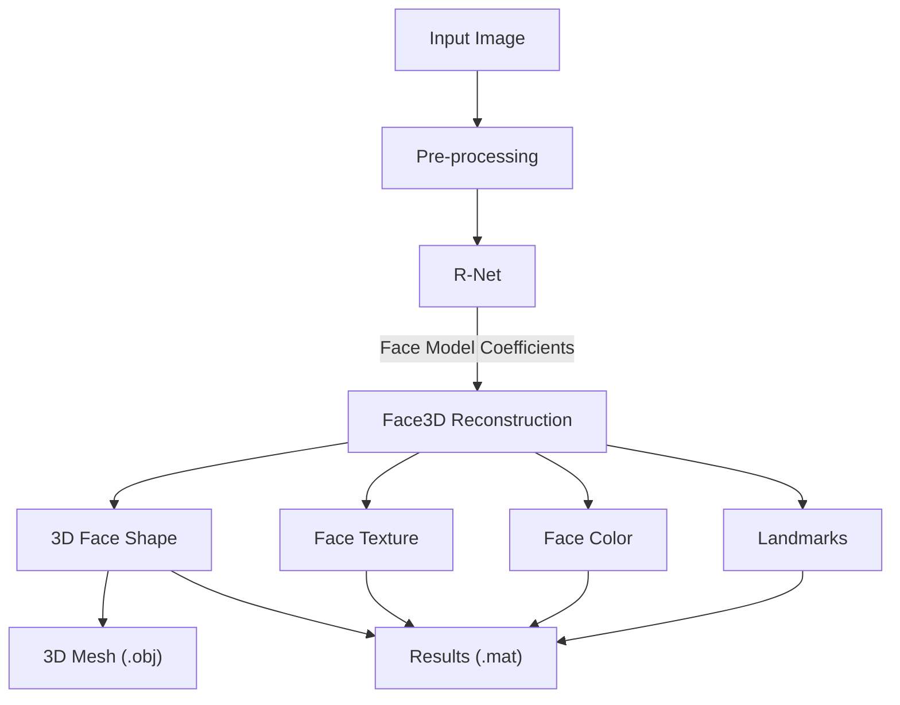
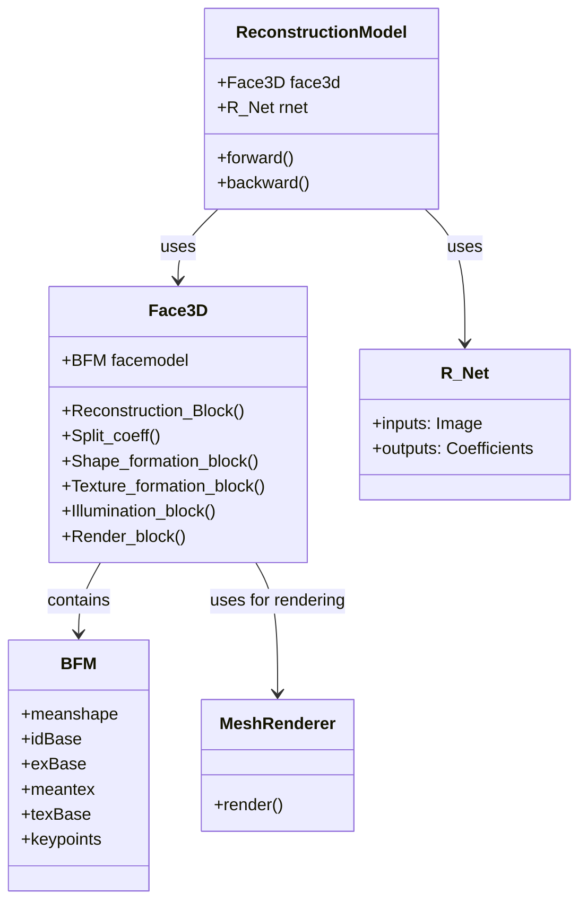
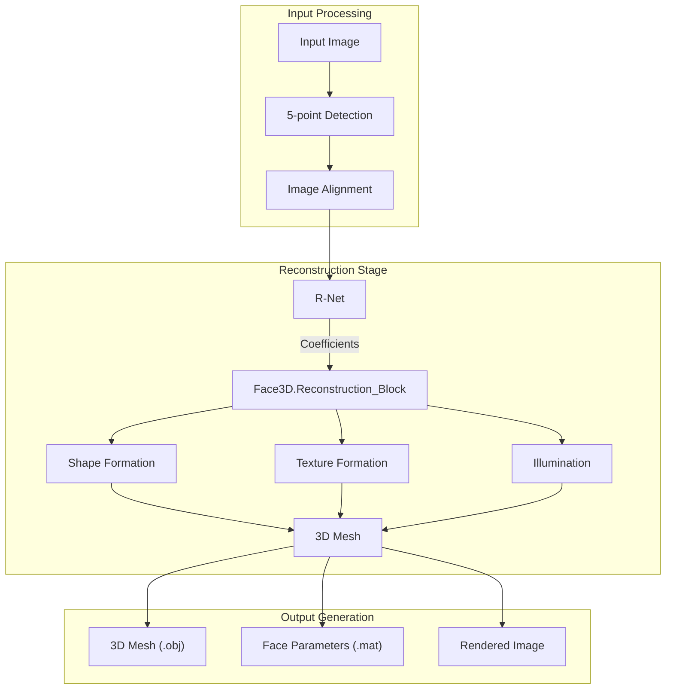

<!-- source: DeepWiki mcp.deepwiki.com · repo microsoft/Deep3DFaceReconstruction · page 1 Overview · fetched 2026-10-26 -->

# Overview

Relevant source files

The following files were used as context for generating this wiki page:

- [images/example.png](images/example.png)
- [readme.md](readme.md)

This document provides an introduction to the Deep3DFaceReconstruction repository, a TensorFlow implementation for accurate 3D face reconstruction from single images. This overview summarizes the system's purpose, architecture, capabilities, and key components, helping developers understand what the system does and how it works at a high level. For detailed installation instructions, see [Installation](#1.1), and for quick usage instructions, see [Quick Start](#1.2).

## Purpose and Scope

Deep3DFaceReconstruction implements a CNN-based approach for accurate 3D face reconstruction from a single image, as described in the paper "Accurate 3D Face Reconstruction with Weakly-Supervised Learning: From Single Image to Image Set" by Deng et al. The system uses a weakly-supervised learning approach to generate detailed 3D face models, including geometry and texture, from a single face image. The reconstructed models are accurate, robust to occlusions and extreme poses, and aligned with input images.

Sources: [readme.md:10-14](), [readme.md:64-65]()

## Key Capabilities

The system offers several key capabilities that make it valuable for 3D face reconstruction tasks:

1. **Accurate Shape Reconstruction**: Achieves state-of-the-art shape accuracy on benchmarks like FaceWareHouse, Florence, and BU3DFE.
2. **High Fidelity Textures**: Produces detailed face textures while preserving identity information.
3. **Disentangled Illumination**: Separates scene illumination to generate pure albedo textures.
4. **Robustness**: Provides reasonable results under extreme conditions like large pose variations and occlusions.
5. **Alignment with Input**: Reconstructions are aligned with input images, providing face pose estimation and 68 facial landmarks.
6. **Fast Processing**: Uses ResNet-50 as backbone to achieve over 50 fps on a GTX 1080 GPU.
7. **Easy Representation**: Uses Basel Face Model 2009 for face representation, making further manipulation easy.

Sources: [readme.md:19-64]()

## System Architecture

The Deep3DFaceReconstruction system consists of several interconnected components that work together to process input images and generate 3D face reconstructions.

Sources: [readme.md:73-75](), [readme.md:210-216]()

### Core Components

1. **R-Net** - A CNN model built on ResNet-50 architecture that takes an aligned face image as input and outputs face model coefficients.
2. **Face3D** - A class that handles 3D face model reconstruction using the Basel Face Model (BFM) and the coefficients predicted by R-Net.
3. **Basel Face Model (BFM)** - A 3D morphable model for face representation, including shape, expression, and texture bases.
4. **Mesh Renderer** - A component using tf_mesh_renderer to visualize the 3D reconstructions.

Sources: [readme.md:73-75](), [readme.md:145-149]()

## Reconstruction Pipeline

The reconstruction pipeline consists of the following key steps:

Sources: [readme.md:139-149](), [readme.md:210-216]()

1. **Pre-processing**: 
   - Detect 5 facial landmarks for each input image
   - Align the face image by solving a least square problem between detected landmarks and BFM average face landmarks

2. **Coefficient Prediction**:
   - Feed the aligned image to R-Net
   - Predict coefficients for identity, expression, texture, illumination, and pose

3. **3D Reconstruction**:
   - Generate 3D face shape using identity and expression coefficients
   - Generate face texture using texture coefficients
   - Apply illumination model to get face color
   - Compute face pose and projection

4. **Output Generation**:
   - Generate 3D face mesh in OBJ format
   - Save reconstruction parameters and results in MAT format
   - Render the reconstructed face aligned with the input image

Sources: [readme.md:139-149]()

## Technical Foundations

The system is built on several important technical foundations:

1. **Weakly-Supervised Learning**: The network is trained with a hybrid-level weakly-supervised approach that doesn't require 3D face scans as ground truth.

2. **Camera Model**: A pinhole camera model is used for face projection. The camera is positioned at (0,0,10) in world coordinates with a field of view of 12.6 degrees.

3. **Basel Face Model**: The 3D face representation uses the Basel Face Model 2009 (BFM09) with additional expression bases transferred from Facewarehouse.

4. **Loss Functions**: The training involves multiple losses including photometric, landmark, perceptual, and regularization losses. For more details about loss functions, see [Loss Functions](#4.1).

5. **Network Architecture**: The system uses ResNet-50 as the backbone for the R-Net and FaceNet for perceptual feature extraction. For more details about network architecture, see [Neural Network Architecture](#2.2).

Sources: [readme.md:12-14](), [readme.md:210-216](), [readme.md:73-75]()

## System Usage Overview

The system supports two main usage modes:

1. **Inference/Testing**: Using pre-trained models to reconstruct 3D faces from input images. This is demonstrated in the demo.py script.

2. **Training**: Training new models using your own data. The system provides scripts for data preprocessing and model training.

For a detailed guide on inference, see [Inference with demo.py](#3.1). For training information, see [Training Pipeline](#3.2).

## Limitations

The current system has a few known limitations:

1. It may give inferior results for images with severe perspective distortions (e.g., selfies).
2. It cannot well handle faces with closed eyes due to limited training data.
3. Pre-alignment with 5 facial landmarks is necessary, and poor alignment may affect reconstruction results.

Sources: [readme.md:223-224](), [readme.md:210-216]()

## Summary

Deep3DFaceReconstruction provides a state-of-the-art approach for 3D face reconstruction from single images. Its key strengths include accurate shape reconstruction, high-fidelity textures, robustness to challenging conditions, and fast processing speed. The system is designed with a modular architecture that supports both inference and training, making it suitable for various applications in computer vision, graphics, and AR/VR.

---

