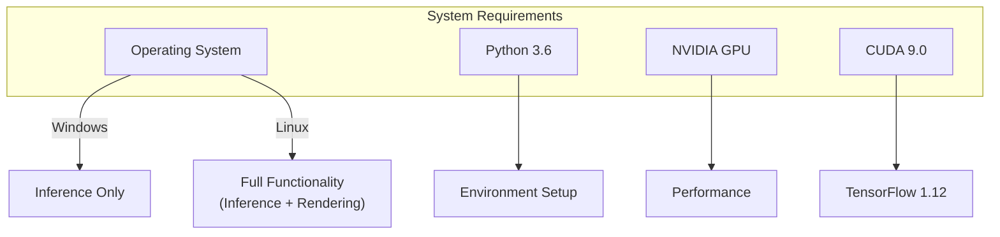
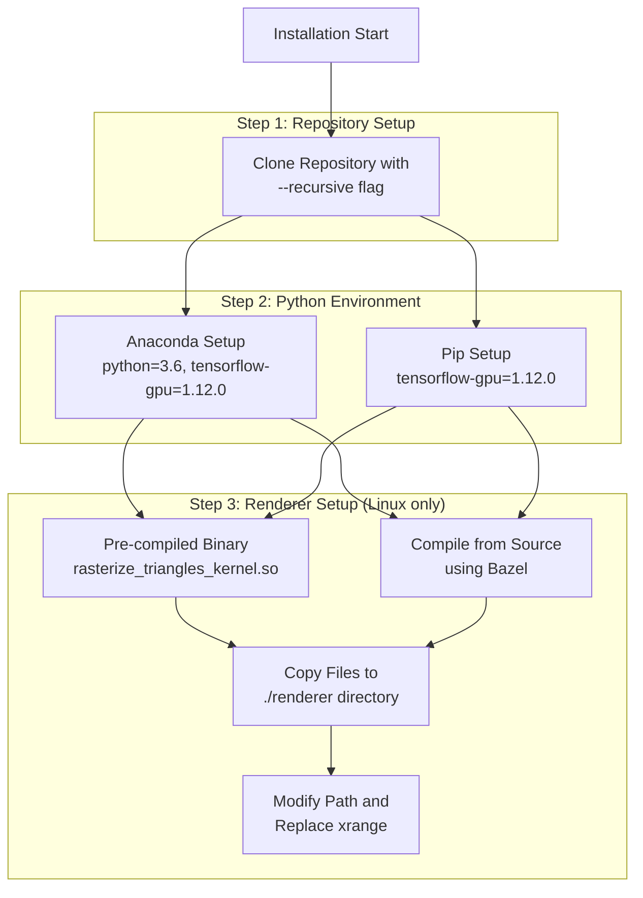
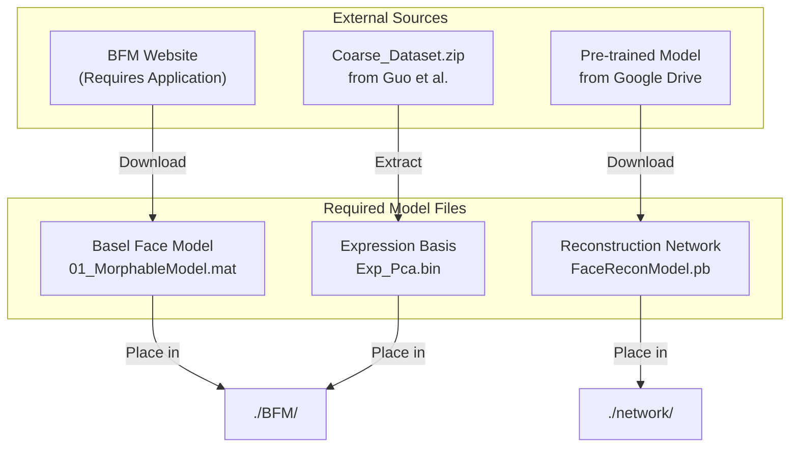
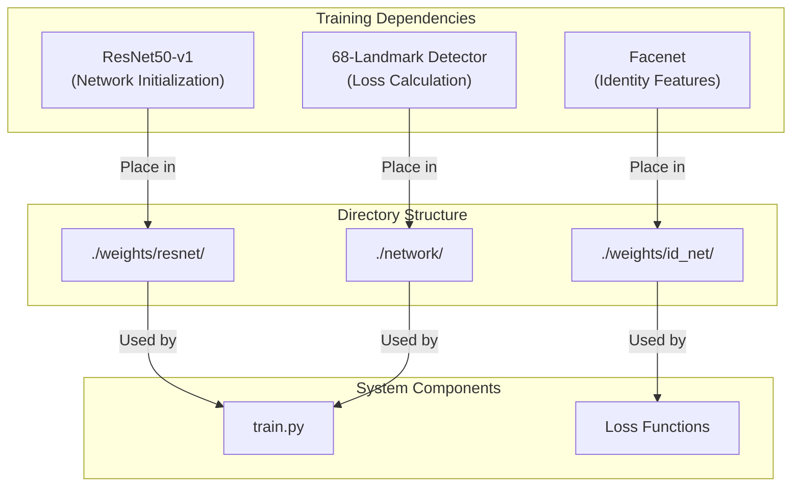

<!-- source: DeepWiki mcp.deepwiki.com · repo microsoft/Deep3DFaceReconstruction · page 1.1 Installation · fetched 2026-10-26 -->

# Installation

<details>
<summary>Relevant source files</summary>

The following files were used as context for generating this wiki page:

- [.gitignore](.gitignore)
- [.gitmodules](.gitmodules)
- [LICENSE](LICENSE)
- [images/example.png](images/example.png)
- [readme.md](readme.md)

</details>


This guide provides detailed instructions for installing and setting up the Deep3DFaceReconstruction system on your machine. It covers environment setup, dependency installation, and preparation of required model files for both inference (testing) and training. For instructions on how to use the system after installation, see [Quick Start](#1.2).

## System Requirements

Before proceeding with the installation, ensure your system meets the following requirements:

| Component | Requirement |
|-----------|-------------|
| **Operating System** | Windows or Linux (Linux recommended as rendering is only supported on Linux) |
| **Python** | Python 3.6 |
| **GPU** | NVIDIA GPU with CUDA support (for optimal performance) |
| **CUDA** | CUDA 9.0 (compatible with TensorFlow 1.12) |



Sources: [readme.md:67-76]()

## Basic Installation

### 1. Clone the Repository

The first step is to clone the repository with all its submodules:

```bash
git clone https://github.com/Microsoft/Deep3DFaceReconstruction --recursive
cd Deep3DFaceReconstruction
```

Note that the `--recursive` flag is important to clone the tf_mesh_renderer submodule.

Sources: [readme.md:78-82]()

### 2. Set up the Python Environment

You can use either Anaconda or pip to set up the Python environment.

#### Option A: Using Anaconda (Recommended)

```bash
conda create -n deep3d python=3.6
source activate deep3d
conda install tensorflow-gpu==1.12.0 scipy
pip install pillow argparse
```

#### Option B: Using pip

```bash
pip install tensorflow-gpu==1.12.0
pip install scipy pillow argparse
```

Note: If you use pip for installation, you'll need to link `/usr/local/cuda` to `cuda-9.0`.

Sources: [readme.md:84-96]()

### 3. Set up the Renderer (Required for Linux)

The rendering process is only supported on Linux and requires tf_mesh_renderer. You have two options:

#### Option A: Use Pre-compiled Binary

If you installed tensorflow using pip, you can download a pre-compiled binary file:
1. Download [rasterize_triangles_kernel.so](https://drive.google.com/file/d/1VUtJPdg0UiJkKWxkACs8ZTf5L7Y4P9Wj/view?usp=sharing)
2. Place it in the `./renderer` subfolder

#### Option B: Compile from Source

If you use conda for tensorflow installation or prefer to compile from source:

```bash
cd tf_mesh_renderer
git checkout ba27ea1798
git checkout master WORKSPACE
# Set -D_GLIBCXX_USE_CXX11_ABI=1 in ./mesh_renderer/kernels/BUILD before compilation
bazel test ...
cd ..
```

After compilation, copy the necessary files:

```bash
cd renderer
cp ./tf_mesh_renderer/mesh_renderer/{camera_utils.py,mesh_renderer.py,rasterize_triangles.py} ./renderer/
cp ./tf_mesh_renderer/bazel-bin/mesh_renderer/kernels/rasterize_triangles_kernel.so ./renderer/
```

You need to make two minor adjustments to the renderer files:
1. Replace the library path in `./renderer/rasterize_triangles.py` (Line 26) with `"./renderer/rasterize_triangles_kernel.so"`
2. Replace `xrange` with `range` in `./renderer/rasterize_triangles.py` (Line 109) for Python 3 compatibility



Sources: [readme.md:98-123](), [.gitmodules:1-4]()

## Preparing Model Files

To use the system, you need to download and prepare several model files:

### 1. Basel Face Model (BFM09)

Due to licensing restrictions, you need to separately download the Basel Face Model:
1. Submit an application on the [BFM website](https://faces.dmi.unibas.ch/bfm/main.php?nav=1-2&id=downloads)
2. After approval, download "01_MorphableModel.mat"
3. Place the file in the `./BFM` subfolder

### 2. Expression Basis

1. Download the expression basis from the [Coarse_Dataset](https://github.com/Juyong/3DFace) (look for "CoarseData" link)
2. Extract "Exp_Pca.bin" from the downloaded Coarse_Dataset.zip
3. Place the file in the `./BFM` subfolder

### 3. Pre-trained Reconstruction Network

1. Download the [pre-trained model](https://drive.google.com/file/d/176LCdUDxAj7T2awQ5knPMPawq5Q2RUWM/view?usp=sharing)
2. Unzip the downloaded file
3. Place "FaceReconModel.pb" in the `./network` subfolder



Sources: [readme.md:126-132]()

## Additional Setup for Training

If you plan to train new models (not just run inference), you need additional components:

### 1. Facenet

1. Download [pre-trained weights](https://drive.google.com/file/d/0B5MzpY9kBtDVZ2RpVDYwWmxoSUk/edit) by Sandberg et al.
2. Unzip and place all files in `./weights/id_net`

### 2. ResNet50-v1

1. Download [pre-trained weights](http://download.tensorflow.org/models/resnet_v1_50_2016_08_28.tar.gz) from TensorFlow Slim
2. Unzip and place "resnet_v1_50.ckpt" in `./weights/resnet`

### 3. 68-Landmark Detector

1. Download the [68-landmark detector](https://drive.google.com/file/d/1KYFeTb963jg0F47sTiwqDdhBIvRlUkPa/view?usp=sharing)
2. Place the file in the `./network` directory



Sources: [readme.md:151-163]()

## Verify Installation

After completing the installation steps, you can verify that everything is set up correctly by running the demo:

```bash
python demo.py
```

If the installation is successful:
1. The demo will process sample images in the `./input` folder
2. Results will be saved in the `./output` folder
3. For each input image, you'll get:
   - A .mat file with reconstruction data
   - A .obj file with the 3D face mesh

Sources: [readme.md:133-150]()

## File Structure After Installation

After completing all installation steps, your directory structure should look like this:

```
Deep3DFaceReconstruction/
├── BFM/
│   ├── 01_MorphableModel.mat
│   └── Exp_Pca.bin
├── input/                   # Sample input images
├── network/
│   ├── FaceReconModel.pb    # For inference
│   └── ... (landmark detector for training)
├── output/                  # Generated outputs
├── renderer/                # Rendering components
│   ├── camera_utils.py
│   ├── mesh_renderer.py
│   ├── rasterize_triangles.py
│   └── rasterize_triangles_kernel.so
├── tf_mesh_renderer/        # Submodule
├── weights/                 # For training
│   ├── id_net/              # Facenet weights
│   └── resnet/              # ResNet weights
├── demo.py                  # For inference
├── train.py                 # For training
└── preprocess_img.py        # For data preparation
```

## Common Issues and Troubleshooting

### TensorFlow Version Compatibility
The system is designed to work with TensorFlow 1.12.0. Using different versions may cause compatibility issues, especially with the pre-compiled renderer binary.

### CUDA Version
Ensure you have CUDA 9.0 installed for TensorFlow 1.12.0 compatibility. If using pip for TensorFlow installation, you may need to create a symbolic link:
```bash
sudo ln -s /usr/local/cuda-9.0 /usr/local/cuda
```

### Renderer Issues
If you encounter errors related to rendering:
1. Ensure you're running on Linux (rendering is not supported on Windows)
2. Check that the renderer files are correctly placed and modified as instructed
3. Verify that the rasterize_triangles_kernel.so file is compatible with your system

### Missing Files Errors
If you encounter "file not found" errors:
1. Check that all required model files are downloaded and placed in their correct directories
2. Verify that the file paths in the code match your actual directory structure

Sources: [readme.md:98-125](), [readme.md:210-224]()

## Next Steps

After completing the installation, refer to [Quick Start](#1.2) to learn how to use the system for 3D face reconstruction.

---

