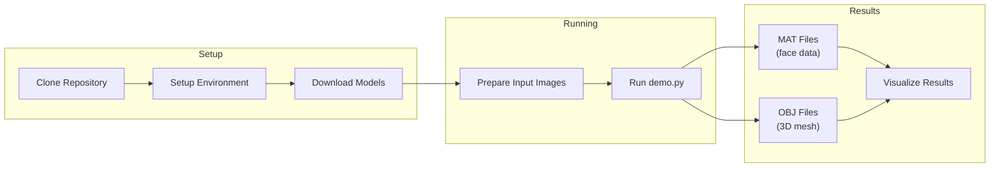
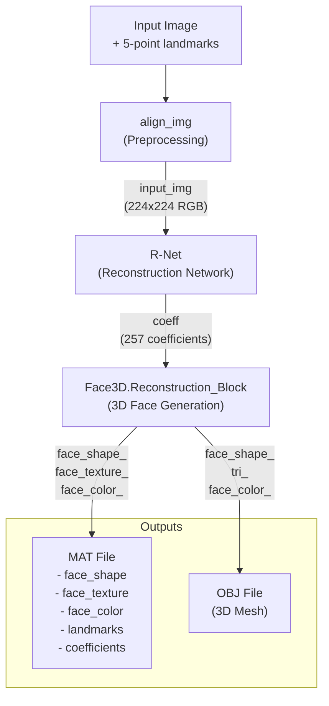
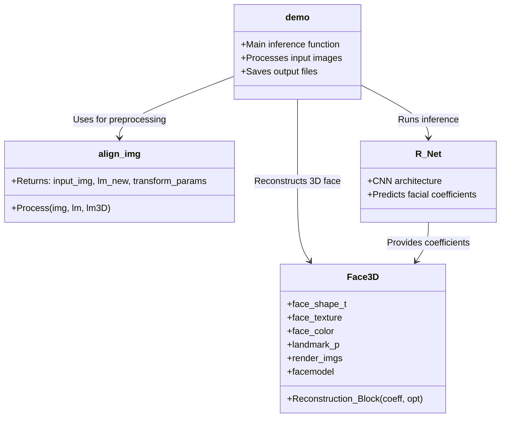

<!-- source: DeepWiki mcp.deepwiki.com · repo microsoft/Deep3DFaceReconstruction · page 1.2 Quick Start · fetched 2026-10-26 -->

# Quick Start

<details>
<summary>Relevant source files</summary>

The following files were used as context for generating this wiki page:

- [demo.py](demo.py)
- [images/example.gif](images/example.gif)
- [images/example.png](images/example.png)
- [readme.md](readme.md)

</details>


This page provides a step-by-step guide for quickly getting started with Deep3DFaceReconstruction to perform 3D face reconstruction from single images using pre-trained models. For detailed information about system architecture, see [System Architecture](#2), or for training your own model, see [Training Pipeline](#3.2).

## Overview of the Quick Start Process



Sources: [readme.md:67-68](), [readme.md:126-138]()

## Prerequisites

Before you begin, ensure your system meets the following requirements:

| Requirement | Details |
|-------------|---------|
| Operating System | Linux (recommended) or Windows (limited rendering support) |
| Python | Version 3.6 with numpy, scipy, pillow, argparse |
| TensorFlow | Version 1.12 |
| Models | Basel Face Model 2009, Expression Basis |
| Rendering | tf_mesh_renderer (Linux only) |

**Note**: While reconstructions can be done on both Windows and Linux, we recommend using Linux because the rendering process is only fully supported on Linux platforms.

Sources: [readme.md:69-76]()

## Installation and Setup

### 1. Clone the Repository

```bash
git clone https://github.com/Microsoft/Deep3DFaceReconstruction --recursive
cd Deep3DFaceReconstruction
```

Sources: [readme.md:78-82]()

### 2. Set up Python Environment

Using Anaconda (recommended):

```bash
conda create -n deep3d python=3.6
source activate deep3d
conda install tensorflow-gpu==1.12.0 scipy
pip install pillow argparse
```

Sources: [readme.md:85-91]()

### 3. Download Required Models

#### Basel Face Model (BFM09)

1. Download "01_MorphableModel.mat" from the [Basel Face Model website](https://faces.dmi.unibas.ch/bfm/main.php?nav=1-2&id=downloads) (requires registration)
2. Place it in the `./BFM` subfolder

#### Expression Basis

1. Download "Exp_Pca.bin" from the [Coarse Data](https://github.com/Juyong/3DFace) repository
2. Place it in the `./BFM` subfolder

#### Pre-trained Network

1. Download the [reconstruction network](https://drive.google.com/file/d/176LCdUDxAj7T2awQ5knPMPawq5Q2RUWM/view?usp=sharing)
2. Unzip it and place "FaceReconModel.pb" in the `./network` subfolder

Sources: [readme.md:127-132]()

### 4. Renderer Setup (Linux Only)

If you're using Linux and want to visualize the reconstructed faces:

1. For pip-installed TensorFlow: Download the [pre-compiled binary](https://drive.google.com/file/d/1VUtJPdg0UiJkKWxkACs8ZTf5L7Y4P9Wj/view?usp=sharing)
2. For conda-installed TensorFlow: Compile from source following instructions in [readme.md:98-123]()
3. Place the renderer files in the `./renderer` subfolder

Sources: [readme.md:98-123]()

## Running Face Reconstruction

### Inference Pipeline



Sources: [demo.py:40-124](), [readme.md:139-149]()

### Input Requirements

Place your test images in the `./input` folder. For each image, you need:

1. An image file (PNG or JPG format)
2. A text file with the same name containing 5 facial landmarks
   - The landmarks should be in the format: `x1 y1\nx2 y2\nx3 y3\nx4 y4\nx5 y5`
   - These represent the coordinates of: left eye, right eye, nose, left mouth corner, right mouth corner

**Note**: The repository includes some example images in the `./input` folder that you can use for reference.

Sources: [demo.py:44-50](), [demo.py:99-102]()

### Running the Demo

To run face reconstruction with default settings:

```bash
python demo.py
```

This will:
1. Process all PNG and JPG images in the `./input` directory
2. Use the pre-trained model in `./network/FaceReconModel.pb`
3. Save results in the `./output` directory

#### Advanced Usage

You can specify a different pre-trained model using command-line arguments:

```bash
# Use a specific checkpoint file instead of the default .pb file
python demo.py --use_pb 0 --pretrain_weights path/to/model.ckpt
```

Sources: [demo.py:17-25](), [demo.py:65-79](), [readme.py:133-137]()

## Understanding the Outputs

The demo script generates two types of output files for each input image:

### 1. MAT File (`.mat`)

Contains the following data:

| Field | Description |
|-------|-------------|
| `cropped_img` | RGB image after alignment (input to the network) |
| `recon_img` | RGBA reconstruction image aligned with input (Linux only) |
| `coeff` | Output coefficients from the reconstruction network |
| `face_shape` | 3D face vertex positions in world coordinates |
| `face_texture` | Face texture values without lighting effects |
| `face_color` | Face color values with lighting applied |
| `lm_68p` | 68 2D facial landmarks derived from the reconstructed face |
| `lm_5p` | 5 detected landmarks from input alignment |

### 2. OBJ File (`_mesh.obj`)

Contains the 3D face mesh in world coordinates, which can be viewed in 3D modeling software like MeshLab.

Sources: [readme.md:140-149](), [demo.py:117-121]()

## Key Components Used in Quick Start



Sources: [demo.py:10-13](), [demo.py:67-88]()

## Troubleshooting

### Common Issues

1. **Missing Basel Face Model**:
   - Error: `FileNotFoundError: BFM/BFM_model_front.mat`
   - Solution: Ensure you've downloaded the Basel Face Model and placed it in the BFM folder

2. **Landmark Detection Issues**:
   - Error: Missing or incorrect landmark files
   - Solution: Ensure each image has a corresponding text file with 5 facial landmarks

3. **Renderer Issues (Linux)**:
   - Error: `ImportError: cannot open shared object file: rasterize_triangles_kernel.so`
   - Solution: Make sure the renderer is properly set up following the instructions in [Installation](#1.1)

4. **Poor Reconstruction Quality**:
   - Issue: Inaccurate face reconstructions
   - Solution: Ensure input images are frontal or near-frontal faces with good lighting and minimal occlusions

Sources: [readme.md:208-224]()

## Next Steps

Once you've successfully run the demo:

1. For visualization, use MeshLab to open the `.obj` files
2. For more detailed analysis, examine the `.mat` files using MATLAB or Python with scipy.io
3. To train your own model, see [Training Pipeline](#3.2)
4. For technical details about the system architecture, see [System Architecture](#2)

Sources: [readme.md:151-196]()

---

