<!-- source: DeepWiki mcp.deepwiki.com · repo microsoft/Deep3DFaceReconstruction · page 2 System Architecture · fetched 2026-10-26 -->

# System Architecture

Relevant source files

The following files were used as context for generating this wiki page:

- [face_decoder.py](face_decoder.py)
- [images/example.png](images/example.png)
- [networks.py](networks.py)
- [readme.md](readme.md)
- [reconstruction_model.py](reconstruction_model.py)

This document provides a comprehensive overview of the system architecture for the Deep3DFaceReconstruction repository. It details the core components, their interactions, and the overall data flow within the system that enables 3D face reconstruction from single images using a weakly-supervised deep learning approach.

For practical usage of the system, see [Using the System](#3). For details about specific neural network architectures, see [Neural Network Architecture](#2.2).

## System Overview

The Deep3DFaceReconstruction system implements a CNN-based approach for reconstructing detailed 3D face models from single images. The system follows a modular design with clear separation between the coefficient prediction network (R-Net), 3D face model reconstruction (Face3D), and rendering components.

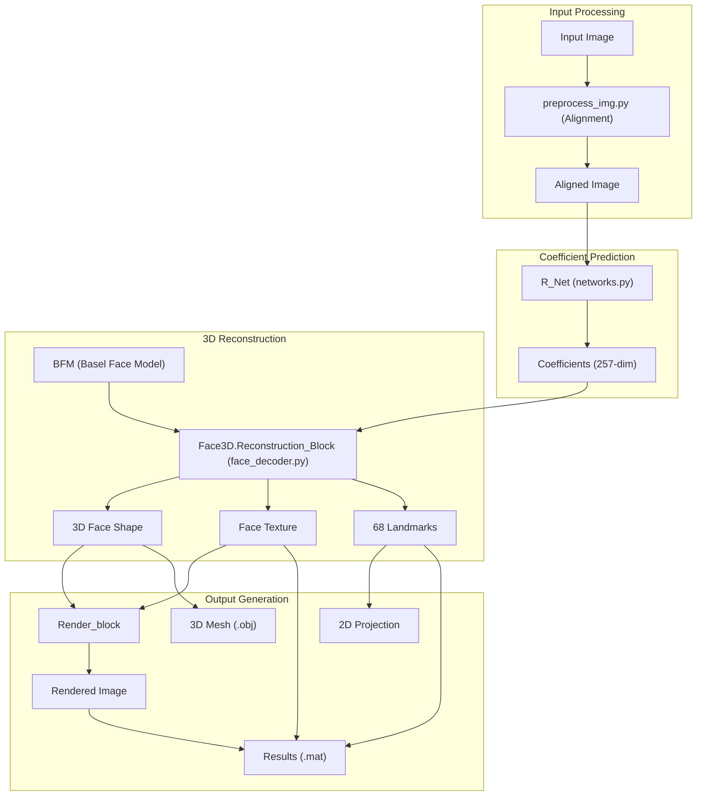

Sources: [networks.py](networks.py), [face_decoder.py](face_decoder.py), [reconstruction_model.py](reconstruction_model.py), [readme.md](readme.md)

## Core Components

The system consists of several core components that work together to perform 3D face reconstruction:

### R-Net: Coefficient Prediction Network

The R-Net is a deep neural network responsible for predicting the coefficients needed for 3D face reconstruction from a single input image.

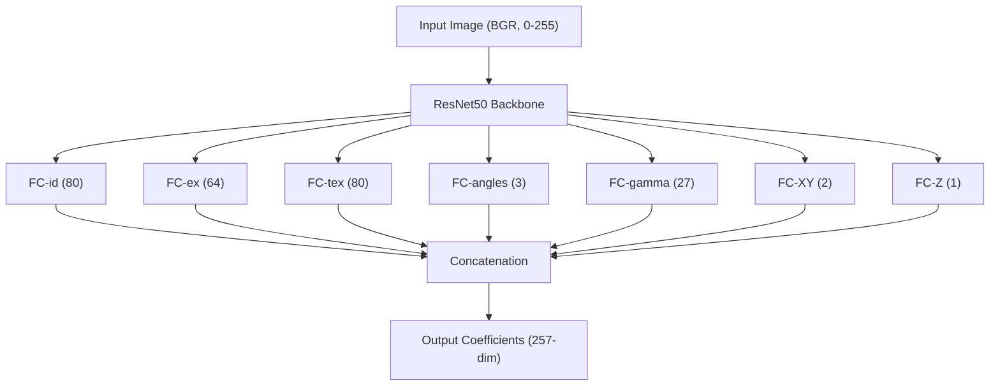

The R-Net takes a 224×224 BGR image as input and processes it through:
1. A ResNet50 backbone (without the classification layer)
2. Multiple fully connected layers that predict different coefficient types
3. Concatenation of these coefficients to produce a 257-dimensional output vector

Sources: [networks.py:9-63](networks.py)

### Face3D: 3D Face Reconstruction

The Face3D class is responsible for reconstructing 3D face shapes from the coefficients predicted by the R-Net.

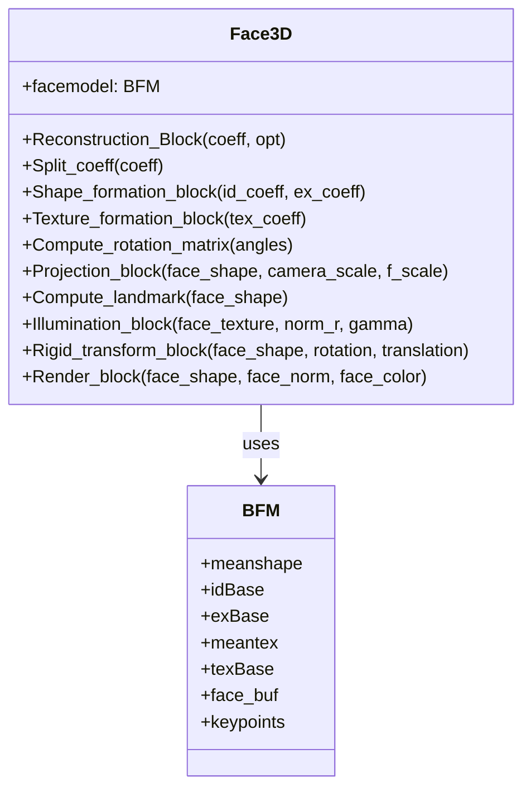

The Face3D reconstruction process:
1. Splits the 257-dimensional coefficient vector
2. Constructs 3D face shape using identity and expression coefficients
3. Generates face texture using texture coefficients
4. Computes rotation matrix from angle coefficients
5. Applies rigid transformation using rotation and translation
6. Computes face color using texture, normals, and lighting (gamma)
7. Projects 3D landmarks to 2D
8. Renders the face if requested

Sources: [face_decoder.py:32-345](face_decoder.py)

### Basel Face Model (BFM)

The Basel Face Model (BFM) is a statistical 3D face model that serves as the foundation for face reconstruction.

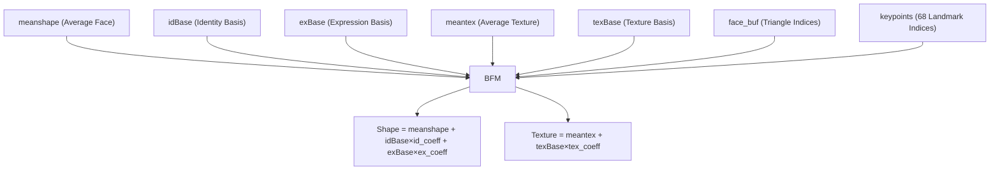

The BFM consists of:
- A mean face shape and texture
- PCA basis vectors for identity and expression variations
- PCA basis vectors for texture variations
- Face topology (triangle indices)
- Landmark indices for 68 facial landmarks

Sources: [face_decoder.py:16-29](face_decoder.py), [readme.md:73-77](readme.md)

### Perceptual Network

The Perceptual Network extracts identity features from face images for computing perceptual loss during training.

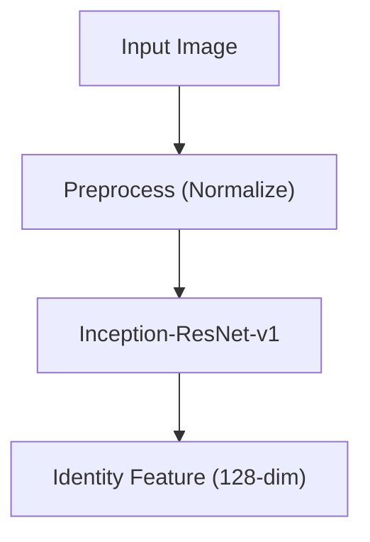

The Perceptual Network:
1. Takes a face image as input
2. Preprocesses it (normalization)
3. Processes it through an Inception-ResNet-v1 network
4. Outputs a 128-dimensional identity feature vector

Sources: [networks.py:66-87](networks.py)

## Pipeline Architecture

The system has three main pipelines: preprocessing, training, and inference.

### Preprocessing Pipeline

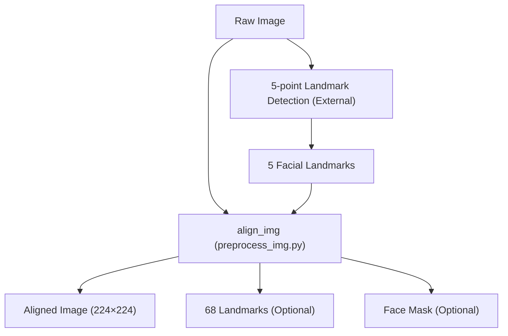

The preprocessing pipeline:
1. Detects 5 facial landmarks using an external detector (e.g., dlib or MTCNN)
2. Aligns the face image using these landmarks
3. Optionally generates 68 landmarks and face masks for training

Sources: [readme.md:166-176](readme.md)

### Training Pipeline

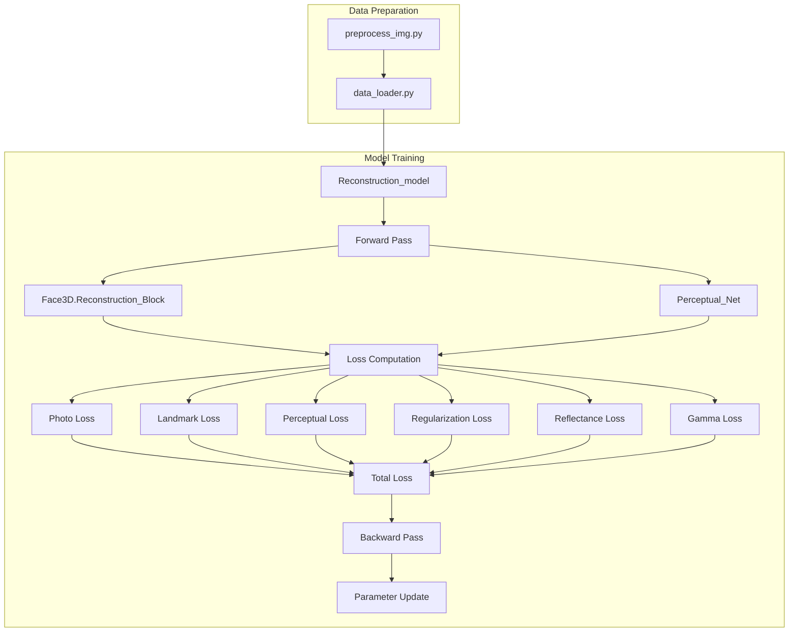

The training pipeline:
1. Loads preprocessed data (aligned images, landmarks, masks)
2. Feeds images to the R-Net to predict coefficients
3. Reconstructs 3D faces using Face3D
4. Computes various losses:
   - Photometric loss (rendered vs. input image)
   - Landmark loss (projected vs. ground truth landmarks)
   - Perceptual loss (identity feature similarity)
   - Regularization loss (coefficient magnitudes)
   - Reflectance loss (texture naturalness)
   - Gamma loss (lighting parameters)
5. Updates network parameters using backpropagation

Sources: [reconstruction_model.py:9-86](reconstruction_model.py), [readme.md:178-196](readme.md)

### Inference Pipeline

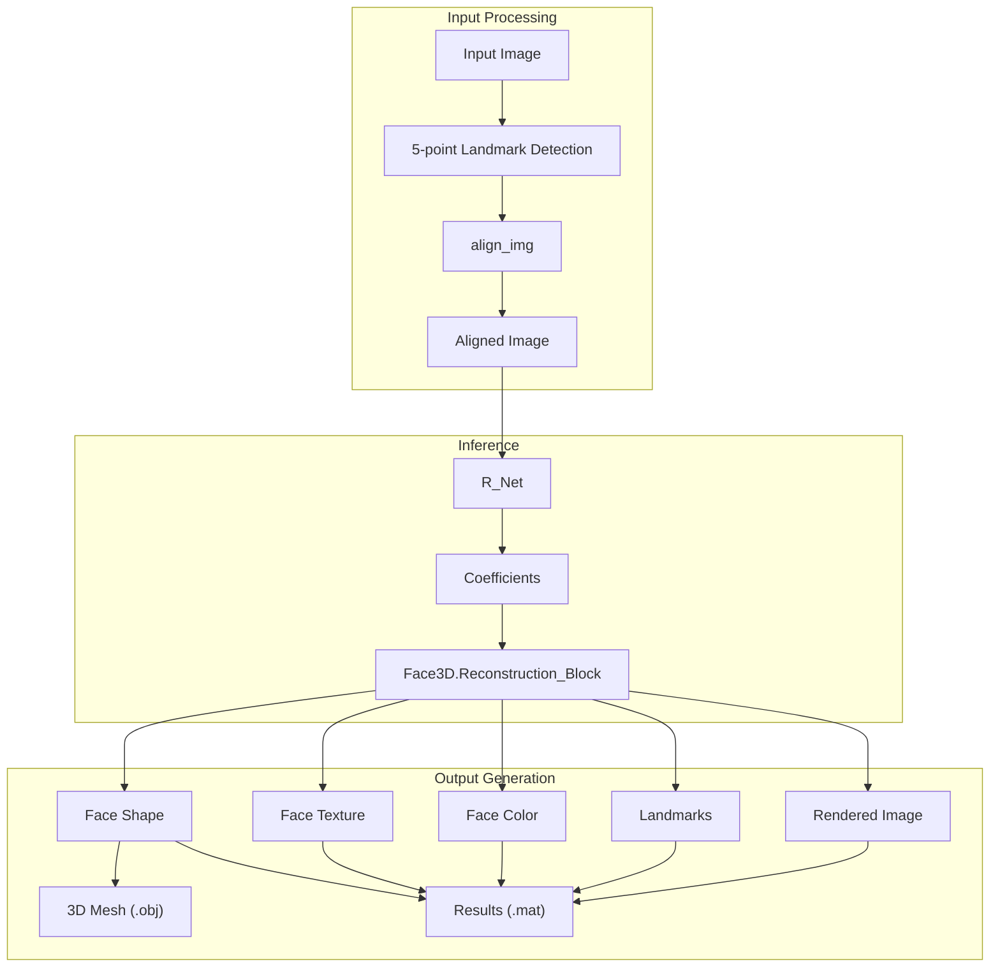

The inference pipeline:
1. Aligns the input image using 5-point landmarks
2. Predicts coefficients using the R-Net
3. Reconstructs 3D face using Face3D
4. Outputs:
   - 3D face mesh (.obj)
   - Face texture and color
   - 68 facial landmarks
   - Rendered face image
   - Results file (.mat)

Sources: [readme.md:134-149](readme.md), [demo.py](demo.py)

## Data Flow and Transformations

This section illustrates how data flows through the system and the key transformations that occur.

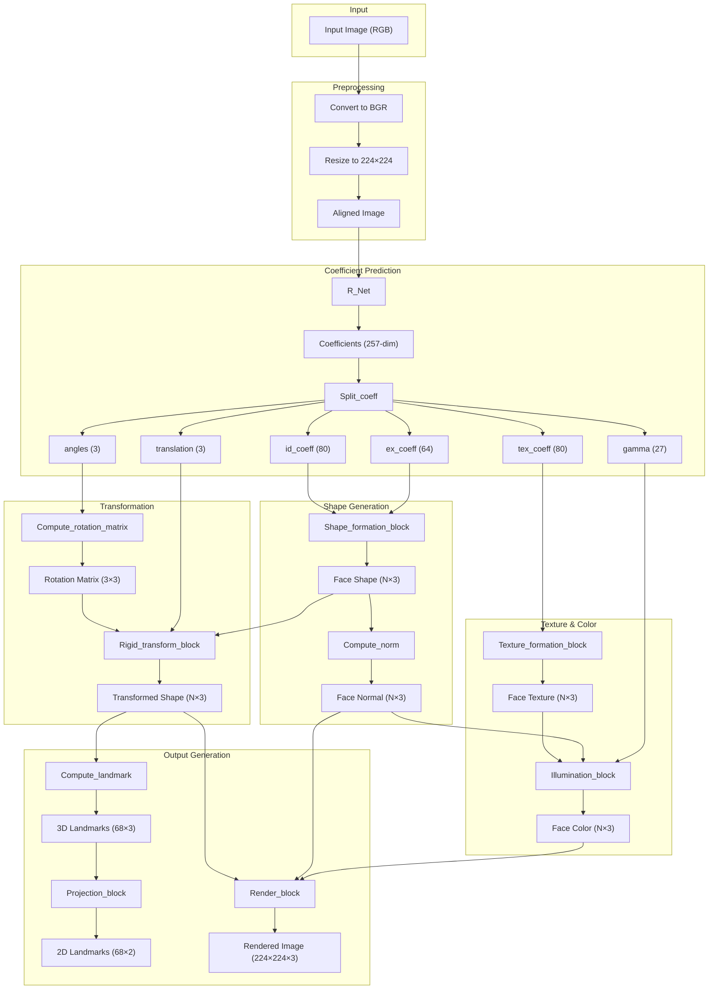

Key data transformations:
1. **Coefficient splitting**: The 257-dimensional coefficient vector is split into components for identity, expression, texture, angles, lighting, and translation.
2. **Shape formation**: 3D face shape is generated by combining the mean shape with weighted identity and expression basis vectors.
3. **Texture formation**: Face texture is generated by combining the mean texture with weighted texture basis vectors.
4. **Illumination**: Face color is calculated by applying lighting (gamma) to the face texture.
5. **Transformation**: Face shape is transformed using rotation and translation.
6. **Projection**: 3D landmarks are projected to 2D for comparison with detected landmarks.
7. **Rendering**: The 3D face is rendered to a 2D image for visualization and loss computation.

Sources: [face_decoder.py:38-346](face_decoder.py)

## Camera Model and Coordinate System

The system uses a specific camera model and coordinate system for 3D face reconstruction and rendering.

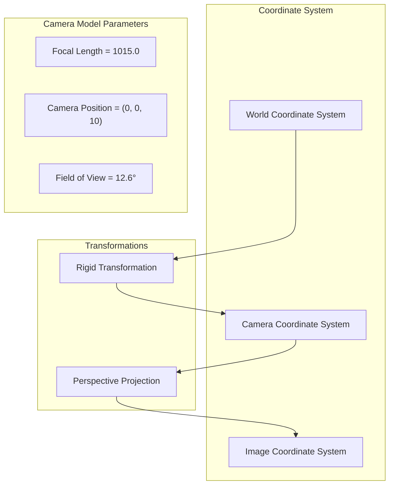

Camera model details:
- Pinhole camera model with perspective projection
- Camera positioned at (0, 0, 10) in world coordinates
- Camera points to the negative z axis
- Fixed focal length of 1015 and field of view of 12.6°
- Canonical face positioned at the origin, facing positive z axis

Sources: [face_decoder.py:185-208](face_decoder.py), [readme.md:212-216](readme.md)

## Component Integration

This diagram illustrates how the various components are integrated in the system:

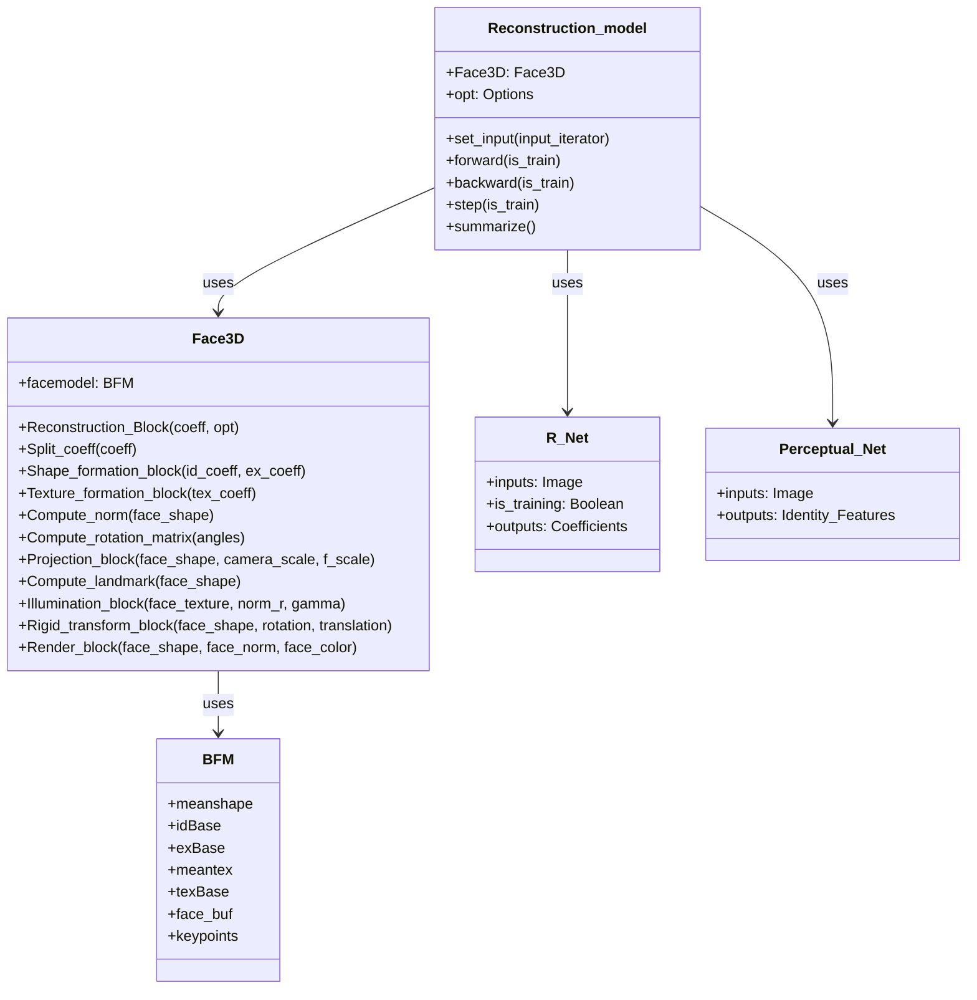

Sources: [reconstruction_model.py:9-86](reconstruction_model.py), [face_decoder.py:32-346](face_decoder.py), [networks.py:9-87](networks.py)

## Summary

The Deep3DFaceReconstruction system employs a modular architecture to reconstruct 3D face models from single images. The system uses:

1. An R-Net for predicting 257 coefficients from input images
2. A Face3D module that leverages the Basel Face Model to reconstruct 3D face geometry and texture
3. A Perceptual Network for extracting identity features during training
4. A rendering module for visualizing the reconstructed face

This architecture enables:
- Accurate 3D face reconstruction from single images
- Disentanglement of identity, expression, texture, and lighting
- Robustness to pose variations and occlusions
- Generation of high-quality 3D face models with detailed geometry and texture

The system achieves state-of-the-art performance through a weakly-supervised training approach that combines photometric, landmark, perceptual, and regularization losses.

---

