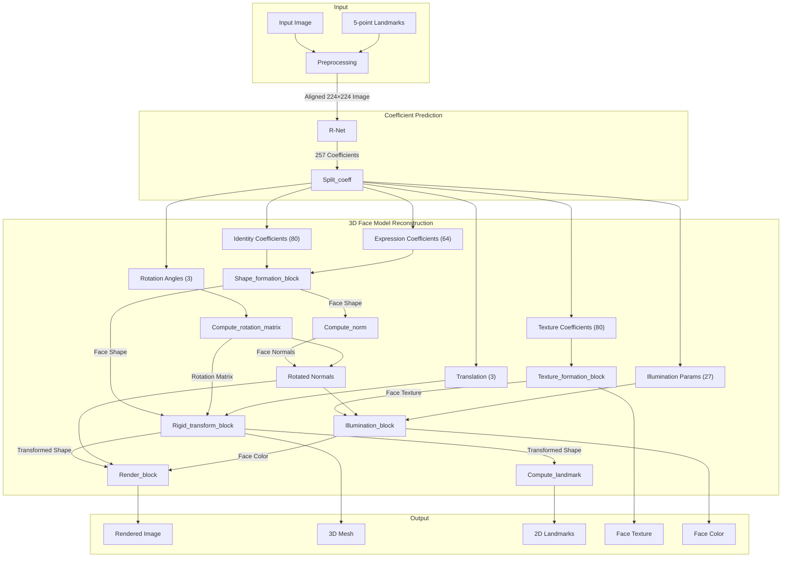
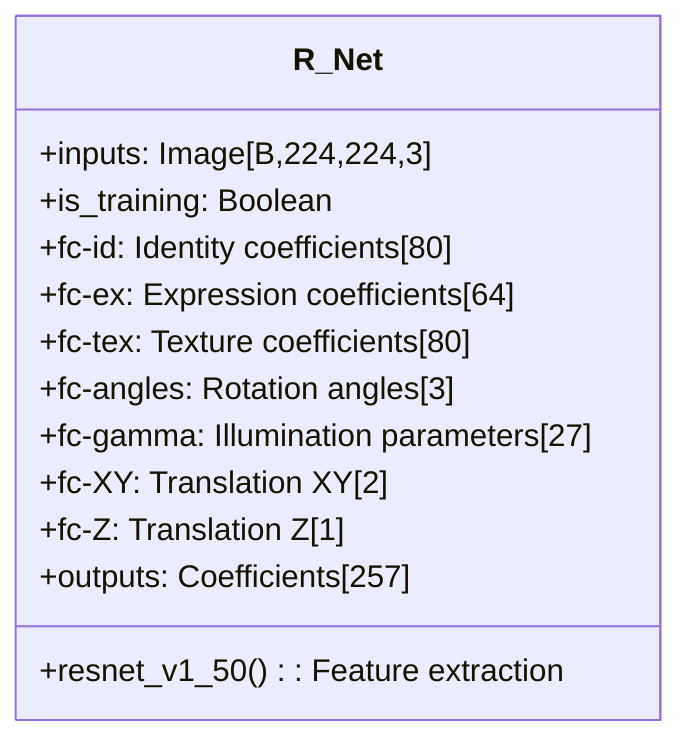
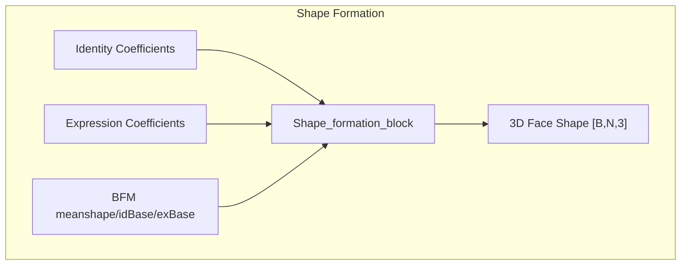
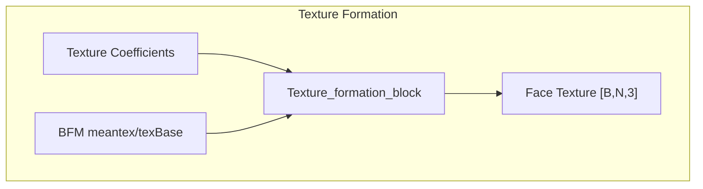
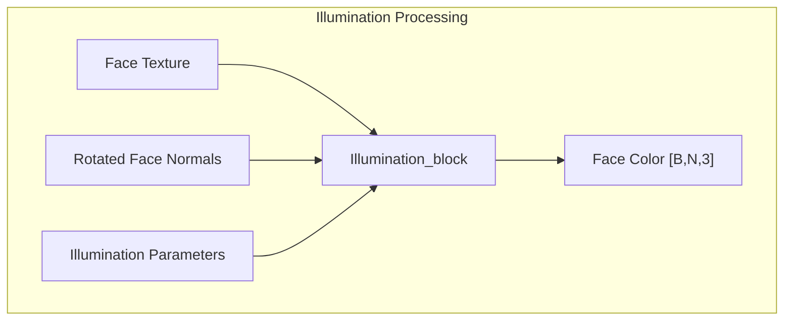
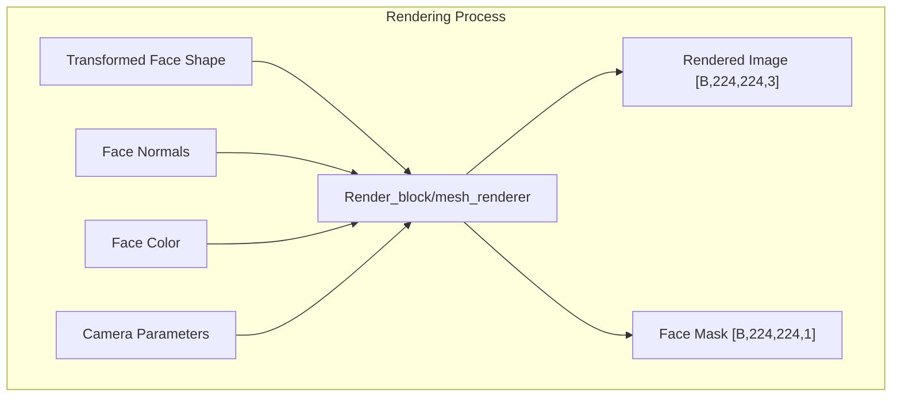
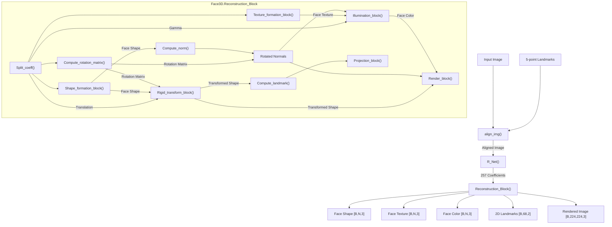
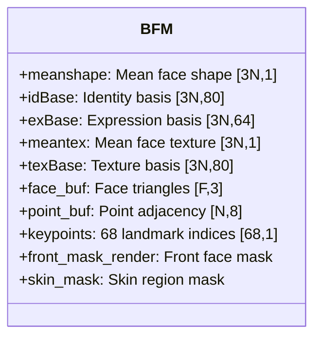

<!-- source: DeepWiki mcp.deepwiki.com · repo microsoft/Deep3DFaceReconstruction · page 2.1 Face Reconstruction Pipeline · fetched 2026-10-26 -->

# Face Reconstruction Pipeline

<details>
<summary>Relevant source files</summary>

The following files were used as context for generating this wiki page:

- [demo.py](demo.py)
- [face_decoder.py](face_decoder.py)
- [networks.py](networks.py)

</details>


This document describes the complete pipeline for reconstructing 3D face models from single images in the Deep3DFaceReconstruction system. It covers the process from input image preprocessing through neural network inference to the final 3D face model generation and rendering. For information about the specific neural network architecture used for coefficient prediction, see [Neural Network Architecture](#2.2).

## 1. Pipeline Overview

The Face Reconstruction Pipeline transforms a 2D facial image into a detailed 3D face model through a series of well-defined steps:



Sources: [demo.py:40-124](), [face_decoder.py:32-346]()

## 2. Pipeline Components

### 2.1 Input Processing

The pipeline begins with an input image and corresponding 5-point facial landmarks:

1. **Input**: RGB image (any resolution) and 5-point facial landmarks (typically eye corners, nose tip, and mouth corners)
2. **Alignment**: The `align_img` function aligns the face to a canonical position using the 5-point landmarks
3. **Normalization**: The aligned image is resized to 224×224 pixels, which is the expected input size for the neural network

Sources: [demo.py:99-102]()

### 2.2 Coefficient Prediction via R-Net

The aligned image is fed into R-Net, which predicts a 257-dimensional coefficient vector:



The R-Net processes the input using:
1. A ResNet-50 backbone that extracts features from the input image
2. Several fully connected layers that predict different sets of coefficients
3. The output coefficients are concatenated into a single 257-dimensional vector

Sources: [networks.py:9-63](), [demo.py:76-79]()

### 2.3 Coefficient Splitting

The 257-dimensional coefficient vector is split into its components:

```
- Identity coefficients (80): Control the identity-specific facial shape
- Expression coefficients (64): Control the facial expression
- Texture coefficients (80): Control the facial texture/appearance
- Rotation angles (3): Control the 3D rotation of the face
- Translation parameters (3): Control the 3D position of the face
- Illumination parameters (27): Control the lighting conditions
```

This is handled by the `Split_coeff` function in the `Face3D` class.

Sources: [face_decoder.py:80-91]()

### 2.4 Face Shape Formation

The identity and expression coefficients are used to form the 3D face shape using the Basel Face Model (BFM):



The face shape is computed as a linear combination of:
- The mean face shape from BFM
- Identity-specific shape components weighted by identity coefficients
- Expression-specific shape components weighted by expression coefficients

Sources: [face_decoder.py:93-101]()

### 2.5 Face Texture Formation

Similarly, the texture coefficients are used to form the face texture:



The face texture is computed as a linear combination of:
- The mean face texture from BFM
- Texture components weighted by texture coefficients

Sources: [face_decoder.py:130-136]()

### 2.6 Face Geometry Processing

The face shape undergoes several geometric processing steps:

1. **Normal Computation**: Face normals are computed for each vertex using `Compute_norm`
2. **Rotation Matrix Computation**: A 3×3 rotation matrix is computed from the rotation angles using `Compute_rotation_matrix`
3. **Rigid Transformation**: The face shape is transformed using rotation and translation via `Rigid_transform_block`
4. **Landmark Projection**: 68 facial landmarks are extracted and projected to 2D using `Compute_landmark` and `Projection_block`

Sources: [face_decoder.py:104-219]()

### 2.7 Illumination and Color

The face texture is processed to include illumination effects:



The `Illumination_block` applies Spherical Harmonic lighting to the face texture, producing the final face color that incorporates illumination effects.

Sources: [face_decoder.py:221-254]()

### 2.8 Rendering

Finally, the 3D face model is rendered to a 2D image using the tf_mesh_renderer:



The renderer produces:
- A rendered RGB image of the face
- A face mask indicating which pixels contain the face

Sources: [face_decoder.py:263-345]()

## 3. Pipeline Data Flow

The complete data flow through the reconstruction pipeline is shown below:



Sources: [demo.py:82-87](), [demo.py:104-105](), [face_decoder.py:38-77]()

## 4. Implementation Details

### 4.1 Coefficient Processing

The coefficients predicted by R-Net are processed as follows:

| Coefficient Type | Dimension | Function | Output |
|------------------|-----------|----------|--------|
| Identity | 80 | Shape_formation_block | Identity-specific shape |
| Expression | 64 | Shape_formation_block | Expression-specific shape |
| Texture | 80 | Texture_formation_block | Face texture/appearance |
| Angles | 3 | Compute_rotation_matrix | 3×3 rotation matrix |
| Translation | 3 | Rigid_transform_block | 3D position offset |
| Gamma | 27 | Illumination_block | Illumination parameters |

Sources: [face_decoder.py:38-42]()

### 4.2 Basel Face Model Integration

The Basel Face Model provides the statistical prior for face reconstruction:



The BFM is used to:
1. Provide the mean face shape and texture
2. Provide basis vectors for identity and expression variations
3. Provide basis vectors for texture variations
4. Define the face topology (triangles)
5. Define landmark positions

Sources: [face_decoder.py:16-29]()

### 4.3 Integration with Demo Pipeline

The pipeline is integrated with the demo script to provide a complete workflow from input image to 3D model:

1. Load input image and landmarks
2. Preprocess and align the face
3. Run R-Net to predict coefficients
4. Reconstruct the 3D face model
5. Save the outputs:
   - 3D mesh (.obj file)
   - Reconstruction parameters (.mat file)
   - Rendered image

Sources: [demo.py:96-121]()

## 5. Pipeline Outputs

The Face Reconstruction Pipeline generates several outputs:

1. **3D Face Shape**: The 3D vertices of the face mesh (in world coordinates)
2. **Face Texture**: The RGB texture values for each vertex (without illumination)
3. **Face Color**: The RGB color values for each vertex (with illumination)
4. **2D Landmarks**: The 2D coordinates of 68 facial landmarks
5. **Rendered Image**: A 2D rendering of the reconstructed 3D face
6. **3D Mesh File**: An .obj file containing the 3D face geometry and texture
7. **MAT File**: A MATLAB file containing all reconstruction parameters and results

Sources: [demo.py:108-121]()

---

