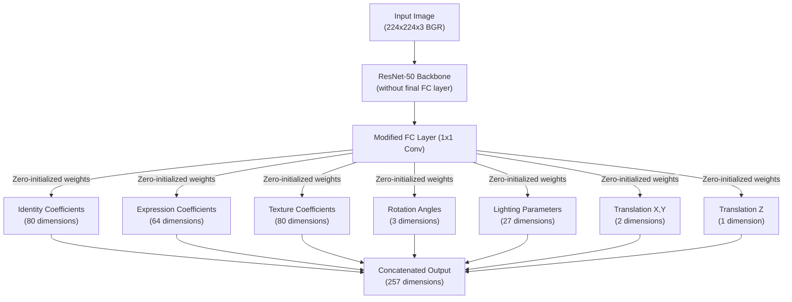
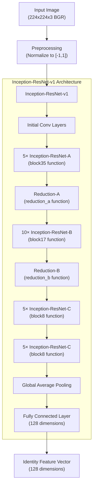
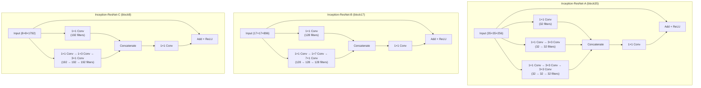
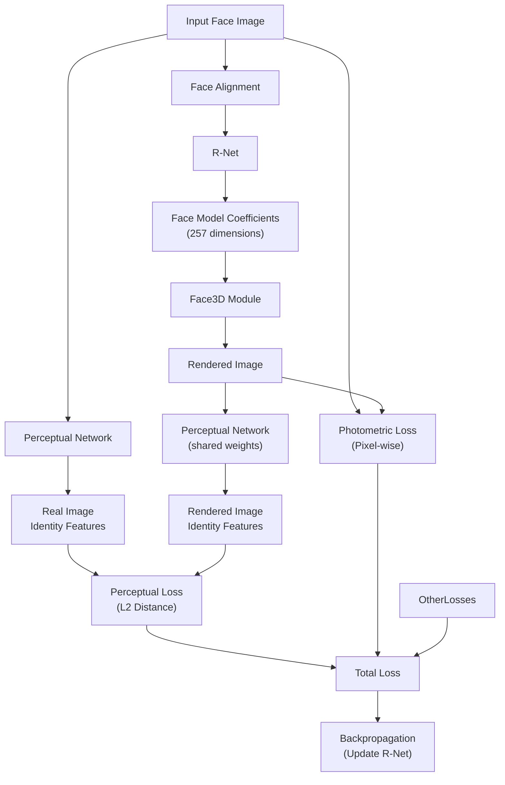
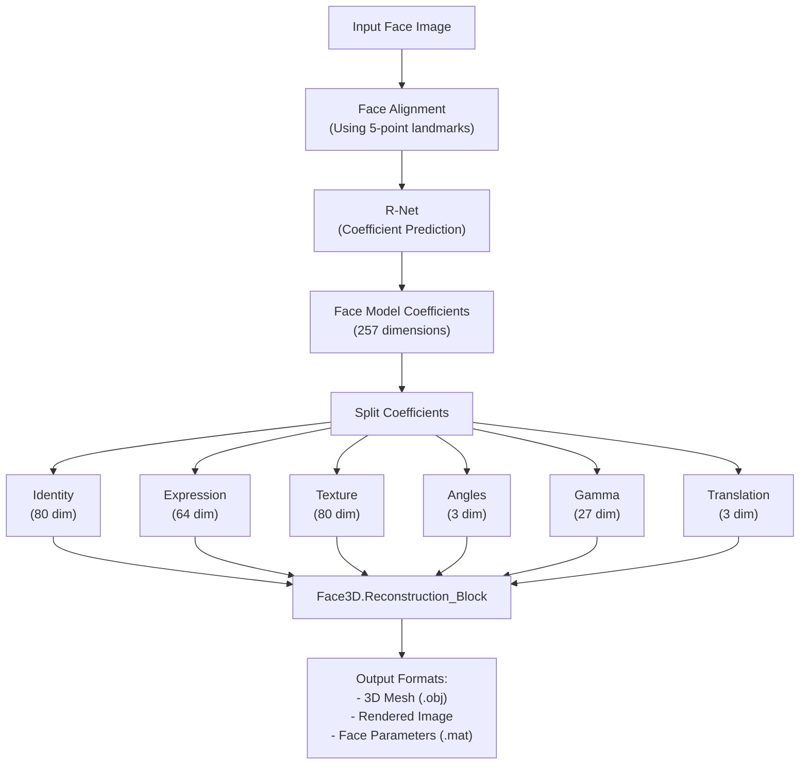

<!-- source: DeepWiki mcp.deepwiki.com · repo microsoft/Deep3DFaceReconstruction · page 2.2 Neural Network Architecture · fetched 2026-10-26 -->

# Neural Network Architecture

<details>
<summary>Relevant source files</summary>

The following files were used as context for generating this wiki page:

- [images/example.png](images/example.png)
- [inception_resnet_v1.py](inception_resnet_v1.py)
- [networks.py](networks.py)
- [readme.md](readme.md)

</details>


This document describes the neural network architectures used in the Deep3DFaceReconstruction system. It focuses on the structure and functionality of the key neural networks: the Reconstruction Network (R-Net) that predicts 3D face model coefficients and the Perceptual Network used for identity feature extraction. For information about the overall reconstruction pipeline, see [Face Reconstruction Pipeline](#2.1). For details about the 3D face model, see [3D Face Model and Rendering](#2.3).

## Neural Network Overview

The Deep3DFaceReconstruction system employs two primary neural networks with distinct purposes:

```mermaid
graph TD
    subgraph "Main Pipeline"
        Input["Input Face Image (224x224x3)"] --> Preprocess["Image Preprocessing<br>(Alignment, Normalization)"]
        Preprocess --> RNet["R-Net<br>(ResNet-50 Backbone)"]
        RNet --> Coefficients["Face Model Coefficients<br>(257 dimensions)"]
        Coefficients --> Face3D["Face3D Module<br>(3D Face Reconstruction)"]
    end
    
    subgraph "Training Only"
        Input2["Input Face Image"] --> PerceptualNet["Perceptual Network<br>(Inception-ResNet-v1)"]
        PerceptualNet --> IdentityFeatures["Identity Features<br>(128 dimensions)"]
        IdentityFeatures --> Loss["Perceptual Loss"]
    end
```



Sources: [networks.py](), [readme.md:10-15]()

## R-Net Architecture

The R-Net is the core neural network responsible for predicting the coefficients of the 3D face model from a single input image. It converts a 2D face image into a comprehensive set of parameters that control identity, expression, texture, pose, and lighting.

### Network Structure



Sources: [networks.py:9-63]()

### Implementation Details

The R-Net is implemented as follows:

1. **Input**: BGR images with pixel values in range 0-255, sized 224×224×3
2. **Backbone**: Standard ResNet-50 pre-trained on ImageNet (without the final classification layer)
   ```python
   with slim.arg_scope(resnet_v1.resnet_arg_scope()):
       net,end_points = resnet_v1.resnet_v1_50(inputs, is_training=is_training, reuse=tf.AUTO_REUSE)
   ```

3. **Coefficient Prediction Layers**: Multiple 1×1 convolution layers (functioning as fully connected layers) with zero initialization to predict different coefficient types:

   | Layer | Output Dimension | Purpose |
   |-------|-----------------|---------|
   | fc-id | 80 | Identity shape coefficients |
   | fc-ex | 64 | Expression coefficients |
   | fc-tex | 80 | Texture coefficients |
   | fc-angles | 3 | Rotation angles (pitch, yaw, roll) |
   | fc-gamma | 27 | Scene illumination (RGB × 9 spherical harmonics) |
   | fc-XY | 2 | Translation in X,Y direction |
   | fc-Z | 1 | Translation in Z direction (depth) |

4. **Output**: 257-dimensional vector representing all coefficients, created by concatenating the outputs of all prediction layers

The use of zero-initialized weights for the prediction layers is significant - it ensures that the network starts with predictions that correspond to the mean face, allowing gradual refinement during training.

Sources: [networks.py:12-63](), [readme.md:216-223]()

## Perceptual Network Architecture

The Perceptual Network extracts identity features from face images and is used during training to compute a perceptual loss that preserves identity across different poses and expressions.

### Network Structure



Sources: [networks.py:66-87](), [inception_resnet_v1.py:153-247]()

### Implementation Details

The Perceptual Network is implemented with the following specifications:

1. **Input Processing**:
   - Takes BGR images (0-255 pixel range)
   - Resizes to 224×224×3
   - Normalizes pixel values to range [-1, 1]

2. **Network Architecture**:
   - Uses Inception-ResNet-v1 architecture
   - The network includes multiple specialized blocks:
     - **Inception-ResNet-A**: 5 blocks with 35×35 resolution (implemented as `block35`)
     - **Reduction-A**: Reduces spatial dimensions from 35×35 to 17×17 (implemented as `reduction_a`)
     - **Inception-ResNet-B**: 10 blocks with 17×17 resolution (implemented as `block17`)
     - **Reduction-B**: Reduces spatial dimensions from 17×17 to 8×8 (implemented as `reduction_b`)
     - **Inception-ResNet-C**: 5 blocks with 8×8 resolution (implemented as `block8`)

3. **Output**: 128-dimensional identity feature vector produced by the final fully connected layer

During training, this network is used as a fixed feature extractor (with pre-trained weights) to compute perceptual loss between the input image and the rendered reconstruction.

Sources: [networks.py:66-87](), [inception_resnet_v1.py:30-247](), [readme.md:154-157]()

## Block Architecture Details

Each Inception-ResNet block has a specific structure that combines traditional convolution with residual connections for improved performance.

### Inception-ResNet Block Details



Sources: [inception_resnet_v1.py:31-90]()

## Integration in Training and Inference

### Training Pipeline

During training, both networks work together:



Sources: [readme.md:149-204](), [networks.py:9-87]()

### Inference Pipeline

During inference, only the R-Net is used:



Sources: [readme.md:134-148](), [networks.py:9-63]()

## Key Technical Specifications

| Network | Architecture | Input | Output | Pre-training |
|---------|-------------|-------|--------|-------------|
| R-Net | ResNet-50 + FC layers | 224×224×3 BGR image | 257-dimensional coefficient vector | ImageNet pre-training for ResNet-50 backbone |
| Perceptual-Net | Inception-ResNet-v1 | 224×224×3 BGR image | 128-dimensional identity feature | Pre-trained on face recognition dataset |

The system achieves high accuracy in 3D face reconstruction with these neural network architectures, demonstrating superior performance across multiple benchmarks as noted in the paper.

Sources: [networks.py:9-87](), [readme.md:19-33]()

---

