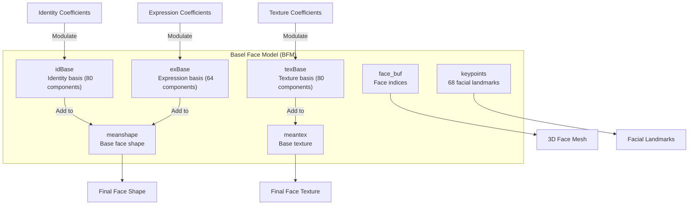
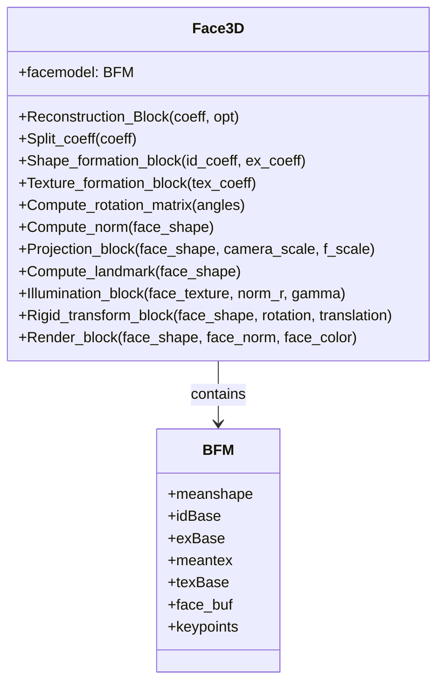
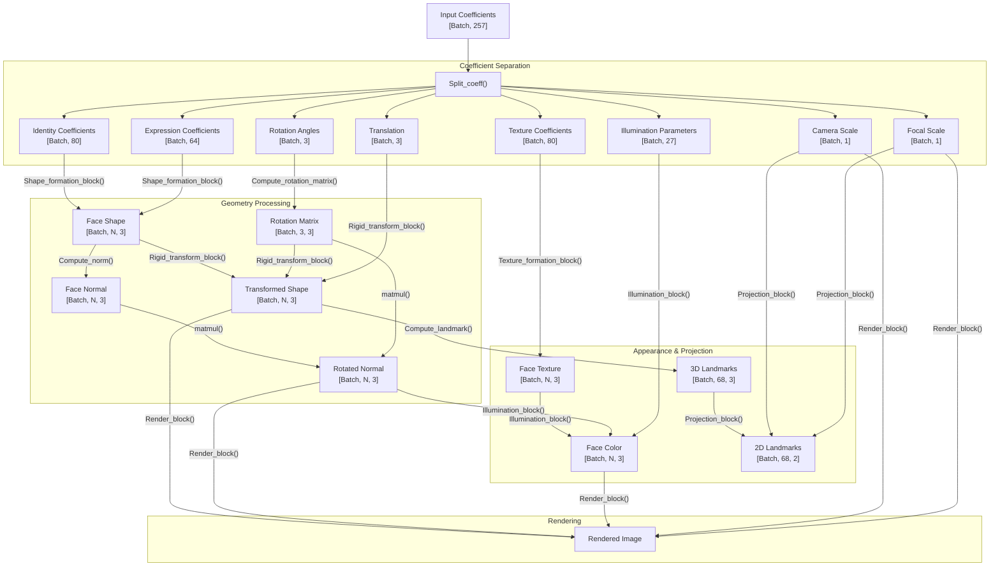
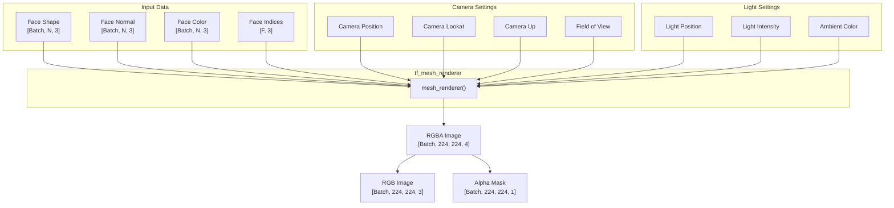

<!-- source: DeepWiki mcp.deepwiki.com · repo microsoft/Deep3DFaceReconstruction · page 2.3 3D Face Model and Rendering · fetched 2026-10-26 -->

# 3D Face Model and Rendering

<details>
<summary>Relevant source files</summary>

The following files were used as context for generating this wiki page:

- [.gitmodules](.gitmodules)
- [face_decoder.py](face_decoder.py)
- [images/camera.png](images/camera.png)
- [images/lm3d.png](images/lm3d.png)
- [images/lm5p.png](images/lm5p.png)
- [renderer/__init__.py](renderer/__init__.py)

</details>


This documentation covers the 3D face model representation and rendering system used in Deep3DFaceReconstruction. It explains the Basel Face Model (BFM) implementation, the Face3D class that provides 3D reconstruction functionality, and the rendering system used to visualize reconstructed face meshes. For information about the neural network architecture that predicts the model coefficients, see [Neural Network Architecture](#2.2).

## 1. 3D Face Model Overview

The Deep3DFaceReconstruction system uses the Basel Face Model (BFM) as its 3D morphable face model framework. The BFM provides a parametric representation of 3D face geometry and texture, allowing the system to generate detailed face reconstructions from a relatively small set of parameters.

### 1.1 Basel Face Model (BFM)

The Basel Face Model represents 3D faces using a PCA-based parametric model with separate components for identity shape, expression shape, and texture.



The BFM model is implemented in the `BFM` class, which loads the pre-computed model parameters from a `.mat` file and stores them as TensorFlow constants.

Sources: [face_decoder.py:15-29]()

### 1.2 BFM Implementation

The `BFM` class initializes the following key components:

| Component | Description | Shape | Data Type |
|-----------|-------------|-------|-----------|
| `meanshape` | Mean face shape | [3*N, 1] | Float |
| `idBase` | Identity basis vectors | [3*N, 80] | Float |
| `exBase` | Expression basis vectors | [3*N, 64] | Float |
| `meantex` | Mean face texture | [3*N, 1] | Float (0-255) |
| `texBase` | Texture basis vectors | [3*N, 80] | Float |
| `face_buf` | Face indices for rendering | [F, 3] | Int |
| `keypoints` | 68 facial landmark indices | [68, 1] | Int |

Where N is the number of vertices in the face model and F is the number of triangular faces.

Sources: [face_decoder.py:16-29]()

## 2. Face3D Class

The `Face3D` class provides the core functionality for 3D face reconstruction and manipulation. It integrates with the BFM model and provides methods for shape formation, texture mapping, illumination, and rendering.

### 2.1 Architecture and Components



Sources: [face_decoder.py:31-36](), [face_decoder.py:37-77]()

### 2.2 Reconstruction Process

The reconstruction process is orchestrated by the `Reconstruction_Block` method, which takes a vector of 257 coefficients produced by the neural network (R-Net) and generates a complete 3D face reconstruction.



Sources: [face_decoder.py:37-77](), [face_decoder.py:80-91]()

### 2.3 Shape Formation

The shape formation process combines identity and expression coefficients with the corresponding basis vectors to generate the 3D face shape. The implementation follows these steps:

1. Multiply identity coefficients with identity basis
2. Multiply expression coefficients with expression basis
3. Add the results to the mean shape
4. Reshape to 3D vertex coordinates
5. Re-center the face shape

The mathematical model is:
```
face_shape = meanshape + idBase * id_coeff + exBase * ex_coeff
```

Sources: [face_decoder.py:93-102]()

### 2.4 Texture Formation

Similarly, the texture formation process uses texture coefficients to generate the face texture:

```
face_texture = meantex + texBase * tex_coeff
```

Sources: [face_decoder.py:130-136]()

### 2.5 Illumination Model

The system uses Spherical Harmonics (SH) to model scene illumination. The `Illumination_block` method computes vertex colors based on:

1. The base face texture (albedo)
2. Surface normals
3. 27 illumination parameters (gamma)

This approach allows realistic face rendering under various lighting conditions without explicit light source definitions.

Sources: [face_decoder.py:221-254]()

## 3. Rendering System

The rendering system converts the 3D face model into 2D images for visualization and error computation during training.

### 3.1 Rendering Pipeline



Sources: [face_decoder.py:263-345]()

### 3.2 Mesh Renderer Integration

The system uses Google's `tf_mesh_renderer` for rasterization, a TensorFlow-compatible renderer that converts 3D triangular meshes into 2D images. The renderer is imported as a submodule in the repository.

The mesh renderer handles:
- Projection of 3D vertices to 2D screen space
- Rasterization of triangular faces
- Shading based on normals, colors, and lighting
- Visibility determination (Z-buffering)

The `Render_block` method configures and calls the mesh renderer with:
- Face geometry (vertices, faces, normals)
- Face appearance (vertex colors)
- Camera parameters (position, look-at point, field of view)
- Light settings

The renderer outputs images with RGBA channels, where the alpha channel serves as a mask for the face region.

Sources: [face_decoder.py:263-345](), [.gitmodules:1-3]()

### 3.3 CPU Execution

Note that rendering operations are explicitly performed on the CPU:

```python
with tf.device('/cpu:0'):
    img_rgba = mesh_renderer.mesh_renderer(...)
```

This is necessary because the mesh renderer is not compatible with GPU execution.

Sources: [face_decoder.py:297-312]()

## 4. Coordinate Systems and Transformations

The system involves several coordinate transformations to go from model space to screen space.

### 4.1 Rigid Transformation

The `Rigid_transform_block` applies rotation and translation to the face shape:

```
face_shape_r = face_shape * rotation
face_shape_t = face_shape_r + translation
```

Sources: [face_decoder.py:256-261]()

### 4.2 Perspective Projection

The `Projection_block` implements perspective projection to convert 3D coordinates to 2D screen coordinates:

1. Apply camera transformation
2. Project using camera intrinsics (focal length)
3. Normalize by Z-coordinate

Sources: [face_decoder.py:185-209]()

### 4.3 Landmark Projection

For facial landmarks, the system:
1. Extracts landmark vertices from the face shape using predefined indices
2. Transforms them to camera space
3. Projects them to 2D screen coordinates

This produces 68 2D landmark points that can be compared with detected landmarks for alignment.

Sources: [face_decoder.py:212-219]()

## 5. Summary

The 3D Face Model and Rendering system provides the foundation for the Deep3DFaceReconstruction pipeline. It enables:

1. Parametric representation of 3D faces through the Basel Face Model
2. Generation of 3D face geometry and appearance from coefficients
3. Realistic illumination through Spherical Harmonics
4. 2D rendering for visualization and training

This component integrates with the Neural Network (see [Neural Network Architecture](#2.2)) which predicts the coefficients, and the Face Reconstruction Pipeline (see [Face Reconstruction Pipeline](#2.1)) which coordinates the overall process.

Sources: [face_decoder.py](), [.gitmodules:1-3](), [renderer/__init__.py:1-2]()

---

