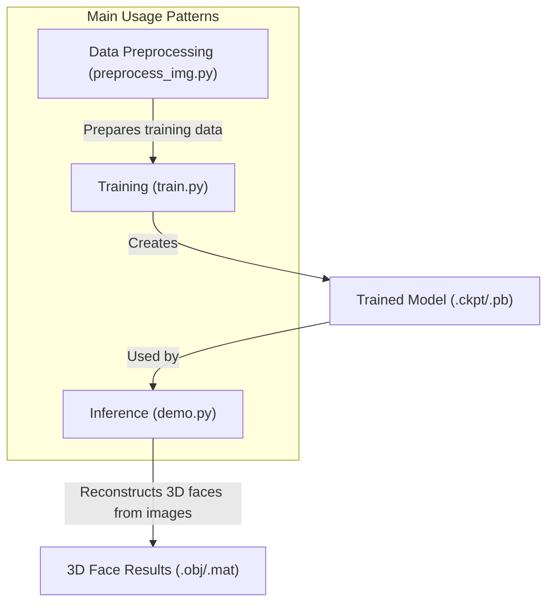
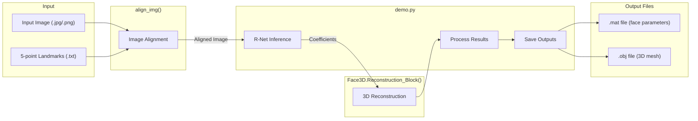
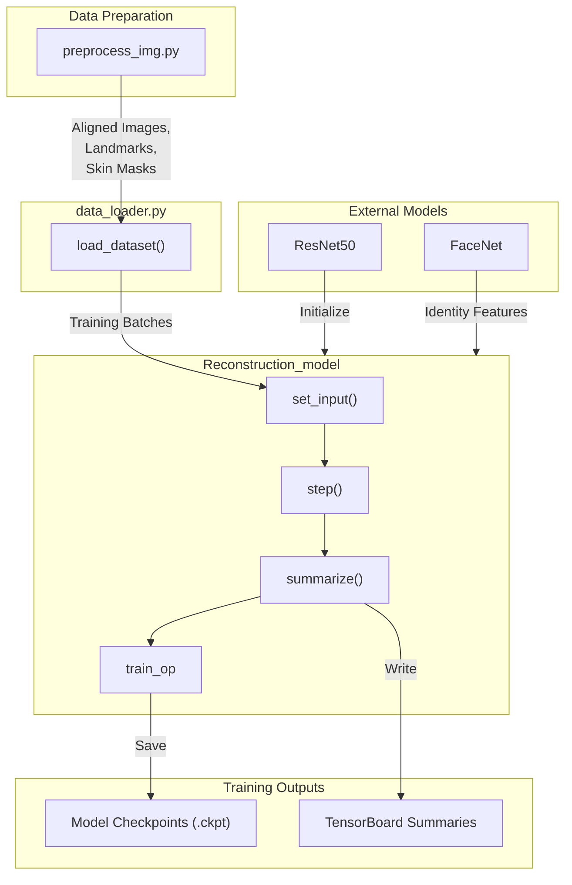
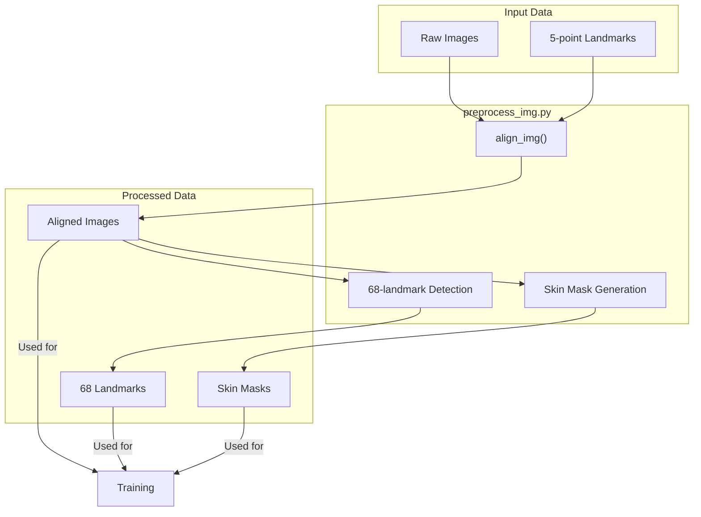
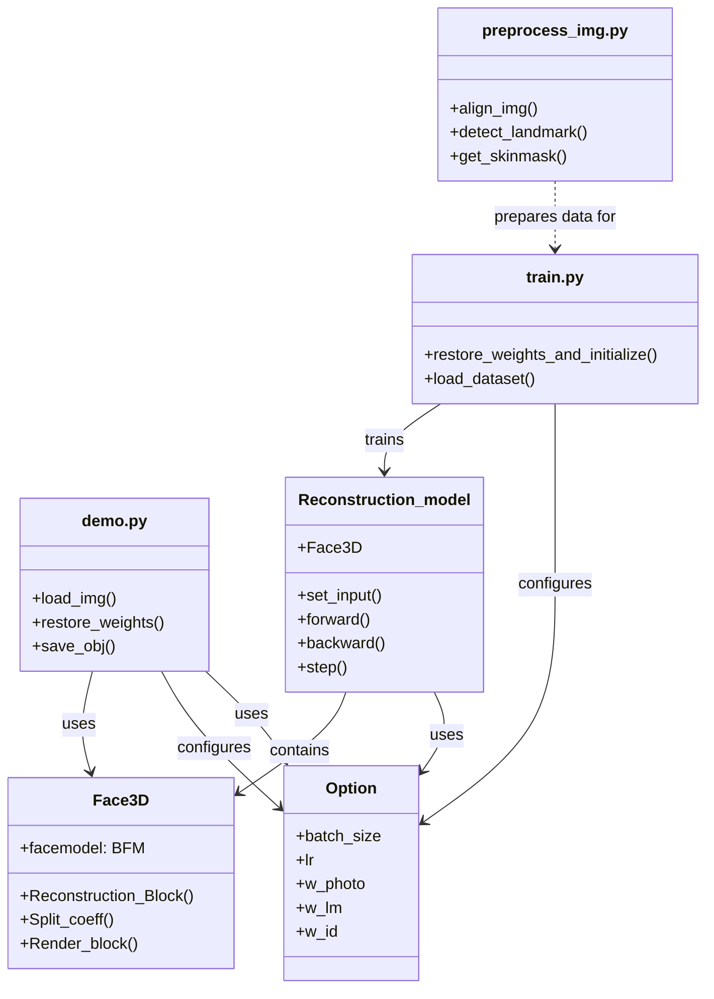

<!-- source: DeepWiki mcp.deepwiki.com · repo microsoft/Deep3DFaceReconstruction · page 3 Using the System · fetched 2026-10-26 -->

# Using the System

<details>
<summary>Relevant source files</summary>

The following files were used as context for generating this wiki page:

- [demo.py](demo.py)
- [images/example.png](images/example.png)
- [options.py](options.py)
- [readme.md](readme.md)
- [train.py](train.py)

</details>


This document provides a detailed guide on how to use the Deep3DFaceReconstruction system for both inference (applying a pre-trained model to reconstruct 3D faces from images) and training (creating your own reconstruction model). For information about the system architecture, see [System Architecture](#2), and for installation instructions, see [Installation](#1.1).

## 1. System Usage Overview

The Deep3DFaceReconstruction system provides two main usage patterns:



Sources: [readme.md:67-196](), [demo.py:1-124](), [train.py:1-141]()

## 2. Using the System for Inference

The inference pipeline allows you to reconstruct 3D face models from images using a pre-trained model.

### 2.1 Inference Data Flow



Sources: [demo.py:40-122](), [readme.md:133-149]()

### 2.2 Running Inference

To run inference with the pre-trained model:

1. Place your test images in the `./input` folder
2. For each image, ensure you have a corresponding text file with the same name containing 5-point facial landmarks
3. Run the demo script:

```bash
python demo.py
```

4. To use a custom model checkpoint instead of the pre-trained model:

```bash
python demo.py --use_pb 0 --pretrain_weights path/to/model.ckpt
```

Sources: [demo.py:16-26](), [demo.py:40-124](), [readme.md:133-149]()

### 2.3 Inference Output Files

For each input image, the system generates the following outputs in the `./output` folder:

| Output File | Format | Contents |
|-------------|--------|----------|
| `xxx.mat` | MATLAB | - `cropped_img`: Aligned input image<br>- `recon_img`: Rendered reconstruction image<br>- `coeff`: Reconstruction coefficients<br>- `face_shape`: 3D vertex positions<br>- `face_texture`: Vertex texture (without lighting)<br>- `face_color`: Vertex color (with lighting)<br>- `lm_68p`: 68 reconstructed landmarks<br>- `lm_5p`: 5 detected landmarks |
| `xxx_mesh.obj` | Wavefront OBJ | 3D face mesh viewable in 3D software like MeshLab |

Sources: [demo.py:117-121](), [readme.md:139-149]()

## 3. Using the System for Training

The training pipeline allows you to train your own face reconstruction model using custom datasets.

### 3.1 Training Pipeline Architecture



Sources: [train.py:64-138](), [readme.md:151-196]()

### 3.2 Running the Training Pipeline

To train the model with your own data:

1. Preprocess your training images with the preprocessing script (see Section 4)
2. Run the training script:

```bash
python train.py
```

3. To customize the training process with your own data paths and model name:

```bash
python train.py --data_path <custom_data_path> --val_data_path <custom_val_data_path> --model_name <custom_model_name>
```

4. Monitor training progress using TensorBoard:

```bash
tensorboard --logdir=result/<custom_model_name> --port=10001
```

Sources: [train.py:17-27](), [train.py:64-138](), [readme.md:178-196]()

### 3.3 Training Configuration Options

Key configuration options for training (defined in `options.py`):

| Parameter | Description | Default Value |
|-----------|-------------|---------------|
| `batch_size` | Batch size for training | 16 |
| `lr` | Learning rate schedule | [1e-4, 2e-5] |
| `boundaries` | Learning rate boundaries | [100000] |
| `train_maxiter` | Maximum training iterations | 200000 |
| `w_photo` | Weight for photometric loss | 1.92 |
| `w_lm` | Weight for landmark loss | 1.6e-3 |
| `w_id` | Weight for identity loss | 0.2 |
| `w_reg` | Weight for regularization | 3.0e-4 |
| `save_iter` | Checkpoint saving frequency | 10000 |

Sources: [options.py:5-63](), [readme.md:178-196]()

## 4. Data Preprocessing

Before training, images must be preprocessed to align faces and generate landmarks and skin masks.

### 4.1 Preprocessing Workflow



Sources: [readme.md:165-175]()

### 4.2 Running Data Preprocessing

To preprocess your data:

1. For each image, generate 5-point facial landmarks using face detectors like dlib or MTCNN
2. Run the preprocessing script:

```bash
# Using default paths (input -> processed_data)
python preprocess_img.py

# Using custom paths
python preprocess_img.py --img_path <raw_img_path> --save_path <save_path_for_processed_data>
```

3. The script will generate aligned images, 68 landmarks, and skin masks for training

Sources: [readme.md:165-175]()

## 5. System Integration Points

This diagram shows how the main executables integrate with core components and where user interactions occur:



Sources: [demo.py:1-124](), [train.py:1-141](), [options.py:5-63]()

## 6. Common Issues and Recommendations

1. **Image Alignment**: The system requires good facial landmark detection for proper alignment. Poor landmarks will lead to inaccurate reconstructions.

2. **Large Pose Images**: For images with large head poses, traditional 2D landmark detectors may provide inaccurate results. Consider using 3D landmark detectors for better alignment.

3. **Perspective Distortion**: The system may give inferior results for images with severe perspective distortions (e.g., selfies taken too close to the face).

4. **Closed Eyes**: The system may not handle faces with closed eyes well due to limited training examples with this condition.

5. **Hardware Requirements**: Training requires a GPU with sufficient memory. Inference can be run on CPU but is much faster on GPU.

Sources: [readme.md:208-223]()

---

